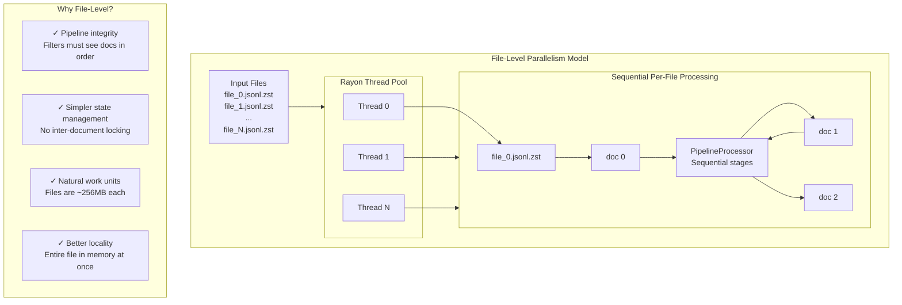
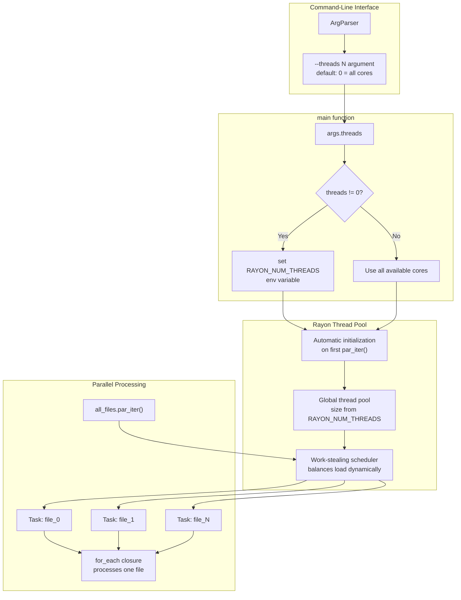
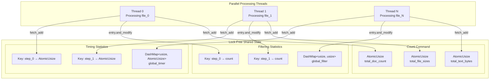
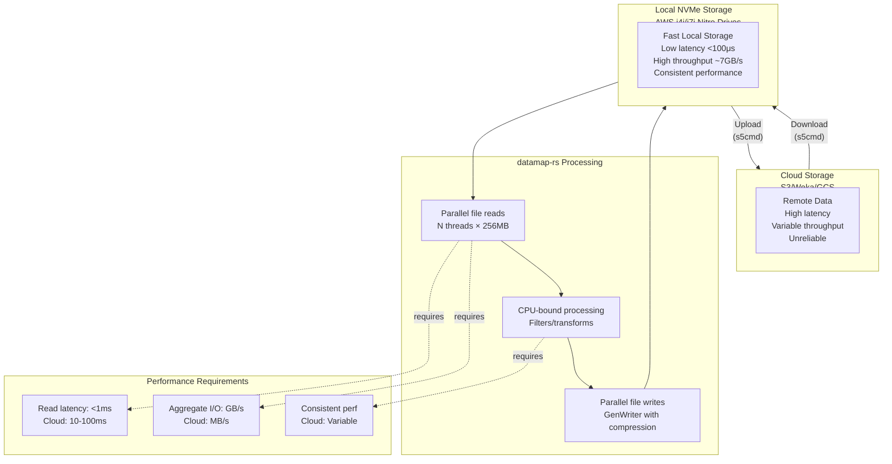
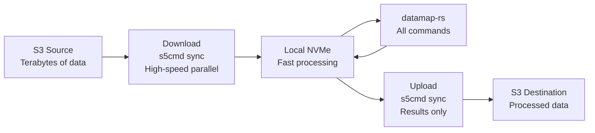
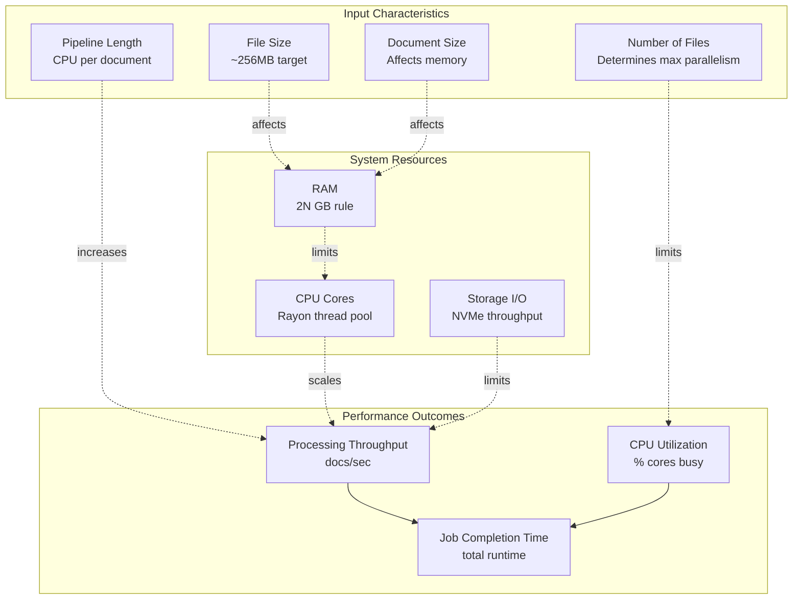
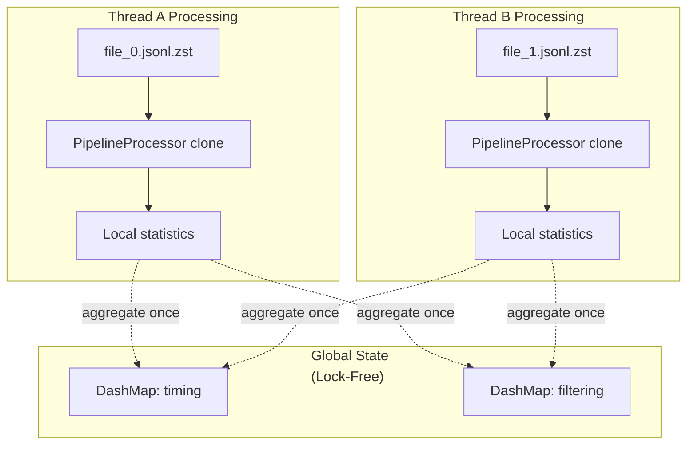

<!-- source: DeepWiki mcp.deepwiki.com · repo allenai/datamap-rs · page 2.2 Parallelism and Performance Model · fetched 2026-10-26 -->

# Parallelism and Performance Model

<details>
<summary>Relevant source files</summary>

The following files were used as context for generating this wiki page:

- [Cargo.toml](Cargo.toml)
- [README.md](README.md)
- [src/main.rs](src/main.rs)

</details>


## Purpose and Scope

This document explains how datamap-rs achieves high performance through parallel processing, efficient memory usage, and optimized I/O. It covers the parallelism strategy (file-level rather than document-level), thread pool configuration, shared state management, streaming memory model, and storage requirements.

For information about the local-first data flow and why NVMe storage is used, see [Data Flow and Storage Strategy](#2.3). For details on how GenWriter handles concurrent file writing, see [GenWriter: Parallel File Writing](#6.1).

---

## Parallelism Strategy: File-Level vs Document-Level

datamap-rs uses **file-level parallelism** rather than document-level parallelism. Each input file is processed by a single thread from start to finish, but multiple files are processed concurrently across threads. This design choice has important implications for correctness and performance.



**Why File-Level Parallelism?**

| Aspect | Document-Level | File-Level (Used) |
|--------|---------------|-------------------|
| **Pipeline Correctness** | Complex - filters may depend on ordering | Simple - sequential processing per file |
| **State Management** | Requires locks/coordination between docs | No coordination needed within file |
| **Work Distribution** | Fine-grained, higher overhead | Coarse-grained, lower overhead |
| **Memory Locality** | Poor - documents scattered | Good - entire file loaded once |
| **Implementation Complexity** | High - complex synchronization | Low - embarrassingly parallel |

The **256MB target file size** (see [Reshard Command](#4.1)) is chosen specifically to create natural work units that balance:
- **Parallelism**: Enough files to keep all threads busy
- **Memory**: Small enough to avoid excessive RAM usage
- **Overhead**: Large enough to amortize thread scheduling costs

Sources: [src/main.rs:359-382](), [README.md:104-112]()

---

## Thread Pool Configuration and Rayon Integration

datamap-rs uses the [Rayon](https://docs.rs/rayon) library for data parallelism. Rayon provides a work-stealing thread pool that automatically distributes tasks across CPU cores.



**Thread Configuration Code Flow:**

1. **Argument Parsing** - [src/main.rs:55-57]()
   ```rust
   #[arg(long, default_value_t = 0)]
   threads: usize,
   ```

2. **Environment Variable Setup** - [src/main.rs:508-511]()
   ```rust
   if threads != 0 {
       std::env::set_var("RAYON_NUM_THREADS", threads.to_string());
   }
   ```

3. **Parallel Iteration** - [src/main.rs:359]()
   ```rust
   all_files.par_iter().for_each(|p| { ... });
   ```

**When to Limit Threads:**

| Scenario | Recommended Setting | Reason |
|----------|-------------------|--------|
| **Memory-constrained** | `--threads 4` to `--threads 8` | Limits concurrent file buffers |
| **Large documents** | `--threads N/2` | Each file may use significant RAM |
| **Shared machine** | `--threads N` explicit | Prevents consuming all cores |
| **Default (dedicated)** | No `--threads` arg | Uses all cores efficiently |

Sources: [src/main.rs:55-57](), [src/main.rs:508-511](), [Cargo.toml:20]()

---

## Shared State and Lock-Free Concurrency

While file processing is embarrassingly parallel, datamap-rs still needs to aggregate statistics across threads. This is accomplished using lock-free concurrent data structures.



**DashMap for Step-Level Statistics:**

The `DashMap<K, V>` type provides a concurrent hashmap that uses fine-grained locking internally but presents a lock-free API to users.

- **Initialization** - [src/main.rs:348-354]()
  ```rust
  let global_timer: DashMap<usize, AtomicUsize> = DashMap::new();
  let global_filter: DashMap<usize, usize> = DashMap::new();
  for i in 0..processor.pipeline.len() {
      global_timer.insert(i, AtomicUsize::new(0));
      global_filter.insert(i, 0);
  }
  ```

- **Atomic Updates (Timing)** - [src/main.rs:437-442]()
  ```rust
  timing_info.iter().for_each(|(k, v)| {
      global_timer
          .get(k)
          .unwrap()
          .fetch_add(*v as usize, Ordering::SeqCst);
  });
  ```

- **Entry API Updates (Filtering)** - [src/main.rs:444-446]()
  ```rust
  filter_info.iter().for_each(|(k, v)| {
      global_filter.entry(*k).and_modify(|gv| *gv += v);
  });
  ```

**AtomicUsize for Simple Counters:**

For the `count` command, simple atomic counters suffice since there's only one value to track per metric.

- **Declaration** - [src/main.rs:456-458]()
  ```rust
  let total_doc_count = AtomicUsize::new(0);
  let total_file_sizes = AtomicUsize::new(0);
  let total_text_bytes = AtomicUsize::new(0);
  ```

- **Atomic Increment** - [src/main.rs:484-486]()
  ```rust
  total_doc_count.fetch_add(file_len, Ordering::SeqCst);
  total_file_sizes.fetch_add(file_size, Ordering::SeqCst);
  total_text_bytes.fetch_add(text_bytes, Ordering::SeqCst);
  ```

**Why Lock-Free Data Structures?**

| Approach | Performance | Complexity | Deadlock Risk |
|----------|------------|------------|---------------|
| **Mutex-based** | Slow - contention on locks | Medium | Yes |
| **Lock-free (DashMap/Atomic)** | Fast - minimal contention | Low | No |
| **Thread-local + reduce** | Fastest - no contention | High | No |

datamap-rs uses lock-free structures for the best balance of performance and simplicity.

Sources: [src/main.rs:348-354](), [src/main.rs:437-446](), [src/main.rs:456-486](), [Cargo.toml:14]()

---

## Memory Model: Streaming and Line-by-Line Processing

datamap-rs processes files using a **streaming memory model** where files are read into memory once, then processed line-by-line without additional allocations.

```mermaid
graph LR
    subgraph Storage["Local NVMe Storage"]
        File["file.jsonl.zst<br/>~256MB compressed<br/>~1GB uncompressed"]
    end
    
    subgraph Reading["File Reading mj_io"]
        ReadFunc["read_pathbuf_to_mem()"]
        DecompBuffer["Decompression buffer<br/>Full file in memory"]
    end
    
    subgraph LineProcessing["Line-by-Line Streaming"]
        Lines["data.lines()"]
        Iterator["Iterator&lt;Result&lt;String&gt;&gt;"]
        FilterMap["filter_map to skip errors"]
        Collect["collect into Vec&lt;String&gt;"]
    end
    
    subgraph Pipeline["Sequential Pipeline"]
        Doc["Document (String)"]
        Parse["Parse JSON"]
        Step0["Processor 0"]
        Step1["Processor 1"]
        StepN["Processor N"]
        Output["Output or filter"]
    end
    
    File -->|decompress| ReadFunc
    ReadFunc --> DecompBuffer
    DecompBuffer --> Lines
    Lines --> Iterator
    Iterator --> FilterMap
    FilterMap --> Collect
    
    Collect --> Doc
    Doc --> Parse
    Parse --> Step0
    Step0 -->|Some| Step1
    Step0 -->|None| Output
    Step1 -->|Some| StepN
    Step1 -->|None| Output
    StepN --> Output
```



**Memory Flow Code Mapping:**

1. **File Reading** - [src/main.rs:405]()
   ```rust
   let data = read_pathbuf_to_mem(input_file).unwrap();
   ```
   - Uses `mj_io::read_pathbuf_to_mem()` which handles decompression
   - File is fully decompressed into memory (trade-off: speed vs memory)

2. **Line Iteration** - [src/main.rs:407]()
   ```rust
   let lines: Vec<_> = data.lines().filter_map(|el| el.ok()).collect();
   ```
   - Creates iterator over lines
   - Filters out any I/O errors
   - Collects into vector for processing

3. **Sequential Pipeline** - [src/main.rs:410-411]()
   ```rust
   let (output_lines, err_lines, timing_info, filter_info) =
       processor.process_lines(lines, input_file).unwrap();
   ```
   - Each document processed sequentially through pipeline
   - See [Pipeline Architecture](#3.1) for details

**Memory Characteristics:**

| Phase | Memory Usage | Duration |
|-------|-------------|----------|
| **File read** | ~1GB per thread (256MB → 1GB decompressed) | Brief |
| **Line iteration** | Vector of strings (~1GB) | Processing duration |
| **Pipeline** | Single document at a time | Per-document |
| **Output buffering** | Per-step output vectors | Until write |

**Peak Memory Formula:**
```
Peak Memory ≈ (Avg Decompressed File Size) × (Num Threads) × 2
             ≈ 1GB × N × 2 = 2N GB
```

The factor of 2 accounts for input buffer + output buffers.

**Why This Model?**

- **Speed**: Decompressing entire file at once is faster than streaming decompression
- **Simplicity**: No complex buffering logic needed
- **Memory predictability**: Easy to calculate resource requirements
- **Trade-off**: Memory for speed (acceptable with 256MB target size)

Sources: [src/main.rs:405-407](), [src/main.rs:410-411](), [src/main.rs:468-488]()

---

## Storage Performance Requirements

datamap-rs is **architecturally designed for local NVMe storage**. This is not just a recommendation but a fundamental requirement for the system to work efficiently and reliably.



**Why Local Storage is Critical:**

| Requirement | Local NVMe | Cloud Storage (S3) | Impact |
|-------------|-----------|-------------------|---------|
| **Read latency** | <100μs | 10-100ms | 100-1000× slower startup |
| **Aggregate throughput** | 7 GB/s | ~100 MB/s | 70× slower total I/O |
| **Consistency** | Predictable | Variable (throttling) | Unpredictable runtime |
| **Parallel reads** | Excellent | Poor (request limits) | Thread starvation |
| **Decompression** | In-memory | Streaming required | Complex buffering |

**Recommended AWS Instance Types:**

The README explicitly recommends [i4i/i7i instances](https://aws.amazon.com/ec2/instance-types/i4i/) - [README.md:20]()

| Instance | Storage | Throughput | Use Case |
|----------|---------|------------|----------|
| **i4i.8xlarge** | 2× 1.875 TB | ~7 GB/s read | Medium datasets (10-50 TB) |
| **i4i.16xlarge** | 4× 1.875 TB | ~14 GB/s read | Large datasets (50-200 TB) |
| **i4i.32xlarge** | 8× 1.875 TB | ~28 GB/s read | Very large datasets (>200 TB) |

**Local-First Workflow:**



The system does **not support** streaming from cloud storage because:
1. **Latency**: Opening files is 100-1000× slower
2. **Throughput**: Cannot saturate processing threads
3. **Reliability**: Network issues cause job failures
4. **Cost**: Excessive API calls for parallel access

Sources: [README.md:20-21](), [README.md:113-128]()

---

## Performance Characteristics and Scaling

Understanding how datamap-rs scales helps tune it for different workloads.

**Scaling Dimensions:**



**Scaling Rules:**

| Factor | Effect | Formula |
|--------|--------|---------|
| **CPU cores** | Linear throughput increase | `throughput ∝ min(cores, num_files)` |
| **File count** | Improves parallelism | `efficiency = min(1.0, num_files / cores)` |
| **File size** | Memory requirement | `RAM needed ≈ 2GB × cores` (for 256MB files) |
| **Document size** | Memory pressure | Larger docs → fewer threads |
| **Pipeline length** | CPU time per doc | Longer pipeline → lower throughput |

**Performance Bottlenecks:**

1. **Not Enough Files** (Amdahl's Law)
   - If `num_files < num_cores`, some cores idle
   - Solution: Use [Reshard](#4.1) to create more files

2. **Memory Exhaustion**
   - If files too large or too many threads
   - Solution: Use `--threads N` to limit parallelism

3. **Storage I/O** (Rare with NVMe)
   - Only if files extremely large (>1GB decompressed)
   - Solution: Reshard to smaller files

4. **CPU-Bound Processing** (Most Common)
   - Complex filters (e.g., `MassiveWebRepetitionFilter`)
   - Solution: This is optimal - CPU fully utilized

**Typical Performance Numbers:**

With 32-core instance, 256MB files, i4i.16xlarge:

| Operation | Throughput | Notes |
|-----------|-----------|-------|
| **Simple filter** | 500-1000 docs/sec/core | Regex, field checks |
| **FastText annotation** | 100-200 docs/sec/core | ML inference |
| **Repetition filter** | 50-100 docs/sec/core | Complex rolling hash |
| **Reshard** | 2-5 GB/s aggregate | I/O bound |
| **Count** | 5-10 GB/s aggregate | I/O + parse only |

**Optimization Guidelines:**

| Scenario | Setting | Rationale |
|----------|---------|-----------|
| **Many small files** | Default (all cores) | Maximum parallelism |
| **Few large files** | `--threads N/2` | Reduce memory pressure |
| **Simple pipeline** | Default | CPU won't saturate |
| **Complex pipeline** | Default | Need all CPU power |
| **Memory-constrained** | `--threads 4-8` | Limit concurrent buffers |

Sources: [src/main.rs:359](), [README.md:104-112]()

---

## Thread Safety Guarantees

datamap-rs achieves thread safety without explicit locks in application code by careful architecture:

**Thread Safety Model:**

| Component | Thread Safety Mechanism | Location |
|-----------|------------------------|----------|
| **File iteration** | Rayon work-stealing | [src/main.rs:359]() |
| **Timing stats** | `AtomicUsize` with `fetch_add` | [src/main.rs:437-442]() |
| **Filter stats** | `DashMap` entry API | [src/main.rs:444-446]() |
| **Count aggregation** | `AtomicUsize` counters | [src/main.rs:484-486]() |
| **File writing** | `GenWriter` with `Arc<Mutex>` per stream | See [GenWriter](#6.1) |

**No Shared Mutable State Within Files:**

Each file is processed entirely by one thread with no shared state:
- Pipeline processors are cloned per thread (cheap with `Arc`)
- Document processing is purely functional (input → output)
- No global state accessed during processing
- Statistics collected locally, aggregated at end

**Why This Works:**



The key insight: **shared state is only updated once per file** (at the end), not once per document. This minimizes contention and makes lock-free structures practical.

Sources: [src/main.rs:366-377](), [src/main.rs:389-449]()

---

