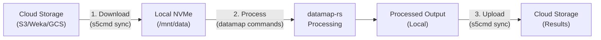
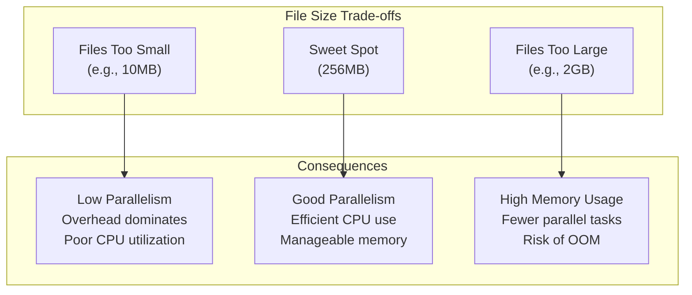
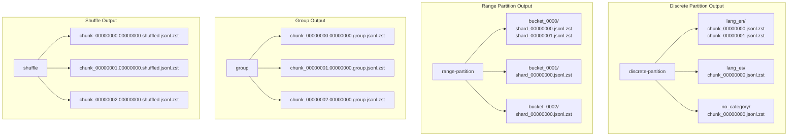
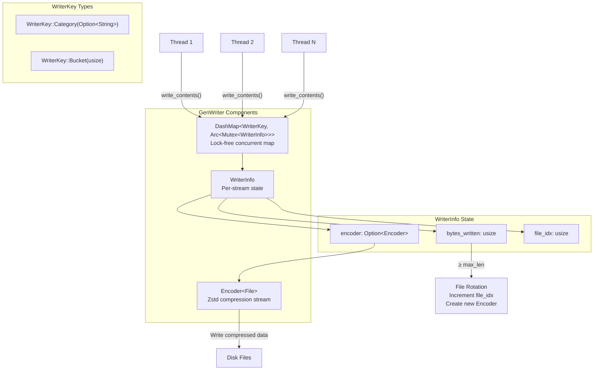
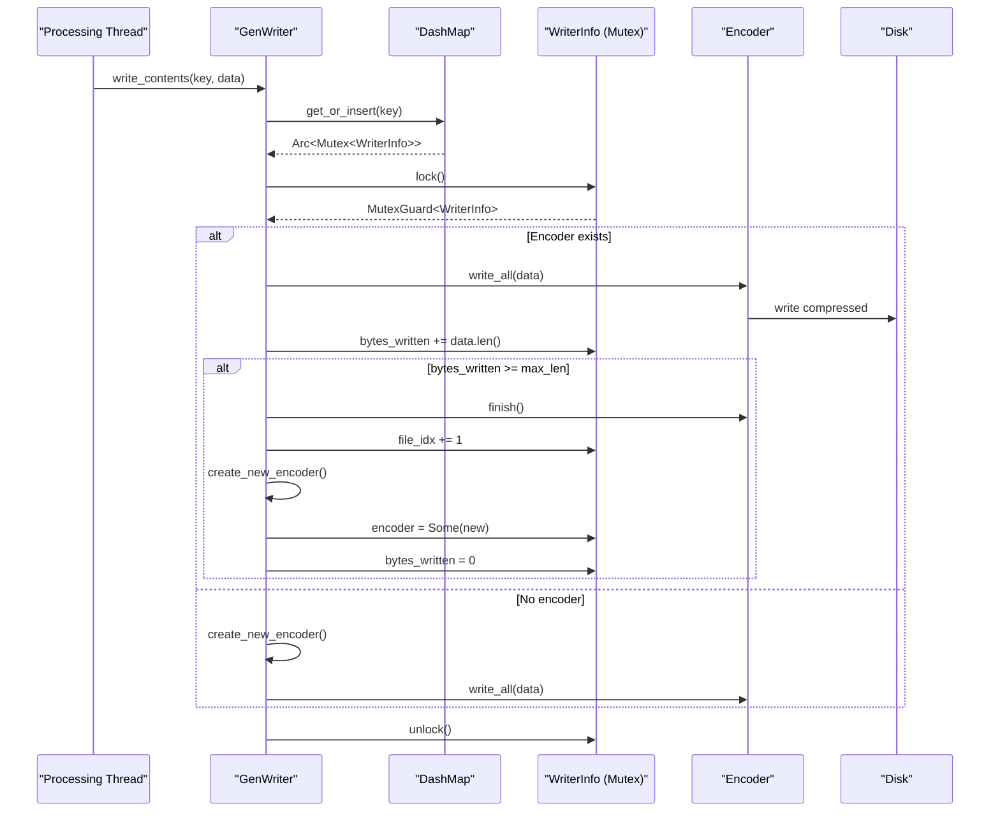
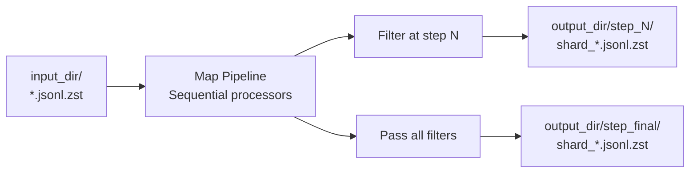
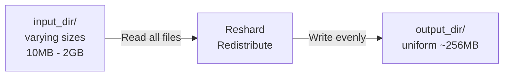
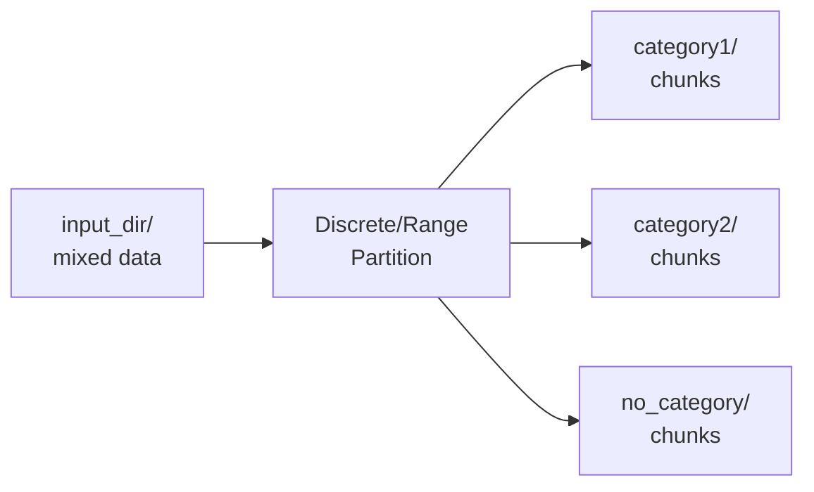
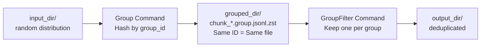

<!-- source: DeepWiki mcp.deepwiki.com · repo allenai/datamap-rs · page 2.3 Data Flow and Storage Strategy · fetched 2026-10-26 -->

# Data Flow and Storage Strategy

<details>
<summary>Relevant source files</summary>

The following files were used as context for generating this wiki page:

- [README.md](README.md)
- [src/groupfilter.rs](src/groupfilter.rs)
- [src/lib.rs](src/lib.rs)
- [src/partition.rs](src/partition.rs)
- [src/reservoir_sample.rs](src/reservoir_sample.rs)
- [src/shuffle.rs](src/shuffle.rs)

</details>


## Purpose and Scope

This document describes the data flow architecture and storage strategy used throughout datamap-rs. It covers the local-first processing model, file format decisions, file size optimization, and the shared infrastructure for writing output files. For details on parallel processing, see [Parallelism and Performance Model](#2.2). For command-specific output structures, see the individual command documentation ([Map](#3), [Data Organization](#4), [Analysis](#5)).

---

## Local-First Architecture

datamap-rs is explicitly designed around a **local-first processing model** where all data operations occur on fast local storage, not streaming from cloud sources. This is not a convenience but an architectural requirement.

### Why Local Storage is Critical

| Reason | Impact |
|--------|--------|
| **Reliability** | Network streaming from S3/cloud is finnicky and prone to failures during long-running jobs |
| **Performance** | Local NVMe provides consistent high-throughput reads/writes; cloud streaming introduces variable latency |
| **Simplicity** | Eliminates retry logic, authentication complexity, and network error handling from processing code |
| **Cost** | Reduces S3 API costs by minimizing request counts through bulk transfers |

The recommended hardware is **AWS i4i/i7i EC2 instances** with **AWS Nitro Drives** providing high-speed local NVMe storage.

**Sources:** [README.md:20-20](), [README.md:104-116]()

---

## Standard Workflow Pattern

All datamap-rs operations follow this three-phase pattern:



### Phase 1: Download to Local Storage

Use `s5cmd` for high-performance cloud transfers:

```bash
# Download entire dataset
s5cmd sync s3://bucket/input-data/ /mnt/nvme/input/

# Optional: Download in parallel across nodes
s5cmd sync s3://bucket/input-data/part-{00..99}/ /mnt/nvme/input/
```

### Phase 2: Local Processing

All datamap-rs commands operate entirely on local files:

```bash
# All operations read/write local paths only
datamap map --input-dir /mnt/nvme/input --output-dir /mnt/nvme/output --config pipeline.yaml
datamap reshard --input-dir /mnt/nvme/output --output-dir /mnt/nvme/resharded
```

### Phase 3: Upload Results

```bash
# Upload processed results
s5cmd sync /mnt/nvme/output/ s3://bucket/output-data/
```

**Sources:** [README.md:115-128]()

---

## File Format and Compression

### JSONL Format

All datamap-rs operations consume and produce **JSON Lines format** (`.jsonl`):
- One complete JSON document per line
- Each line is a valid, self-contained JSON object
- Lines are separated by newline characters (`\n`)
- Documents are processed line-by-line for memory efficiency

Example JSONL file:
```jsonl
{"id": "doc1", "text": "First document", "score": 0.95}
{"id": "doc2", "text": "Second document", "score": 0.87}
{"id": "doc3", "text": "Third document", "score": 0.92}
```

### Zstandard Compression

All output files are compressed using **Zstandard (zstd)** with the `.zst` extension:

| Parameter | Value | Rationale |
|-----------|-------|-----------|
| Compression Level | 3 | Balances compression ratio with speed |
| Extension | `.jsonl.zst` | Indicates both format and compression |
| On-the-fly | Yes | Data is compressed as written, never stored uncompressed |

The compression level 3 is hardcoded throughout the codebase:

```rust
// From partition.rs, groupfilter.rs, shuffle.rs
Encoder::new(file, 3).unwrap()
```

**Sources:** [src/partition.rs:436-445](), [src/groupfilter.rs:326-333](), [src/shuffle.rs:93-100]()

---

## File Size Strategy: The 256MB Target

### The Sweet Spot

datamap-rs uses a **256MB target file size** (before compression) as the optimal balance between parallelism and memory usage:



### Why 256MB?

| Factor | Impact of 256MB Choice |
|--------|----------------------|
| **Parallelism** | Enough files to keep all CPU cores busy without excessive overhead |
| **Memory** | Each thread loads one file; 256MB × thread_count ≈ manageable RAM |
| **I/O Efficiency** | Large enough for efficient disk operations, small enough for fast rotation |
| **Compression** | Good chunk size for zstd compression efficiency (~60-70% reduction) |

### Default Configuration

The 256MB default is defined throughout the codebase:

```rust
// Default max file size function
fn default_max_file_size() -> usize {
    256_000_000  // 256 million bytes
}
```

**Sources:** [src/partition.rs:59-61](), [src/groupfilter.rs:69-71](), [README.md:110-110]()

---

## Storage Organization Patterns

Different commands organize output files in different ways to support their specific use cases:



### Pattern 1: Category Directories (Discrete Partition)

**Purpose:** Split data by categorical values (language, domain, etc.)

**Structure:**
```
output/
├── lang_en/
│   ├── chunk_00000000.jsonl.zst
│   ├── chunk_00000001.jsonl.zst
│   └── chunk_00000002.jsonl.zst
├── lang_es/
│   └── chunk_00000000.jsonl.zst
└── no_category/
    └── chunk_00000000.jsonl.zst
```

**File naming:** `{category_name}/chunk_{index:08}.jsonl.zst`

**Implementation:** [src/partition.rs:406-425]()

### Pattern 2: Bucket Directories (Range Partition)

**Purpose:** Split data by numeric ranges (quality scores, dates, etc.)

**Structure:**
```
output/
├── bucket_0000/
│   ├── shard_00000000.jsonl.zst
│   └── shard_00000001.jsonl.zst
├── bucket_0001/
│   └── shard_00000000.jsonl.zst
└── bucket_0002/
    └── shard_00000000.jsonl.zst
```

**File naming:** `{bucket_name}_{index:04}/shard_{file_idx:08}.jsonl.zst`

**Implementation:** [src/partition.rs:418-422]()

### Pattern 3: Flat Chunked Files (Group/Shuffle)

**Purpose:** Redistribute data without hierarchical organization

**Structure:**
```
output/
├── chunk_00000000.00000000.group.jsonl.zst
├── chunk_00000001.00000000.group.jsonl.zst
├── chunk_00000002.00000000.group.jsonl.zst
└── chunk_00000003.00000001.group.jsonl.zst  # Rotated file
```

**File naming:** `chunk_{chunk_id:08}.{file_idx:08}.{subext}.jsonl.zst`

- `chunk_id`: Hash bucket or shuffle destination
- `file_idx`: Rotation index when file exceeds max_len
- `subext`: Operation identifier (`group`, `shuffled`, etc.)

**Implementation:** [src/groupfilter.rs:344-347](), [src/shuffle.rs:111-114]()

**Sources:** [src/partition.rs:300-555](), [src/groupfilter.rs:296-434](), [src/shuffle.rs:60-201]()

---

## GenWriter: Shared File Writing Infrastructure

The `GenWriter` struct provides thread-safe, concurrent file writing with automatic rotation and compression. It is the core infrastructure used by partition, group, and shuffle commands.

### GenWriter Architecture



### Key Design Decisions

| Decision | Implementation | Rationale |
|----------|---------------|-----------|
| **Lock-free map** | `DashMap` for outer registry | Minimizes contention for accessing different streams |
| **Per-stream locks** | `Arc<Mutex<WriterInfo>>` | Serializes writes to same stream, allows parallel writes to different streams |
| **Lazy initialization** | Writers created on first write | Avoids pre-creating thousands of files when categories are unknown |
| **Automatic rotation** | New file when `bytes_written >= max_len` | Maintains target file size |
| **Compression on-the-fly** | Zstd `Encoder` wraps `File` | Never stores uncompressed data |

### GenWriter Implementations

There are multiple implementations of GenWriter in different files, each tailored to specific use cases:

#### Partition GenWriter (Two Key Types)

[src/partition.rs:304-555]()

Supports both categorical and bucket-based keys:

```rust
pub enum WriterKey {
    Category(Option<String>),  // For discrete partition
    Bucket(usize),             // For range partition
}

pub enum WriterConfig {
    Category { full_choices: Option<HashSet<Option<String>>> },
    Bucket { bucket_name: String },
}
```

**Constructors:**
- `new_category_writer()` - Discrete partition with known/unknown categories
- `new_bucket_writer()` - Range partition with numeric buckets

#### GroupFilter/Shuffle GenWriter (Single Key Type)

[src/groupfilter.rs:297-434](), [src/shuffle.rs:64-201]()

Simplified version with only numeric keys:

```rust
pub struct GenWriter<'a> {
    pub writer: DashMap<usize, Arc<Mutex<WriterInfo<'a>>>>,
    storage_loc: PathBuf,
    num_chunks: usize,
    max_len: usize
}
```

**Key differences:**
- Pre-creates all writers for known number of chunks
- Simpler filename generation (flat structure)
- Includes `subext` field for operation-specific labeling

### Write Flow



### File Rotation Logic

When `bytes_written >= max_len`:

1. **Flush and close current encoder**: [src/partition.rs:505-508]()
2. **Increment file index**: [src/partition.rs:509]()
3. **Reset encoder to None**: [src/partition.rs:510]()
4. **Reset byte counter**: [src/partition.rs:511]()
5. **Lazy creation**: New encoder created on next write

This ensures files stay close to the target size while minimizing memory usage (no encoder kept open unnecessarily).

**Sources:** [src/partition.rs:304-555](), [src/groupfilter.rs:297-434](), [src/shuffle.rs:64-201]()

---

## Memory Management Strategy

### Streaming Line-by-Line Processing

datamap-rs uses **streaming line-by-line processing** to maintain constant memory usage regardless of file size:


### File Reading Pattern

All commands follow this pattern:

```rust
let contents = read_pathbuf_to_mem(path).unwrap();
for line in contents.lines() {
    let line = line.unwrap();
    // Process line
    let json_value: Value = serde_json::from_str(&line).unwrap();
    // Transform and write
}
```

**Key characteristics:**
- `read_pathbuf_to_mem()` returns a `BufReader` (despite the name)
- `.lines()` iterator processes one line at a time
- No need to load entire decompressed file into memory
- Each line parsed, processed, and written before next line read

**Sources:** [src/partition.rs:118-148](), [src/groupfilter.rs:112-130](), [src/shuffle.rs:30-47]()

### Memory Usage Formula

For parallel processing with Rayon:

```
Total Memory ≈ (num_threads × avg_file_size) + (num_output_streams × buffer_size)
```

Where:
- `num_threads`: CPU cores (default) or `--threads` parameter
- `avg_file_size`: Typically 256MB uncompressed per file being read
- `num_output_streams`: Number of concurrent GenWriter streams
- `buffer_size`: Zstd encoder buffer (~few MB per stream)

**Example:** 32 cores processing 256MB files:
- Input buffers: 32 × 256MB = 8GB
- Output buffers: ~1000 streams × 2MB = 2GB
- Total: ~10GB memory usage

### Accumulation Patterns

Some operations accumulate data temporarily before writing:

#### Partitioning Accumulation

[src/partition.rs:118-154]()

```rust
let mut partitioned_bytes: HashMap<Option<String>, Vec<u8>> = HashMap::new();

for line in contents.lines() {
    // ... determine category ...
    let append_vec = partitioned_bytes.entry(key.clone()).or_default();
    append_vec.extend(line.as_bytes());
    append_vec.push(b'\n');
}

// Write all categories at once
partitioned_bytes.into_iter().for_each(|(key, val)| {
    writer.write_contents(WriterKey::Category(key), val).unwrap();
});
```

**Rationale:** Batching writes per file reduces lock contention on GenWriter

#### Grouping Accumulation

[src/groupfilter.rs:113-139]()

```rust
let mut buckets: Vec<Vec<u8>> = vec![Vec::new(); num_chunks];

for line in contents.lines() {
    let bucket_id = hash_val % num_chunks;
    buckets[bucket_id].extend_from_slice(line.as_bytes());
    buckets[bucket_id].push(b'\n');
}

for (bucket_id, contents) in buckets.into_iter().enumerate() {
    writer.write_batch(bucket_id, contents).unwrap();
}
```

**Rationale:** Hash-based distribution requires knowing all destinations before writing

**Sources:** [src/partition.rs:114-154](), [src/groupfilter.rs:110-139]()

---

## Data Flow Patterns by Command

### Map Command Flow



- Input/output both use standard JSONL format
- Output partitioned by which stage filtered document
- File size controlled by reshard (separate operation)

### Reshard Command Flow



- Normalizes file sizes to target
- Can respect subdirectory structure
- Output maintains same directory hierarchy as input

### Partition Command Flow



- Splits data into subdirectories
- Each subdirectory contains ~256MB chunks
- Can handle unknown categories dynamically

### Group → GroupFilter Flow



- Two-phase deduplication
- Group co-locates documents with same ID
- GroupFilter keeps first or last from each group

**Sources:** [src/map_fxn.rs](), [src/reshard.rs](), [src/partition.rs](), [src/groupfilter.rs]()

---

## Best Practices

### Storage Layout

**Recommended directory structure:**

```
/mnt/nvme/
├── input/           # Downloaded raw data
├── processing/      # Intermediate outputs
│   ├── filtered/
│   ├── resharded/
│   └── partitioned/
├── output/          # Final results
└── cache/           # ML models, banlists
    ├── models/
    └── banlists/
```

### File Size Management

| Operation | When to Reshard |
|-----------|-----------------|
| **Before processing** | When input files vary wildly in size |
| **After partitioning** | When partition creates small files (<50MB) |
| **Before grouping** | To optimize memory usage during hash distribution |
| **After filtering** | When Map removes >50% of documents |

### Temporary File Cleanup

Some commands support `delete_after_read` for streaming pipelines:

```rust
// From groupfilter.rs configuration
#[serde(default="default_delete_after_read")]
delete_after_read: bool,
```

Use this when disk space is limited and intermediate results aren't needed:

```bash
# Group operation that deletes input as processed
datamap group --config config.yaml  # delete_after_read: true in config
```

**Warning:** Only use when you're confident in the pipeline; deleted files cannot be recovered.

**Sources:** [src/groupfilter.rs:64-75]()

---

## Performance Implications

### Local vs. Cloud Storage Performance

| Metric | Local NVMe | S3 Streaming |
|--------|------------|--------------|
| Sequential Read | 3-7 GB/s | 100-400 MB/s (varies) |
| Random Read | 500k+ IOPS | Poor (high latency) |
| Write Throughput | 2-4 GB/s | 100-300 MB/s (varies) |
| Consistency | Guaranteed | Variable (network conditions) |
| Failure Mode | Predictable | Retry storms, timeouts |

### File Size Impact on Parallelism

With 32 CPU cores:

| File Size | Files for 100GB | Parallel Efficiency |
|-----------|-----------------|---------------------|
| 10 MB | 10,000 | Overhead dominates |
| 256 MB | 400 | Optimal |
| 1 GB | 100 | Underutilized CPUs |
| 4 GB | 25 | Severely underutilized |

**Sources:** [README.md:20-20](), [README.md:104-112]()

---

## Common Issues and Solutions

### Issue: Out of Memory Errors

**Symptoms:** Process killed by OOM killer during processing

**Causes:**
- Too many parallel threads
- Files larger than expected
- Accumulation in HashMap for partitioning

**Solutions:**
1. Reduce thread count: `--threads 16`
2. Reshard input to ensure 256MB files
3. Monitor memory usage: `watch -n 1 free -h`

### Issue: Slow Processing

**Symptoms:** Low CPU utilization, slow progress

**Causes:**
- Files too small (excessive overhead)
- Processing from network-attached storage
- Files not decompressing in parallel

**Solutions:**
1. Reshard to larger files
2. Move to local NVMe storage
3. Check file count vs. CPU core count

### Issue: Disk Full During Processing

**Symptoms:** Write errors, "No space left on device"

**Causes:**
- Underestimated output size
- Compression less effective than expected
- Temporary accumulation in partitioning

**Solutions:**
1. Calculate space: `input_size × 1.5` for safety margin
2. Enable `delete_after_read` for streaming operations
3. Use separate disk for input/output when possible

**Sources:** [README.md:104-112]()

---

