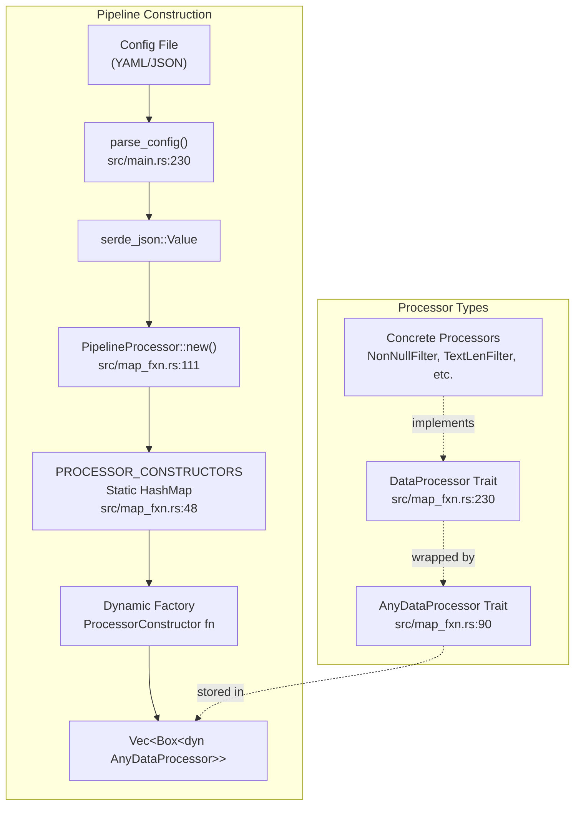
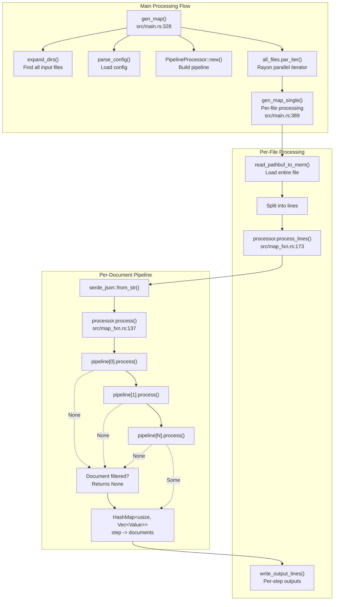
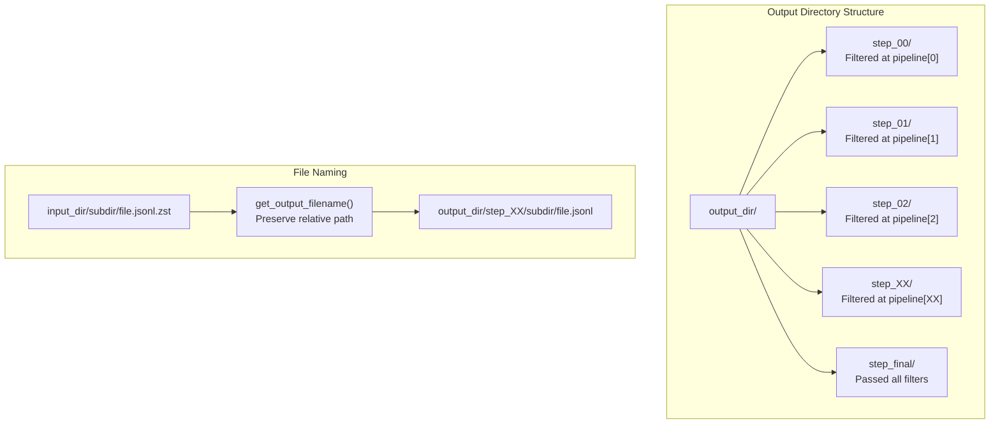
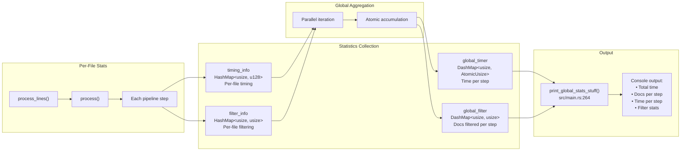

<!-- source: DeepWiki mcp.deepwiki.com · repo allenai/datamap-rs · page 3 Map Command (Pipeline Processing) · fetched 2026-10-26 -->

# Map Command (Pipeline Processing)

<details>
<summary>Relevant source files</summary>

The following files were used as context for generating this wiki page:

- [docs/map.md](docs/map.md)
- [src/main.rs](src/main.rs)
- [src/map_fxn.rs](src/map_fxn.rs)

</details>


The Map command is the core data transformation system in datamap-rs. It processes JSONL documents through a configurable pipeline of filters, modifiers, and annotators to clean, enrich, and filter datasets at scale. Each document flows sequentially through the pipeline stages, with file-level parallelism enabling high throughput processing.

For data organization operations (partitioning, grouping, resharding), see [Data Organization Commands](#4). For sampling and statistics, see [Analysis Commands](#5).

## Command Line Interface

The Map command is invoked through the `Commands::Map` variant in the CLI dispatcher:

```bash
datamap map \
  --input_dir <INPUT_DIR> \
  --output_dir <OUTPUT_DIR> \
  --config <CONFIG_FILE> \
  [--err_dir <ERR_DIR>] \
  [--delete_after_read] \
  [--threads <N>]
```

| Argument | Required | Description |
|----------|----------|-------------|
| `--input_dir` | Yes | Directory containing input JSONL files (`.jsonl`, `.jsonl.gz`, `.jsonl.zst`) |
| `--output_dir` | Yes | Output directory for processed documents, organized by filter stage |
| `--config` | Yes | YAML or JSON configuration file defining the pipeline |
| `--err_dir` | No | Directory for documents that failed to parse or caused errors |
| `--delete_after_read` | No | Delete input files after successful processing |
| `--threads` | No | Number of threads (default: `RAYON_NUM_THREADS` or all cores) |

**Sources:** [src/main.rs:62-77](), [src/main.rs:514-521]()

## Pipeline Configuration Format

Pipelines are defined using YAML or JSON configuration files. The configuration specifies a global `text_field` (defaults to `"text"`) and an ordered list of processors with their arguments.

```yaml
text_field: "text"  # Optional: default text field for all processors
pipeline:
  - name: "processor_name"
    kwargs:
      arg1: value1
      arg2: value2
  - name: "another_processor"
    kwargs:
      arg1: value1
```

The configuration is parsed by `parse_config()` which handles both YAML and JSON formats, converting to `serde_json::Value` internally. The `text_field` is automatically injected into each processor's kwargs during construction.

**Sources:** [src/main.rs:230-248](), [src/map_fxn.rs:109-135]()

## Pipeline Architecture

### Core Components



**Diagram: Pipeline Construction and Processor Registration**

The `PipelineProcessor` struct orchestrates the entire pipeline:

```rust
pub struct PipelineProcessor {
    pub pipeline: Vec<Box<dyn AnyDataProcessor>>,
}
```

Processors are registered at compile time using a macro that populates the `PROCESSOR_CONSTRUCTORS` static map:

```rust
static PROCESSOR_CONSTRUCTORS: Lazy<HashMap<&'static str, ProcessorConstructor>> = ...
```

The `register_processor!` macro [src/map_fxn.rs:38-45]() adds each processor type to the registry with a constructor function that instantiates it from configuration.

**Sources:** [src/map_fxn.rs:104-135](), [src/map_fxn.rs:38-88](), [src/map_fxn.rs:230-238]()

### DataProcessor Trait

All processors implement the `DataProcessor` trait:

```rust
pub trait DataProcessor {
    fn new(config: &Value) -> Result<Self, Error>
    where
        Self: Sized;
    
    fn process(&self, data: Value) -> Result<Option<Value>, Error>;
}
```

The `process()` method signature defines the pipeline semantics:
- **Input:** `serde_json::Value` representing a JSON document
- **Output:** `Result<Option<Value>, Error>`
  - `Ok(Some(modified_doc))` - Document passes, possibly modified
  - `Ok(None)` - Document filtered (removed from pipeline)
  - `Err(e)` - Processing error

The `AnyDataProcessor` trait [src/map_fxn.rs:90-102]() wraps `DataProcessor` to enable dynamic dispatch and trait object storage.

**Sources:** [src/map_fxn.rs:230-238](), [src/map_fxn.rs:90-102]()

## Processing Execution Model

### File-Level Parallelism



**Diagram: Map Command Execution Flow**

The processing flow has three levels of iteration:

1. **File Level (Parallel):** `all_files.par_iter()` processes each file independently using Rayon [src/main.rs:359]()
2. **Line Level (Sequential):** Within each file, lines are processed sequentially [src/map_fxn.rs:190]()
3. **Pipeline Level (Sequential):** Each document flows through pipeline stages [src/map_fxn.rs:154-168]()

**Sources:** [src/main.rs:328-386](), [src/main.rs:389-449](), [src/map_fxn.rs:137-171](), [src/map_fxn.rs:173-216]()

### Document Flow Through Pipeline

The `PipelineProcessor::process()` method [src/map_fxn.rs:137-171]() implements the core processing logic:

1. **Clone original:** Store unmodified document in `og_copy`
2. **Sequential processing:** Iterate through `pipeline` vector
3. **Timing tracking:** Record time spent in each step
4. **Filter detection:** If any processor returns `None`:
   - Record filter step number
   - Return original document with step index
5. **Final output:** If all processors return `Some`:
   - Return modified document with `usize::MAX` as step indicator

The step index determines output directory:
- `step < usize::MAX` → `output_dir/step_XX/` (filtered at step XX)
- `step == usize::MAX` → `output_dir/step_final/` (passed all filters)

**Sources:** [src/map_fxn.rs:137-171](), [src/main.rs:414-422]()

## Output Organization

### Directory Structure



**Diagram: Output Directory Organization**

Each step directory contains documents that were **filtered** at that pipeline stage (returned `None`). The `step_final/` directory contains documents that **survived** all filters. This organization enables analysis of which filters removed which documents.

Output files preserve the input directory structure and filename (minus compression extension) using `get_output_filename()` from the `mj_io` crate.

**Sources:** [src/main.rs:414-422](), [src/main.rs:250-262]()

### Error Handling

Documents that fail JSON parsing are written to `err_dir` if specified [src/main.rs:207-209](), [src/main.rs:424-433](). Processing errors during pipeline execution are also captured to `err_dir`.

**Sources:** [src/main.rs:361-365](), [src/main.rs:424-433](), [src/map_fxn.rs:204-210]()

## Processor Categories

### Filters (17 Types)

Filters evaluate documents and return `None` to remove them from the pipeline. Common filters include:

| Processor | Purpose | Key Configuration |
|-----------|---------|-------------------|
| `non_null_filter` | Remove null JSON values | None |
| `text_len_filter` | Character count bounds | `lower_bound`, `upper_bound` |
| `page_len_filter` | Word/sentence/line/paragraph/char counts | `length_type`, `lower_bound`, `upper_bound` |
| `float_filter` | Numeric field range filter | `float_field`, `lower_bound`, `upper_bound`, `negate` |
| `string_eq_filter` | String field equality | `str_field`, `eq`, `keep_matches` |
| `subsample` | Random sampling | `subsample_rate` |
| `url_substring_filter` | URL banlist matching | `banlist_file`, `exact_domain_match`, etc. |
| `massive_web_repetition_filter` | Repetition detection via rolling hash | `text_field` |
| `stop_word_filter` | English stop word presence | `min_stop_word`, `count_unique` |

**Sources:** [src/map_fxn.rs:243-260](), [src/map_fxn.rs:263-291](), [src/map_fxn.rs:649-702](), [src/map_fxn.rs:312-331]()

### Modifiers (7 Types)

Modifiers transform documents and return the modified version:

| Processor | Purpose | Key Configuration |
|-----------|---------|-------------------|
| `newline_removal_modifier` | Control consecutive newlines | `max_consecutive` |
| `ratio_line_modifier` | Remove lines with too many uppercase/digits | `check`, `upper_bound` |
| `regex_line_modifier` | Remove lines matching regex | `regex` |
| `line_len_modifier` | Remove short lines | `lower_bound` |
| `substring_line_modifier` | Remove/modify lines with banned substrings | `banlist`, `remove_substring_only` |
| `add_id` | Add UUID4 identifier | `id_key` |
| `rename_modifier` | Rename JSON fields | `old_field`, `new_field` |

**Sources:** [src/map_fxn.rs:550-584](), [src/map_fxn.rs:1438-1510](), [src/map_fxn.rs:1512-1562](), [src/map_fxn.rs:293-309]()

### Annotators (7 Types)

Annotators add metadata without filtering:

| Processor | Purpose | Key Configuration |
|-----------|---------|-------------------|
| `fasttext_annotator` | ML-based classification | `fast_text_file`, `k`, `threshold` |
| `madlad400_sentence_annotator` | Multi-rule sentence quality analysis | `fast_text_file`, `rules_to_include` |
| `word_count_adder` | Add word count field | `word_count_field` |
| `hash_annotator` | Add XXH3 hash of field | `hash_source`, `num_bits` |
| `constant_annotator` | Add constant value | `key`, `value` |
| `dd_max_getter` | Extract max from prefixed attributes | `prefix`, `output_attribute` |
| `max_extractor` | Extract key with max value | `main_attribute`, `lower_bound` |

**Sources:** [src/map_fxn.rs:586-647](), [src/map_fxn.rs:1753-1966](), [src/map_fxn.rs:1405-1436](), [src/map_fxn.rs:2397-2436]()

## Statistics and Monitoring

### Timing and Filtering Statistics



**Diagram: Statistics Collection and Reporting**

The Map command tracks comprehensive statistics during processing:

1. **Per-File Timing:** Each call to `process_lines()` returns `TimingInfo` with nanoseconds spent in each step [src/map_fxn.rs:186]()
2. **Per-File Filtering:** `FilterInfo` tracks documents filtered at each step [src/map_fxn.rs:186]()
3. **Global Aggregation:** Thread-safe accumulation using `DashMap<usize, AtomicUsize>` for timing [src/main.rs:348]() and `DashMap<usize, usize>` for filtering [src/main.rs:349]()
4. **Statistics Output:** `print_global_stats_stuff()` computes and displays:
   - Total processing time
   - Total documents processed
   - Per-step time percentage
   - Per-step removal counts and percentages

**Sources:** [src/main.rs:264-321](), [src/main.rs:348-355](), [src/map_fxn.rs:173-216]()

### Example Statistics Output

```
Finishing map in 342 seconds
Processed 10000000 total documents
-------------------------------------------
Step 0 | NonNullFilter
	 Spent 0.05% of processing time in this step
	 Removed 123 docs | 0.00% of remaining | 0.00% of pool
Step 1 | TextLenFilter { lower_bound: 100, upper_bound: 100000 }
	 Spent 2.31% of processing time in this step
	 Removed 1234567 docs | 12.35% of remaining | 12.35% of pool
Step 2 | UrlSubstringFilter { ... }
	 Spent 15.67% of processing time in this step
	 Removed 567890 docs | 6.49% of remaining | 5.68% of pool
...
FINAL:
	 5432100 docs survived | 54.32% of pool
```

**Sources:** [src/main.rs:287-320]()

## Performance Characteristics

### Parallelism Model

- **File-Level Parallelism:** Each file processed by a separate thread via Rayon `par_iter()` [src/main.rs:359]()
- **Sequential Per-File:** Lines within a file processed sequentially [src/map_fxn.rs:190]()
- **Sequential Per-Document:** Pipeline stages execute in order [src/map_fxn.rs:154]()

**Rationale:** File-level parallelism provides optimal throughput while maintaining:
- Deterministic per-file ordering
- Memory efficiency (one file per thread)
- Simplicity (no cross-document state)

### Memory Usage

- Each thread loads one complete file into memory [src/main.rs:405]()
- Target file size: ~256MB (see [Reshard Command](#4.1))
- Total memory ≈ `num_threads × file_size`
- Processors may cache additional data (FastText models, banlists)

### Optimization Techniques

1. **Early Exit:** Documents filtered at step N skip steps N+1...end [src/map_fxn.rs:159-164]()
2. **Atomic Counters:** Lock-free statistics accumulation [src/main.rs:348]()
3. **Static Registration:** Zero-cost processor lookup [src/map_fxn.rs:48]()
4. **Efficient JSON:** Multiple parser options (serde_json, sonic-rs, simd-json) [src/map_fxn.rs:191]()

**Sources:** [src/main.rs:328-386](), [src/main.rs:405](), [src/map_fxn.rs:137-171]()

## Advanced Processor Examples

### URL Substring Filter

The `UrlSubstringFilter` [src/map_fxn.rs:333-497]() provides flexible URL filtering with multiple modes:

- **Exact domain matching:** `exact_domain_match=true` extracts host via `url::Url::parse()`
- **Exact subdomain matching:** `exact_subdomain_match=true` uses custom extraction
- **Substring matching:** Uses `AhoCorasick` for multi-pattern search [src/map_fxn.rs:370]()
- **Word boundary matching:** Filters AhoCorasick results to word boundaries [src/map_fxn.rs:475-488]()
- **Case normalization:** Optional case-insensitive matching [src/map_fxn.rs:380]()
- **Character ignoring:** Strip specified characters (e.g., '.', '-') [src/map_fxn.rs:436-438]()

**Sources:** [src/map_fxn.rs:333-548]()

### Massive Web Repetition Filter

The `MassiveWebRepetitionFilter` [src/map_fxn.rs:1195-1352]() implements the Gopher paper's repetition detection:

- **Rolling hash:** `CompatibleRollingHash` tracks n-gram hashes [src/map_fxn.rs:1356-1400]()
- **Multiple granularities:** Lines, paragraphs, words [src/map_fxn.rs:1216-1230]()
- **Multiple n-gram sizes:** 1 through 10 [src/map_fxn.rs:1216-1230]()
- **13 threshold configurations:** Different limits for different patterns [src/map_fxn.rs:1216-1230]()
- **FxHashMap:** Fast hash table for n-gram counting [src/map_fxn.rs:1251]()

**Sources:** [src/map_fxn.rs:1195-1400]()

### Madlad400 Sentence Annotator

The `Madlad400SentenceAnnotator` [src/map_fxn.rs:1753-2039]() implements multi-criteria sentence quality checking:

1. **Document consistency:** FastText-based sentence vs. document language comparison [src/map_fxn.rs:2019-2038]()
2. **List case detection:** Uppercase letter ratio in sentences [src/map_fxn.rs:1985-2003]()
3. **Abnormal length:** Character count bounds [src/map_fxn.rs:1970-1975]()
4. **Technical characters:** Ratio of technical symbols [src/map_fxn.rs:1977-1983]()
5. **Cursed patterns:** AhoCorasick + regex matching [src/map_fxn.rs:2005-2017]()

Annotations are stored in a nested JSON structure with per-rule sentence IDs, enabling downstream filtering via `Madlad400RuleFilter`.

**Sources:** [src/map_fxn.rs:1753-2039](), [src/map_fxn.rs:2043-2115]()

## Related Commands

- **Pipeline Configuration Format:** See [Configuration Format Reference](#8.1) for complete syntax
- **Example Pipelines:** See [Example: DCLM Pipeline](#8.2) and [Example: Classification and Annotation](#8.3)
- **Processor Development:** See [Adding New Processors](#10.1) for extending the system
- **Data Organization:** For partitioning and grouping operations, see [Data Organization Commands](#4)

---

