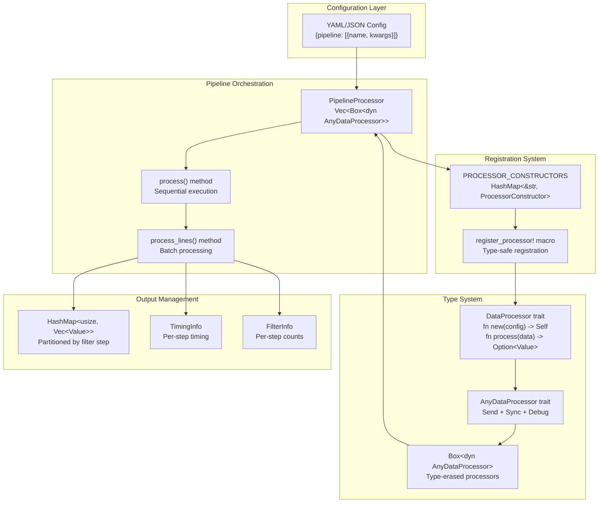
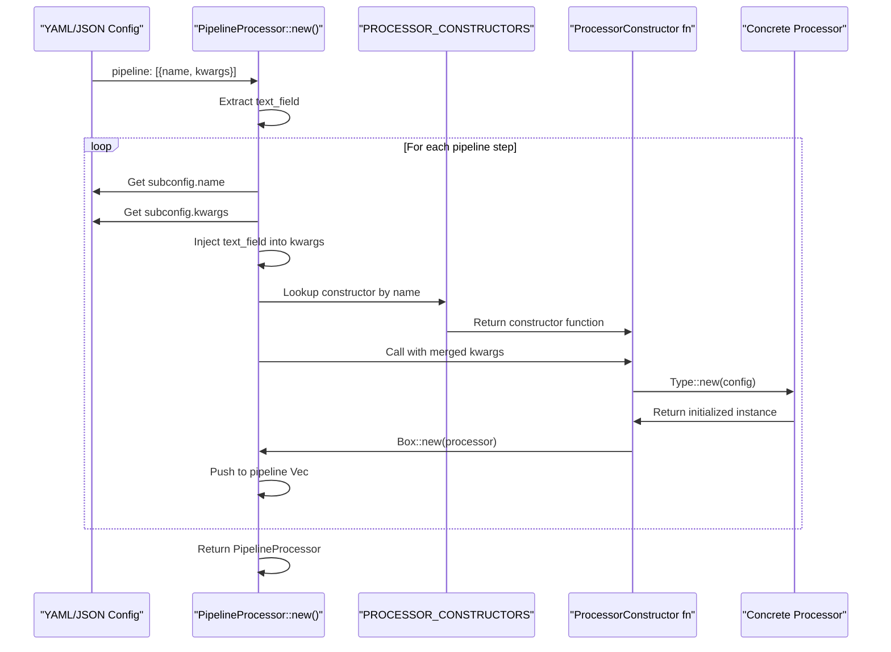

<!-- source: DeepWiki mcp.deepwiki.com · repo allenai/datamap-rs · page 3.1 Pipeline Architecture · fetched 2026-10-26 -->

# Pipeline Architecture

<details>
<summary>Relevant source files</summary>

The following files were used as context for generating this wiki page:

- [src/map_fxn.rs](src/map_fxn.rs)

</details>


## Purpose and Scope

This document describes the architecture of the Map pipeline processing system, which is the most complex component in datamap-rs. The pipeline system allows configurable transformation, filtering, and annotation of JSONL documents through a sequence of processing steps. This page covers the core architecture, processor registration mechanism, and execution model. For details on specific processor implementations, see [Filter Processors](#3.3), [Modifier Processors](#3.4), and [Annotator Processors](#3.5). For pipeline configuration syntax, see [Pipeline Configuration](#3.6).

---

## Overview

The pipeline architecture implements a **plugin-based system** where processors are registered in a static map and dynamically instantiated from YAML/JSON configuration files. Documents flow through a sequential pipeline where each processor can:
- **Filter**: Return `None` to remove the document
- **Transform**: Return modified document data
- **Annotate**: Add metadata fields without filtering

The system processes files in parallel using Rayon, but documents within a file are processed sequentially through the pipeline to maintain ordering and allow stateful filtering decisions.

**Sources:** [src/map_fxn.rs:30-217]()

---

## Core Components

### Component Diagram



**Sources:** [src/map_fxn.rs:30-217]()

---

## Processor Registration System

### Static Registration Map

The `PROCESSOR_CONSTRUCTORS` is a static `HashMap` that maps processor names (strings) to constructor functions. This map is initialized once at program startup using `once_cell::sync::Lazy`.

```rust
type ProcessorConstructor = fn(&Value) -> Result<Box<dyn AnyDataProcessor>, Error>;

static PROCESSOR_CONSTRUCTORS: Lazy<HashMap<&'static str, ProcessorConstructor>> = ...
```

Each entry maps a processor name (e.g., `"text_len_filter"`) to a function that:
1. Accepts a `serde_json::Value` configuration
2. Returns a boxed trait object implementing `AnyDataProcessor`

**Sources:** [src/map_fxn.rs:36-88]()

### Registration Macro

The `register_processor!` macro provides type-safe registration by generating the boilerplate for each processor type:

```rust
macro_rules! register_processor {
    ($map:expr, $name:expr, $processor_type:ty) => {
        $map.insert($name, |config| {
            let processor = <$processor_type>::new(config).unwrap();
            Ok(Box::new(processor) as Box<dyn AnyDataProcessor>)
        });
    };
}
```

This macro:
- Calls the processor's `new()` constructor with the config
- Boxes the result as a trait object
- Inserts the constructor function into the map

**Sources:** [src/map_fxn.rs:38-45]()

### Registration Example Table

| Processor Name | Type | Line |
|---------------|------|------|
| `non_null_filter` | `NonNullFilter` | 51 |
| `text_len_filter` | `TextLenFilter` | 52 |
| `subsample` | `SubsampleFilter` | 53 |
| `add_id` | `AddIdModifier` | 54 |
| `url_substring_filter` | `UrlSubstringFilter` | 55 |
| `fasttext_annotator` | `FastTextAnnotator` | 57 |
| `float_filter` | `FloatFilter` | 58 |
| `massive_web_repetition_filter` | `MassiveWebRepetitionFilter` | 67-71 |
| `madlad400_sentence_annotator` | `Madlad400SentenceAnnotator` | 78 |
| `interval_filter` | `IntervalFilter` | 81 |
| `hash_annotator` | `HashAnnotator` | 83 |
| `constant_annotator` | `ConstantAnnotator` | 85 |
| `rename_modifier` | `RenameModifier` | 86 |

**Sources:** [src/map_fxn.rs:48-88]()

---

## Trait System

### DataProcessor Trait

The `DataProcessor` trait defines the interface that all processors must implement:

```rust
pub trait DataProcessor {
    fn new(config: &Value) -> Result<Self, Error>
    where
        Self: Sized;

    fn process(&self, data: Value) -> Result<Option<Value>, Error>;
}
```

- **`new()`**: Constructor that initializes the processor from configuration, loading any required resources (models, banlists, etc.)
- **`process()`**: Core processing method that takes a document and returns:
  - `Ok(Some(modified_doc))` to pass the document forward
  - `Ok(None)` to filter out the document
  - `Err(...)` on processing errors

**Sources:** [src/map_fxn.rs:230-238]()

### AnyDataProcessor Trait

The `AnyDataProcessor` trait provides type erasure and trait object compatibility:

```rust
pub trait AnyDataProcessor: Send + Sync + std::fmt::Debug {
    fn process(&self, data: Value) -> Result<Option<Value>, Error>;
}
```

Key requirements:
- **`Send + Sync`**: Enables parallel processing across threads
- **`Debug`**: Allows logging and debugging of pipeline structure
- **Type erasure**: Allows heterogeneous processors in `Vec<Box<dyn AnyDataProcessor>>`

Any type implementing `DataProcessor + Send + Sync + Serialize + Debug` automatically implements `AnyDataProcessor` through a blanket implementation.

**Sources:** [src/map_fxn.rs:90-102]()

---

## Pipeline Construction

### Construction Flow



**Sources:** [src/map_fxn.rs:109-135]()

### Construction Code Path

The `PipelineProcessor::new()` method performs the following steps:

1. **Extract global configuration**
   - Read `text_field` from config (defaults to `"text"`)
   - Get `pipeline` array from config

2. **Iterate pipeline steps**
   - For each step, extract `name` and `kwargs`
   - Inject `text_field` into `kwargs` using `json_set()`
   - Look up constructor in `PROCESSOR_CONSTRUCTORS` map
   - Call constructor with merged configuration
   - Push boxed processor to pipeline vector

3. **Return orchestrator**
   - Return `PipelineProcessor` containing the processor vector

**Configuration Example:**
```json
{
  "text_field": "text",
  "pipeline": [
    {
      "name": "text_len_filter",
      "kwargs": {
        "lower_bound": 100,
        "upper_bound": 10000
      }
    },
    {
      "name": "fasttext_annotator",
      "kwargs": {
        "fast_text_file": "/models/lid176.bin",
        "output_field": "metadata.language"
      }
    }
  ]
}
```

**Sources:** [src/map_fxn.rs:111-135]()

---

## Document Processing Execution

### Per-Document Processing Flow

```mermaid
graph TB
    Start["Input: serde_json::Value"] --> Clone["Clone document<br/>(for filtered outputs)"]
    Clone --> Loop["For each processor<br/>in pipeline"]
    
    Loop --> StartTimer["Record start time"]
    StartTimer --> CallProc["processor.process(current_data)"]
    
    CallProc --> UpdateTiming["Update timing_info"]
    UpdateTiming --> CheckResult{"Result?"}
    
    CheckResult -->|Some(value)| Continue["current_data = value<br/>filter_step++"]
    CheckResult -->|None| Filtered["Document filtered<br/>at this step"]
    
    Continue --> MoreProc{"More<br/>processors?"}
    MoreProc -->|Yes| Loop
    MoreProc -->|No| Final["Return (MAX, Some(data))"]
    
    Filtered --> RecordFilter["Update filter_info[step]"]
    RecordFilter --> ReturnClone["Return (step, Some(original))"]
    
    Final --> Output1["Passed all filters"]
    ReturnClone --> Output2["Filtered at step N"]
    
    style Filtered fill:#ffcccc
    style Final fill:#ccffcc
```

**Sources:** [src/map_fxn.rs:137-171]()

### Processing Method Signature

```rust
pub fn process(
    &self,
    data: Value,
    _timing_info: &mut TimingInfo,
    _filter_info: &mut FilterInfo,
) -> Result<(usize, Option<Value>), Error>
```

**Return value semantics:**
- `(usize::MAX, Some(data))`: Document passed all filters
- `(N, Some(original))`: Document filtered at step N (returns original for analysis)
- Timing and filter statistics accumulated in mutable references

**Sources:** [src/map_fxn.rs:137-171]()

### Batch Processing Flow

The `process_lines()` method handles batch processing of multiple documents:

```rust
pub fn process_lines(
    &self,
    lines: Vec<String>,
    filename: &PathBuf,
) -> Result<(
    HashMap<usize, Vec<Value>>,  // Outputs by step
    Vec<String>,                  // Error lines
    TimingInfo,                   // Timing statistics
    FilterInfo,                   // Filter statistics
), Error>
```

**Processing steps:**
1. Initialize tracking structures (timing, filter counts, output map, error list)
2. For each line:
   - Parse JSON with `serde_json::from_str()`
   - If parse succeeds: call `process()` and partition output by step
   - If parse fails: add to error list
3. Return all accumulated results

**Sources:** [src/map_fxn.rs:173-216]()

---

## Output Partitioning

### Step-Based Output Organization

Documents are partitioned into different output groups based on where they were filtered:

| Output Key | Meaning |
|-----------|---------|
| `usize::MAX` | Passed all filters (written to `step_final/`) |
| `0` | Filtered at step 0 (written to `step_00/`) |
| `1` | Filtered at step 1 (written to `step_01/`) |
| `N` | Filtered at step N (written to `step_XX/`) |

**Implementation:**
```rust
match proc_result {
    Some(data_value) => current_data = data_value,
    None => {
        *_filter_info.entry(filter_step).or_insert(0) += 1;
        return Ok((filter_step, Some(og_copy)));  // Return ORIGINAL document
    }
}
```

**Key insight:** Filtered documents return the **original unmodified version**, allowing analysis of what was filtered before any modifications were applied.

**Sources:** [src/map_fxn.rs:159-164](), [src/map_fxn.rs:196-201]()

---

## Timing and Statistics

### Tracking Structures

```rust
type TimingInfo = HashMap<usize, u128>;   // step -> nanoseconds
type FilterInfo = HashMap<usize, usize>;  // step -> count
```

**Timing accumulation:**
- Each processor execution is timed using `Instant::now()` and `elapsed().as_nanos()`
- Times are accumulated per-step across all documents
- Enables profiling of which processors are slowest

**Filter counting:**
- Each time a processor returns `None`, the count for that step increments
- Final statistics show distribution of where documents were filtered
- Special key `usize::MAX` tracks documents that passed all filters

**Sources:** [src/map_fxn.rs:33-34](), [src/map_fxn.rs:157-169]()

---

## Parallelism Model

While not directly in `map_fxn.rs`, the pipeline integrates with the file-level parallelism model:

- **File-level parallelism**: Rayon processes multiple input files concurrently
- **Sequential per-document**: Within a file, documents are processed sequentially through the pipeline
- **Thread-safety**: Processors must be `Send + Sync` to support parallel file processing
- **No shared state**: Each file's processing is independent

This design avoids the complexity of parallel document processing (which would require careful handling of stateful filters and ordering) while still achieving high throughput through file-level concurrency.

**Sources:** High-level system diagrams, [src/map_fxn.rs:90]()

---

## Error Handling

### Error Propagation

Errors can occur at multiple stages:

1. **JSON parsing errors**: Malformed JSONL lines are collected in `err_lines` vector
2. **Processor errors**: `process()` returns `Result<Option<Value>, Error>`
3. **Configuration errors**: Constructor returns `Result<Self, Error>`

**Error line handling:**
```rust
Err(_e) => {
    println!("Error parsing json in {:?}:{:?}", filename, line_num);
    err_lines.push(line.clone())
}
```

Lines that fail processing (either parse or processor errors) are:
- Logged with file and line number
- Added to error collection
- Not written to any output directory
- Available for separate error handling/logging

**Sources:** [src/map_fxn.rs:192-212]()

---

## Memory Management

### Cloning Strategy

The pipeline uses a strategic cloning approach:

1. **Initial clone**: Original document cloned at pipeline start (`og_copy = data.clone()`)
2. **Processor modifications**: Processors may mutate `current_data` in place
3. **Filter output**: If filtered, return the **original clone**, not modified version
4. **Final output**: If passed all filters, return the **modified** version

This ensures:
- Filtered documents show their original state for debugging
- Passed documents include all accumulated modifications
- No unnecessary cloning during processing (only one clone per document)

**Sources:** [src/map_fxn.rs:150-151](), [src/map_fxn.rs:163]()

### Resource Management

Processors may hold expensive resources:
- **FastText models**: Loaded once in constructor, reused across documents
- **Regex patterns**: Compiled once, cached in processor
- **Banlist HashSets**: Loaded from disk once, held in memory
- **AhoCorasick automata**: Built once from banlist data

These resources are **not** `Clone`, which is why processors are held behind `Box<dyn>` trait objects.

**Sources:** [src/map_fxn.rs:594-596](), [src/map_fxn.rs:1767-1792]()

---

## Pipeline Processor Structure

### PipelineProcessor Fields

```rust
pub struct PipelineProcessor {
    pub pipeline: Vec<Box<dyn AnyDataProcessor>>,
}
```

The structure is intentionally minimal:
- Single field: vector of boxed trait objects
- No shared state or configuration
- Processors are self-contained with their own state

**Implications:**
- Easy to serialize pipeline structure (for debugging)
- Processors cannot communicate with each other
- No global context beyond the document being processed
- Thread-safe due to immutable pipeline structure

**Sources:** [src/map_fxn.rs:104-107]()

---

## Summary Table

| Component | Purpose | Key Trait/Type |
|-----------|---------|----------------|
| `PROCESSOR_CONSTRUCTORS` | Static registry of processor types | `HashMap<&str, ProcessorConstructor>` |
| `register_processor!` | Type-safe registration macro | Macro |
| `DataProcessor` | Processor implementation interface | Trait with `new()` and `process()` |
| `AnyDataProcessor` | Type-erased processor interface | Trait object (`Send + Sync + Debug`) |
| `PipelineProcessor` | Orchestrates sequential execution | Struct with `Vec<Box<dyn>>` |
| `process()` | Single document processing | Returns `(step, Option<Value>)` |
| `process_lines()` | Batch document processing | Returns partitioned outputs + stats |
| `TimingInfo` | Performance profiling | `HashMap<usize, u128>` |
| `FilterInfo` | Filter statistics | `HashMap<usize, usize>` |

**Sources:** [src/map_fxn.rs:30-217]()

---

