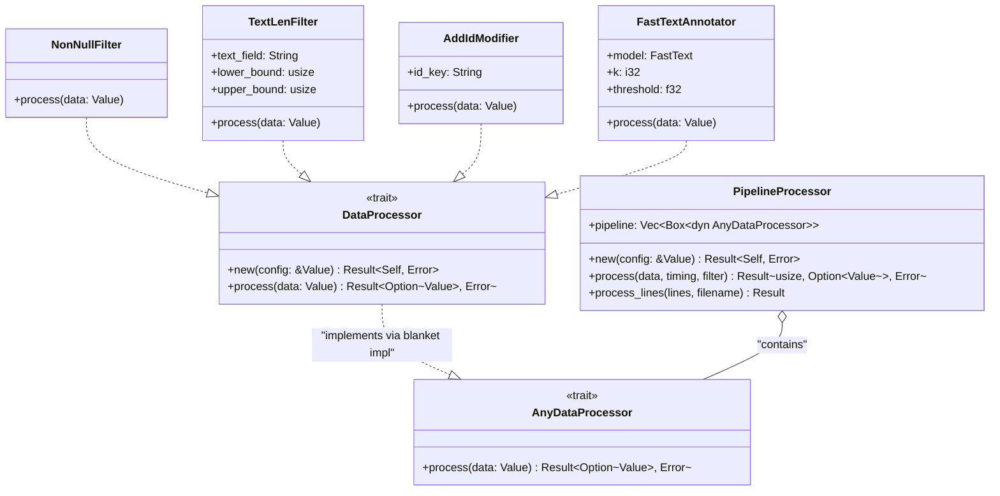
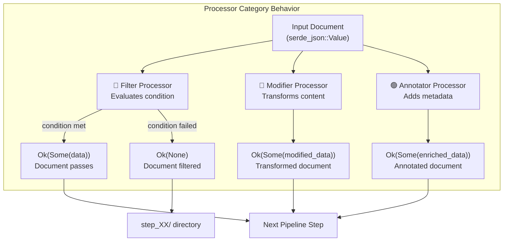
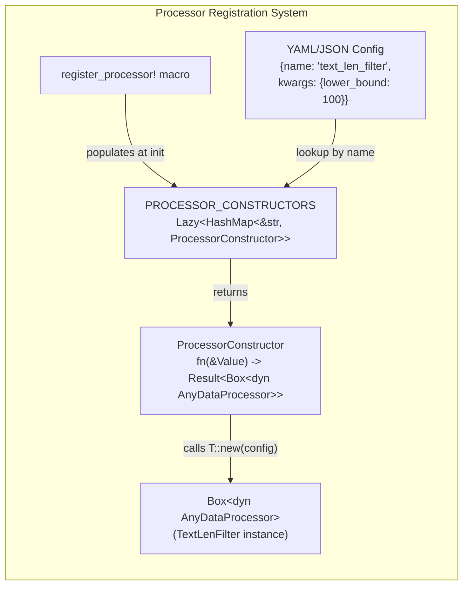
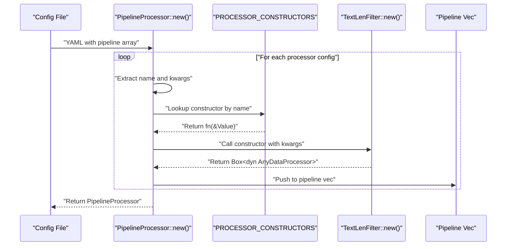
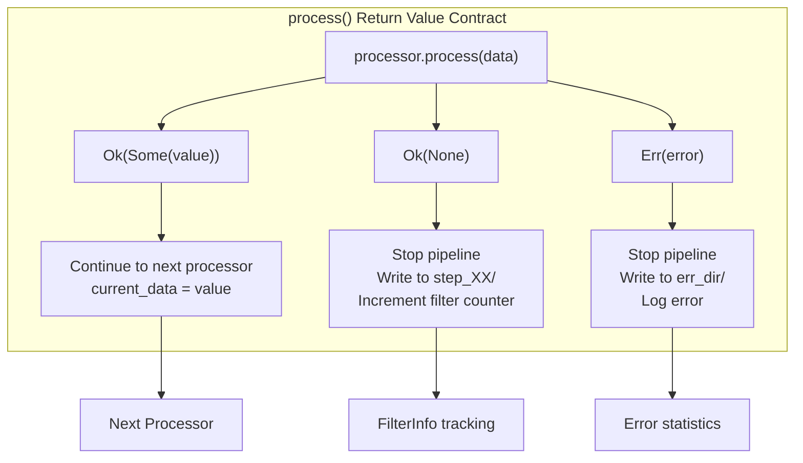

<!-- source: DeepWiki mcp.deepwiki.com · repo allenai/datamap-rs · page 3.2 Processor Types Overview · fetched 2026-10-26 -->

# Processor Types Overview

<details>
<summary>Relevant source files</summary>

The following files were used as context for generating this wiki page:

- [docs/map.md](docs/map.md)
- [src/map_fxn.rs](src/map_fxn.rs)

</details>


This document explains the three fundamental processor categories in the Map pipeline: Filters, Modifiers, and Annotators. It describes the common `DataProcessor` trait, the behavioral contract each category follows, and how processors are instantiated and composed into pipelines.

For details on the pipeline execution model and how processors are chained together, see [Pipeline Architecture](#3.1). For comprehensive references of individual processors, see [Filter Processors Reference](#3.3), [Modifier Processors Reference](#3.4), and [Annotator Processors Reference](#3.5).

---

## The DataProcessor Trait

All processors implement the `DataProcessor` trait, which defines a common contract for document transformation. The trait specifies two required methods that every processor must provide.

**Trait Definition**



Sources: [src/map_fxn.rs:90-102](), [src/map_fxn.rs:230-238]()

### Method: new(config: &Value)

The `new` method is a constructor that receives a `serde_json::Value` containing configuration parameters. This method is responsible for:
- Parsing configuration options
- Loading external resources (banlist files, ML models, regex patterns)
- Initializing internal state
- Returning a fully-constructed processor instance

Each processor uses the `get_default()` utility function to extract configuration values with fallback defaults.

Sources: [src/map_fxn.rs:232-234](), [src/map_fxn.rs:4]()

### Method: process(data: Value)

The `process` method is the core transformation function. It receives a `serde_json::Value` representing a single JSON document and returns `Result<Option<Value>, Error>`.

**Return Value Semantics**

| Return Value | Meaning | Pipeline Behavior |
|--------------|---------|-------------------|
| `Ok(Some(value))` | Processing succeeded, document continues | Pass `value` to next processor |
| `Ok(None)` | Document filtered out | Stop processing, write to `step_XX/` directory |
| `Err(error)` | Processing failed | Write to error directory |

Sources: [src/map_fxn.rs:237](), [src/map_fxn.rs:98-101]()

---

## Three Processor Categories

Processors are conceptually divided into three categories based on their behavioral patterns. While all implement the same `DataProcessor` trait, they follow different conventions for using the return value.



Sources: [src/map_fxn.rs:154-171](), [docs/map.md:89-142]()

### Filters: Conditional Removal

**Behavioral Contract**: Filters evaluate a condition and return `None` to remove documents from the pipeline or `Some(data)` to pass them forward unchanged.

**Common Characteristics**:
- Never modify document content
- Return original document when passing
- Return `None` to trigger filtering
- Document is written to `step_XX/` directory when filtered

**Examples**:

| Processor | Purpose | Configuration Fields |
|-----------|---------|---------------------|
| `NonNullFilter` | Removes null JSON values | None |
| `TextLenFilter` | Filters by text length | `lower_bound`, `upper_bound`, `text_field` |
| `FloatFilter` | Filters by numeric field ranges | `float_field`, `lower_bound`, `upper_bound`, `negate` |
| `SubsampleFilter` | Randomly samples documents | `subsample_rate` |
| `UrlSubstringFilter` | Filters by URL patterns | `url_key`, `banlist_file`, `exact_domain_match`, etc. |
| `MassiveWebRepetitionFilter` | Detects repetitive content | `text_field` |

Sources: [src/map_fxn.rs:243-260](), [src/map_fxn.rs:263-291](), [src/map_fxn.rs:312-331](), [src/map_fxn.rs:649-702]()

### Modifiers: Content Transformation

**Behavioral Contract**: Modifiers transform document content and always return `Some(modified_data)`. They may filter by returning `None` if the transformation results in an empty or invalid document.

**Common Characteristics**:
- Transform document fields (typically the `text_field`)
- Preserve document structure
- May remove lines or characters
- Return `None` only if transformation produces empty content

**Examples**:

| Processor | Purpose | Configuration Fields |
|-----------|---------|---------------------|
| `AddIdModifier` | Adds UUID identifier | `id_key` |
| `NewlineRemovalModifier` | Limits consecutive newlines | `max_consecutive`, `text_field` |
| `RatioLineModifier` | Removes lines with excessive uppercase/digits | `upper_bound`, `check`, `text_field` |
| `RegexLineModifier` | Removes lines matching regex | `regex`, `text_field` |
| `LineLenModifier` | Removes short lines | `lower_bound`, `text_field` |
| `SubstringLineModifier` | Removes banned substrings | `banlist`, `remove_substring_only`, `text_field` |
| `RenameModifier` | Renames fields | `old_field`, `new_field` |

Sources: [src/map_fxn.rs:293-309](), [src/map_fxn.rs:550-584](), [src/map_fxn.rs:1438-1510](), [src/map_fxn.rs:1512-1562](), [src/map_fxn.rs:2461-2483]()

### Annotators: Metadata Enrichment

**Behavioral Contract**: Annotators add metadata fields without removing content. They always return `Some(enriched_data)` unless the enrichment process itself fails (e.g., ML model prediction failure).

**Common Characteristics**:
- Add new fields to document
- Never remove existing fields (except via internal errors)
- Often involve ML models or complex analysis
- Computation-intensive operations

**Examples**:

| Processor | Purpose | Configuration Fields |
|-----------|---------|---------------------|
| `FastTextAnnotator` | Adds ML classification predictions | `fast_text_file`, `output_field`, `k`, `threshold` |
| `WordCountAdder` | Adds word count field | `word_count_field`, `text_field` |
| `HashAnnotator` | Adds hash of field | `hash_source`, `hash_destination`, `num_bits` |
| `ConstantAnnotator` | Adds constant value | `key`, `value` |
| `Madlad400SentenceAnnotator` | Adds sentence-level quality analysis | `fast_text_file`, `langid_field`, `annotation_key`, `rules_to_include` |
| `DDMaxGetter` | Extracts maximum value key | `main_attribute`, `prefix`, `output_attribute` |
| `MaxExtractor` | Extracts maximum from dict | `main_attribute`, `lower_bound`, `output_attribute` |

Sources: [src/map_fxn.rs:586-647](), [src/map_fxn.rs:1405-1436](), [src/map_fxn.rs:2397-2436](), [src/map_fxn.rs:2439-2458](), [src/map_fxn.rs:1753-1966]()

---

## Processor Registration and Construction

Processors are dynamically instantiated from configuration through a registration system using a static constructor map.



Sources: [src/map_fxn.rs:36-88](), [src/map_fxn.rs:48-88]()

### The Registration Macro

The `register_processor!` macro simplifies adding processors to the registry. It creates a closure that:
1. Calls the processor's `new(config)` method
2. Wraps the result in `Box<dyn AnyDataProcessor>`
3. Registers the closure in the static map

**Macro Definition**

[src/map_fxn.rs:38-45]()

**Usage Pattern**

[src/map_fxn.rs:51-86]()

### Static Constructor Map

The `PROCESSOR_CONSTRUCTORS` static variable is a `Lazy<HashMap>` that maps processor names (as strings) to constructor functions. It is initialized once at program startup and contains all available processor types.

**Type Definition**

```rust
type ProcessorConstructor = fn(&Value) -> Result<Box<dyn AnyDataProcessor>, Error>;
static PROCESSOR_CONSTRUCTORS: Lazy<HashMap<&'static str, ProcessorConstructor>>
```

Sources: [src/map_fxn.rs:36](), [src/map_fxn.rs:48-50]()

### Dynamic Instantiation

When `PipelineProcessor::new()` parses a configuration file, it:
1. Iterates through the `pipeline` array in the config
2. Extracts each processor's `name` field
3. Looks up the constructor in `PROCESSOR_CONSTRUCTORS`
4. Calls the constructor with the processor's `kwargs`
5. Collects all processors into a `Vec<Box<dyn AnyDataProcessor>>`

**Pipeline Construction Flow**



Sources: [src/map_fxn.rs:111-135]()

---

## Common Configuration Patterns

### Text Field Configuration

Most processors operate on a text field within the JSON document. The global `text_field` is specified at the pipeline level and automatically injected into each processor's configuration.

**Pipeline-Level Configuration**

```yaml
text_field: "content"  # Default: "text"
pipeline:
  - name: "text_len_filter"
    kwargs:
      lower_bound: 100
      # text_field automatically set to "content"
```

**Implementation**

[src/map_fxn.rs:113-129]()

Sources: [src/map_fxn.rs:113-129](), [docs/map.md:68-84]()

### Default Value Handling

Processors use the `get_default()` utility function to extract configuration with fallback defaults, enabling concise configuration files.

**Example Patterns**

| Processor | Field | Default Value |
|-----------|-------|---------------|
| `TextLenFilter` | `lower_bound` | `0` |
| `TextLenFilter` | `upper_bound` | `usize::MAX` |
| `FloatFilter` | `negate` | `false` |
| `FloatFilter` | `default` | `0.0` |
| `AddIdModifier` | `id_key` | `"id"` |
| `FastTextAnnotator` | `k` | `10` |
| `FastTextAnnotator` | `threshold` | `0.0` |

Sources: [src/map_fxn.rs:272-278](), [src/map_fxn.rs:667-677](), [src/map_fxn.rs:300-301](), [src/map_fxn.rs:606-609]()

### Resource Loading

Processors that require external resources (models, banlists, regex files) load them during construction in the `new()` method.

**Common Resource Types**

| Resource Type | Processors | Loading Pattern |
|---------------|-----------|-----------------|
| FastText models (`.bin`) | `FastTextAnnotator`, `Madlad400SentenceAnnotator` | `FastText::load_model()` |
| Banlist files | `UrlSubstringFilter`, `SubstringLineModifier` | `read_pathbuf_to_mem()` + line iteration |
| Regex pattern files | `Madlad400SentenceAnnotator` | `read_pathbuf_to_mem()` + `Regex::new()` |
| AhoCorasick automata | `UrlSubstringFilter`, `Madlad400SentenceAnnotator` | `AhoCorasick::new(patterns)` |

**Example: UrlSubstringFilter Loading Banlist**

[src/map_fxn.rs:382-395]()

**Example: FastTextAnnotator Loading Model**

[src/map_fxn.rs:600-619]()

Sources: [src/map_fxn.rs:382-395](), [src/map_fxn.rs:600-619](), [src/map_fxn.rs:1806-1847]()

---

## Processing Return Value Contract

The `Result<Option<Value>, Error>` return type encodes three distinct outcomes that drive pipeline execution behavior.



Sources: [src/map_fxn.rs:154-171]()

### Pipeline Execution Logic

The `PipelineProcessor::process()` method implements the sequential pipeline logic:

1. Start with input document
2. For each processor in sequence:
   - Call `processor.process(current_data)`
   - If `Ok(Some(value))`: set `current_data = value`, continue
   - If `Ok(None)`: record filter step, return original document with step index
   - If `Err(e)`: propagate error
3. If all processors pass: return `(usize::MAX, Some(final_data))`

**Key Implementation Details**

[src/map_fxn.rs:137-171]()

- `filter_step` tracks the current processor index
- `og_copy` preserves the original document for filtered output
- `usize::MAX` indicates the document passed all filters
- `FilterInfo` and `TimingInfo` track statistics per step

Sources: [src/map_fxn.rs:137-171](), [src/map_fxn.rs:33-34]()

---

## Trait Object Performance

All processors are stored as trait objects (`Box<dyn AnyDataProcessor>`), which enables dynamic dispatch but has performance implications.

**Trade-offs**

| Aspect | Static Dispatch | Dynamic Dispatch (Current) |
|--------|----------------|---------------------------|
| Flexibility | Fixed at compile time | Configured at runtime |
| Performance | Inline + optimization | Virtual function call overhead |
| Binary Size | Larger (monomorphization) | Smaller |
| Configuration | Requires recompilation | YAML/JSON configs |

The system prioritizes configuration flexibility over raw performance, as the per-processor overhead is minimal compared to actual processing work (file I/O, text parsing, ML inference).

Sources: [src/map_fxn.rs:94-102](), [src/map_fxn.rs:106-107]()

---

