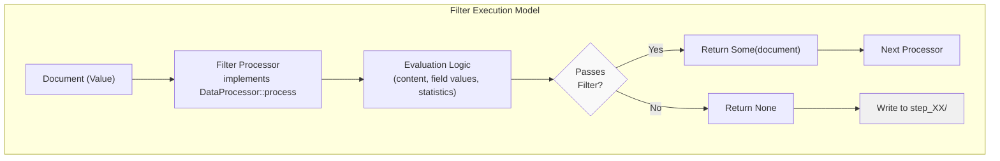
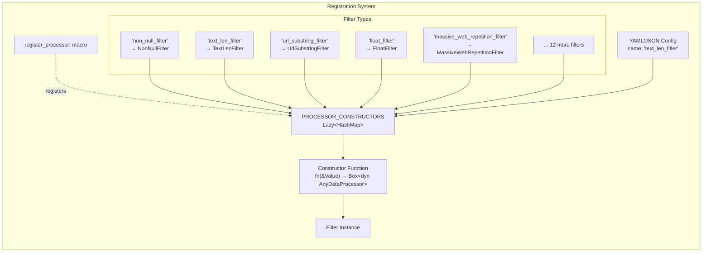
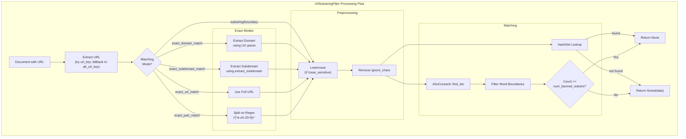
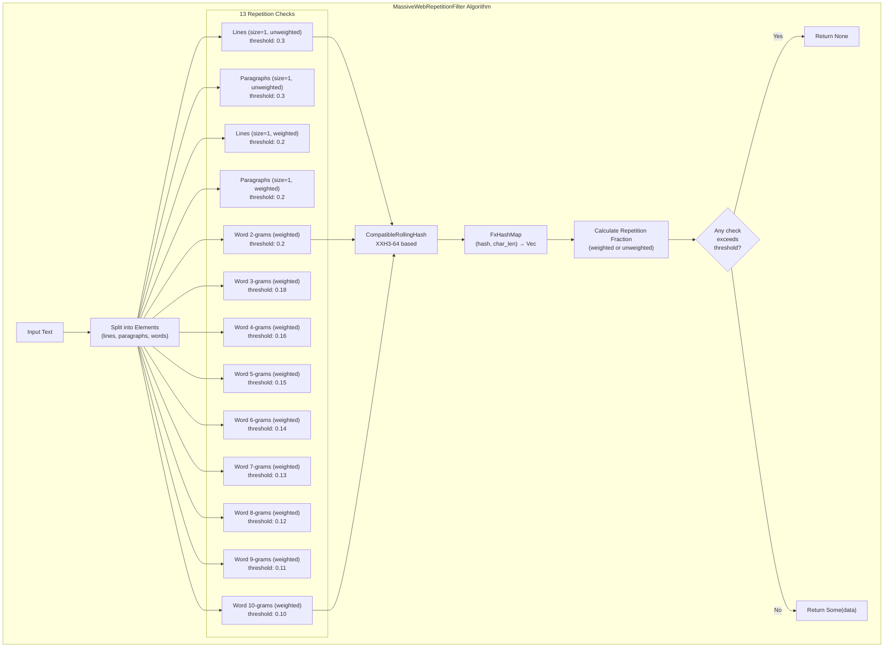

<!-- source: DeepWiki mcp.deepwiki.com · repo allenai/datamap-rs · page 3.3 Filter Processors Reference · fetched 2026-10-26 -->

# Filter Processors Reference

<details>
<summary>Relevant source files</summary>

The following files were used as context for generating this wiki page:

- [docs/map.md](docs/map.md)
- [src/map_fxn.rs](src/map_fxn.rs)
- [tests/map_fxn_tests/fast_text_annotator_test.rs](tests/map_fxn_tests/fast_text_annotator_test.rs)
- [tests/map_fxn_tests/page_len_filter_test.rs](tests/map_fxn_tests/page_len_filter_test.rs)

</details>


## Purpose and Scope

This document provides a complete reference for all **filter processors** available in the datamap-rs pipeline system. Filter processors are components that evaluate documents and return `None` to remove them from the pipeline, or `Some(document)` to allow them to continue. Unlike modifiers which transform content (see [Modifier Processors Reference](#3.4)) or annotators which add metadata (see [Annotator Processors Reference](#3.5)), filters make binary keep/remove decisions.

For information about the overall pipeline architecture and how processors are registered and executed, see [Pipeline Architecture](#3.1). For guidance on configuring pipelines with these filters, see [Pipeline Configuration](#3.6).

---

## Filter Processor Architecture

### How Filters Work

Filter processors implement the `DataProcessor` trait and return `Result<Option<Value>, Error>`. When a filter returns `None`, the document is immediately removed from the pipeline and written to the appropriate `step_XX/` output directory. When a filter returns `Some(document)`, the document proceeds to the next processor.



**Sources:** [src/map_fxn.rs:230-238](), [src/map_fxn.rs:90-102]()

### Filter Registration System

All filters are registered in a static map that enables dynamic instantiation from configuration files. The registration uses a macro-based system that associates string names with constructor functions.



**Sources:** [src/map_fxn.rs:36-45](), [src/map_fxn.rs:48-88]()

---

## Basic Filters

Basic filters provide simple, foundational filtering capabilities based on document structure, field values, or random sampling.

### NonNullFilter

**Purpose:** Removes documents that are JSON null values.

**Configuration Parameters:**
- None

**Struct Definition:** `NonNullFilter` [src/map_fxn.rs:243-260]()

**Example:**
```yaml
pipeline:
  - name: "non_null_filter"
```

**Implementation:** Checks if the document is `null` using `data.is_null()` and returns `None` if true.

**Sources:** [src/map_fxn.rs:243-260]()

---

### TextLenFilter

**Purpose:** Filters documents based on character count in the text field.

**Configuration Parameters:**

| Parameter | Type | Default | Description |
|-----------|------|---------|-------------|
| `text_field` | String | `"text"` | JSON path to the text field |
| `lower_bound` | usize | `0` | Minimum character count (inclusive) |
| `upper_bound` | usize | `usize::MAX` | Maximum character count (inclusive) |

**Struct Definition:** `TextLenFilter` [src/map_fxn.rs:263-291]()

**Example:**
```yaml
pipeline:
  - name: "text_len_filter"
    kwargs:
      lower_bound: 100
      upper_bound: 50000
```

**Implementation:** Extracts text using `json_get`, measures length with `.len()`, and checks bounds.

**Sources:** [src/map_fxn.rs:263-291]()

---

### SubsampleFilter

**Purpose:** Randomly samples documents at a specified rate for statistical subsampling.

**Configuration Parameters:**

| Parameter | Type | Default | Description |
|-----------|------|---------|-------------|
| `subsample_rate` | f64 | `1.0` | Fraction of documents to keep (0.0-1.0) |

**Struct Definition:** `SubsampleFilter` [src/map_fxn.rs:312-331]()

**Example:**
```yaml
pipeline:
  - name: "subsample"
    kwargs:
      subsample_rate: 0.1  # Keep 10% of documents
```

**Implementation:** Generates a random float using `rng().random::<f64>()` and compares to `subsample_rate`.

**Sources:** [src/map_fxn.rs:312-331]()

---

### FloatFilter

**Purpose:** Filters documents based on numeric field values with optional range negation.

**Configuration Parameters:**

| Parameter | Type | Default | Description |
|-----------|------|---------|-------------|
| `float_field` | String | **Required** | JSON path to numeric field |
| `lower_bound` | f32 | `0.0` | Minimum value (inclusive) |
| `upper_bound` | f32 | `f32::MAX` | Maximum value (inclusive) |
| `negate` | bool | `false` | If true, keep only documents OUTSIDE range |
| `default` | f32 | `0.0` | Default value if field missing |

**Struct Definition:** `FloatFilter` [src/map_fxn.rs:649-702]()

**Example:**
```yaml
pipeline:
  # Keep documents with quality score >= 0.7
  - name: "float_filter"
    kwargs:
      float_field: "metadata.quality_score"
      lower_bound: 0.7
  
  # Remove documents with language confidence between 0.3-0.7 (keep low and high)
  - name: "float_filter"
    kwargs:
      float_field: "metadata.language.en"
      lower_bound: 0.3
      upper_bound: 0.7
      negate: true
```

**Implementation:** Uses `json_get` to extract value, applies default if missing, checks bounds, and optionally negates result.

**Sources:** [src/map_fxn.rs:649-702]()

---

### StringEqFilter

**Purpose:** Filters documents based on exact string field equality.

**Configuration Parameters:**

| Parameter | Type | Default | Description |
|-----------|------|---------|-------------|
| `str_field` | String | **Required** | JSON path to string field |
| `eq` | String | **Required** | Value to match |
| `keep_matches` | bool | `true` | If true, keep matches; if false, remove matches |

**Struct Definition:** `StringEqFilter` [src/map_fxn.rs:705-740]()

**Example:**
```yaml
pipeline:
  # Keep only English documents
  - name: "string_eq_filter"
    kwargs:
      str_field: "metadata.language"
      eq: "en"
      keep_matches: true
  
  # Remove spam category
  - name: "string_eq_filter"
    kwargs:
      str_field: "category"
      eq: "spam"
      keep_matches: false
```

**Implementation:** Extracts string value, compares with `eq` parameter, and applies `keep_matches` logic.

**Sources:** [src/map_fxn.rs:705-740]()

---

## Content-Based Filters

Content-based filters analyze document text structure and composition to identify quality issues.

### PageLenFilter

**Purpose:** Filters documents based on length measured in words, sentences, lines, paragraphs, or characters.

**Configuration Parameters:**

| Parameter | Type | Default | Description |
|-----------|------|---------|-------------|
| `text_field` | String | `"text"` | JSON path to text field |
| `length_type` | LengthType | **Required** | One of: `"word"`, `"sentence"`, `"line"`, `"paragraph"`, `"char"` |
| `lower_bound` | usize | `1` | Minimum count (inclusive) |
| `upper_bound` | usize | `usize::MAX` | Maximum count (inclusive) |
| `ignore_punctuation` | bool | `true` | Whether to ignore punctuation in word/char counts |

**Struct Definition:** `PageLenFilter` [src/map_fxn.rs:743-894]()

**Length Type Enum:** `LengthType` [src/map_fxn.rs:752-777]()

**Example:**
```yaml
pipeline:
  # Keep documents with 50-10000 words
  - name: "page_len_filter"
    kwargs:
      length_type: "word"
      lower_bound: 50
      upper_bound: 10000
  
  # Keep documents with at least 5 sentences
  - name: "page_len_filter"
    kwargs:
      length_type: "sentence"
      lower_bound: 5
```

**Implementation:** 
- Word counting: Uses optimized ASCII path [src/map_fxn.rs:831-867]() or Unicode segmentation [src/map_fxn.rs:871-879]()
- Sentence counting: Counts sentence-ending punctuation (`.`, `!`, `?`) [src/map_fxn.rs:881-886]()
- Line counting: Uses `text.lines().count()` [src/map_fxn.rs:826]()
- Paragraph counting: Splits on double newlines [src/map_fxn.rs:888-893]()

**Sources:** [src/map_fxn.rs:743-894](), [tests/map_fxn_tests/page_len_filter_test.rs:1-172]()

---

### WordLenFilter

**Purpose:** Filters documents based on average word length to detect gibberish or unusual character sequences.

**Configuration Parameters:**

| Parameter | Type | Default | Description |
|-----------|------|---------|-------------|
| `text_field` | String | `"text"` | JSON path to text field |
| `lower_bound` | f32 | `0.0` | Minimum average word length |
| `upper_bound` | f32 | `f32::MAX` | Maximum average word length |

**Struct Definition:** `WordLenFilter` [src/map_fxn.rs:897-933]()

**Example:**
```yaml
pipeline:
  # Remove documents with suspiciously short or long words
  - name: "word_len_filter"
    kwargs:
      lower_bound: 3.0
      upper_bound: 10.0
```

**Implementation:** Splits text on whitespace, calculates character length of each word, computes average.

**Sources:** [src/map_fxn.rs:897-933]()

---

### SymbolRatioFilter

**Purpose:** Filters documents by the ratio of special symbols to words, detecting list-heavy or navigation-heavy content.

**Configuration Parameters:**

| Parameter | Type | Default | Description |
|-----------|------|---------|-------------|
| `text_field` | String | `"text"` | JSON path to text field |
| `max_symbol_to_word_ratio` | f32 | `f32::MAX` | Maximum allowed ratio |

**Struct Definition:** `SymbolRatioFilter` [src/map_fxn.rs:935-978]()

**Detected Symbols:**
- `"#"`
- `"..."`
- `". . ."`
- `"\u{2026}"` (Unicode ellipsis)

**Example:**
```yaml
pipeline:
  - name: "symbol_ratio_filter"
    kwargs:
      max_symbol_to_word_ratio: 0.1  # Max 1 symbol per 10 words
```

**Implementation:** Counts occurrences of each symbol using `text.matches(symbol)`, normalizes by word count.

**Sources:** [src/map_fxn.rs:935-978]()

---

### BulletFilter

**Purpose:** Filters documents by the density of lines starting with bullet points, removing list-heavy content.

**Configuration Parameters:**

| Parameter | Type | Default | Description |
|-----------|------|---------|-------------|
| `text_field` | String | `"text"` | JSON path to text field |
| `max_bullet_ratio` | f32 | `f32::MAX` | Maximum fraction of lines with bullets |

**Struct Definition:** `BulletFilter` [src/map_fxn.rs:980-1019]()

**Detected Bullets:**
- `'●'` (filled circle)
- `'•'` (bullet)
- `'*'` (asterisk)
- `'-'` (hyphen)

**Example:**
```yaml
pipeline:
  - name: "bullet_filter"
    kwargs:
      max_bullet_ratio: 0.3  # Reject if >30% of lines are bullets
```

**Implementation:** Splits text into lines, filters lines starting with bullet characters, computes ratio.

**Sources:** [src/map_fxn.rs:980-1019]()

---

### EllipsisLineRatioFilter

**Purpose:** Filters documents by the fraction of lines ending with ellipses, detecting truncated or teaser content.

**Configuration Parameters:**

| Parameter | Type | Default | Description |
|-----------|------|---------|-------------|
| `text_field` | String | `"text"` | JSON path to text field |
| `max_ratio` | f32 | `f32::MAX` | Maximum fraction of lines ending with ellipsis |

**Struct Definition:** `EllipsisLineRatioFilter` [src/map_fxn.rs:1021-1060]()

**Detected Patterns:**
- `"..."`
- `". . ."`
- `"\u{2026}"` (Unicode ellipsis)

**Example:**
```yaml
pipeline:
  - name: "ellipsis_line_ratio_filter"
    kwargs:
      max_ratio: 0.15  # Reject if >15% lines end with ellipsis
```

**Implementation:** Filters lines using `.ends_with()` checks for each ellipsis pattern, computes ratio against total non-empty lines.

**Sources:** [src/map_fxn.rs:1021-1060]()

---

### AlphabeticWordRatioFilter

**Purpose:** Filters documents by the ratio of non-alphabetic words, detecting number-heavy or symbol-heavy content.

**Configuration Parameters:**

| Parameter | Type | Default | Description |
|-----------|------|---------|-------------|
| `text_field` | String | `"text"` | JSON path to text field |
| `max_ratio` | f32 | `f32::MAX` | Maximum fraction of non-alphabetic words |

**Struct Definition:** `AlphabeticWordRatioFilter` [src/map_fxn.rs:1062-1104]()

**Example:**
```yaml
pipeline:
  - name: "alphabetic_word_ratio_filter"
    kwargs:
      max_ratio: 0.4  # Reject if >40% words have no letters
```

**Implementation:** Splits into words, filters words containing no alphabetic characters using `w.chars().any(|c| c.is_alphabetic())`, computes ratio. Automatically rejects single-word documents.

**Sources:** [src/map_fxn.rs:1062-1104]()

---

### StopWordFilter

**Purpose:** Filters documents by the presence of common English stop words, ensuring natural language content.

**Configuration Parameters:**

| Parameter | Type | Default | Description |
|-----------|------|---------|-------------|
| `text_field` | String | `"text"` | JSON path to text field |
| `count_unique` | bool | `false` | If true, count unique stop words; if false, count total |
| `min_stop_word` | usize | `2` | Minimum stop words required |

**Struct Definition:** `StopWordFilter` [src/map_fxn.rs:1107-1191]()

**Stop Words:** `["the", "be", "to", "of", "and", "that", "have", "with"]`

**Example:**
```yaml
pipeline:
  # Ensure at least 5 unique stop words present
  - name: "stop_word_filter"
    kwargs:
      count_unique: true
      min_stop_word: 5
  
  # Ensure at least 10 total stop word occurrences
  - name: "stop_word_filter"
    kwargs:
      count_unique: false
      min_stop_word: 10
```

**Implementation:** Iterates through words, converts to lowercase, checks against static stop word set, counts until threshold reached for early termination.

**Sources:** [src/map_fxn.rs:1107-1191]()

---

### WordRemovalRatioFilter

**Purpose:** Filters documents that lost too many words during prior processing, ensuring content integrity.

**Configuration Parameters:**

| Parameter | Type | Default | Description |
|-----------|------|---------|-------------|
| `text_field` | String | `"text"` | JSON path to text field |
| `word_count_field` | String | **Required** | JSON path to original word count annotation |
| `upper_bound` | f32 | `f32::MAX` | Maximum allowed fraction of words removed |

**Struct Definition:** `WordRemovalRatioFilter` [src/map_fxn.rs:1411-1459]()

**Example:**
```yaml
pipeline:
  # Add word count before line removal
  - name: "word_count_adder"
    kwargs:
      word_count_field: "original_word_count"
  
  # Remove short lines
  - name: "line_len_modifier"
    kwargs:
      lower_bound: 5
  
  # Filter documents that lost >30% of words
  - name: "word_removal_ratio_filter"
    kwargs:
      word_count_field: "original_word_count"
      upper_bound: 0.3
```

**Implementation:** Extracts original word count from annotation, calculates current word count, computes removal ratio, compares to threshold.

**Sources:** [src/map_fxn.rs:1411-1459]()

---

## Advanced Filters

Advanced filters implement sophisticated algorithms for URL filtering, repetition detection, and quality scoring.

### UrlSubstringFilter

**Purpose:** Comprehensive URL filtering with multiple matching modes, domain/subdomain extraction, and banlist support.

**Configuration Parameters:**

| Parameter | Type | Default | Description |
|-----------|------|---------|-------------|
| `url_key` | String | **Required** | JSON path to URL field |
| `alt_url_key` | String | `"ALT_URL_KEY"` | Fallback URL field if primary missing |
| `banlist_file` | String | **Required** | Path to newline-separated banlist file |
| `exact_domain_match` | bool | `false` | Extract domain and check for exact match |
| `exact_subdomain_match` | bool | `false` | Extract subdomain and check for exact match |
| `exact_url_match` | bool | `false` | Check full URL for exact match |
| `exact_part_match` | bool | `false` | Split URL into parts and check each |
| `match_substrings` | bool | `true` | Allow substring matching (vs word boundaries) |
| `case_sensitive` | bool | `false` | Perform case-sensitive matching |
| `ignore_chars` | Vec\<String\> | `[]` | Characters to remove before matching |
| `num_banned_substrs` | usize | `1` | Number of banlist hits required to filter |

**Struct Definition:** `UrlSubstringFilter` [src/map_fxn.rs:333-547]()



**Example:**
```yaml
pipeline:
  # Exact domain matching against banlist
  - name: "url_substring_filter"
    kwargs:
      url_key: "url"
      banlist_file: "./banlists/adult_domains.txt"
      exact_domain_match: true
  
  # Substring matching with word boundaries
  - name: "url_substring_filter"
    kwargs:
      url_key: "url"
      banlist_file: "./banlists/spam_keywords.txt"
      match_substrings: false  # Require word boundaries
      num_banned_substrs: 2    # Need 2+ hits to filter
      ignore_chars: [".", "-", "_"]
  
  # Subdomain filtering
  - name: "url_substring_filter"
    kwargs:
      url_key: "metadata.source_url"
      banlist_file: "./banlists/cdn_subdomains.txt"
      exact_subdomain_match: true
```

**Implementation Details:**
- **Domain extraction:** Uses `url::Url::parse` to extract host [src/map_fxn.rs:413-418]()
- **Subdomain extraction:** Uses `extract_subdomain` utility [src/map_fxn.rs:419-425]()
- **Banlist loading:** Reads file into `HashSet<String>` [src/map_fxn.rs:382-393]()
- **Substring matching:** Uses `AhoCorasick` multi-pattern automaton [src/map_fxn.rs:518-524]()
- **Word boundary detection:** Checks `is_alphanumeric()` at match edges [src/map_fxn.rs:475-487]()

**Sources:** [src/map_fxn.rs:333-547]()

---

### MassiveWebRepetitionFilter

**Purpose:** Advanced repetition detection using rolling hash algorithm based on the Gopher paper methodology. Detects documents with excessive repeated lines, paragraphs, or word n-grams.

**Configuration Parameters:**

| Parameter | Type | Default | Description |
|-----------|------|---------|-------------|
| `text_field` | String | `"text"` | JSON path to text field |

**Struct Definition:** `MassiveWebRepetitionFilter` [src/map_fxn.rs:1195-1397]()

**Rolling Hash Implementation:** `CompatibleRollingHash` [src/map_fxn.rs:1399-1463]()



**Example:**
```yaml
pipeline:
  - name: "massive_web_repetition_filter"
```

**Implementation Details:**

The filter runs 13 separate repetition checks [src/map_fxn.rs:1216-1230]():

1. **Single Element Checks (size=1):**
   - Lines unweighted: max 30% repeated
   - Paragraphs unweighted: max 30% repeated  
   - Lines weighted by character length: max 20%
   - Paragraphs weighted by character length: max 20%

2. **Word N-gram Checks (size=2-10, weighted):**
   - Decreasing thresholds from 20% (2-grams) to 10% (10-grams)
   - For n-grams ≥ 4, uses most common n-gram only
   - For n-grams < 4, uses all repeated n-grams

**Rolling Hash Mechanism:**
- Uses XXH3-64 hash function [src/map_fxn.rs:1446-1447]()
- Maintains fixed-size window of elements
- Tracks hash and total character length of window
- Enables efficient n-gram duplicate detection

**Weighted vs Unweighted:**
- **Unweighted:** Count of repeated elements / total elements
- **Weighted:** Character length of repeated content / total character length

**Sources:** [src/map_fxn.rs:1195-1397](), [src/map_fxn.rs:1399-1463]()

---

### Madlad400RuleFilter

**Purpose:** Filters documents based on sentence-level quality annotations produced by `Madlad400SentenceAnnotator`.

**Configuration Parameters:**

| Parameter | Type | Default | Description |
|-----------|------|---------|-------------|
| `text_field` | String | `"text"` | JSON path to text field |
| `sentence_annotations_field` | String | **Required** | JSON path to sentence annotations |
| `require_doc_consistency` | bool | `false` | Require consistent language across sentences |
| `allow_list_case` | bool | `true` | Allow list-style casing patterns |
| `allow_abnormal_line_lengths` | bool | `true` | Allow lines with abnormal length distribution |
| `allow_tech_chars` | bool | `true` | Allow technical characters |
| `allow_cursed` | bool | `true` | Allow documents with "cursed" patterns |

**Struct Definition:** `Madlad400RuleFilter` [src/map_fxn.rs:1465-1532]()

**Example:**
```yaml
pipeline:
  # First annotate sentences
  - name: "madlad400_sentence_annotator"
    kwargs:
      fast_text_file: "./models/madlad400.bin"
      output_field: "metadata.sentence_quality"
  
  # Then apply quality rules
  - name: "madlad400_rule_filter"
    kwargs:
      sentence_annotations_field: "metadata.sentence_quality"
      require_doc_consistency: true
      allow_list_case: false
      allow_abnormal_line_lengths: false
```

**Quality Checks:**
- `doc_consistent`: All sentences have same predicted language
- `list_case`: Unusual casing suggesting list content
- `abnormal_line_lengths`: Lines with abnormal length distribution
- `has_tech_chars`: Contains technical characters
- `cursed`: Matches suspicious patterns

**Implementation:** Extracts boolean flags from annotation field, applies logical AND/OR based on configuration.

**Sources:** [src/map_fxn.rs:1465-1532]()

---

### IntervalFilter

**Purpose:** Removes text within specified character intervals with optional fuzzy interval merging.

**Configuration Parameters:**

| Parameter | Type | Default | Description |
|-----------|------|---------|-------------|
| `text_field` | String | `"text"` | JSON path to text field |
| `interval_field` | String | **Required** | JSON path to array of `[start, end]` intervals |
| `fuzziness` | Option\<usize\> | `None` | If set, merge intervals within this distance |

**Struct Definition:** `IntervalFilter` [src/map_fxn.rs:1534-1629]()

```mermaid
graph TB
    subgraph "IntervalFilter Processing"
        Doc["Document with Intervals"]
        ExtractIntervals["Extract Intervals<br/>from interval_field"]
        HasFuzz{"fuzziness<br/>set?"}
        
        subgraph "Fuzzy Merging"
            SortIntervals["Sort by start position"]
            MergeLoop["Iterate & Merge<br/>if gap < fuzziness"]
            Merged["Merged Intervals"]
        end
        
        Invert["Invert Intervals<br/>to keep-ranges"]
        ExtractText["Extract Text<br/>for each keep-range"]
        Join["Join with space"]
        Replace["Replace text_field"]
        
        Check{"Text<br/>empty?"}
        Filter["Return None"]
        Return["Return Some(data)"]
    end
    
    Doc --> ExtractIntervals
    ExtractIntervals --> HasFuzz
    
    HasFuzz -->|Yes| SortIntervals
    SortIntervals --> MergeLoop
    MergeLoop --> Merged
    Merged --> Invert
    
    HasFuzz -->|No| Invert
    
    Invert --> ExtractText
    ExtractText --> Join
    Join --> Replace
    Replace --> Check
    
    Check -->|Yes| Filter
    Check -->|No| Return
```



**Example:**
```yaml
pipeline:
  # Remove PII intervals (exact)
  - name: "interval_filter"
    kwargs:
      interval_field: "metadata.pii_spans"
  
  # Remove with fuzzy merging (merge intervals within 20 chars)
  - name: "interval_filter"
    kwargs:
      interval_field: "metadata.low_quality_spans"
      fuzziness: 20
```

**Implementation Details:**
- **Interval format:** Array of `[start, end]` tuples in JSON
- **Fuzzy merging:** Sorts intervals, merges if gap ≤ fuzziness [src/map_fxn.rs:1583-1605]()
- **Inversion:** Converts remove-intervals to keep-intervals [src/map_fxn.rs:1607-1617]()
- **Text extraction:** Extracts substrings for each keep-interval, joins with space

**Sources:** [src/map_fxn.rs:1534-1629]()

---

## Filter Comparison Table

### Basic Filters Summary

| Filter Name | Primary Use Case | Configuration Complexity | Performance Impact |
|-------------|------------------|-------------------------|-------------------|
| `non_null_filter` | Remove null documents | Minimal (no config) | Negligible |
| `text_len_filter` | Length-based filtering | Low (2 params) | Negligible |
| `subsample` | Statistical sampling | Low (1 param) | Negligible |
| `float_filter` | Numeric threshold filtering | Medium (5 params) | Low |
| `string_eq_filter` | Categorical filtering | Low (3 params) | Negligible |

### Content-Based Filters Summary

| Filter Name | Primary Use Case | Configuration Complexity | Performance Impact |
|-------------|------------------|-------------------------|-------------------|
| `page_len_filter` | Multi-unit length filtering | Medium (5 params) | Low-Medium |
| `word_len_filter` | Average word length | Low (3 params) | Low |
| `symbol_ratio_filter` | Symbol density | Low (2 params) | Low |
| `bullet_filter` | List content detection | Low (2 params) | Low |
| `ellipsis_line_ratio_filter` | Truncated content | Low (2 params) | Low |
| `alphabetic_word_ratio_filter` | Non-text content | Low (2 params) | Low |
| `stop_word_filter` | Natural language detection | Low (3 params) | Medium |
| `word_removal_ratio_filter` | Processing integrity | Low (3 params) | Low |

### Advanced Filters Summary

| Filter Name | Primary Use Case | Configuration Complexity | Performance Impact |
|-------------|------------------|-------------------------|-------------------|
| `url_substring_filter` | URL-based filtering | High (12 params) | Medium-High |
| `massive_web_repetition_filter` | Repetition detection | Minimal (1 param) | High |
| `madlad400_rule_filter` | ML-based quality | Medium (6 params) | Low (requires annotator) |
| `interval_filter` | Span removal | Low (3 params) | Medium |

**Sources:** [src/map_fxn.rs:48-88](), [docs/map.md:88-115]()

---

## Common Filter Patterns

### Quality Pipeline Pattern

```yaml
pipeline:
  # 1. Structural validity
  - name: "non_null_filter"
  
  # 2. Basic length constraints
  - name: "text_len_filter"
    kwargs:
      lower_bound: 200
      upper_bound: 100000
  
  # 3. Natural language detection
  - name: "stop_word_filter"
    kwargs:
      min_stop_word: 5
  
  # 4. Content quality
  - name: "alphabetic_word_ratio_filter"
    kwargs:
      max_ratio: 0.3
  
  # 5. Repetition removal
  - name: "massive_web_repetition_filter"
```

### URL Filtering Pattern

```yaml
pipeline:
  # Stage 1: Domain banlist (fast)
  - name: "url_substring_filter"
    kwargs:
      url_key: "url"
      banlist_file: "./banlists/blocked_domains.txt"
      exact_domain_match: true
  
  # Stage 2: Keyword filtering (slower)
  - name: "url_substring_filter"
    kwargs:
      url_key: "url"
      banlist_file: "./banlists/spam_keywords.txt"
      match_substrings: true
      num_banned_substrs: 2
```

### Language Filtering Pattern

```yaml
pipeline:
  # Annotate language
  - name: "fasttext_annotator"
    kwargs:
      fast_text_file: "./models/lid176.bin"
      output_field: "metadata.lang"
      k: 1
  
  # Filter by confidence
  - name: "float_filter"
    kwargs:
      float_field: "metadata.lang.__label__en"
      lower_bound: 0.7
```

**Sources:** [docs/map.md:152-192]()

---

## Performance Considerations

### Filter Ordering Strategy

1. **Cheapest First:** Place simple filters (`non_null_filter`, `text_len_filter`) early to reduce documents
2. **Most Selective:** Place filters that remove most documents early in pipeline
3. **Expensive Last:** Place computationally expensive filters (`massive_web_repetition_filter`, `url_substring_filter`) after cheaper filters

### Memory Usage

- **Static data:** Banlists and models loaded once at startup per filter instance
- **Per-document:** Only current document in memory during filter evaluation
- **URL filter:** AhoCorasick automaton built once, reused for all documents

### Parallelism

- **File-level:** Each input file processed independently by worker thread
- **Document-level:** Documents processed sequentially through filter chain
- **Filter-level:** Each filter instance shared (read-only) across all threads

**Sources:** [src/map_fxn.rs:137-171](), [src/main.rs:1-100]()

---

## Implementation Reference

### Trait Requirements

All filters implement the `DataProcessor` trait:

```rust
pub trait DataProcessor {
    fn new(config: &Value) -> Result<Self, Error>
    where
        Self: Sized;

    fn process(&self, data: Value) -> Result<Option<Value>, Error>;
}
```

**Sources:** [src/map_fxn.rs:230-238]()

### Type Wrapping

Filters are wrapped in `Box<dyn AnyDataProcessor>` for dynamic dispatch:

```rust
pub trait AnyDataProcessor: Send + Sync + std::fmt::Debug {
    fn process(&self, data: Value) -> Result<Option<Value>, Error>;
}
```

**Sources:** [src/map_fxn.rs:90-102]()

### Constructor Pattern

The registration macro wraps constructors:

```rust
macro_rules! register_processor {
    ($map:expr, $name:expr, $processor_type:ty) => {
        $map.insert($name, |config| {
            let processor = <$processor_type>::new(config).unwrap();
            Ok(Box::new(processor) as Box<dyn AnyDataProcessor>)
        });
    };
}
```

**Sources:** [src/map_fxn.rs:38-45]()

---

## Error Handling

Filters can signal errors in three ways:

1. **Return `Ok(None)`:** Document filtered out (normal operation)
2. **Return `Ok(Some(data))`:** Document passes filter
3. **Return `Err(error)`:** Processing error (document written to `err_dir`)

**Sources:** [src/map_fxn.rs:156-165](), [src/map_fxn.rs:194-211]()

---

