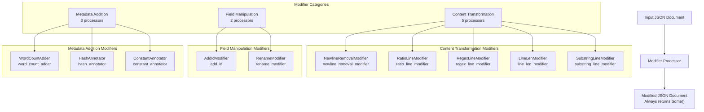
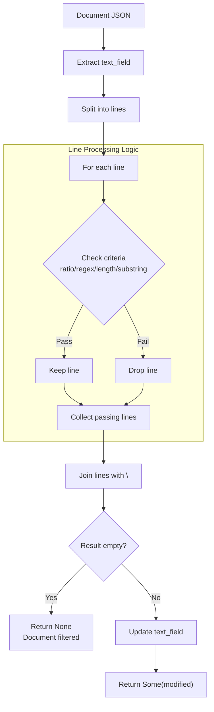
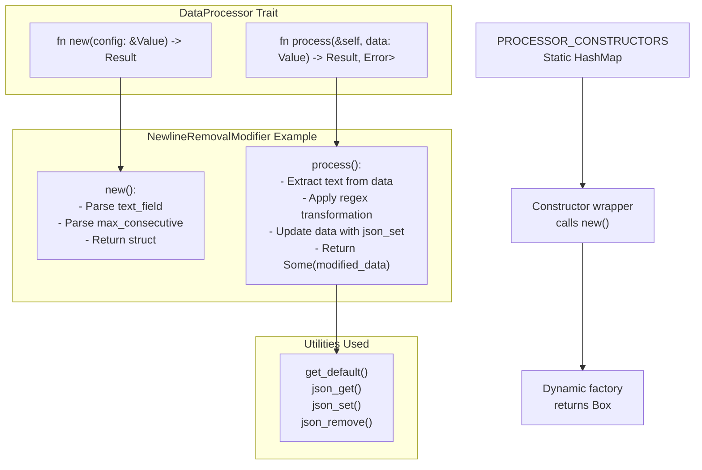

<!-- source: DeepWiki mcp.deepwiki.com · repo allenai/datamap-rs · page 3.4 Modifier Processors Reference · fetched 2026-10-26 -->

# Modifier Processors Reference

<details>
<summary>Relevant source files</summary>

The following files were used as context for generating this wiki page:

- [docs/map.md](docs/map.md)
- [src/map_fxn.rs](src/map_fxn.rs)

</details>


This page provides a comprehensive reference for all modifier processors in datamap-rs. Modifiers transform document content or structure, always returning a modified document (rather than filtering it out). For processors that remove documents, see [Filter Processors Reference](#3.3). For processors that add ML-derived metadata, see [Annotator Processors Reference](#3.5).

**Sources:** [src/map_fxn.rs:1-2484]()

## Overview

Modifier processors implement the `DataProcessor` trait and transform JSON documents by:
- **Content transformation**: Modifying text field content (removing lines, controlling formatting)
- **Field manipulation**: Adding, renaming, or restructuring JSON fields
- **Metadata addition**: Computing and adding derived values (counts, hashes, constants)

Unlike filters which return `None` to remove documents, modifiers always return `Some(modified_data)`. They may still filter out documents if the transformation results in empty content (e.g., removing all lines leaves an empty document).

**Sources:** [src/map_fxn.rs:230-238](), [src/map_fxn.rs:90-102]()

---

## Modifier Architecture



**Sources:** [src/map_fxn.rs:48-88](), [src/map_fxn.rs:294-2483]()

---

## Content Transformation Modifiers

These modifiers operate on text content, typically transforming the `text_field` by filtering or modifying individual lines.

### NewlineRemovalModifier

Controls the maximum number of consecutive newlines in text, preventing excessive whitespace.

**Configuration Name:** `newline_removal_modifier`

**Implementation:** [src/map_fxn.rs:551-584]()

#### Fields

| Field | Type | Default | Description |
|-------|------|---------|-------------|
| `text_field` | String | `"text"` | Field containing text to modify |
| `max_consecutive` | usize | `2` | Maximum allowed consecutive newlines |

#### Behavior

Uses regex pattern to replace sequences of more than `max_consecutive` newlines with exactly `max_consecutive` newlines. The pattern is `\n{max_consecutive+1,}`.

#### Configuration Example

```yaml
- name: "newline_removal_modifier"
  kwargs:
    text_field: "text"
    max_consecutive: 2
```

**Sources:** [src/map_fxn.rs:551-584]()

---

### RatioLineModifier

Removes lines with excessive uppercase characters or digits, useful for filtering headers, navigation elements, or machine-generated content.

**Configuration Name:** `ratio_line_modifier`

**Implementation:** [src/map_fxn.rs:1438-1510]()

#### Fields

| Field | Type | Required | Description |
|-------|------|----------|-------------|
| `text_field` | String | No | Field containing text to modify |
| `upper_bound` | f32 | **Yes** | Maximum ratio (0.0-1.0) allowed |
| `check` | String | **Yes** | Type of check: `"uppercase"` or `"numeric"` |

#### Behavior

For each line:
1. Calculate ratio of uppercase chars (or digits) to total line length
2. Keep line only if ratio ≤ `upper_bound`
3. Empty lines are always preserved

#### Configuration Example

```yaml
# Remove lines that are >60% uppercase
- name: "ratio_line_modifier"
  kwargs:
    text_field: "text"
    upper_bound: 0.6
    check: "uppercase"
```

**Sources:** [src/map_fxn.rs:1438-1510]()

---

### RegexLineModifier

Removes lines matching a regex pattern (case-insensitive). Defaults to removing social media counter lines.

**Configuration Name:** `regex_line_modifier`

**Implementation:** [src/map_fxn.rs:1512-1562]()

#### Fields

| Field | Type | Default | Description |
|-------|------|---------|-------------|
| `text_field` | String | `"text"` | Field containing text to modify |
| `regex` | String | Counter pattern | Regex pattern to match |

#### Default Pattern

The default regex removes social media counter lines:
```
^\W*\d(?:,|\.|\d)*(?:K|k|M|m|B|b)?\s+(?:likes|shares|comments|retweets|reposts|quotes|bookmarks|upvotes|downvotes|downloads|views|followers)\W*$
```

#### Behavior

1. Convert each line to lowercase
2. Check if regex matches
3. Keep only non-matching lines
4. **Filters document** (returns `None`) if all lines removed

#### Configuration Example

```yaml
# Remove lines containing URLs
- name: "regex_line_modifier"
  kwargs:
    text_field: "text"
    regex: "https?://[^\s]+"
```

**Sources:** [src/map_fxn.rs:1512-1562]()

---

### LineLenModifier

Removes lines with fewer than a minimum number of words.

**Configuration Name:** `line_len_modifier`

**Implementation:** [src/map_fxn.rs:1564-1608]()

#### Fields

| Field | Type | Default | Description |
|-------|------|---------|-------------|
| `text_field` | String | `"text"` | Field containing text to modify |
| `lower_bound` | usize | `0` | Minimum word count per line |

#### Behavior

1. Count words per line using Unicode word segmentation
2. Keep lines with ≥ `lower_bound` words
3. Empty lines (len == 0) are always preserved
4. **Filters document** (returns `None`) if all text removed

#### Configuration Example

```yaml
# Remove lines with fewer than 3 words
- name: "line_len_modifier"
  kwargs:
    text_field: "text"
    lower_bound: 3
```

**Sources:** [src/map_fxn.rs:1564-1608]()

---

### SubstringLineModifier

Removes lines containing banned substrings, or removes just the substrings themselves. Supports positional matching (prefix/suffix/anywhere).

**Configuration Name:** `substring_line_modifier`

**Implementation:** [src/map_fxn.rs:1610-1706]()

#### Fields

| Field | Type | Required | Description |
|-------|------|----------|-------------|
| `text_field` | String | No | Field containing text to modify |
| `banlist` | String | **Yes** | Regex pattern of banned substrings |
| `max_len` | usize | No | Only process lines ≤ this word count |
| `remove_substring_only` | bool | No (default: true) | If true, remove substring; if false, remove entire line |
| `location` | String | No (default: `"any"`) | Where to match: `"prefix"`, `"suffix"`, or `"any"` |

#### Behavior

Uses `OnceCell<Regex>` to lazily compile regex pattern on first use. For each line:
1. Check word count against `max_len` (skip processing if too long)
2. If `remove_substring_only == true`: Replace matching substrings with appropriate separator
3. If `remove_substring_only == false`: Remove entire line if match found
4. Filter out empty lines (after trimming)

#### Regex Pattern by Location

| Location | Pattern | Replacement |
|----------|---------|-------------|
| `"prefix"` | `^(?:banlist)\s?` | `""` |
| `"suffix"` | `\s?(?:banlist)$` | `""` |
| `"any"` | `\s?(?:banlist)\s?` | `" "` |

#### Configuration Example

```yaml
# Remove attribution lines at end of articles
- name: "substring_line_modifier"
  kwargs:
    text_field: "text"
    banlist: "Posted by|Written by|Copyright"
    max_len: 20
    remove_substring_only: false
    location: "prefix"
```

**Sources:** [src/map_fxn.rs:1610-1706]()

---

## Line-Based Modifier Flow



**Sources:** [src/map_fxn.rs:1470-1509](), [src/map_fxn.rs:1536-1561](), [src/map_fxn.rs:1582-1607](), [src/map_fxn.rs:1662-1704]()

---

## Field Manipulation Modifiers

These modifiers restructure JSON documents by adding or renaming fields.

### AddIdModifier

Adds a UUID4 identifier to documents, useful for tracking documents through pipelines or creating unique identifiers.

**Configuration Name:** `add_id`

**Implementation:** [src/map_fxn.rs:294-309]()

#### Fields

| Field | Type | Default | Description |
|-------|------|---------|-------------|
| `id_key` | String | `"id"` | Field name where UUID will be stored |

#### Behavior

Generates a new UUID4 using `Uuid::new_v4()` and stores it as a string at the specified field path. Uses `json_set` utility for nested path support (e.g., `"metadata.id"`).

#### Configuration Example

```yaml
- name: "add_id"
  kwargs:
    id_key: "metadata.document_id"
```

**Sources:** [src/map_fxn.rs:294-309]()

---

### RenameModifier

Renames a field in the JSON document, moving the value from one path to another.

**Configuration Name:** `rename_modifier`

**Implementation:** [src/map_fxn.rs:2461-2483]()

#### Fields

| Field | Type | Required | Description |
|-------|------|----------|-------------|
| `old_field` | String | **Yes** | Path to field to rename |
| `new_field` | String | **Yes** | New path for field |

#### Behavior

1. Read value from `old_field` using `json_get`
2. Write value to `new_field` using `json_set`
3. Remove `old_field` using `json_remove`

Supports nested paths (e.g., `"metadata.old_name"` → `"attributes.new_name"`).

#### Configuration Example

```yaml
- name: "rename_modifier"
  kwargs:
    old_field: "url"
    new_field: "metadata.source_url"
```

**Sources:** [src/map_fxn.rs:2461-2483]()

---

## Metadata Addition Modifiers

These modifiers compute and add derived values to documents.

### WordCountAdder

Counts Unicode words in text field and stores the count. Essential for tracking word removal through pipelines (used with `WordRemovalRatioFilter`).

**Configuration Name:** `word_count_adder`

**Implementation:** [src/map_fxn.rs:1406-1436]()

#### Fields

| Field | Type | Default | Description |
|-------|------|---------|-------------|
| `text_field` | String | `"text"` | Field to count words from |
| `word_count_field` | String | `"original_word_count"` | Where to store count |

#### Behavior

Uses `unicode_words()` iterator to count words, properly handling non-ASCII text. Stores count as JSON number.

#### Configuration Example

```yaml
- name: "word_count_adder"
  kwargs:
    text_field: "text"
    word_count_field: "metadata.word_count"
```

#### Typical Pipeline Pattern

```yaml
pipeline:
  # Store original count before modifications
  - name: "word_count_adder"
    kwargs:
      word_count_field: "original_word_count"
  
  # Apply content modifications
  - name: "line_len_modifier"
    kwargs:
      lower_bound: 5
  
  # Filter if too many words removed
  - name: "word_removal_ratio_filter"
    kwargs:
      word_count_field: "original_word_count"
      upper_bound: 0.3
```

**Sources:** [src/map_fxn.rs:1406-1436]()

---

### HashAnnotator

Computes XXH3 hash of a field and stores it, useful for deduplication tracking or content fingerprinting.

**Configuration Name:** `hash_annotator`

**Implementation:** [src/map_fxn.rs:2397-2436]()

#### Fields

| Field | Type | Default | Description |
|-------|------|---------|-------------|
| `hash_source` | String | `"text"` | Field to hash |
| `hash_destination` | String | `"metadata.text_hash"` | Where to store hash |
| `num_bits` | usize | `128` | Hash size: `64` or `128` |

#### Behavior

- **64-bit**: Uses `xxh3_64`, stores as JSON number
- **128-bit**: Uses `xxh3_128`, stores as string (due to JSON number limitations)

Hash functions from `xxhash_rust::xxh3`.

#### Configuration Example

```yaml
# Create 128-bit content fingerprint
- name: "hash_annotator"
  kwargs:
    hash_source: "text"
    hash_destination: "content_hash"
    num_bits: 128
```

**Sources:** [src/map_fxn.rs:2397-2436](), [src/map_fxn.rs:26]()

---

### ConstantAnnotator

Adds a constant string value to all documents, useful for labeling documents with dataset source or processing batch.

**Configuration Name:** `constant_annotator`

**Implementation:** [src/map_fxn.rs:2439-2458]()

#### Fields

| Field | Type | Required | Description |
|-------|------|----------|-------------|
| `key` | String | **Yes** | Field path where constant is stored |
| `value` | String | **Yes** | Constant string value to add |

#### Configuration Example

```yaml
- name: "constant_annotator"
  kwargs:
    key: "metadata.source"
    value: "common_crawl_2024_01"
```

**Sources:** [src/map_fxn.rs:2439-2458]()

---

## Modifier Implementation Pattern



**Sources:** [src/map_fxn.rs:36-88](), [src/map_fxn.rs:230-238](), [src/map_fxn.rs:4]()

---

## Common Configuration Patterns

### Track Changes Through Pipeline

```yaml
pipeline:
  # Add initial metrics
  - name: "add_id"
    kwargs:
      id_key: "pipeline_id"
  
  - name: "word_count_adder"
    kwargs:
      word_count_field: "original_words"
  
  - name: "hash_annotator"
    kwargs:
      hash_source: "text"
      hash_destination: "original_hash"
      num_bits: 64
  
  # Apply transformations
  - name: "line_len_modifier"
    kwargs:
      lower_bound: 3
  
  # Verify changes
  - name: "word_removal_ratio_filter"
    kwargs:
      word_count_field: "original_words"
      upper_bound: 0.5
```

### Clean Social Media Content

```yaml
pipeline:
  # Remove counter lines
  - name: "regex_line_modifier"
    kwargs:
      regex: "^\\W*\\d(?:,|\\.|\\d)*(?:K|M|B)?\\s+(?:likes|shares|views)\\W*$"
  
  # Remove short lines (probably buttons/links)
  - name: "line_len_modifier"
    kwargs:
      lower_bound: 4
  
  # Control excessive newlines
  - name: "newline_removal_modifier"
    kwargs:
      max_consecutive: 2
  
  # Remove attribution prefixes
  - name: "substring_line_modifier"
    kwargs:
      banlist: "Posted by|Shared by|Reposted by"
      remove_substring_only: true
      location: "prefix"
      max_len: 20
```

### Metadata Enrichment

```yaml
pipeline:
  # Add processing metadata
  - name: "constant_annotator"
    kwargs:
      key: "metadata.pipeline_version"
      value: "v2.1"
  
  - name: "add_id"
    kwargs:
      id_key: "metadata.processing_id"
  
  - name: "hash_annotator"
    kwargs:
      hash_source: "text"
      hash_destination: "metadata.content_fingerprint"
      num_bits: 128
  
  # Reorganize fields
  - name: "rename_modifier"
    kwargs:
      old_field: "url"
      new_field: "metadata.source_url"
```

---

## Registration and Construction

All modifiers are registered in the static `PROCESSOR_CONSTRUCTORS` map at compile time:

```rust
register_processor!(m, "add_id", AddIdModifier);
register_processor!(m, "newline_removal_modifier", NewlineRemovalModifier);
register_processor!(m, "word_count_adder", WordCountAdder);
register_processor!(m, "ratio_line_modifier", RatioLineModifier);
register_processor!(m, "regex_line_modifier", RegexLineModifier);
register_processor!(m, "line_len_modifier", LineLenModifier);
register_processor!(m, "substring_line_modifier", SubstringLineModifier);
register_processor!(m, "hash_annotator", HashAnnotator);
register_processor!(m, "constant_annotator", ConstantAnnotator);
register_processor!(m, "rename_modifier", RenameModifier);
```

The `register_processor!` macro wraps each processor's `new()` method in a constructor function that returns `Box<dyn AnyDataProcessor>`.

**Sources:** [src/map_fxn.rs:38-88](), [src/map_fxn.rs:48]()

---

## Performance Considerations

### Memory Efficiency

- **Line-based modifiers** operate on borrowed string slices when possible
- **Regex compilation** cached using `OnceCell<Regex>` in `SubstringLineModifier`
- **Hash computation** uses fast XXH3 algorithm optimized for throughput

### Processing Characteristics

| Modifier | Complexity | Memory Impact |
|----------|-----------|---------------|
| `NewlineRemovalModifier` | O(n) | Single regex allocation |
| `RatioLineModifier` | O(n×m) lines×chars | Minimal |
| `RegexLineModifier` | O(n×m) lines×pattern | Single regex allocation |
| `LineLenModifier` | O(n) | Word iteration |
| `SubstringLineModifier` | O(n×m) lines×pattern | OnceCell regex cache |
| `AddIdModifier` | O(1) | UUID generation |
| `RenameModifier` | O(1) | Field cloning |
| `WordCountAdder` | O(n) | Unicode word iteration |
| `HashAnnotator` | O(n) | Hash state |
| `ConstantAnnotator` | O(1) | Minimal |

**Sources:** [src/map_fxn.rs:551-1706]()

---

## Error Handling

Modifiers follow consistent error handling patterns:

1. **Configuration errors**: Return `Err` during `new()` if required fields missing
2. **Processing errors**: Propagate errors from utility functions (`json_get`, `json_set`)
3. **Empty content**: May return `None` to filter document (e.g., after removing all lines)
4. **Invalid field access**: Typically unwrap and panic (assumes pipeline validation)

**Sources:** [src/map_fxn.rs:230-238]()

---

