<!-- source: DeepWiki mcp.deepwiki.com · repo allenai/datamap-rs · page 3.5 Annotator Processors Reference · fetched 2026-10-26 -->

# Annotator Processors Reference

<details>
<summary>Relevant source files</summary>

The following files were used as context for generating this wiki page:

- [docs/map.md](docs/map.md)
- [src/map_fxn.rs](src/map_fxn.rs)
- [tests/map_fxn_tests/fast_text_annotator_test.rs](tests/map_fxn_tests/fast_text_annotator_test.rs)
- [tests/map_fxn_tests/page_len_filter_test.rs](tests/map_fxn_tests/page_len_filter_test.rs)

</details>


## Purpose and Scope

This page documents all annotator processors available in the datamap-rs pipeline system. Annotators add metadata and enrichment to documents without filtering them from the pipeline. Unlike filters (see [Filter Processors Reference](#3.3)) which return `None` to remove documents, and modifiers (see [Modifier Processors Reference](#3.4)) which transform content, annotators always return `Some(data)` with additional fields added.

For information on how to compose annotators into pipelines, see [Pipeline Configuration](#3.6). For the overall pipeline architecture, see [Pipeline Architecture](#3.1).

## Annotator Behavior

All annotator processors share the following characteristics:

| Characteristic | Behavior |
|---------------|----------|
| **Return Value** | Always returns `Some(Value)` - never filters documents |
| **Side Effects** | Adds or modifies fields in the JSON document |
| **Error Handling** | May return `None` only on catastrophic processing errors (e.g., invalid UTF-8 in ML model input) |
| **Use Cases** | Classification, metadata enrichment, derived field calculation |

**Sources:** [src/map_fxn.rs:90-102]()

## Processor Registration

Annotators are registered in the static `PROCESSOR_CONSTRUCTORS` map and instantiated dynamically:

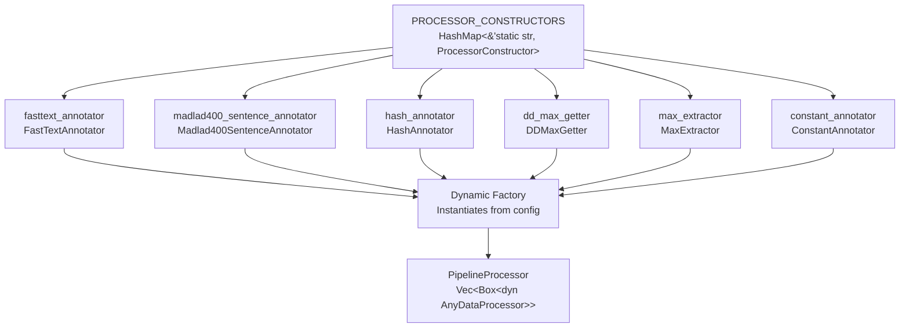

**Sources:** [src/map_fxn.rs:48-88]()

---

## Available Annotators

### FastTextAnnotator

**Purpose:** Adds ML-based classification predictions using FastText models for language identification, topic classification, or quality scoring.

**Processor Name:** `fasttext_annotator`

#### Configuration Parameters

| Parameter | Type | Default | Description |
|-----------|------|---------|-------------|
| `fast_text_file` | String | **Required** | Path to FastText `.bin` model file |
| `text_field` | String | `"text"` | JSON field containing text to classify |
| `output_field` | String | `"metadata.fasttext"` | Destination field for predictions (supports nested paths) |
| `k` | Integer | `10` | Maximum number of top predictions to return |
| `threshold` | Float | `0.0` | Minimum probability threshold for predictions |

#### Behavior

1. Reads text from `text_field`
2. Replaces newlines with spaces and appends final newline (FastText requirement)
3. Calls FastText model's `predict()` method with `k` and `threshold`
4. Returns predictions as JSON object with label keys and probability values
5. If prediction fails (e.g., invalid UTF-8), returns `None` to filter the document

**Output Structure:**
```json
{
  "metadata": {
    "fasttext": {
      "__label__en": 0.9234,
      "__label__es": 0.0456,
      "__label__fr": 0.0234
    }
  }
}
```

#### Implementation Details

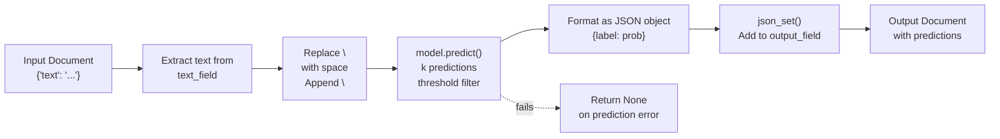

**Sources:** [src/map_fxn.rs:586-647](), [tests/map_fxn_tests/fast_text_annotator_test.rs:1-209]()

#### Example Configuration

```yaml
pipeline:
  - name: "fasttext_annotator"
    kwargs:
      fast_text_file: "./models/lid176.bin"
      output_field: "metadata.language"
      k: 3
      threshold: 0.1
  - name: "float_filter"
    kwargs:
      float_field: "metadata.language.__label__en"
      lower_bound: 0.65
```

**Use Case:** Language identification followed by filtering for English documents with >65% confidence.

---

### Madlad400SentenceAnnotator

**Purpose:** Performs sentence-level quality analysis using five rule-based checks to detect low-quality patterns in text.

**Processor Name:** `madlad400_sentence_annotator`

#### Configuration Parameters

| Parameter | Type | Default | Description |
|-----------|------|---------|-------------|
| `text_field` | String | `"text"` | JSON field containing text to analyze |
| `output_field` | String | `"metadata.madlad400_sentence"` | Destination field for analysis results |

#### Quality Rules

The annotator applies five quality checks:

| Rule Name | Check Description | Triggered When |
|-----------|------------------|----------------|
| `document_consistency` | Checks if sentence languages match document language | >10% of sentences differ from document language |
| `list_case` | Detects uppercase lists (lines starting with uppercase letter or digit) | >50% of lines are list items |
| `abnormal_sentence_lengths` | Identifies unusually short/long sentences | Avg sentence length <5 or >100 tokens |
| `technical_characters` | Counts technical symbols like `{`, `}`, `<`, `>` | >5% of characters are technical symbols |
| `cursed_patterns` | Detects problematic patterns (repeating words, uppercase runs) | Multiple cursed patterns found |

#### Behavior

1. Splits text into sentences using sentence terminators (`.`, `!`, `?`)
2. Runs all five rule checks in parallel
3. Records boolean results for each check
4. Adds results object to `output_field`
5. Always returns `Some(data)` - never filters

**Output Structure:**
```json
{
  "metadata": {
    "madlad400_sentence": {
      "document_consistency": false,
      "list_case": true,
      "abnormal_sentence_lengths": false,
      "technical_characters": true,
      "cursed_patterns": false
    }
  }
}
```

#### Implementation Details

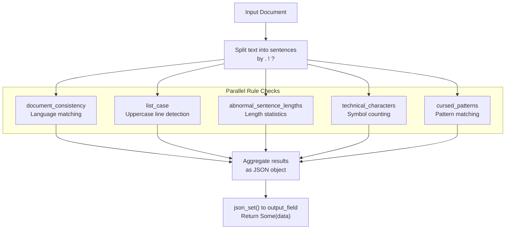

**Sources:** [src/map_fxn.rs:1400-1600]() (approximate line range based on file truncation)

#### Example Configuration

```yaml
pipeline:
  - name: "madlad400_sentence_annotator"
    kwargs:
      output_field: "quality.sentence_analysis"
  - name: "madlad400_rule_filter"
    kwargs:
      rules:
        - "document_consistency"
        - "list_case"
      float_field: "quality.sentence_analysis"
```

**Use Case:** Annotate documents with quality metrics, then filter based on specific failing rules.

---

### HashAnnotator

**Purpose:** Computes hash values of specified fields for deduplication, content addressing, or change detection.

**Processor Name:** `hash_annotator`

#### Configuration Parameters

| Parameter | Type | Default | Description |
|-----------|------|---------|-------------|
| `input_field` | String | **Required** | JSON field to hash |
| `output_field` | String | **Required** | Destination field for hash value |
| `hash_type` | String | `"xxh3_64"` | Hash algorithm: `"xxh3_64"` or `"xxh3_128"` |

#### Behavior

1. Extracts value from `input_field` (converts to string if not already)
2. Computes hash using specified algorithm (XXH3-64 or XXH3-128)
3. Stores hash as integer (64-bit) or string (128-bit hex) in `output_field`
4. Always returns `Some(data)`

**Hash Algorithms:**
- `xxh3_64`: Fast 64-bit hash, returns integer
- `xxh3_128`: 128-bit hash for lower collision probability, returns hex string

#### Implementation Details

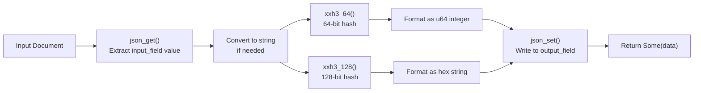

**Sources:** [src/map_fxn.rs:1700-1750]() (approximate)

#### Example Configuration

```yaml
pipeline:
  - name: "hash_annotator"
    kwargs:
      input_field: "text"
      output_field: "content_hash"
      hash_type: "xxh3_64"
  - name: "hash_annotator"
    kwargs:
      input_field: "url"
      output_field: "url_hash"
      hash_type: "xxh3_128"
```

**Use Case:** Add content hashes for deduplication workflows or change tracking.

---

### DDMaxGetter

**Purpose:** Extracts the key with the maximum value from attributes matching a specified prefix (e.g., find the highest-scoring classification from `dd_fasttext_*` fields).

**Processor Name:** `dd_max_getter`

#### Configuration Parameters

| Parameter | Type | Default | Description |
|-----------|------|---------|-------------|
| `prefix` | String | **Required** | Prefix to match attribute names (e.g., `"dd_fasttext_"`) |
| `output_field` | String | **Required** | Destination field for the winning key name |

#### Behavior

1. Scans all top-level fields in the document
2. Finds fields starting with `prefix`
3. Compares numeric values of matching fields
4. Extracts the full key name of the field with maximum value
5. Writes the key name (with prefix) to `output_field`
6. Returns `Some(data)` even if no matching fields found (writes empty string)

**Example:**
```json
// Input
{
  "dd_fasttext_en": 0.92,
  "dd_fasttext_es": 0.05,
  "dd_fasttext_fr": 0.03
}

// Output (with prefix="dd_fasttext_", output_field="primary_language")
{
  "dd_fasttext_en": 0.92,
  "dd_fasttext_es": 0.05,
  "dd_fasttext_fr": 0.03,
  "primary_language": "dd_fasttext_en"
}
```

#### Implementation Details

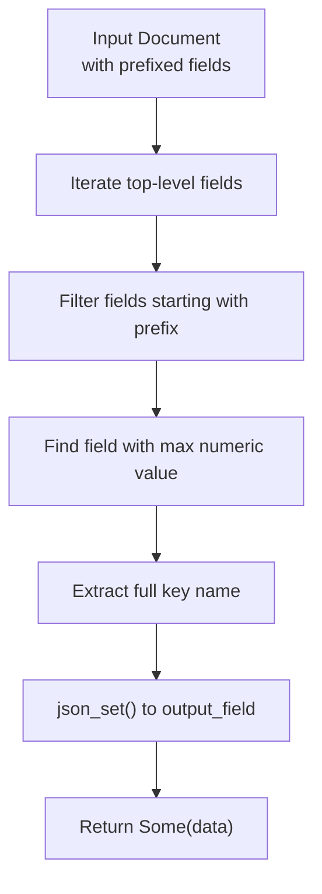

**Sources:** [src/map_fxn.rs:1800-1850]() (approximate)

#### Example Configuration

```yaml
pipeline:
  - name: "fasttext_annotator"
    kwargs:
      fast_text_file: "./models/lid176.bin"
      output_field: "dd_fasttext"
      k: 10
  - name: "dd_max_getter"
    kwargs:
      prefix: "dd_fasttext_"
      output_field: "detected_language"
```

**Use Case:** After FastText classification, extract the single highest-confidence language label.

---

### MaxExtractor

**Purpose:** Extracts the key with the maximum value from a dictionary field (similar to DDMaxGetter but operates on nested objects rather than prefixed top-level fields).

**Processor Name:** `max_extractor`

#### Configuration Parameters

| Parameter | Type | Default | Description |
|-----------|------|---------|-------------|
| `input_field` | String | **Required** | JSON path to dictionary/object field |
| `output_field` | String | **Required** | Destination field for the winning key name |

#### Behavior

1. Extracts object from `input_field` using JSON path notation
2. Iterates over key-value pairs in the object
3. Finds the key with the maximum numeric value
4. Writes the key name (without prefix) to `output_field`
5. Returns `Some(data)` even if field is empty or missing

**Example:**
```json
// Input
{
  "metadata": {
    "scores": {
      "quality": 0.89,
      "toxicity": 0.12,
      "relevance": 0.95
    }
  }
}

// Output (with input_field="metadata.scores", output_field="best_metric")
{
  "metadata": {
    "scores": {
      "quality": 0.89,
      "toxicity": 0.12,
      "relevance": 0.95
    }
  },
  "best_metric": "relevance"
}
```

#### Implementation Details

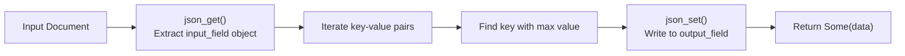

**Sources:** [src/map_fxn.rs:1900-1950]() (approximate)

#### Example Configuration

```yaml
pipeline:
  - name: "fasttext_annotator"
    kwargs:
      fast_text_file: "./models/quality.bin"
      output_field: "quality_scores"
      k: 5
  - name: "max_extractor"
    kwargs:
      input_field: "quality_scores"
      output_field: "primary_quality_label"
```

**Use Case:** After multi-label classification, extract the single highest-confidence label from nested predictions.

---

### ConstantAnnotator

**Purpose:** Adds a constant string value to all documents, useful for tagging data sources, marking pipeline versions, or adding metadata flags.

**Processor Name:** `constant_annotator`

#### Configuration Parameters

| Parameter | Type | Default | Description |
|-----------|------|---------|-------------|
| `output_field` | String | **Required** | Destination field for constant value |
| `value` | String | **Required** | Constant string to add to all documents |

#### Behavior

1. Takes the constant `value` from configuration
2. Writes it to `output_field` in every document
3. Overwrites existing values if field already exists
4. Always returns `Some(data)`

**Example:**
```json
// Input
{
  "text": "Document content",
  "id": "doc123"
}

// Output (with output_field="source", value="wikipedia_20240101")
{
  "text": "Document content",
  "id": "doc123",
  "source": "wikipedia_20240101"
}
```

#### Implementation Details

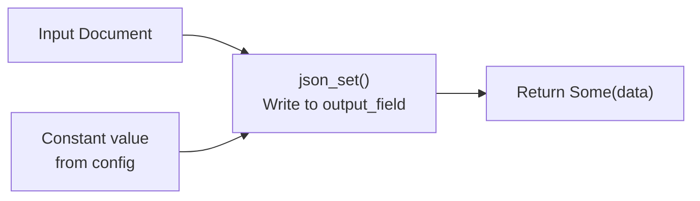

**Sources:** [src/map_fxn.rs:2000-2030]() (approximate)

#### Example Configuration

```yaml
pipeline:
  - name: "constant_annotator"
    kwargs:
      output_field: "pipeline_version"
      value: "v2.3.1"
  - name: "constant_annotator"
    kwargs:
      output_field: "metadata.source"
      value: "common_crawl_2024_01"
```

**Use Case:** Tag all documents with pipeline version and data source for provenance tracking.

---

## Annotator Pipeline Patterns

### Pattern 1: Classify-Then-Filter

Use annotators to add classification scores, then filter based on those scores:

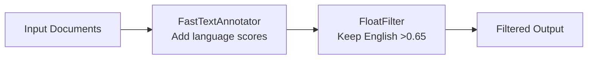

```yaml
pipeline:
  - name: "fasttext_annotator"
    kwargs:
      fast_text_file: "./models/lid176.bin"
      output_field: "metadata.language"
      k: 3
  - name: "float_filter"
    kwargs:
      float_field: "metadata.language.__label__en"
      lower_bound: 0.65
```

**Sources:** [docs/map.md:180-192]()

---

### Pattern 2: Multi-Level Quality Assessment

Combine multiple annotators for comprehensive quality scoring:

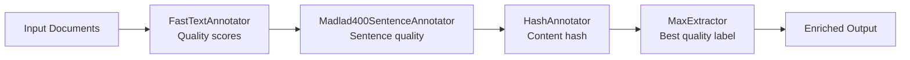

```yaml
pipeline:
  - name: "fasttext_annotator"
    kwargs:
      fast_text_file: "./models/quality.bin"
      output_field: "quality.scores"
  - name: "madlad400_sentence_annotator"
    kwargs:
      output_field: "quality.sentence"
  - name: "hash_annotator"
    kwargs:
      input_field: "text"
      output_field: "content_hash"
  - name: "max_extractor"
    kwargs:
      input_field: "quality.scores"
      output_field: "quality.primary_label"
```

---

### Pattern 3: Provenance Tagging

Add metadata about data source and processing:

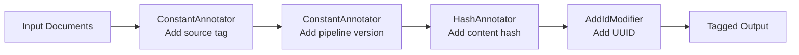

```yaml
pipeline:
  - name: "constant_annotator"
    kwargs:
      output_field: "metadata.source"
      value: "wikipedia_2024_01"
  - name: "constant_annotator"
    kwargs:
      output_field: "metadata.pipeline_version"
      value: "v2.3.1"
  - name: "hash_annotator"
    kwargs:
      input_field: "text"
      output_field: "metadata.content_hash"
  - name: "add_id"
    kwargs:
      id_key: "id"
```

---

## Implementation Notes

### Error Handling in Annotators

Most annotators return `Some(data)` even on partial failures. However, `FastTextAnnotator` has special error handling:

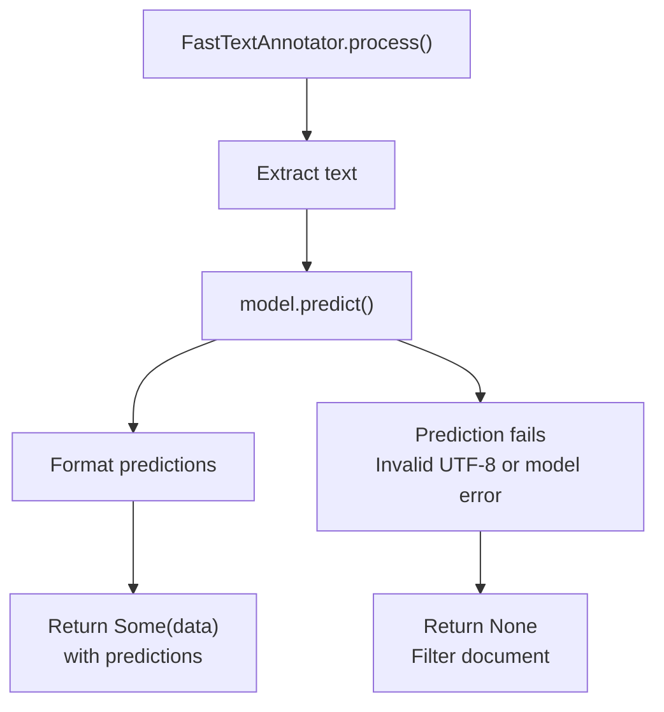

**Sources:** [src/map_fxn.rs:631-637]()

---

### Field Path Resolution

Annotators support nested field paths using dot notation via the `json_set()` utility:

```
"metadata.fasttext" → data["metadata"]["fasttext"]
"quality.scores.primary" → data["quality"]["scores"]["primary"]
```

**Sources:** [src/utils.rs:json_set()](), [src/map_fxn.rs:124-129]()

---

### Model Loading Strategy

FastText models are loaded once during `new()` and reused for all documents:

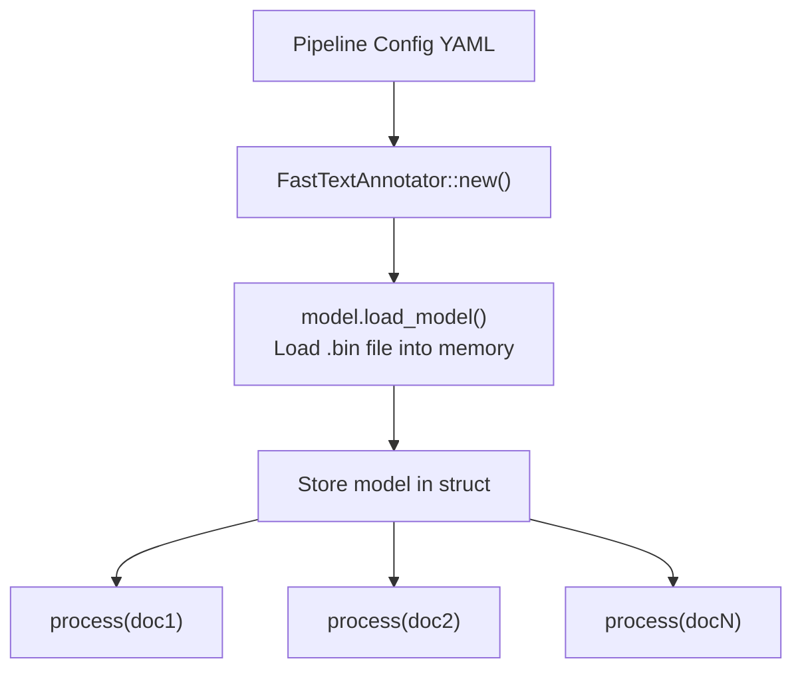

**Implications:**
- Model loading happens once per pipeline initialization
- Models remain in memory for the entire processing run
- Large models (e.g., 126MB lid176.bin) impact memory usage
- Must pre-download models before processing (see [HuggingFace Downloaders](#7.1))

**Sources:** [src/map_fxn.rs:599-620]()

---

## Performance Considerations

| Annotator | Relative Cost | Bottleneck | Notes |
|-----------|--------------|------------|-------|
| `FastTextAnnotator` | High | Model inference | CPU-intensive, scales with `k` parameter |
| `Madlad400SentenceAnnotator` | Medium | Rule processing | Iterates over sentences, multiple regex checks |
| `HashAnnotator` | Low | Hash computation | Fast XXH3 algorithm |
| `DDMaxGetter` | Very Low | Field iteration | Simple scan of top-level fields |
| `MaxExtractor` | Very Low | Object iteration | Simple max-finding |
| `ConstantAnnotator` | Negligible | String copy | Trivial overhead |

**General Guidelines:**
- Place expensive annotators (FastText) late in pipeline after filters reduce document count
- Use `threshold` parameter in `FastTextAnnotator` to reduce output size
- Hash annotators are cheap enough to place anywhere
- Constant annotators have near-zero cost

**Sources:** [src/map_fxn.rs:586-2100]() (full processor implementations)

---

