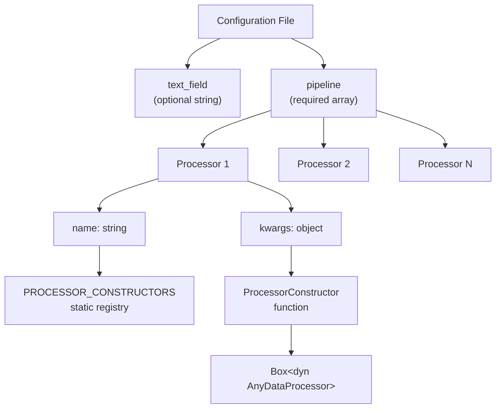
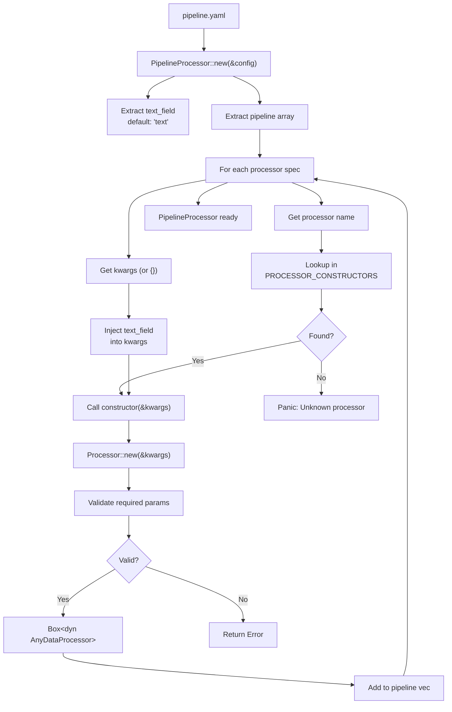

<!-- source: DeepWiki mcp.deepwiki.com · repo allenai/datamap-rs · page 3.6 Pipeline Configuration · fetched 2026-10-26 -->

# Pipeline Configuration

<details>
<summary>Relevant source files</summary>

The following files were used as context for generating this wiki page:

- [configs/dclm/dclm_config.yaml](configs/dclm/dclm_config.yaml)
- [docs/map.md](docs/map.md)
- [src/map_fxn.rs](src/map_fxn.rs)

</details>


## Purpose and Scope

This document explains how to write configuration files for the `datamap map` command. Configuration files define the sequence of processors (filters, modifiers, and annotators) that transform your data. For details on how the pipeline executes these processors, see [Pipeline Architecture](#3.1). For reference documentation on individual processors and their parameters, see [Filter Processors Reference](#3.3), [Modifier Processors Reference](#3.4), and [Annotator Processors Reference](#3.5).

---

## Configuration File Format

Pipeline configurations are defined in either **YAML** or **JSON** format. Both formats are functionally equivalent; YAML is typically preferred for readability.

**YAML Example:**
```yaml
text_field: "text"
pipeline:
  - name: "text_len_filter"
    kwargs:
      lower_bound: 100
      upper_bound: 50000
  - name: "stop_word_filter"
    kwargs:
      min_stop_word: 3
```

**JSON Equivalent:**
```json
{
  "text_field": "text",
  "pipeline": [
    {
      "name": "text_len_filter",
      "kwargs": {
        "lower_bound": 100,
        "upper_bound": 50000
      }
    },
    {
      "name": "stop_word_filter",
      "kwargs": {
        "min_stop_word": 3
      }
    }
  ]
}
```

The configuration file is passed to the map command via the `--config` argument:
```bash
datamap map --input_dir ./input --output_dir ./output --config pipeline.yaml
```

**Sources:** [src/map_fxn.rs:111-135](), [docs/map.md:66-84]()

---

## Configuration Structure

### Top-Level Schema



**Sources:** [src/map_fxn.rs:111-135](), [src/map_fxn.rs:48-88]()

### Top-Level Fields

| Field | Type | Required | Default | Description |
|-------|------|----------|---------|-------------|
| `text_field` | string | No | `"text"` | Global default field containing document text. This value is automatically injected into all processor `kwargs` unless explicitly overridden. |
| `pipeline` | array | Yes | - | Ordered list of processor specifications. Documents flow through processors sequentially. |

**Sources:** [src/map_fxn.rs:113]()

---

## Processor Specification

Each processor in the `pipeline` array is defined by a JSON object with two fields:

### Processor Entry Structure

```yaml
- name: "processor_type_name"    # Required: must match a registered processor
  kwargs:                         # Optional: processor-specific parameters
    param1: value1
    param2: value2
```

### Name Field

The `name` field must exactly match a key in the `PROCESSOR_CONSTRUCTORS` registry. Available processor names:

| Processor Name | Type | Purpose |
|----------------|------|---------|
| `non_null_filter` | Filter | Remove null documents |
| `text_len_filter` | Filter | Filter by character count |
| `subsample` | Filter | Random sampling |
| `add_id` | Modifier | Add UUID identifier |
| `url_substring_filter` | Filter | URL-based filtering |
| `newline_removal_modifier` | Modifier | Control consecutive newlines |
| `fasttext_annotator` | Annotator | Language/topic classification |
| `float_filter` | Filter | Numeric field filtering |
| `string_eq_filter` | Filter | String equality filtering |
| `page_len_filter` | Filter | Length-based filtering |
| `word_len_filter` | Filter | Average word length filtering |
| `symbol_ratio_filter` | Filter | Symbol density filtering |
| `bullet_filter` | Filter | Bullet point density filtering |
| `ellipsis_line_ratio_filter` | Filter | Ellipsis line filtering |
| `alphabetic_word_ratio_filter` | Filter | Non-alphabetic word filtering |
| `stop_word_filter` | Filter | Stop word presence filtering |
| `massive_web_repetition_filter` | Filter | Repetition detection |
| `word_count_adder` | Modifier | Add word count field |
| `ratio_line_modifier` | Modifier | Remove lines by character ratio |
| `regex_line_modifier` | Modifier | Remove lines by regex |
| `line_len_modifier` | Modifier | Remove short lines |
| `substring_line_modifier` | Modifier | Remove/replace banned substrings |
| `word_removal_ratio_filter` | Filter | Filter by word removal rate |
| `madlad400_sentence_annotator` | Annotator | Sentence quality analysis |
| `madlad400_rule_filter` | Filter | Filter by Madlad annotations |
| `interval_filter` | Filter | Remove character intervals |
| `dd_max_getter` | Annotator | Extract max-value key |
| `hash_annotator` | Annotator | Add hash field |
| `max_extractor` | Annotator | Extract dictionary max |
| `constant_annotator` | Annotator | Add constant value |
| `rename_modifier` | Modifier | Rename JSON fields |

**Sources:** [src/map_fxn.rs:48-88]()

### Kwargs Field

The `kwargs` field is an optional JSON object containing processor-specific parameters. If omitted, an empty object `{}` is used as default.

**Parameter Resolution Order:**
1. Processor checks `kwargs` for each parameter
2. If parameter not found, processor uses its built-in default value
3. The global `text_field` is **automatically injected** into every processor's `kwargs`

**Example of text_field injection:**
```yaml
text_field: "content"  # Set at top level
pipeline:
  - name: "text_len_filter"
    kwargs:
      lower_bound: 100
      # text_field: "content" is automatically added here
```

**Sources:** [src/map_fxn.rs:118-129]()

---

## Configuration Parsing Flow



**Sources:** [src/map_fxn.rs:111-135]()

### Error Handling

Configuration errors result in immediate panics or errors:

- **Unknown processor name**: Panics at line 130 when `PROCESSOR_CONSTRUCTORS[subconfig_name]` lookup fails
- **Invalid kwargs**: Each processor's `new` method returns `Result<Self, Error>` and may fail if required parameters are missing or invalid
- **Missing required fields**: Panics with `unwrap()` if `pipeline` field is missing

**Sources:** [src/map_fxn.rs:115-131]()

---

## Processor Configuration Parameters

Each processor defines its own configuration parameters via the `DataProcessor::new()` trait method. Common patterns:

### Common Parameter Types

| Pattern | Example | Description |
|---------|---------|-------------|
| **Field paths** | `text_field: "text"` | JSON path to field using dot notation |
| **Numeric bounds** | `lower_bound: 100`<br/>`upper_bound: 5000` | Range constraints for filtering |
| **File paths** | `banlist_file: "./banlists/domains.txt"` | Paths to external resources (banlists, models) |
| **Flags** | `case_sensitive: false` | Boolean configuration options |
| **Thresholds** | `max_ratio: 0.3` | Floating-point cutoff values |
| **Arrays** | `ignore_chars: ['-', '.']` | Lists of values |

### Parameter Extraction Utilities

Processors use the `get_default()` utility function to extract parameters with fallback defaults:

```rust
// Example from TextLenFilter::new()
let lower_bound = get_default(config, "lower_bound", 0);
let upper_bound = get_default(config, "upper_bound", usize::MAX);
let text_field = get_default(config, "text_field", String::from("text"));
```

**Sources:** [src/map_fxn.rs:272-279](), [src/utils.rs]()

---

## Configuration Patterns

### Pattern 1: Sequential Filtering

Apply filters in order of computational cost (cheap filters first):

```yaml
pipeline:
  # Fast: field existence check
  - name: "non_null_filter"
  
  # Fast: simple length check
  - name: "text_len_filter"
    kwargs:
      lower_bound: 100
  
  # Moderate: requires text parsing
  - name: "stop_word_filter"
    kwargs:
      min_stop_word: 3
  
  # Expensive: ML model inference
  - name: "fasttext_annotator"
    kwargs:
      fast_text_file: "./models/lid176.bin"
      output_field: "metadata.language"
```

**Rationale:** Early filters remove documents before expensive operations run on them.

**Sources:** [configs/dclm/dclm_config.yaml:1-102]()

### Pattern 2: Annotate-Then-Filter

Add metadata first, then filter based on that metadata:

```yaml
pipeline:
  # Step 1: Add word count annotation
  - name: "word_count_adder"
    kwargs:
      word_count_field: "original_word_count"
  
  # Step 2: Modify text (removes lines)
  - name: "line_len_modifier"
    kwargs:
      lower_bound: 5
  
  # Step 3: Filter if too many words removed
  - name: "word_removal_ratio_filter"
    kwargs:
      word_count_field: "original_word_count"
      upper_bound: 0.3  # Remove if >30% words deleted
```

**Sources:** [docs/map.md:166-178]()

### Pattern 3: Multi-Stage URL Filtering

Apply the same filter type with different configurations:

```yaml
pipeline:
  # Stage 1: Exact domain matching
  - name: "url_substring_filter"
    kwargs:
      url_key: "metadata.warc_url"
      banlist_file: "banlists/banned_domains.txt"
      exact_domain_match: true
  
  # Stage 2: Strict substring matching
  - name: "url_substring_filter"
    kwargs:
      url_key: "metadata.warc_url"
      banlist_file: "banlists/banned_words_strict.txt"
      match_substrings: true
  
  # Stage 3: Soft matching (requires 2+ hits)
  - name: "url_substring_filter"
    kwargs:
      url_key: "metadata.warc_url"
      banlist_file: "banlists/banned_words_soft.txt"
      num_banned_substrs: 2
      match_substrings: false
```

**Sources:** [configs/dclm/dclm_config.yaml:4-25]()

### Pattern 4: Conditional Field Access

Use default values for optional fields:

```yaml
pipeline:
  - name: "float_filter"
    kwargs:
      float_field: "metadata.quality_score"
      lower_bound: 0.5
      default: 0.0  # Use 0.0 if field missing
```

If the `float_field` doesn't exist in a document, the processor uses the `default` value instead of failing.

**Sources:** [src/map_fxn.rs:656-701]()

---

## Complete Configuration Examples

### Example 1: Basic Text Quality Pipeline

```yaml
text_field: "text"
pipeline:
  # Remove very short documents
  - name: "text_len_filter"
    kwargs:
      lower_bound: 100
      upper_bound: 100000
  
  # Ensure documents are in English
  - name: "stop_word_filter"
    kwargs:
      min_stop_word: 5
  
  # Remove documents with too many symbols
  - name: "symbol_ratio_filter"
    kwargs:
      max_symbol_to_word_ratio: 0.1
  
  # Detect excessive repetition
  - name: "massive_web_repetition_filter"
```

**Sources:** [docs/map.md:152-163]()

### Example 2: DCLM Pipeline Breakdown

The DCLM configuration demonstrates a comprehensive data cleaning pipeline:

```mermaid
graph TB
    Start["Input Document"]
    
    subgraph "Stage 1: URL Filtering"
        URL1["url_substring_filter<br/>exact_domain_match"]
        URL2["url_substring_filter<br/>strict words"]
        URL3["url_substring_filter<br/>hard words"]
        URL4["url_substring_filter<br/>soft words (2+ required)"]
    end
    
    subgraph "Stage 2: Text Normalization"
        NL["newline_removal_modifier<br/>max_consecutive: 2"]
    end
    
    subgraph "Stage 3: Language Identification"
        FT["fasttext_annotator<br/>lid176.bin model"]
        Lang["float_filter<br/>__label__en >= 0.65"]
    end
    
    subgraph "Stage 4: Basic Quality Filters"
        PageLen["page_len_filter<br/>50-100000 words"]
        WordLen["word_len_filter<br/>3-10 chars avg"]
        Symbol["symbol_ratio_filter"]
        Bullet["bullet_filter"]
        Ellipsis["ellipsis_line_ratio_filter"]
        Alpha["alphabetic_word_ratio_filter"]
        Stop["stop_word_filter"]
        Rep["massive_web_repetition_filter"]
    end
    
    subgraph "Stage 5: Line-Level Cleaning"
        WC["word_count_adder<br/>track original count"]
        Upper["ratio_line_modifier<br/>uppercase limit"]
        Numeric["ratio_line_modifier<br/>numeric limit"]
        Regex["regex_line_modifier<br/>remove counters"]
        LineLen["line_len_modifier<br/>min 2 words"]
        SS1["substring_line_modifier<br/>items in cart"]
        SS2["substring_line_modifier<br/>Read more..."]
        SS3["substring_line_modifier<br/>Sign-in"]
        WCF["word_removal_ratio_filter<br/>max 5% removal"]
    end
    
    Start --> URL1 --> URL2 --> URL3 --> URL4
    URL4 --> NL
    NL --> FT --> Lang
    Lang --> PageLen --> WordLen --> Symbol --> Bullet
    Bullet --> Ellipsis --> Alpha --> Stop --> Rep
    Rep --> WC --> Upper --> Numeric --> Regex --> LineLen
    LineLen --> SS1 --> SS2 --> SS3 --> WCF
    WCF --> Final["Final Output"]
```



**Key Features:**
- **4 URL filter stages** with progressive strictness ([configs/dclm/dclm_config.yaml:4-25]())
- **Language filtering** using FastText model ([configs/dclm/dclm_config.yaml:29-37]())
- **8 basic quality filters** for document-level characteristics ([configs/dclm/dclm_config.yaml:38-64]())
- **Line-level modifications** to clean text while tracking word removal ([configs/dclm/dclm_config.yaml:66-102]())

**Sources:** [configs/dclm/dclm_config.yaml:1-102]()

---

## Configuration Best Practices

### Ordering Strategy

| Order | Stage | Rationale |
|-------|-------|-----------|
| 1 | Fast filters | Remove obvious bad documents early (null checks, length bounds) |
| 2 | URL/domain filters | Use efficient AhoCorasick matching before content analysis |
| 3 | Annotators | Add metadata needed by subsequent filters |
| 4 | Content filters | Document-level quality checks |
| 5 | Modifiers | Transform text (most expensive when combined) |
| 6 | Post-modification filters | Validate transformed text meets criteria |

### Performance Considerations

1. **Place expensive processors late**: ML models, repetition detection
2. **Use exact matches when possible**: `exact_domain_match: true` is faster than substring matching
3. **Minimize file I/O**: Load banlists/models at processor construction, not per-document
4. **Track modifications**: Use `word_count_adder` before text modification to detect excessive changes

### Field Path Conventions

JSON paths use dot notation for nested fields:
- `text` → top-level field
- `metadata.language` → nested field
- `metadata.lang.__label__en` → deeply nested (FastText output)

**Sources:** [src/utils.rs]()

### External Resource Management

Processors that load external files (banlists, ML models) do so in their `new()` method, not during document processing:

```yaml
- name: "url_substring_filter"
  kwargs:
    banlist_file: "./banlists/domains.txt"  # Loaded once at startup
```

**Ensure these files exist before running** to avoid runtime panics.

**Sources:** [src/map_fxn.rs:378-396]()

---

## Configuration Validation

To validate a pipeline configuration before processing large datasets, use the Python verification tool:

```bash
python -m python_utils.map_verifiers verify \
  --config pipeline.yaml \
  --check_resources
```

This tool verifies:
- Configuration file syntax (YAML/JSON parsing)
- Processor name validity (exists in registry)
- Required parameter presence
- External resource existence (banlist files, model files)

For more information, see [Pipeline Verification Tool](#7.3).

**Sources:** [python_utils/map_verifiers.py]()

---

## Summary Table: Configuration Structure

| Level | Element | Type | Description |
|-------|---------|------|-------------|
| **Root** | `text_field` | string | Global default text field name |
| **Root** | `pipeline` | array | Ordered list of processors |
| **Pipeline[i]** | `name` | string | Processor type from `PROCESSOR_CONSTRUCTORS` |
| **Pipeline[i]** | `kwargs` | object | Processor-specific parameters |
| **Kwargs** | *(varies)* | *(varies)* | Each processor defines its own schema |

**Sources:** [src/map_fxn.rs:111-135]()

---

