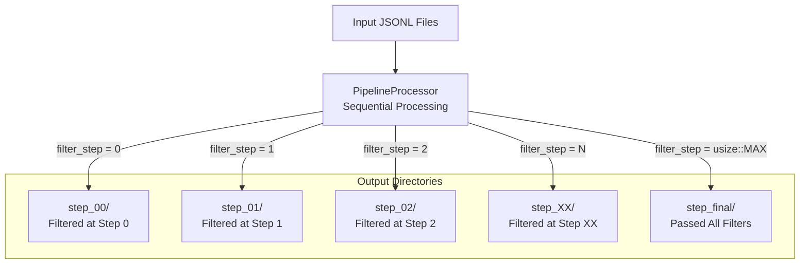
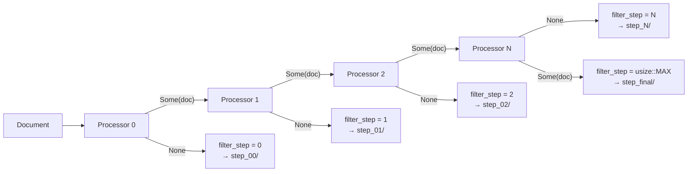
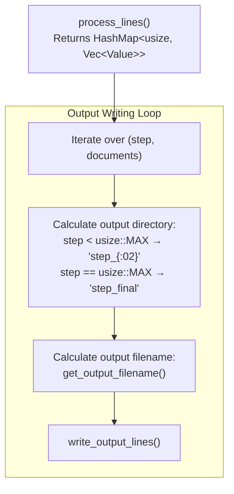
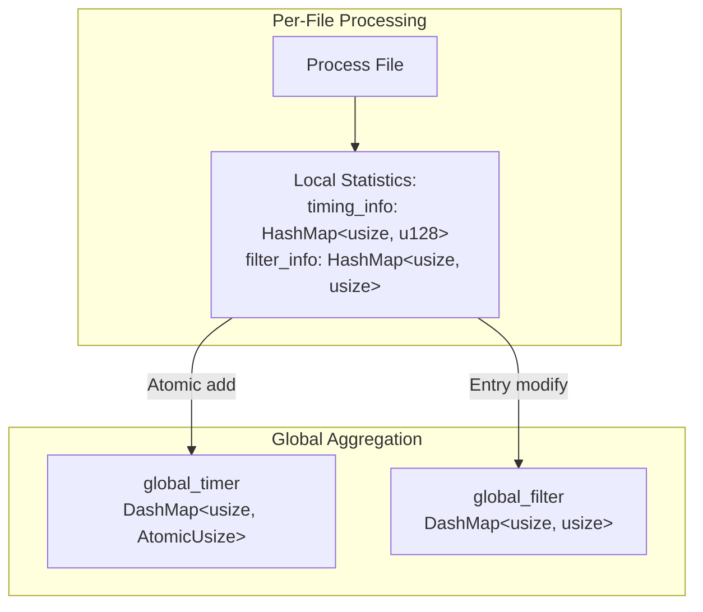
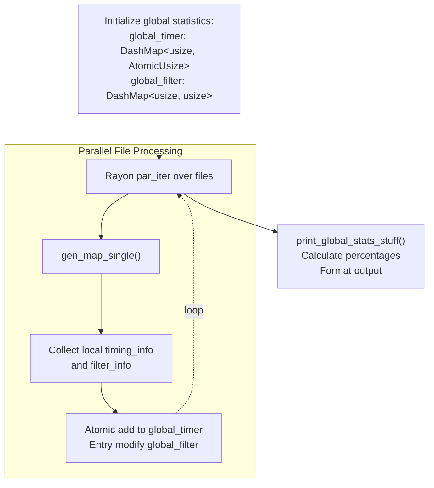

<!-- source: DeepWiki mcp.deepwiki.com · repo allenai/datamap-rs · page 3.7 Output Organization and Statistics · fetched 2026-10-26 -->

# Output Organization and Statistics

<details>
<summary>Relevant source files</summary>

The following files were used as context for generating this wiki page:

- [docs/map.md](docs/map.md)
- [src/main.rs](src/main.rs)
- [src/map_fxn.rs](src/map_fxn.rs)

</details>


This document explains how the Map command organizes output files and reports processing statistics. It covers the step-based directory structure, the filtering statistics collected during processing, and how to interpret the results.

For information about the Map command itself and pipeline configuration, see [Map Command (Pipeline Processing)](#3). For details on individual processor types, see [Filter Processors Reference](#3.3), [Modifier Processors Reference](#3.4), and [Annotator Processors Reference](#3.5).

---

## Purpose and Scope

When processing documents through a pipeline, the Map command tracks two critical pieces of information:
1. **Where each document was filtered** - which processor step removed it from the pipeline
2. **Processing statistics** - timing and filtering counts for each step

This information is materialized as both output directory structure and terminal statistics, enabling users to analyze pipeline effectiveness and identify bottlenecks.

---

## Output Directory Structure

### Step-Based Organization

The Map command organizes output into separate directories based on where documents were filtered or whether they passed all filters.



**Directory Structure Example:**
```
output_dir/
├── step_00/
│   ├── file001.jsonl.zst
│   ├── file002.jsonl.zst
│   └── file003.jsonl.zst
├── step_01/
│   ├── file001.jsonl.zst
│   └── file004.jsonl.zst
├── step_02/
│   └── file002.jsonl.zst
└── step_final/
    ├── file001.jsonl.zst
    ├── file002.jsonl.zst
    ├── file003.jsonl.zst
    └── file004.jsonl.zst
```

**Sources:** [src/main.rs:414-422]()

---

## Document Flow and Filter Step Assignment

### Filter Step Logic

Each document is assigned a `filter_step` value that determines its output directory:

| Filter Step Value | Meaning | Output Directory |
|------------------|---------|------------------|
| `0` | Filtered by first processor | `step_00/` |
| `1` | Filtered by second processor | `step_01/` |
| `N` | Filtered by processor at index N | `step_N/` (formatted as `step_{:02}`) |
| `usize::MAX` | Passed all processors | `step_final/` |



**Sources:** [src/map_fxn.rs:137-171]()

### Implementation Details

The `PipelineProcessor::process` method returns a tuple `(usize, Option<Value>)`:

```rust
// From PipelineProcessor::process
let mut filter_step = 0;
for processor in &self.pipeline {
    let proc_result = processor.process(current_data)?;
    
    match proc_result {
        Some(data_value) => current_data = data_value,
        None => {
            // Document filtered at this step
            *_filter_info.entry(filter_step).or_insert(0) += 1;
            return Ok((filter_step, Some(og_copy)));
        }
    }
    filter_step += 1;
}
// Document passed all filters
*_filter_info.entry(usize::MAX).or_insert(0) += 1;
Ok((usize::MAX, Some(current_data)))
```

**Sources:** [src/map_fxn.rs:152-170]()

---

## Output File Writing

### Per-Step Output Writing

The `gen_map_single` function collects documents by filter step and writes them to the appropriate directories:



**Code Reference:**
```rust
output_lines.into_iter().for_each(|(k, v)| {
    let step_output_dir = if k < usize::MAX {
        output_dir.clone().join(format!("step_{:02}", k))
    } else {
        output_dir.clone().join("step_final")
    };
    let output_file = get_output_filename(input_file, input_dir, &step_output_dir).unwrap();
    write_output_lines(v, &output_file).unwrap();
});
```

**Sources:** [src/main.rs:414-422]()

---

## Statistics Collection and Reporting

### Statistics Data Structures

The Map command collects two types of statistics during processing:

| Structure | Type | Purpose |
|-----------|------|---------|
| `global_timer` | `DashMap<usize, AtomicUsize>` | Time spent in each processor (nanoseconds) |
| `global_filter` | `DashMap<usize, usize>` | Number of documents filtered at each step |



**Sources:** [src/main.rs:348-354](), [src/main.rs:437-446]()

### Statistics Output Format

The `print_global_stats_stuff` function generates comprehensive statistics after all files are processed:

**Terminal Output Structure:**
```
Finishing map in X seconds
Processed Y total documents
-------------------------------------------
Step 0 | ProcessorName
     Spent Z.Z% of processing time in this step
     Removed N docs | X.X% of remaining | Y.Y% of pool
Step 1 | ProcessorName
     Spent Z.Z% of processing time in this step
     Removed N docs | X.X% of remaining | Y.Y% of pool
...
FINAL:
     N docs survived | X.X% of pool
```

**Sources:** [src/main.rs:264-321]()

---

## Statistics Calculation Details

### Time Statistics

Time percentages are calculated relative to total processor time (excluding I/O):

```rust
let total_step_time = step_times.values().sum::<usize>();
let step_fracs: HashMap<usize, f64> = step_times
    .iter()
    .map(|(k, v)| (*k, *v as f64 / total_step_time as f64))
    .collect();
```

### Filter Statistics

Two percentage metrics are reported for each step:

1. **Percentage of remaining documents:** `removed / remaining_docs * 100`
2. **Percentage of total pool:** `removed / total_docs * 100`

```rust
let remaining_remove_pct = 
    *removed_in_this_step as f32 / f32::max(0.0, remaining_docs as f32) * 100.0;
let total_remove_pct = 
    *removed_in_this_step as f32 / f32::max(0.0, total_docs as f32) * 100.0;
remaining_docs -= removed_in_this_step;
```

**Sources:** [src/main.rs:283-310]()

---

## Interpreting Results

### Understanding Filter Effectiveness

Use the statistics to identify high-impact and low-impact filters:

| Metric | Interpretation |
|--------|----------------|
| **High "% of remaining"** | This filter is catching many documents at this stage |
| **High "% of pool"** | This filter removes a large portion of the original dataset |
| **High "% of processing time"** | This filter is computationally expensive |
| **Low removal + high time** | Consider optimization or removal of this filter |

### Example Statistics Analysis

```
Step 0 | text_len_filter
     Spent 5.2% of processing time in this step
     Removed 12,450 docs | 8.3% of remaining | 8.3% of pool

Step 1 | url_substring_filter
     Spent 42.7% of processing time in this step
     Removed 89,234 docs | 64.8% of remaining | 59.4% of pool

Step 2 | massive_web_repetition_filter
     Spent 31.4% of processing time in this step
     Removed 15,890 docs | 32.4% of remaining | 10.6% of pool

FINAL:
     33,426 docs survived | 22.3% of pool
```

**Analysis:**
- **Step 0** is fast and removes 8.3% - good initial filter
- **Step 1** is slow but high-impact - removes 59.4% of documents
- **Step 2** is computationally expensive but only removes 10.6% - consider moving earlier or optimizing

---

## Step Directory Contents

### Document Preservation

Documents in `step_XX/` directories contain the **original** document as it appeared before filtering:

```rust
let og_copy = data.clone();
let mut current_data = data;

// ... processing ...

match proc_result {
    Some(data_value) => current_data = data_value,
    None => {
        return Ok((filter_step, Some(og_copy)));  // Returns original
    }
}
```

This allows analysis of **why** documents were filtered at each step.

**Sources:** [src/map_fxn.rs:150-164]()

### File Naming Convention

Output files maintain the same name as input files within their respective step directories:

```rust
let output_file = get_output_filename(input_file, input_dir, &step_output_dir).unwrap();
```

This enables easy traceability from input to output.

**Sources:** [src/main.rs:420]()

---

## Error Handling

### Error Directory

Documents that fail to parse or cause processing errors are written to the optional `err_dir`:

```rust
let err_file: Option<PathBuf> = if let Some(err_dir_real) = &err_dir {
    Some(get_output_filename(p, input_dir, &err_dir_real).unwrap())
} else {
    None
};
```

Error documents are written as raw strings (not JSON) to preserve unparseable content.

**Sources:** [src/main.rs:361-365](), [src/main.rs:424-433]()

---

## Practical Usage Examples

### Analyzing Filter Bottlenecks

**Command:**
```bash
datamap map \
  --input_dir ./data/input \
  --output_dir ./data/output \
  --config pipeline.yaml \
  --threads 32
```

**Check which steps removed the most documents:**
```bash
# Count documents in each step directory
for dir in output_dir/step_*/; do
  echo "$dir: $(zstdcat $dir/*.zst | wc -l) documents"
done
```

### Examining Filtered Documents

**Inspect documents filtered at a specific step:**
```bash
# View first 10 documents filtered at step 3
zstdcat output_dir/step_03/file001.jsonl.zst | head -10 | jq '.'
```

### Performance Profiling

Monitor the statistics output to identify slow processors:
- Processors with >20% time share may need optimization
- Consider reordering pipeline to put expensive filters later (after cheaper filters have reduced the pool)

---

## Statistics Implementation Flow



**Sources:** [src/main.rs:348-354](), [src/main.rs:437-446](), [src/main.rs:384]()

---

## Summary

The Map command's output organization provides:

1. **Spatial separation** of filtered vs. passed documents via `step_XX/` directories
2. **Temporal metrics** showing processing time per step
3. **Quantitative analysis** of filter effectiveness via removal percentages
4. **Traceability** through preserved filenames and original document content

This organization enables pipeline debugging, optimization, and quality analysis at scale.

---

