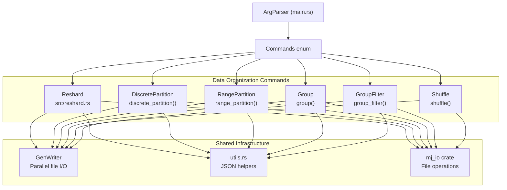
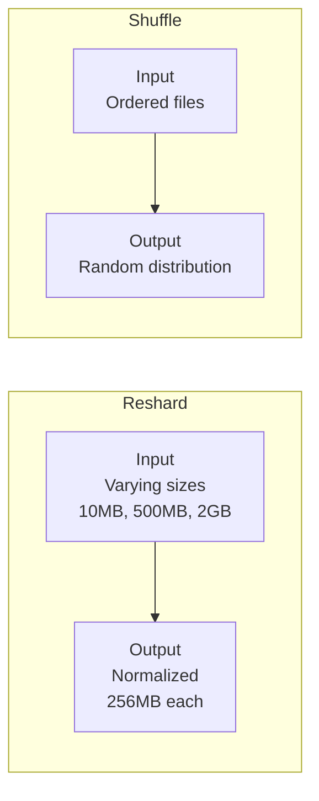
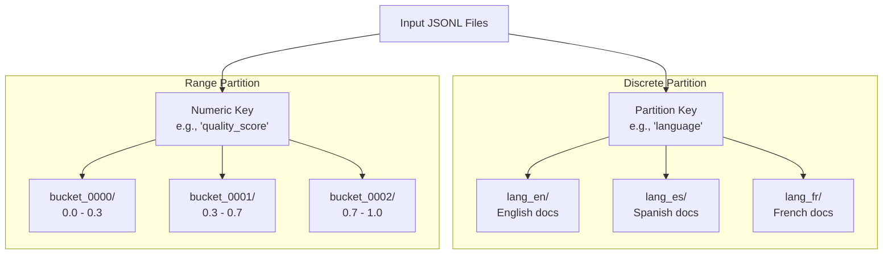
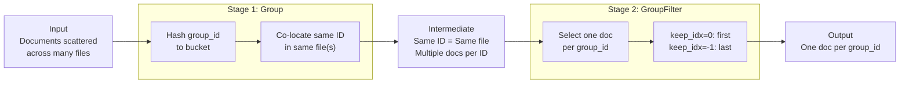
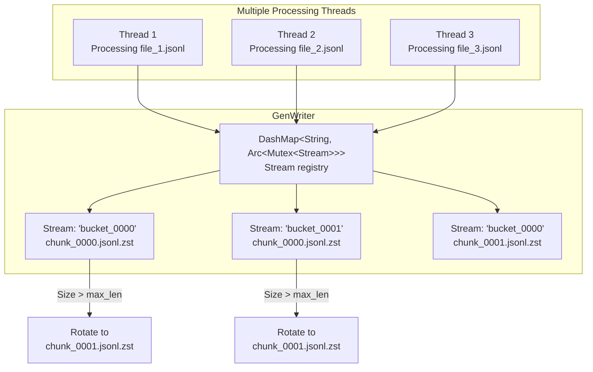
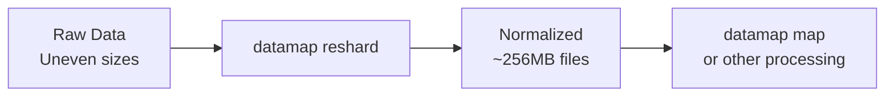
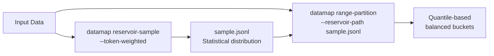
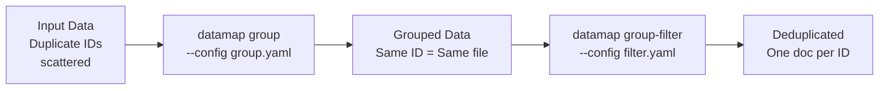
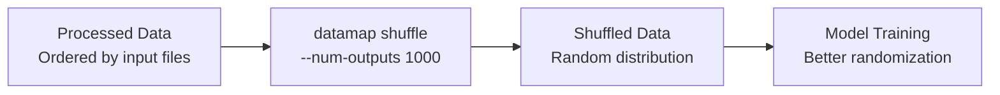

<!-- source: DeepWiki mcp.deepwiki.com · repo allenai/datamap-rs · page 4 Data Organization Commands · fetched 2026-10-26 -->

# Data Organization Commands

<details>
<summary>Relevant source files</summary>

The following files were used as context for generating this wiki page:

- [README.md](README.md)
- [src/main.rs](src/main.rs)

</details>


## Purpose and Scope

This page provides an overview of the **data organization commands** in datamap-rs. These commands restructure, repartition, and redistribute JSONL datasets without transforming document content. They focus on physical data layout rather than content modification.

For content transformation and filtering pipelines, see [Map Command (Pipeline Processing)](#3). For statistical analysis operations, see [Analysis Commands](#5).

The six data organization commands covered by this page are:
- **Reshard** - Normalize file sizes to optimal processing chunks
- **Discrete Partition** - Split data by categorical field values
- **Range Partition** - Split data by continuous numeric values
- **Group** - Co-locate documents with the same identifier
- **GroupFilter** - Deduplicate grouped documents
- **Shuffle** - Randomly redistribute documents across files

Each command is documented in detail on its respective subpage ([4.1](#4.1) through [4.6](#4.6)).

**Sources:** [src/main.rs:59-224](), [README.md:31-64]()

---

## Command Overview

The data organization commands operate on the **structure** of datasets rather than content. All commands:
- Consume JSONL files (optionally compressed with Zstandard)
- Produce JSONL files with Zstandard compression
- Process files in parallel via Rayon
- Share the `GenWriter` infrastructure for output

| Command | Primary Function | Output Structure | Typical Use Case |
|---------|------------------|------------------|------------------|
| **Reshard** | File size normalization | `shard_*.jsonl.zst` files ~256MB | Prepare data for efficient parallel processing |
| **Discrete Partition** | Categorical splitting | `category_name/` directories | Split by language, domain, classification label |
| **Range Partition** | Numeric range splitting | `bucket_NNNN/` directories | Split by quality scores, token counts |
| **Group** | Co-locate by ID | `chunk_*.jsonl.zst` files | First stage of deduplication workflow |
| **GroupFilter** | Group deduplication | Standard output files | Second stage of deduplication workflow |
| **Shuffle** | Random redistribution | `chunk_*.jsonl.zst` files | Randomize data order across files |

**Sources:** [src/main.rs:59-224](), [README.md:31-64]()

---

## Architecture Overview

### Command Dispatch Structure



**Diagram: Command dispatch and shared infrastructure dependencies**

The CLI entry point at [src/main.rs:506-584]() dispatches to individual command implementations. All organization commands share:
- `GenWriter` for concurrent, compressed file output with rotation
- `mj_io` utilities for file discovery and I/O
- `utils.rs` for JSON manipulation and path operations

**Sources:** [src/main.rs:506-584](), [src/main.rs:21-35]()

---

## Functional Categories

### File Layout Commands

**Reshard** and **Shuffle** modify how data is distributed across files without regard to content:



**Diagram: File layout transformation commands**

- **Reshard** normalizes file sizes to the 256MB "sweet spot" that balances parallelism with memory usage
- **Shuffle** randomly redistributes documents across a fixed number of output files using `fastrand`

**Sources:** [src/main.rs:79-100](), [src/main.rs:194-209]()

### Content-Based Partitioning

**Discrete Partition** and **Range Partition** split data based on field values:



**Diagram: Content-based partitioning strategies**

- **Discrete Partition** creates directories named by category values (e.g., `lang_en/`, `domain_wikipedia/`)
- **Range Partition** creates numbered bucket directories (`bucket_0000/`, `bucket_0001/`, etc.)

**Sources:** [src/main.rs:123-135](), [src/main.rs:137-167]()

### Grouping Workflow

**Group** and **GroupFilter** form a two-stage deduplication pipeline:



**Diagram: Two-stage deduplication workflow with Group and GroupFilter**

This pattern ensures that all documents with the same `group_id` are:
1. **Grouped**: Co-located in the same output file
2. **Filtered**: Reduced to a single representative document

**Sources:** [src/main.rs:169-181](), [src/main.rs:183-192]()

---

## GenWriter Infrastructure

All data organization commands except `GroupFilter` use `GenWriter` for parallel output. This component provides:

- **Thread-safe writing**: Multiple threads can write to different streams concurrently
- **Automatic rotation**: Files are closed and new ones opened when size exceeds `max_len`
- **Compression**: All output uses Zstandard level 3 compression
- **Lock-free registry**: `DashMap` tracks active output streams



**Diagram: GenWriter concurrent output architecture**

The `GenWriter` allows many threads to write to the same logical output stream (e.g., "bucket_0000") safely. When a file grows too large, it automatically rotates to a new chunk file. This is critical for:
- **Discrete Partition**: Multiple threads may write to the same category
- **Range Partition**: Multiple threads may write to the same bucket
- **Group**: Multiple threads may hash to the same output file
- **Shuffle**: Multiple threads randomly write to the same buckets

For implementation details, see [GenWriter: Parallel File Writing](#6.1).

**Sources:** [src/main.rs:6]() (DashMap import)

---

## CLI Structure and Arguments

### Common Arguments

All organization commands share these patterns:

| Argument Pattern | Purpose | Commands Using It |
|------------------|---------|-------------------|
| `--input-dir` | Source JSONL directory | All |
| `--output-dir` | Destination directory | All except Group |
| `--group-dir` | Special output for grouping | Group only |
| `--config` | YAML/JSON configuration | Discrete/Range Partition, Group, GroupFilter |
| `--delete-after-read` | Remove input files after processing | Reshard, Shuffle |
| `--max-len` / `--max-size` | File size limits | Reshard, Shuffle |

### Command-Specific Arguments

**Reshard** ([src/main.rs:79-100]()):
- `--max-lines`: Maximum lines per output file (alternative to `max_size`)
- `--max-size`: Maximum bytes per output file
- `--subsample`: Fraction of data to keep (0.0-1.0)
- `--keep-dirs`: Preserve input directory structure

**Discrete Partition** ([src/main.rs:123-135]()):
- `--config`: YAML/JSON with `partition_key` and optional `choices`
- `--partition-key`: Simple mode - just specify the key field

**Range Partition** ([src/main.rs:137-167]()):
- `--value`: JSON path to numeric field
- `--default-value`: Fallback for missing values
- `--range-groups`: Comma-separated boundaries (manual mode)
- `--reservoir-path`: Path to reservoir sample (automatic mode)
- `--num-buckets`: Number of quantile-based buckets
- `--max-file-size`: Maximum bytes per output file
- `--bucket-name`: Custom prefix for bucket directories

**Group** ([src/main.rs:169-181]()):
- `--config`: YAML/JSON with `group_key` and `num_groups`
- `--subext`: Optional file extension filter

**GroupFilter** ([src/main.rs:183-192]()):
- `--config`: YAML/JSON with `group_key` and `keep_idx`

**Shuffle** ([src/main.rs:194-209]()):
- `--num-outputs`: Number of output files
- `--max-len`: Maximum bytes per output file (default: 256MB)

**Sources:** [src/main.rs:59-224]()

---

## Data Flow Patterns

### Pattern 1: Reshard Before Processing



**Diagram: Standard preprocessing workflow**

Resharding is typically the **first operation** on raw data to optimize subsequent processing.

### Pattern 2: Sample-Informed Partitioning



**Diagram: Two-pass partitioning with statistical sampling**

Range partitioning with automatic boundaries requires a reservoir sample to calculate quantiles. See [Reservoir Sample Command](#5.1) and [Range Partition Command](#4.3).

### Pattern 3: Deduplication Workflow



**Diagram: Complete deduplication pipeline**

This is the **recommended workflow** for exact or near-exact deduplication. Group first, then filter. See [Group Command](#4.4) and [GroupFilter Command](#4.5).

### Pattern 4: Shuffle After Pipeline



**Diagram: Post-processing shuffle for training data**

Shuffling is typically the **last operation** before model training to ensure data randomization.

**Sources:** [README.md:31-64]()

---

## Configuration Files

Several commands use YAML or JSON configuration files parsed by `parse_config()` at [src/main.rs:230-248]().

### Supported Formats

Both YAML and JSON are supported. The parser:
1. Detects format by file extension (`.yaml`, `.yml`, or `.json`)
2. Parses to native format (YAML or JSON)
3. Converts to `serde_json::Value` for uniform processing

### Configuration by Command

| Command | Config Required | Config Contents |
|---------|----------------|-----------------|
| **Reshard** | No | N/A - uses CLI arguments only |
| **Discrete Partition** | Optional | `partition_key`, optional `choices` list |
| **Range Partition** | Optional | `value`, `default_value`, `range_groups`, etc. |
| **Group** | Required | `group_key`, `num_groups` |
| **GroupFilter** | Required | `group_key`, `keep_idx` |
| **Shuffle** | No | N/A - uses CLI arguments only |

**Example Discrete Partition Config:**
```yaml
partition_key: "language"
choices: ["en", "es", "fr", "de"]
```

**Example Group Config:**
```yaml
group_key: "doc_id"
num_groups: 1024
```

**Example GroupFilter Config:**
```yaml
group_key: "doc_id"
keep_idx: 0  # Keep first document in each group
```

See individual command pages for complete configuration details.

**Sources:** [src/main.rs:230-248]()

---

## Performance Characteristics

### Parallelism Model

All organization commands use **file-level parallelism** via Rayon:

```rust
all_files.par_iter().for_each(|file| {
    // Process each file independently
});
```

This pattern appears at:
- Reshard: Processing each input file in parallel
- Discrete/Range Partition: Scanning and partitioning in parallel
- Group: Hashing and writing in parallel
- Shuffle: Random assignment in parallel

The `--threads` global argument at [src/main.rs:55-56]() controls Rayon's thread pool size.

### Memory Usage

Memory consumption scales with:
1. **Number of parallel files**: More threads = more files loaded simultaneously
2. **File sizes**: Larger files = more memory per thread
3. **Active output streams**: GenWriter keeps one buffer per unique output stream

The 256MB default file size is chosen to balance:
- **Parallelism**: Smaller files = more parallel units of work
- **Memory**: Larger files = fewer files in memory simultaneously
- **I/O overhead**: Moderate size minimizes open/close operations

### I/O Patterns

All commands use:
- **Streaming input**: Files are read line-by-line, not loaded entirely into memory
- **Buffered output**: GenWriter accumulates writes before flushing to disk
- **Compression**: Zstandard level 3 provides good compression ratio with fast speed
- **Local storage**: Architecture assumes fast NVMe drives (see [Data Flow and Storage Strategy](#2.3))

**Sources:** [src/main.rs:359-382]() (parallel iteration example), [src/main.rs:55-56]() (thread control)

---

## Comparison with Map Command

| Aspect | Data Organization Commands | Map Command |
|--------|---------------------------|-------------|
| **Purpose** | Restructure data layout | Transform document content |
| **Processing** | File-level or document-level | Pipeline of processors per document |
| **Output** | Reorganized files | Filtered and annotated documents |
| **Configuration** | Simple YAML/JSON | Complex pipeline specifications |
| **Filtering** | No content-based filtering | Multiple filter stages |
| **Statistics** | Minimal (counts only) | Detailed per-stage statistics |
| **Typical Speed** | Very fast (I/O bound) | Slower (CPU bound with ML models) |

The Map command (page [3](#3)) is the most complex subsystem, handling content transformation through configurable pipelines. Data organization commands are simpler and focus on data structure.

**Sources:** [src/main.rs:328-386]() (Map implementation)

---

## Common Use Cases

### 1. Preparing Raw Data
```bash
# Normalize file sizes for efficient processing
datamap reshard --input-dir ./raw_data \
                --output-dir ./normalized \
                --max-size 268435456  # 256MB
```

### 2. Language-Based Splitting
```bash
# Partition by language after annotation
datamap discrete-partition --input-dir ./annotated \
                          --output-dir ./by_language \
                          --partition-key "language"
```

### 3. Quality-Based Splitting
```bash
# First: sample the data
datamap reservoir-sample --input-dir ./data \
                        --output-file ./sample.jsonl \
                        --key "quality_score" \
                        --reservoir-size 100000

# Second: partition into quality tiers
datamap range-partition --input-dir ./data \
                       --output-dir ./by_quality \
                       --reservoir-path ./sample.jsonl \
                       --num-buckets 10
```

### 4. Exact Deduplication
```bash
# Stage 1: Group by document ID
datamap group --input-dir ./data \
              --group-dir ./grouped \
              --config group_config.yaml

# Stage 2: Keep first document per group
datamap group-filter --input-dir ./grouped \
                    --output-dir ./deduped \
                    --config filter_config.yaml
```

### 5. Training Data Randomization
```bash
# Shuffle data before training
datamap shuffle --input-dir ./processed \
                --output-dir ./shuffled \
                --num-outputs 500 \
                --max-len 268435456
```

**Sources:** [README.md:117-128]() (example patterns)

---

## Next Steps

For detailed information on each command:
- [4.1 - Reshard Command](#4.1) - File size normalization
- [4.2 - Discrete Partition Command](#4.2) - Categorical splitting  
- [4.3 - Range Partition Command](#4.3) - Numeric range splitting
- [4.4 - Group Command](#4.4) - Co-location by ID
- [4.5 - GroupFilter Command](#4.5) - Group deduplication
- [4.6 - Shuffle Command](#4.6) - Random redistribution

For related topics:
- [6.1 - GenWriter: Parallel File Writing](#6.1) - Shared output infrastructure
- [2.2 - Parallelism and Performance Model](#2.2) - Understanding parallel execution
- [2.3 - Data Flow and Storage Strategy](#2.3) - Why local storage matters

**Sources:** [README.md:139-151]() (documentation links)

---

