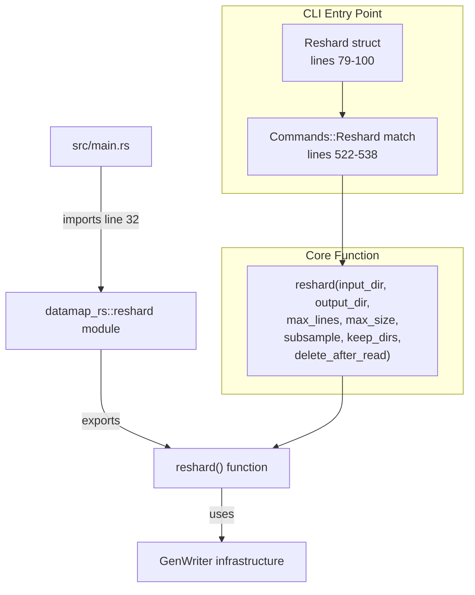
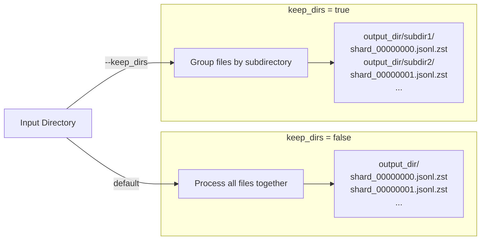
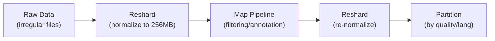

<!-- source: DeepWiki mcp.deepwiki.com · repo allenai/datamap-rs · page 4.1 Reshard Command · fetched 2026-10-26 -->

# Reshard Command

<details>
<summary>Relevant source files</summary>

The following files were used as context for generating this wiki page:

- [docs/reshard.md](docs/reshard.md)
- [src/main.rs](src/main.rs)

</details>


The Reshard command reorganizes JSONL datasets with irregular file sizes into uniformly-sized shards. This normalization is critical for optimal parallel processing performance, as it ensures balanced work distribution across threads and maintains predictable memory usage during downstream operations. The command streams documents from input files and redistributes them into new output shards that respect specified size or line count constraints.

For pipeline-based data transformation, see [Map Command](#3). For partitioning data by field values, see [Discrete Partition](#4.2) and [Range Partition](#4.3). For random redistribution, see [Shuffle Command](#4.6).

## Purpose and Target File Size

Reshard addresses the problem of file size heterogeneity that accumulates during data processing. Input datasets often contain files ranging from kilobytes to gigabytes, which creates several problems:

- **Unbalanced parallelism**: Small files complete quickly while threads process large files, leaving CPU cores idle
- **Memory pressure**: Very large files can exceed available memory during processing
- **I/O inefficiency**: Too many small files increase filesystem metadata overhead

The recommended target of **256MB** (268,435,456 bytes) represents a carefully chosen balance:

| Constraint | Smaller Files | 256MB Target | Larger Files |
|-----------|---------------|--------------|--------------|
| Parallel efficiency | Poor (too many files) | Optimal | Good but wastes threads |
| Memory usage | Low | Moderate | High risk of OOM |
| I/O throughput | Poor (metadata overhead) | Optimal | Good |
| Compression ratio | Lower | Good | Better but slower |

Sources: [docs/reshard.md:133-140](), [src/main.rs:86-90]()

## Command Interface

### CLI Structure

```bash
datamap reshard \
  --input_dir <PATH> \
  --output_dir <PATH> \
  [--max_lines <N>] \
  [--max_size <BYTES>] \
  [--subsample <RATE>] \
  [--keep_dirs] \
  [--delete_after_read] \
  [--threads <N>]
```

### Arguments

| Argument | Type | Required | Default | Description |
|----------|------|----------|---------|-------------|
| `--input_dir` | PathBuf | Yes | - | Directory containing input JSONL files |
| `--output_dir` | PathBuf | Yes | - | Directory for resharded output |
| `--max_lines` | usize | No* | 0 (unlimited) | Maximum lines per shard |
| `--max_size` | usize | No* | 0 (unlimited) | Maximum uncompressed bytes per shard |
| `--subsample` | f32 | No | 0.0 | Random sampling rate (0.0-1.0) |
| `--keep_dirs` | bool | No | false | Preserve input directory structure |
| `--delete_after_read` | bool | No | false | Delete input files after processing |
| `--threads` | usize | No | 0 (all cores) | Thread pool size |

*At least one of `--max_lines` or `--max_size` must be specified (non-zero).

**Title: Reshard Command Dispatch Flow**
```mermaid
graph TB
    User["User invokes CLI"]
    ArgParser["ArgParser::parse()"]
    Commands["Commands::Reshard variant"]
    Main["main() match statement"]
    Reshard["reshard() function"]
    
    User --> ArgParser
    ArgParser --> Commands
    Commands --> Main
    Main --> Reshard
    
    subgraph "Parsed Arguments"
        InputDir["input_dir: PathBuf"]
        OutputDir["output_dir: PathBuf"]
        MaxLines["max_lines: usize"]
        MaxSize["max_size: usize"]
        Subsample["subsample: f32"]
        KeepDirs["keep_dirs: bool"]
        DeleteAfter["delete_after_read: bool"]
    end
    
    Commands --> Parsed Arguments
    Parsed Arguments --> Reshard
```

Sources: [src/main.rs:79-100](), [src/main.rs:522-538]()

## Architecture and Implementation

### Module Structure

**Title: Reshard Code Entity Map**


The reshard implementation is located in a separate module (`datamap_rs::reshard`) that is imported at [src/main.rs:32](). The CLI dispatcher matches the `Commands::Reshard` variant and invokes the function with parsed arguments at [src/main.rs:530-538]().

Sources: [src/main.rs:32](), [src/main.rs:522-538]()

### Processing Model

Reshard operates on the following principles:

1. **File-level parallelism**: Input files are distributed across threads via Rayon's parallel iterator
2. **Streaming within files**: Documents are processed line-by-line to maintain low memory footprint
3. **Dynamic shard creation**: New output shards are created when size/line thresholds are exceeded
4. **GenWriter coordination**: Concurrent writes to output files are managed by the GenWriter infrastructure (see [GenWriter](#6.1))

**Title: Reshard Processing Flow**
```mermaid
graph TB
    Input["Input JSONL Files<br/>Varying sizes"]
    ExpandDirs["expand_dirs()<br/>Collect all files"]
    
    subgraph "Parallel Processing"
        ParIter["Rayon par_iter()<br/>File-level parallelism"]
        
        subgraph "Per-Thread Processing"
            ReadFile["read_pathbuf_to_mem()<br/>Load file to memory"]
            StreamLines["Iterate lines"]
            
            subgraph "Document Processing"
                CheckSubsample["Check subsample rate?"]
                CheckSize["Check shard size"]
                CheckLines["Check shard lines"]
                WriteShard["Write to current shard"]
                NewShard["Create new shard"]
            end
        end
    end
    
    subgraph "GenWriter Layer"
        DashMap["DashMap registry<br/>Track open files"]
        Mutex["Arc<Mutex> per stream"]
        Compress["Zstd compression"]
        Rotate["File rotation<br/>on threshold"]
    end
    
    Output["Output Shards<br/>shard_XXXXXXXX.jsonl.zst"]
    
    Input --> ExpandDirs
    ExpandDirs --> ParIter
    ParIter --> Per-Thread Processing
    
    StreamLines --> CheckSubsample
    CheckSubsample -->|"pass"| CheckSize
    CheckSubsample -->|"fail"| StreamLines
    CheckSize --> CheckLines
    CheckLines -->|"under limit"| WriteShard
    CheckLines -->|"over limit"| NewShard
    NewShard --> WriteShard
    
    WriteShard --> GenWriter Layer
    GenWriter Layer --> Output
```

Sources: [docs/reshard.md:69-88](), diagram based on general architecture from Diagram 4 in system overview

### Directory Preservation Mode

When `--keep_dirs` is enabled, the command preserves the input directory structure in the output:

| Mode | Behavior | Output Structure |
|------|----------|------------------|
| Default | All files merged into single flat output | `output_dir/shard_XXXXXXXX.jsonl.zst` |
| `--keep_dirs` | Subdirectories preserved, files resharded within each | `output_dir/subdir/shard_XXXXXXXX.jsonl.zst` |

This mode is critical when subdirectories represent meaningful data partitions (e.g., by source, language, or domain) that should remain separated.

**Title: Directory Preservation Logic**


Sources: [docs/reshard.md:84-88](), [src/main.rs:96]()

## Output Format and Naming

### File Naming Convention

Output files follow the pattern:
```
shard_XXXXXXXX.jsonl.zst
```

Where:
- `XXXXXXXX` is an 8-digit zero-padded sequential integer
- `.jsonl` indicates line-delimited JSON format
- `.zst` indicates Zstandard compression (level 3)

### Output Structure Examples

**Without directory preservation:**
```
output_dir/
├── shard_00000000.jsonl.zst  (256MB uncompressed)
├── shard_00000001.jsonl.zst  (256MB uncompressed)
├── shard_00000002.jsonl.zst  (256MB uncompressed)
└── shard_00000003.jsonl.zst  (<256MB, final shard)
```

**With `--keep_dirs`:**
```
output_dir/
├── lang_en/
│   ├── shard_00000000.jsonl.zst
│   ├── shard_00000001.jsonl.zst
│   └── shard_00000002.jsonl.zst
├── lang_es/
│   ├── shard_00000003.jsonl.zst
│   └── shard_00000004.jsonl.zst
└── lang_fr/
    └── shard_00000005.jsonl.zst
```

Sources: [docs/reshard.md:40-63]()

## Subsample Feature

The `--subsample` parameter enables random document sampling during resharding. Each document has an independent probability of inclusion:

| Subsample Value | Behavior | Use Case |
|----------------|----------|----------|
| 0.0 (default) | Keep all documents | Standard resharding |
| 0.1 | Keep ~10% randomly | Create small test sets |
| 0.5 | Keep ~50% randomly | Balanced sampling |
| 1.0 | Keep all documents | Same as default |

The sampling occurs **before** size checking, so output shards may be smaller than `max_size` when subsampling is active. Sampling uses `fastrand` for efficient random number generation.

Sources: [src/main.rs:92-93](), [docs/reshard.md:106-113]()

## Performance Characteristics

### Parallelism Model

The reshard command exhibits **embarrassingly parallel** characteristics at the file level:

1. **No inter-file dependencies**: Files can be processed independently
2. **Rayon thread pool**: Distributes files across available cores
3. **Lock-free writes**: GenWriter uses `DashMap` for concurrent file registry
4. **Per-shard locking**: Only contention is per-output-shard writes

**Title: Reshard Parallelism Architecture**
```mermaid
graph TB
    Files["Input Files<br/>(100s to 1000s)"]
    
    subgraph "Rayon Thread Pool"
        T1["Thread 1"]
        T2["Thread 2"]
        T3["Thread 3"]
        TN["Thread N"]
    end
    
    subgraph "GenWriter Registry"
        DashMap["DashMap<String, Arc<Mutex>>"]
        S1["Shard 0 Writer"]
        S2["Shard 1 Writer"]
        S3["Shard 2 Writer"]
    end
    
    Files -->|"par_iter()"| Rayon Thread Pool
    
    T1 --> DashMap
    T2 --> DashMap
    T3 --> DashMap
    TN --> DashMap
    
    DashMap -->|"get or create"| S1
    DashMap -->|"get or create"| S2
    DashMap -->|"get or create"| S3
    
    S1 --> Out1["shard_00000000.jsonl.zst"]
    S2 --> Out2["shard_00000001.jsonl.zst"]
    S3 --> Out3["shard_00000002.jsonl.zst"]
```

Sources: [src/main.rs:16]() (Rayon import), diagram based on Diagram 5 parallelism architecture

### Memory Footprint

Memory usage is determined by:

1. **Per-thread file buffer**: One input file loaded into memory at a time
2. **Per-shard write buffer**: GenWriter maintains buffers for each open shard
3. **Compression state**: Zstd maintains compression dictionaries

Expected peak memory: `(num_threads × avg_file_size) + (num_active_shards × write_buffer_size)`

For typical 256MB shards with 16 threads, expect ~4-6GB peak memory usage.

Sources: Derived from GenWriter architecture in Diagram 4

## Common Usage Patterns

### Standard Resharding to 256MB

Create uniformly-sized shards for optimal processing:
```bash
datamap reshard \
  --input_dir ./raw_data \
  --output_dir ./sharded_data \
  --max_size 268435456
```

### Reshard with Directory Preservation

Maintain source-level separation while normalizing file sizes:
```bash
datamap reshard \
  --input_dir ./data/by_source \
  --output_dir ./data/sharded_by_source \
  --max_size 268435456 \
  --keep_dirs
```

### Create Small Test Set

Reshard and sample simultaneously:
```bash
datamap reshard \
  --input_dir ./full_dataset \
  --output_dir ./test_set \
  --max_size 268435456 \
  --subsample 0.01
```

### Line-Based Sharding

Control shard size by document count rather than bytes:
```bash
datamap reshard \
  --input_dir ./documents \
  --output_dir ./fixed_count_shards \
  --max_lines 50000
```

### Combined Size and Line Limits

First limit reached triggers new shard:
```bash
datamap reshard \
  --input_dir ./variable_docs \
  --output_dir ./bounded_shards \
  --max_size 268435456 \
  --max_lines 100000
```

Sources: [docs/reshard.md:96-152]()

## Relationship to Other Commands

Reshard is typically used:

1. **Before Map**: Normalize input sizes before applying expensive pipelines
2. **After Map**: Re-normalize after filtering reduces file sizes
3. **Before Partition**: Ensure balanced partitions by normalizing first
4. **Before Shuffle**: Create uniform inputs for random redistribution

**Title: Reshard in Typical Workflows**


Sources: Based on Diagram 2 workflow patterns

## Technical Implementation Notes

### Size Calculation

The `--max_size` parameter controls **uncompressed** byte size. The command tracks:
- Total bytes written to current shard (sum of JSON line lengths)
- Line count in current shard
- When either threshold is exceeded, rotation occurs

### Compression Details

All output uses Zstandard compression (level 3):
- **Level 3** chosen for balance of speed vs. compression ratio
- Typical compression ratio: 3-5x for text data
- A 256MB uncompressed shard becomes ~50-85MB compressed

### File Deletion Safety

The `--delete_after_read` flag deletes input files only after successful write:
1. File is read into memory
2. Documents are written to output shards
3. GenWriter confirms writes complete
4. Input file is deleted via `fs::remove_file()`

This ensures no data loss if the process is interrupted.

Sources: [src/main.rs:99](), [docs/reshard.md:28]()

## Output Statistics

The command prints summary statistics on completion:
- Total processing time (wall-clock seconds)
- Number of shards created
- (Implicitly: throughput = input_bytes / time)

Sources: [docs/reshard.md:142-145]()

---

