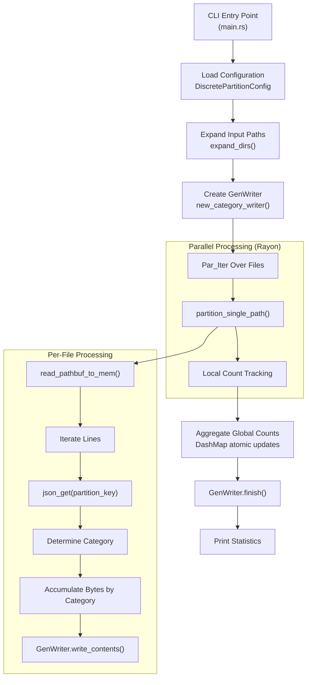
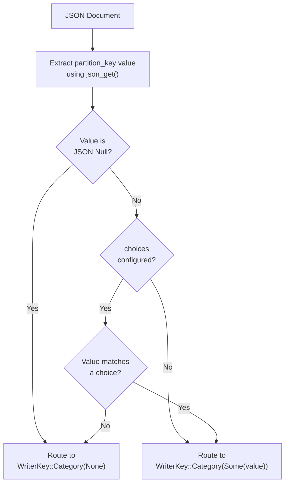
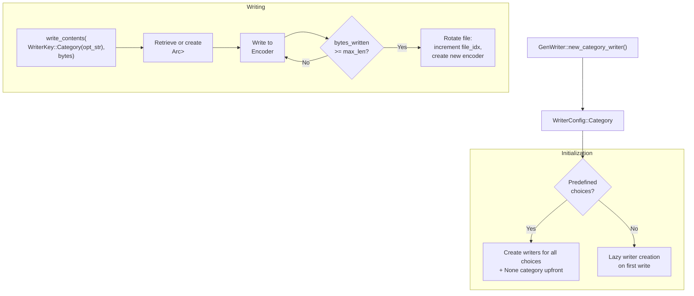

<!-- source: DeepWiki mcp.deepwiki.com · repo allenai/datamap-rs · page 4.2 Discrete Partition Command · fetched 2026-10-26 -->

# Discrete Partition Command

<details>
<summary>Relevant source files</summary>

The following files were used as context for generating this wiki page:

- [docs/group.md](docs/group.md)
- [docs/partition.md](docs/partition.md)
- [src/partition.rs](src/partition.rs)
- [src/reservoir_sample.rs](src/reservoir_sample.rs)

</details>


## Purpose and Scope

The Discrete Partition command organizes JSONL datasets into categorical subdirectories based on the value of a specified field. This command is designed for partitioning data with discrete, categorical values such as language codes, domains, content types, or any other field with a manageable number of distinct categories.

For partitioning by continuous numeric values (e.g., quality scores), see [Range Partition Command](#4.3). For other data organization operations, see [Data Organization Commands](#4).

---

## Command Overview

The `discrete-partition` command reads JSONL files, extracts a specified field from each document, and routes the document to an output directory named after the field's value. It supports two operational modes:

1. **Predefined categories**: When categories are specified upfront, documents matching those categories are routed to their respective directories, while non-matching documents go to `no_category/`
2. **Dynamic discovery**: When categories are not predefined, the command automatically creates directories for all encountered values

The command processes files in parallel and automatically splits output files when they exceed a configurable size threshold (default: 256MB uncompressed).

**Sources**: [src/partition.rs:21-46](), [src/partition.rs:66-111]()

---

## Command-Line Interface

### Basic Usage

```bash
datamap discrete-partition \
  --input_dir <PATH> \
  --output_dir <PATH> \
  [--config <CONFIG_FILE>] \
  [--partition_key <FIELD_PATH>] \
  [--threads <N>]
```

### Arguments

| Argument | Required | Description |
|----------|----------|-------------|
| `--input_dir` | Yes | Directory containing input JSONL files (`.jsonl.zst` or `.jsonl`) |
| `--output_dir` | Yes | Directory where partitioned output will be written |
| `--config` | Conditional | Path to YAML configuration file (required if `--partition_key` not provided) |
| `--partition_key` | Conditional | JSON field path to partition on (required if `--config` not provided) |
| `--threads` | No | Number of parallel threads (default: all available cores) |

**Note**: Either `--config` or `--partition_key` must be provided, but not both.

**Sources**: [src/partition.rs:66-80]()

---

## Configuration Format

### DiscretePartitionConfig Structure

The configuration can be specified via YAML file or partially through command-line arguments. When using a configuration file, it must conform to the `DiscretePartitionConfig` structure:

```yaml
name: "Language Partition"
partition_key: "metadata.language"
choices: ["en", "es", "fr", "de"]  # Optional
max_file_size: 256000000  # Optional, default: 256MB
```

### Configuration Fields

| Field | Type | Required | Default | Description |
|-------|------|----------|---------|-------------|
| `name` | String | Yes | - | Descriptive name for logging |
| `partition_key` | String | Yes | - | JSON path to field (e.g., `"metadata.lang"`, `"domain"`) |
| `choices` | Vec\<String\> | No | `None` | Predefined list of valid categories |
| `max_file_size` | usize | No | `256000000` | Maximum uncompressed bytes per output file |

### JSON Path Syntax

The `partition_key` field supports dot-notation for nested fields:
- `"language"` - Top-level field
- `"metadata.language"` - Nested field
- `"attributes.classification.primary"` - Deeply nested field

The path is resolved using the `json_get()` utility function, which returns `None` if the path doesn't exist.

**Sources**: [src/partition.rs:49-61](), [src/partition.rs:124]()

---

## Processing Architecture

### Overall Flow



**Sources**: [src/partition.rs:66-111](), [src/partition.rs:114-154]()

### Category Determination Logic



**Sources**: [src/partition.rs:127-142]()

### GenWriter Integration

The discrete partition command uses `GenWriter` with the `Category` configuration variant:



**Sources**: [src/partition.rs:334-386](), [src/partition.rs:448-516]()

---

## Input/Output Structure

### Input Requirements

- **Format**: JSONL files (`.jsonl` or `.jsonl.zst`)
- **Structure**: Each line must be a valid JSON object
- **Field**: Documents must contain the field specified by `partition_key` (or will be routed to `no_category/`)

### Output Directory Structure

#### Without Predefined Choices (Dynamic Discovery)

```
output_dir/
├── value1/
│   ├── chunk_00000000.jsonl.zst
│   ├── chunk_00000001.jsonl.zst
│   └── chunk_00000002.jsonl.zst
├── value2/
│   ├── chunk_00000000.jsonl.zst
│   └── chunk_00000001.jsonl.zst
├── value3/
│   └── chunk_00000000.jsonl.zst
└── no_category/
    └── chunk_00000000.jsonl.zst
```

#### With Predefined Choices

```
output_dir/
├── en/
│   ├── chunk_00000000.jsonl.zst
│   ├── chunk_00000001.jsonl.zst
│   └── ...
├── es/
│   ├── chunk_00000000.jsonl.zst
│   └── ...
├── fr/
│   └── chunk_00000000.jsonl.zst
├── de/
│   └── chunk_00000000.jsonl.zst
└── no_category/
    └── chunk_00000000.jsonl.zst
```

### File Naming Convention

Output files follow the pattern: `chunk_{file_idx:08}.jsonl.zst`

Where:
- `file_idx` is an 8-digit zero-padded integer (e.g., `00000000`, `00000001`)
- Files are automatically rotated when uncompressed size exceeds `max_file_size`
- All files are compressed with zstd at level 3

**Sources**: [src/partition.rs:406-416]()

---

## Behavior Details

### Category Matching Modes

#### Mode 1: Dynamic Category Discovery

When `choices` is `None` in the configuration:

1. Categories are discovered during processing
2. A new directory is created for each unique value encountered
3. `WriterInfo` instances are lazily created on first write
4. The `no_category/` directory only contains documents with null or missing partition keys

**Implementation**: [src/partition.rs:458-473]()

#### Mode 2: Predefined Categories

When `choices` is specified:

1. All category directories and writers are pre-initialized
2. Only specified categories get their own directories
3. Any value not in `choices` is routed to `no_category/`
4. Null or missing values also go to `no_category/`

**Implementation**: [src/partition.rs:344-369](), [src/partition.rs:450-457]()

### Null and Missing Value Handling

The command handles three scenarios for the partition key:

| Scenario | Routing Decision |
|----------|------------------|
| Field missing from JSON | `WriterKey::Category(None)` → `no_category/` |
| Field value is JSON null | `WriterKey::Category(None)` → `no_category/` |
| Field value is non-null string | `WriterKey::Category(Some(value))` → category directory or `no_category/` (if choices don't match) |

**Sources**: [src/partition.rs:127-142]()

### File Rotation Mechanism

File rotation occurs automatically when a file reaches `max_file_size`:

1. The current `Encoder` is flushed and finished
2. `file_idx` is incremented
3. A new `Encoder` is created with the new index
4. `bytes_written` counter is reset to 0

The rotation threshold is checked after each write operation within `GenWriter::write_contents()`.

**Sources**: [src/partition.rs:495-512]()

### Statistics Tracking

The command tracks document counts using a two-level aggregation strategy:

1. **Local counts**: Each thread maintains a `HashMap<Option<String>, usize>` for files it processes
2. **Global aggregation**: Local counts are merged into a shared `DashMap<Option<String>, AtomicUsize>` using atomic fetch-add operations
3. **Final reporting**: After all files are processed, statistics are printed showing document counts per category

**Sources**: [src/partition.rs:83-108]()

---

## Common Use Cases

### Example 1: Partition by Language

**Scenario**: Separate a multilingual corpus into language-specific subdirectories.

```yaml
name: "Language Partition"
partition_key: "metadata.language"
choices: ["en", "es", "fr", "de", "zh", "ja", "ko", "ar", "hi"]
max_file_size: 256000000
```

**Command**:
```bash
datamap discrete-partition \
  --input_dir ./multilingual_corpus \
  --output_dir ./by_language \
  --config language_partition.yaml
```

### Example 2: Partition by Domain (Dynamic Discovery)

**Scenario**: Organize web documents by domain without knowing all domains in advance.

```bash
datamap discrete-partition \
  --input_dir ./web_crawl \
  --output_dir ./by_domain \
  --partition_key "domain"
```

This creates directories dynamically as new domains are encountered.

### Example 3: Partition by Content Classification

**Scenario**: Separate documents by a classification field into predefined categories.

```yaml
name: "Content Type Partition"
partition_key: "classification.primary_type"
choices: ["article", "forum_post", "social_media", "news", "documentation"]
max_file_size: 256000000
```

Documents with classifications outside this list go to `no_category/`.

### Example 4: Partition by Quality Tier

**Scenario**: Separate documents into discrete quality tiers (low, medium, high).

```yaml
name: "Quality Tier Partition"
partition_key: "metadata.quality_tier"
choices: ["low", "medium", "high"]
```

**Note**: For continuous quality scores, use [Range Partition Command](#4.3) instead.

**Sources**: [docs/partition.md:99-123]()

---

## Performance Characteristics

### Parallelism Model

The discrete partition command uses **file-level parallelism** via Rayon:

- Input files are processed in parallel across available CPU cores
- Each file is processed sequentially (line-by-line) by a single thread
- Thread count can be controlled with `--threads` argument
- Default: Uses all available CPU cores

**Trade-offs**:
- **Pros**: Simple, no contention at document level, efficient for large files
- **Cons**: Limited parallelism if few input files exist

**Sources**: [src/partition.rs:85-91]()

### Memory Usage

#### Per-Thread Memory

Each thread processing a file maintains:
- Input file contents loaded into memory via `read_pathbuf_to_mem()`
- A `HashMap<Option<String>, Vec<u8>>` accumulating bytes per category
- A `HashMap<Option<String>, usize>` tracking local counts

**Memory pattern**: Accumulates all documents for each category in the current file before writing to `GenWriter`.

#### Shared Memory

- `DashMap<Option<String>, AtomicUsize>`: Global statistics (lightweight)
- `GenWriter`: Lock-free `DashMap` of `Arc<Mutex<WriterInfo>>` instances (one per category)
- Each `WriterInfo` contains an `Encoder` buffering compressed data

**Sources**: [src/partition.rs:114-154]()

### I/O Characteristics

| Aspect | Behavior |
|--------|----------|
| **Input Reading** | Files loaded entirely into memory before processing |
| **Output Writing** | Buffered writes through zstd `Encoder` |
| **Compression** | Zstd level 3 (balance of speed and compression ratio) |
| **File System Operations** | Directories created on-demand with `create_dir_all()` |

### Scaling Considerations

**Best Performance When**:
- Many input files (more parallelism)
- Files are moderately sized (fits in memory)
- Output distributed across multiple categories (less write contention)
- Fast local storage (NVMe recommended)

**Performance Degradation When**:
- Very few input files (limited parallelism)
- Extremely large files (memory pressure)
- All documents map to one category (write serialization)
- Many categories with predefined choices (many open file handles)

**Sources**: [src/partition.rs:85-92](), [src/partition.rs:334-386]()

---

## Comparison with Related Commands

| Feature | Discrete Partition | Range Partition | Group Command |
|---------|-------------------|-----------------|---------------|
| **Field Type** | Categorical (string) | Numeric (f64) | String ID |
| **Number of Outputs** | One per unique value | Fixed number of buckets | One per unique group_id |
| **Primary Use Case** | Language, domain, type | Quality scores, percentiles | Deduplication prep |
| **Output Naming** | `{category}/chunk_*.jsonl.zst` | `bucket_XXXX/shard_*.jsonl.zst` | `chunk_*.jsonl.zst` |
| **Category Discovery** | Optional (dynamic) | N/A (ranges predefined) | Always dynamic |

See [Range Partition Command](#4.3) for numeric partitioning and [Group Command](#4.4) for ID-based grouping.

**Sources**: [src/partition.rs:21-41](), [src/partition.rs:156-252]()

---

