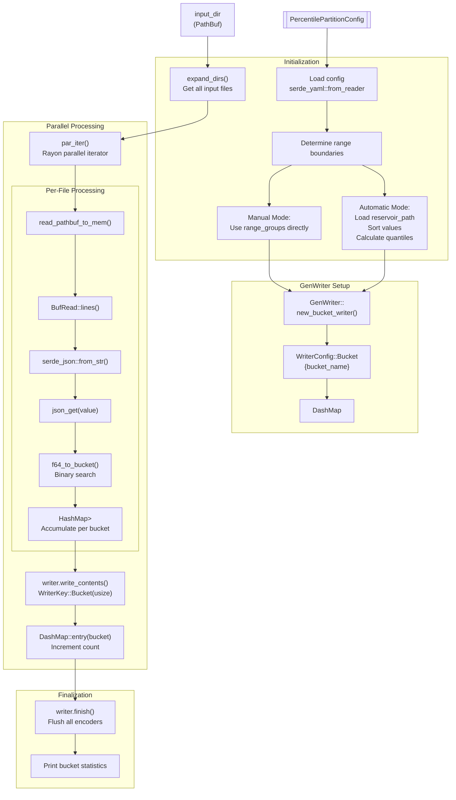
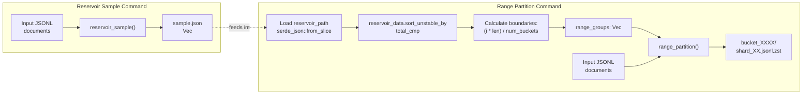
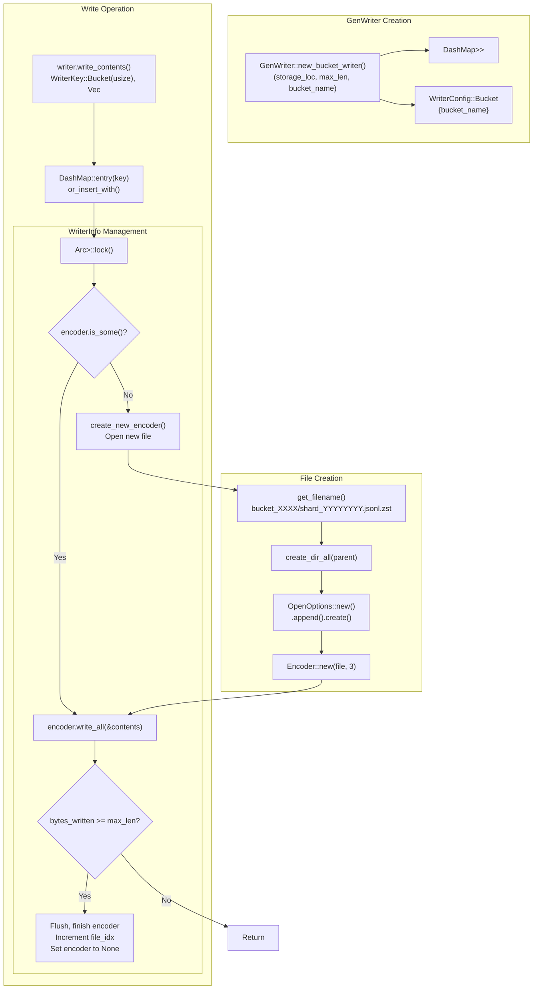
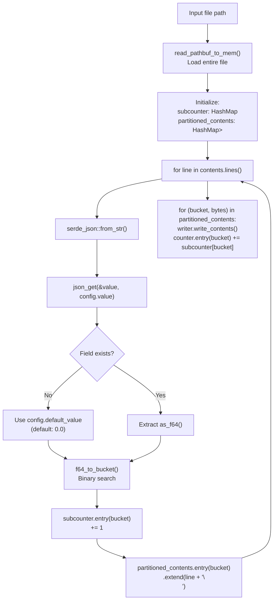

<!-- source: DeepWiki mcp.deepwiki.com · repo allenai/datamap-rs · page 4.3 Range Partition Command · fetched 2026-10-26 -->

# Range Partition Command

<details>
<summary>Relevant source files</summary>

The following files were used as context for generating this wiki page:

- [docs/group.md](docs/group.md)
- [docs/partition.md](docs/partition.md)
- [src/partition.rs](src/partition.rs)
- [src/reservoir_sample.rs](src/reservoir_sample.rs)

</details>


## Purpose and Scope

The Range Partition command organizes data into subdirectories (buckets) based on continuous numeric field values. It divides documents into ranges using either manually specified boundaries or automatically calculated quantiles from a reservoir sample. This command is useful for creating quality tiers, percentile-based splits, or any partitioning based on continuous metrics.

For partitioning by categorical values, see [Discrete Partition Command](#4.2). For statistical sampling that feeds into range partition, see [Reservoir Sample Command](#5.1).

---

## Command Overview

Range partition reads JSONL files, extracts a numeric field from each document, assigns the document to a bucket based on range boundaries, and writes output to bucket-specific directories. The command operates in parallel and produces compressed output files.

**Key characteristics:**
- Partitions by continuous numeric values (scores, probabilities, counts)
- Supports manual range boundaries or automatic quantile calculation
- Parallel processing at file level
- Automatic file rotation at size threshold
- All output compressed with zstd level 3

Sources: [src/partition.rs:34-41](), [src/partition.rs:181-252]()

---

## CLI Usage

### Basic Usage

```bash
datamap range-partition \
  --input_dir ./data/input \
  --output_dir ./data/partitioned \
  --config partition_config.yaml
```

### Command-Line Arguments

| Argument | Required | Description | Default |
|----------|----------|-------------|---------|
| `--input_dir` | Yes | Directory containing input JSONL files | - |
| `--output_dir` | Yes | Directory for partitioned output | - |
| `--config` | No* | Path to YAML configuration file | - |
| `--value` | No* | Numeric field to partition on | - |
| `--default_value` | No | Default value for missing fields | `0.0` |
| `--range_groups` | No** | Comma-separated boundary values | - |
| `--reservoir_path` | No** | Path to reservoir sample JSON | - |
| `--num_buckets` | No** | Number of buckets (with reservoir) | - |
| `--max_file_size` | No | Max uncompressed bytes per file | `256000000` |
| `--bucket_name` | No | Prefix for bucket directories | `"bucket"` |
| `--threads` | No | Number of parallel threads | All cores |

*Either `--config` or `--value` must be provided  
**Either provide `--range_groups` OR both `--reservoir_path` and `--num_buckets`

Sources: [src/partition.rs:181-200]()

---

## Configuration Format

### Manual Range Mode

```yaml
name: "Quality Score Partition"
value: "metadata.quality_score"
default_value: 0.0
range_groups: [0.25, 0.5, 0.75]
max_file_size: 256000000
bucket_name: "quality"
```

### Automatic Quantile Mode

```yaml
name: "Quality Score Partition"
value: "metadata.quality_score"
default_value: 0.0
reservoir_path: "./stats/quality_sample.json"
num_buckets: 10
max_file_size: 256000000
bucket_name: "bucket"
```

### Configuration Fields

The configuration is represented by the `PercentilePartitionConfig` struct:

| Field | Type | Required | Description |
|-------|------|----------|-------------|
| `name` | String | Yes | Descriptive name for the operation |
| `value` | String | Yes | JSON field path to numeric value |
| `default_value` | f64 | No | Value for missing/null fields (default: `0.0`) |
| `range_groups` | Vec\<f64\> | Conditional* | Explicit boundary values |
| `reservoir_path` | PathBuf | Conditional* | Path to reservoir sample |
| `num_buckets` | usize | Conditional* | Number of buckets for quantile mode |
| `max_file_size` | usize | No | Max uncompressed bytes (default: `256000000`) |
| `bucket_name` | String | No | Bucket directory prefix (default: `"bucket"`) |

*Either `range_groups` or both `reservoir_path` and `num_buckets` required

Sources: [src/partition.rs:159-173]()

---

## Partitioning Modes

### Manual Range Mode

When `range_groups` is specified, boundaries are used directly to create buckets. Given boundaries `[b₁, b₂, ..., bₙ]`, the system creates `n+1` buckets:

- **Bucket 0**: `(-∞, b₁)`
- **Bucket 1**: `[b₁, b₂)`
- **Bucket 2**: `[b₂, b₃)`
- ...
- **Bucket n**: `[bₙ, ∞)`

**Example:**  
`range_groups: [0.25, 0.5, 0.75]` creates 4 buckets:
- `bucket_0000`: `(-∞, 0.25)`
- `bucket_0001`: `[0.25, 0.5)`
- `bucket_0002`: `[0.5, 0.75)`
- `bucket_0003`: `[0.75, ∞)`

Sources: [src/partition.rs:204-223]()

### Automatic Quantile Mode

When `reservoir_path` and `num_buckets` are specified:

1. Load reservoir sample from JSON file
2. Parse as `Vec<f64>` and sort values
3. Calculate quantile boundaries: for `n` buckets, compute boundaries at indices `i * len / n` for `i = 1..n-1`
4. Use these boundaries as `range_groups`

**Example:**  
With `num_buckets: 4` and 1000 sample values:
- Boundary 1: Value at index 250 (25th percentile)
- Boundary 2: Value at index 500 (50th percentile)
- Boundary 3: Value at index 750 (75th percentile)

This creates approximately equal-sized buckets based on the distribution in the sample.

Sources: [src/partition.rs:204-223]()

---

## Range Partition Architecture

### Overall Processing Flow



Sources: [src/partition.rs:181-252](), [src/partition.rs:254-281]()

---

## Bucket Assignment Algorithm

The `f64_to_bucket` function determines which bucket a value belongs to using binary search.

```mermaid
graph TB
    Input["Input: value (f64)<br/>boundaries [b₀, b₁, ..., bₙ]"]
    
    CheckFirst{"value < b₀?"}
    ReturnZero["Return bucket 0"]
    
    BinarySearch["binary_search_by()<br/>Find insertion point"]
    
    FoundExact{"Exact match?"}
    ReturnExact["Return exact index"]
    ReturnInsert["Return insertion index"]
    
    Input --> CheckFirst
    CheckFirst -->|Yes| ReturnZero
    CheckFirst -->|No| BinarySearch
    BinarySearch --> FoundExact
    FoundExact -->|Ok(index)| ReturnExact
    FoundExact -->|Err(index)| ReturnInsert
```

**Implementation details:**

The function first checks if the value is less than the first boundary. If so, it returns bucket 0. Otherwise, it uses Rust's `binary_search_by` with `partial_cmp` to find the appropriate bucket index in O(log n) time.

```
Boundaries: [0.25, 0.5, 0.75]

value = 0.1  → bucket 0 (< 0.25)
value = 0.25 → bucket 1 (exact match)
value = 0.3  → bucket 1 (0.25 ≤ 0.3 < 0.5)
value = 0.6  → bucket 2 (0.5 ≤ 0.6 < 0.75)
value = 0.9  → bucket 3 (≥ 0.75)
```

Sources: [src/partition.rs:283-292]()

---

## Integration with Reservoir Sample

Range partition can use reservoir sample output to automatically calculate quantile boundaries.



**Token-weighted quantiles:**  
When using `--token_weighted` with reservoir sample, boundaries represent token-based percentiles rather than document-based percentiles. This ensures buckets are balanced by token count, which is useful for training data partitioning.

Sources: [src/partition.rs:206-222](), [src/reservoir_sample.rs:113-140]()

---

## Output Structure

### Directory Layout

```
output_dir/
├── bucket_0000/
│   ├── shard_00000000.jsonl.zst
│   ├── shard_00000001.jsonl.zst
│   └── shard_00000002.jsonl.zst
├── bucket_0001/
│   ├── shard_00000000.jsonl.zst
│   └── shard_00000001.jsonl.zst
├── bucket_0002/
│   └── shard_00000000.jsonl.zst
└── bucket_0003/
    ├── shard_00000000.jsonl.zst
    └── ...
```

**Naming conventions:**
- Bucket directories: `{bucket_name}_{bucket_num:04}` where `bucket_num` is zero-indexed
- Shard files: `shard_{file_idx:08}.jsonl.zst` where `file_idx` increments per bucket
- All files compressed with zstd level 3

Sources: [src/partition.rs:418-422]()

---

## GenWriter Integration

Range partition uses `GenWriter` with `WriterConfig::Bucket` mode.



**Key implementation details:**

- `DashMap` provides lock-free concurrent map for bucket writers
- Each bucket has its own `Arc<Mutex<WriterInfo>>` for thread-safe writes
- File rotation happens automatically when `bytes_written >= max_len`
- Encoders are lazily created on first write to each bucket
- The `finish()` method flushes and closes all encoders in parallel

Sources: [src/partition.rs:388-404](), [src/partition.rs:448-516](), [src/partition.rs:537-554]()

---

## Per-File Processing

The `percentile_partition_path` function processes a single input file.



**Processing strategy:**

1. Read entire file into memory (optimized for NVMe drives)
2. Parse each line as JSON
3. Extract numeric field using `json_get` with nested path support
4. Use `default_value` if field is missing or null
5. Accumulate lines per bucket in memory
6. Write all buckets at once (reduces lock contention)
7. Update global counters atomically using `DashMap`

Sources: [src/partition.rs:254-281]()

---

## Output Statistics

Upon completion, the command prints statistics to stdout:

```
Starting partition...
Range groups are [0.25, 0.5, 0.75]
Finished partition in 42 seconds
Put this many docs in each group
(-∞, 0.25) | 15,234 docs
[0.25, 0.5) | 23,456 docs
[0.5, 0.75) | 18,900 docs
[0.75, ∞) | 12,410 docs
```

Statistics are gathered using a shared `DashMap<usize, usize>` counter that accumulates document counts per bucket across all threads. The final output sorts buckets numerically and displays ranges with mathematical notation.

Sources: [src/partition.rs:226-250]()

---

## Common Use Cases

### Quality-Based Tiering

Partition by quality score into low/medium/high/premium tiers:

```yaml
name: "Quality Tiers"
value: "metadata.quality_score"
default_value: 0.0
range_groups: [0.3, 0.6, 0.8]
bucket_name: "quality"
```

Output: `quality_0000/` (< 0.3), `quality_0001/` (0.3-0.6), `quality_0002/` (0.6-0.8), `quality_0003/` (≥ 0.8)

### Automatic Decile Partitioning

Create 10 equally-sized buckets based on sample distribution:

```bash
# Step 1: Create reservoir sample
datamap reservoir-sample \
  --input_dir ./data \
  --output_file ./stats/quality_sample.json \
  --key "metadata.quality_score" \
  --reservoir_size 100000

# Step 2: Partition into deciles
datamap range-partition \
  --input_dir ./data \
  --output_dir ./deciles \
  --value "metadata.quality_score" \
  --reservoir_path ./stats/quality_sample.json \
  --num_buckets 10 \
  --bucket_name "decile"
```

### Token-Weighted Quantile Partitioning

Partition by quality score where buckets are balanced by token count:

```bash
# Step 1: Token-weighted sample
datamap reservoir-sample \
  --input_dir ./data \
  --output_file ./stats/token_weighted.json \
  --key "metadata.quality_score" \
  --reservoir_size 50000 \
  --token_weighted \
  --text_key "text"

# Step 2: Partition using token-weighted quantiles
datamap range-partition \
  --input_dir ./data \
  --output_dir ./token_partitioned \
  --value "metadata.quality_score" \
  --reservoir_path ./stats/token_weighted.json \
  --num_buckets 5 \
  --bucket_name "token_bucket"
```

This ensures each bucket contains approximately the same number of tokens, which is important for balanced training data splits.

Sources: [docs/partition.md:237-285]()

---

## Performance Characteristics

### Parallelism

- **File-level parallelism**: Uses Rayon `par_iter()` to process files in parallel
- **Thread pool size**: Defaults to all CPU cores, configurable with `--threads`
- **Per-bucket locking**: `DashMap` provides lock-free map access; `Arc<Mutex<WriterInfo>>` per bucket minimizes lock contention
- **No document-level parallelism**: Documents within a file are processed sequentially

### Memory Usage

- **Per-file buffering**: Each thread accumulates output per bucket before writing
- **Typical memory**: `O(num_buckets * avg_file_size)` per thread
- **256MB default file size**: Balances parallelism with memory footprint

### I/O Pattern

- **Read**: Sequential read of entire file into memory (optimized for NVMe)
- **Write**: Batched writes per bucket (reduces system calls)
- **Compression**: Zstd level 3 applied inline during write
- **File rotation**: Automatic rotation when uncompressed bytes exceed `max_file_size`

Sources: [src/partition.rs:230-233](), [src/partition.rs:254-281]()

---

## Implementation Details

### Key Data Structures

| Structure | Type | Purpose |
|-----------|------|---------|
| `PercentilePartitionConfig` | Struct | Configuration deserialized from YAML |
| `WriterKey::Bucket(usize)` | Enum variant | Key type for bucket identification |
| `GenWriter<'a>` | Struct | Manages concurrent file writers |
| `WriterInfo<'a>` | Struct | Per-bucket encoder state |
| `DashMap<usize, usize>` | Concurrent map | Document count per bucket |
| `HashMap<usize, Vec<u8>>` | Local buffer | Per-thread accumulation buffer |

### Critical Functions

| Function | Location | Purpose |
|----------|----------|---------|
| `range_partition` | [src/partition.rs:181-252]() | Main entry point and orchestration |
| `percentile_partition_path` | [src/partition.rs:254-281]() | Process single input file |
| `f64_to_bucket` | [src/partition.rs:283-292]() | Assign value to bucket via binary search |
| `GenWriter::new_bucket_writer` | [src/partition.rs:388-404]() | Initialize writer for bucket mode |
| `GenWriter::write_contents` | [src/partition.rs:448-516]() | Thread-safe write with rotation |
| `GenWriter::finish` | [src/partition.rs:537-554]() | Flush and close all writers |

Sources: [src/partition.rs:159-554]()

---

## Error Handling

The command handles several error conditions:

- **Missing configuration**: Panics if neither `range_groups` nor `reservoir_path` is provided
- **Invalid reservoir format**: Panics on JSON parse errors when loading sample
- **Missing field**: Uses `default_value` when specified field doesn't exist
- **Invalid numeric values**: Uses `default_value` on null or non-numeric values
- **I/O errors**: Propagates errors from file operations with `?` operator

Sources: [src/partition.rs:220-222](), [src/partition.rs:261-266]()

---

## Comparison with Discrete Partition

| Aspect | Range Partition | Discrete Partition |
|--------|----------------|-------------------|
| **Input type** | Continuous numeric values | Categorical string values |
| **Bucket assignment** | Binary search O(log n) | Hash map lookup O(1) |
| **Number of buckets** | Fixed (n+1 for n boundaries) | Dynamic or predefined |
| `WriterKey` | `Bucket(usize)` | `Category(Option<String>)` |
| **Output naming** | `bucket_XXXX/shard_YY.jsonl.zst` | `{category}/chunk_YY.jsonl.zst` |
| **Quantile support** | Yes (via reservoir sample) | No |
| **Use case** | Quality scores, probabilities | Languages, domains, types |

Sources: [src/partition.rs:159-292](), [src/partition.rs:49-154]()

---

