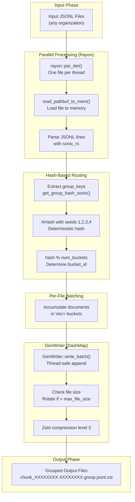
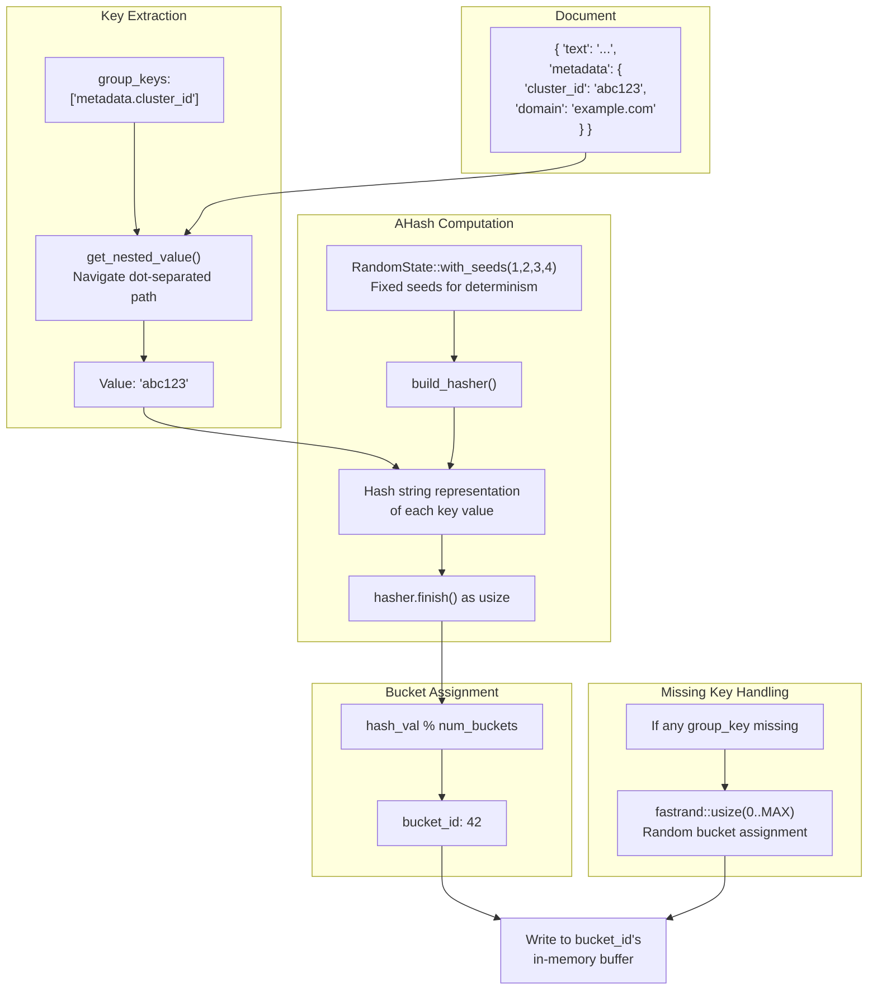

<!-- source: DeepWiki mcp.deepwiki.com · repo allenai/datamap-rs · page 4.4 Group Command · fetched 2026-10-26 -->

# Group Command

<details>
<summary>Relevant source files</summary>

The following files were used as context for generating this wiki page:

- [docs/group.md](docs/group.md)
- [src/groupfilter.rs](src/groupfilter.rs)
- [src/lib.rs](src/lib.rs)
- [src/shuffle.rs](src/shuffle.rs)

</details>


## Purpose and Scope

The Group command co-locates documents with the same group identifier into the same output file through hash-based distribution. This command is the first stage of a two-phase deduplication workflow, where documents are reorganized by group ID so that all duplicates live together, enabling efficient downstream filtering. For the second stage that selects one document per group, see [GroupFilter Command](#4.5).

**Sources:** [src/groupfilter.rs:28-52]()

---

## Overview

The Group command redistributes documents across output files such that all documents sharing the same `group_id` (or set of group keys) are written to the same output file. This reorganization is performed using deterministic hash-based bucketing, where the hash of the group keys determines which output bucket receives each document.

Unlike partitioning commands ([Discrete Partition](#4.2), [Range Partition](#4.3)) that organize data by field values, the Group command focuses solely on co-location: ensuring that related documents end up in the same file regardless of their content or metadata.

**Key characteristics:**
- **Hash-based distribution**: Uses AHash with fixed seeds for deterministic routing
- **Parallel processing**: Multiple input files processed concurrently via Rayon
- **Batch writing**: Documents accumulate in memory per bucket, then written in batches
- **No content modification**: Documents are copied verbatim to new locations

**Sources:** [src/groupfilter.rs:83-107](), [src/groupfilter.rs:110-140]()

---

## Use Cases

### Fuzzy Deduplication Workflow

The primary use case is preparing data for deduplication after running similarity detection:

1. **Annotation phase**: Documents are annotated with `fuzzy_duplicate_id` or `cluster_id` 
2. **Group phase**: This command co-locates all documents with same ID
3. **Filter phase**: GroupFilter selects one document per group (see [GroupFilter Command](#4.5))

### Other Grouping Scenarios

- **Consolidating by document hash**: Group documents by content hash for exact deduplication
- **Collecting by URL**: Group variations of the same webpage
- **Organizing by entity ID**: Co-locate documents referring to the same entity
- **Multi-key grouping**: Group by composite keys (e.g., domain + language)

**Important constraint:** This command will fail if any single group contains too many documents to fit in memory. Avoid "hot keys" where billions of documents share the same group ID.

**Sources:** [src/groupfilter.rs:42-51]()

---

## Command Line Usage

```bash
datamap group \
  --input_dir ./data/annotated \
  --group_dir ./data/grouped \
  --config group_config.yaml \
  [--subext "group"] \
  [--threads 16]
```

### Arguments

| Argument | Required | Description |
|----------|----------|-------------|
| `--input_dir` | Yes | Directory containing input JSONL files |
| `--group_dir` | Yes | Directory for grouped output files |
| `--config` | Yes | Path to YAML/JSON configuration file |
| `--subext` | No | Substring to append to output filenames (default: "group") |
| `--threads` | No | Number of parallel threads (default: all CPU cores) |

**Sources:** [src/groupfilter.rs:83-107]()

---

## Configuration

### Configuration File Structure

```yaml
name: "Fuzzy Dedup Grouping"
group_keys: ["metadata.fuzzy_cluster_id"]
num_buckets: 1024
max_file_size: 256000000
delete_after_read: false
```

### Configuration Fields

| Field | Type | Required | Default | Description |
|-------|------|----------|---------|-------------|
| `name` | string | Yes | - | Descriptive name for the operation |
| `group_keys` | array[string] | Yes | - | JSON field paths to compute group hash from |
| `num_buckets` | integer | Yes | - | Number of output buckets (output files) |
| `max_file_size` | integer | No | 256000000 | Max uncompressed bytes per output file (256MB) |
| `delete_after_read` | boolean | No | false | Delete input files after successful processing |

### Group Keys

The `group_keys` field supports:
- **Simple keys**: `"cluster_id"`
- **Nested keys**: `"metadata.fuzzy_cluster_id"` (dot notation)
- **Multiple keys**: `["domain", "language"]` (composite grouping)

When multiple keys are specified, all key values are concatenated for hashing. If any key is missing, the document is placed in a random bucket.

**Sources:** [src/groupfilter.rs:54-76](), [src/groupfilter.rs:142-169]()

---

## How Group Operations Work

### Overall Process Flow



**Sources:** [src/groupfilter.rs:83-140](), [src/groupfilter.rs:297-341]()

---

## Hash-Based Distribution Algorithm

### Deterministic Hashing Process



**Sources:** [src/groupfilter.rs:142-169](), [src/groupfilter.rs:171-191](), [src/groupfilter.rs:110-140]()

---

## Implementation Details

### Key Code Entities

| Component | Location | Purpose |
|-----------|----------|---------|
| `group()` | [src/groupfilter.rs:83-107]() | Main entry point, orchestrates parallel processing |
| `group_path()` | [src/groupfilter.rs:110-140]() | Processes single input file, routes documents to buckets |
| `get_group_hash_sonic()` | [src/groupfilter.rs:142-169]() | Computes hash from group keys using sonic-rs parser |
| `get_nested_value()` | [src/groupfilter.rs:171-191]() | Extracts nested JSON values via dot notation |
| `GenWriter` | [src/groupfilter.rs:297-341]() | Concurrent file writer with automatic rotation |
| `GroupFilterConfig` | [src/groupfilter.rs:54-76]() | Configuration structure |

### Per-File Processing Logic

The `group_path()` function processes each input file:

1. **Memory allocation**: Creates `Vec<Vec<u8>>` with `num_buckets` empty vectors
2. **Line-by-line processing**: Iterates through JSONL lines
3. **Parse and hash**: Uses `sonic_rs` for fast JSON parsing, computes group hash
4. **Accumulate**: Appends document bytes to appropriate bucket vector
5. **Batch write**: After processing entire file, writes each non-empty bucket to `GenWriter`
6. **Optional cleanup**: Deletes input file if `delete_after_read: true`

**Sources:** [src/groupfilter.rs:110-140]()

---

## Output Structure

### File Naming Convention

```
group_dir/
├── chunk_00000000.00000000.group.jsonl.zst
├── chunk_00000000.00000001.group.jsonl.zst  (rotation after max_file_size)
├── chunk_00000001.00000000.group.jsonl.zst
├── chunk_00000002.00000000.group.jsonl.zst
...
└── chunk_00001023.00000000.group.jsonl.zst
```

### Filename Components

The filename pattern is: `chunk_{BUCKET:08}.{FILE_IDX:08}.{SUBEXT}.jsonl.zst`

- **BUCKET**: Zero-padded bucket ID (0 to `num_buckets-1`)
- **FILE_IDX**: Zero-padded rotation index (increments when file exceeds `max_file_size`)
- **SUBEXT**: Extension from config or CLI (default: "group")
- **Compression**: All files are zstd compressed at level 3

**Sources:** [src/groupfilter.rs:344-347](), [src/groupfilter.rs:349-365]()

---

## GenWriter Infrastructure

The Group command uses the `GenWriter` component for concurrent file writing:

```mermaid
graph TB
    subgraph GenWriterStructure["GenWriter Components"]
        DashMapRegistry["DashMap<usize, Arc<Mutex<WriterInfo>>><br/>Lock-free concurrent map"]
        
        subgraph WriterInfo["WriterInfo (per bucket)"]
            Encoder["Encoder: zstd::stream::Encoder"]
            BytesWritten["bytes_written: usize"]
            FileIdx["file_idx: usize (rotation counter)"]
            Subext["subext: String"]
        end
    end
    
    subgraph WriteOperation["write_batch() Flow"]
        GetWriter["DashMap::get(bucket_id)"]
        LockMutex["Arc<Mutex>::lock()<br/>Exclusive access to WriterInfo"]
        WriteBytes["encoder.write_all(contents)"]
        CheckSize["bytes_written >= max_len?"]
        RotateFile["Flush & finish old encoder<br/>Create new encoder<br/>Increment file_idx"]
        
        GetWriter --> LockMutex
        LockMutex --> WriteBytes
        WriteBytes --> CheckSize
        CheckSize -->|Yes| RotateFile
        CheckSize -->|No| ReleaseLock["Release mutex"]
        RotateFile --> ReleaseLock
    end
    
    subgraph Finish["finish() - Cleanup"]
        ParallelFlush["into_par_iter()<br/>Flush all encoders in parallel"]
    end
```



**Key characteristics:**
- **DashMap**: Lock-free concurrent hash map for bucket registry
- **Per-bucket locking**: Each bucket has its own `Mutex<WriterInfo>`, minimizing contention
- **Automatic rotation**: Files split when exceeding `max_file_size`
- **Zstd compression**: Level 3 compression applied to all output

**Sources:** [src/groupfilter.rs:297-341](), [src/groupfilter.rs:367-389](), [src/groupfilter.rs:415-432]()

---

## Performance Characteristics

### Parallelism Model

| Level | Strategy | Implementation |
|-------|----------|----------------|
| **File-level** | Embarrassingly parallel | `input_paths.par_iter()` via Rayon |
| **Document-level** | Sequential per file | Single-threaded loop in `group_path()` |
| **Write-level** | Lock per bucket | `DashMap` + `Mutex<WriterInfo>` |

### Memory Usage

- **Per input file**: `Vec<Vec<u8>>` with `num_buckets` elements
- **Worst case per file**: All documents go to same bucket = file size in memory
- **Typical case**: Documents spread across buckets = manageable memory
- **Recommendation**: Choose `num_buckets` ≥ number of threads to distribute load

### Throughput Factors

1. **Input I/O**: Reading from local NVMe (critical path)
2. **Hash computation**: AHash is fast, rarely bottleneck
3. **Output I/O**: Concurrent writes via `GenWriter`, compressed with Zstd
4. **Lock contention**: Minimized by per-bucket mutexes

**Sources:** [src/groupfilter.rs:98-101](), [src/groupfilter.rs:110-140]()

---

## Common Workflows

### Two-Stage Deduplication

```bash
# Stage 1: Annotate documents with fuzzy cluster IDs
datamap map \
  --input_dir ./raw_data \
  --output_dir ./annotated \
  --config fuzzy_dedup_annotation.yaml

# Stage 2: Group documents by cluster ID
datamap group \
  --input_dir ./annotated/step_final \
  --group_dir ./grouped \
  --config group_config.yaml

# Stage 3: Keep one document per group
datamap group-filter \
  --input_dir ./grouped \
  --output_dir ./deduplicated \
  --config filter_config.yaml
```

**Configuration for Stage 2:**
```yaml
name: "Fuzzy Dedup Grouping"
group_keys: ["metadata.fuzzy_cluster_id"]
num_buckets: 2048  # More buckets = better parallelism
max_file_size: 268435456  # 256MB per file
```

### Multi-Key Grouping for Composite Deduplication

```yaml
name: "Domain + Language Grouping"
group_keys: 
  - "domain"
  - "metadata.language"
num_buckets: 4096
max_file_size: 256000000
```

This creates groups where documents must match on both domain AND language to be co-located.

### Large-Scale Processing with Deletion

For disk space management on large datasets:

```yaml
name: "Space-Efficient Grouping"
group_keys: ["content_hash"]
num_buckets: 8192
max_file_size: 256000000
delete_after_read: true  # Delete inputs as they're processed
```

**Sources:** [src/groupfilter.rs:42-49]()

---

## Comparison with Similar Commands

| Command | Purpose | Distribution Method | Output Organization |
|---------|---------|---------------------|---------------------|
| **Group** | Co-locate by ID | Hash-based on group keys | `chunk_XXXXXXXX.*.jsonl.zst` |
| [Discrete Partition](#4.2) | Split by category | Direct mapping (field value → directory) | `category_name/chunk_*.jsonl.zst` |
| [Range Partition](#4.3) | Split by numeric range | Bucket selection by value comparison | `bucket_XXXX/shard_*.jsonl.zst` |
| [Shuffle](#4.6) | Random redistribution | Random bucket assignment | `chunk_*.shuffled.jsonl.zst` |

**When to use Group:**
- You need documents with same ID in same file (co-location)
- Preparing for deduplication (group then filter)
- Working with fuzzy matching or clustering results

**When NOT to use Group:**
- You want to split by category (use Discrete Partition)
- You want to split by numeric threshold (use Range Partition)
- You just want random redistribution (use Shuffle)

**Sources:** [src/groupfilter.rs:28-52]()

---

## Troubleshooting

### Hot Key Problem

**Symptom:** Process crashes with out-of-memory error

**Cause:** Too many documents share the same group key value

**Solution:**
- Reduce hot key cardinality before grouping
- Increase available memory
- Split into smaller batches
- Use larger `num_buckets` to distribute load

### Missing Group Keys

**Behavior:** Documents with missing `group_keys` are placed in random buckets

**Impact:** These documents will NOT be co-located with any group

**Mitigation:**
- Ensure all documents have the specified group keys
- Filter out documents without group keys before grouping
- Use annotation pipeline to add missing keys

### File Rotation Issues

**Symptom:** Unexpectedly many output files per bucket

**Cause:** Documents in bucket exceed `max_file_size`, triggering rotation

**Solution:**
- Increase `max_file_size` if appropriate
- Understand that rotation is normal behavior for large groups
- Adjust `num_buckets` to spread data more evenly

**Sources:** [src/groupfilter.rs:119-124](), [src/groupfilter.rs:376-385]()

---

