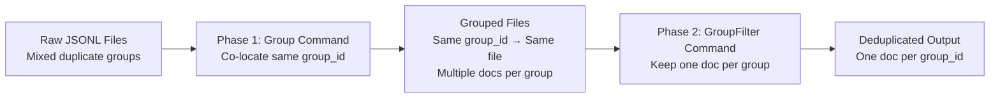
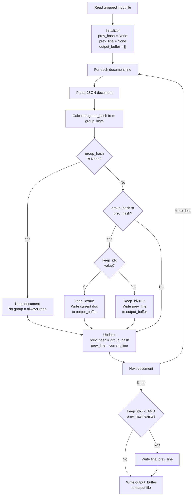
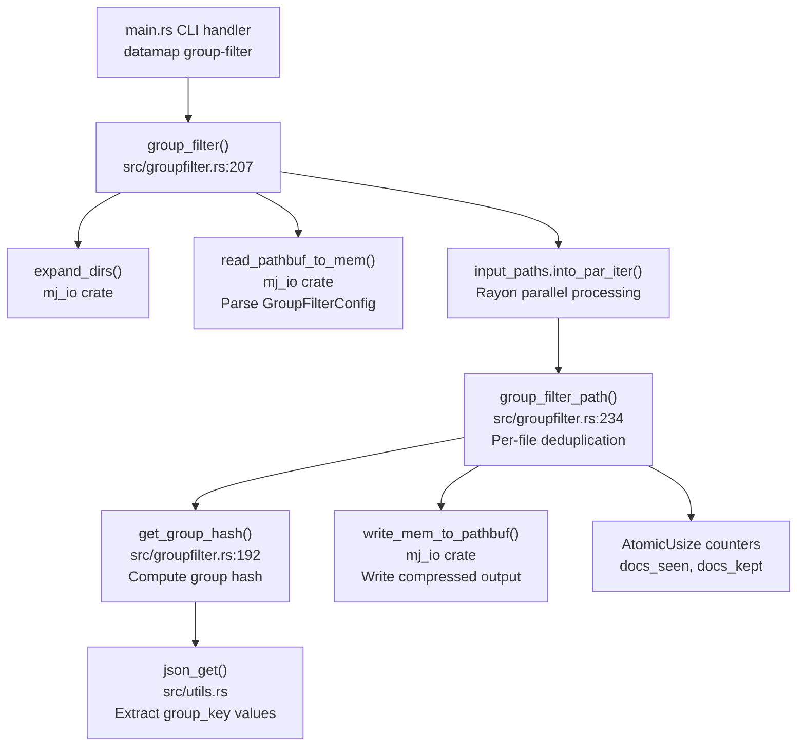
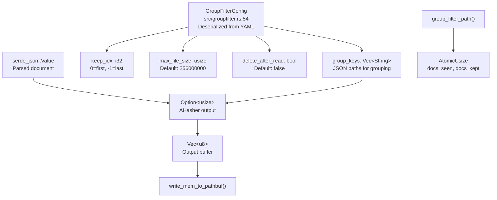
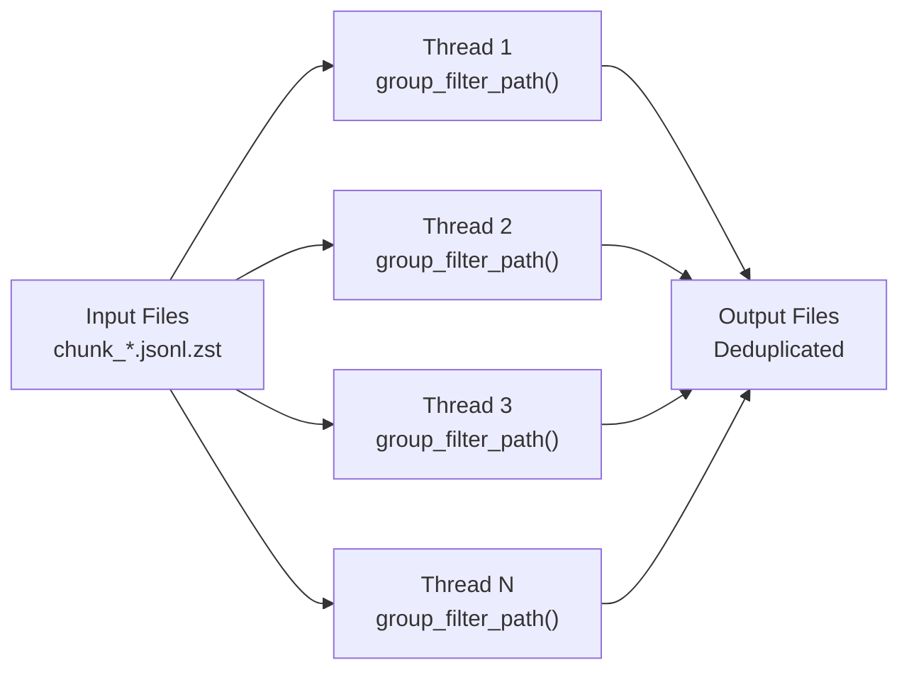

<!-- source: DeepWiki mcp.deepwiki.com · repo allenai/datamap-rs · page 4.5 GroupFilter Command · fetched 2026-10-26 -->

# GroupFilter Command

<details>
<summary>Relevant source files</summary>

The following files were used as context for generating this wiki page:

- [docs/group.md](docs/group.md)
- [src/groupfilter.rs](src/groupfilter.rs)
- [src/lib.rs](src/lib.rs)
- [src/shuffle.rs](src/shuffle.rs)

</details>


## Purpose and Scope

The GroupFilter command deduplicates grouped data by keeping exactly one document per group. This command operates on data that has been previously organized by the Group command (see [Group Command](#4.4)), completing a two-phase deduplication workflow. The command processes grouped JSONL files and outputs deduplicated JSONL files where each unique group is represented by a single document.

For information about the initial grouping phase, see [Group Command](#4.4). For general pipeline-based filtering, see [Map Command](#3).

**Sources:** [src/groupfilter.rs:28-52]()

---

## Command Overview

### Two-Phase Deduplication Architecture

The GroupFilter command is designed as the second stage of a two-phase deduplication workflow:



**Diagram:** Two-phase deduplication workflow showing the relationship between Group and GroupFilter commands.

**Sources:** [src/groupfilter.rs:28-52]()

---

### Command Usage

```bash
datamap group-filter \
  --input_dir ./grouped_data \
  --output_dir ./deduplicated_data \
  --config groupfilter_config.yaml
```

#### Arguments

| Argument | Required | Description |
|----------|----------|-------------|
| `--input_dir` | Yes | Directory containing grouped JSONL files from Group command |
| `--output_dir` | Yes | Directory for deduplicated output files |
| `--config` | Yes | Path to YAML configuration file |

**Sources:** [src/groupfilter.rs:207-230]()

---

## Configuration Format

### Configuration Structure

```yaml
name: "Fuzzy Deduplication Filter"
group_keys: ["metadata.fuzzy_dup_id"]
sort_keys: [["metadata.date"], ["metadata.timestamp", "id"]]
num_buckets: 256
max_file_size: 256000000
keep_idx: -1
size_key: "metadata.chunk_count"
delete_after_read: false
```

### Configuration Fields Reference

| Field | Type | Required | Default | Description |
|-------|------|----------|---------|-------------|
| `name` | string | Yes | - | Descriptive name for the operation |
| `group_keys` | list[string] | Yes | - | JSON paths to fields that identify group membership |
| `sort_keys` | list[list[string]] | No | - | Not used in filter phase (used in Group phase) |
| `num_buckets` | integer | No | - | Not used in filter phase (used in Group phase) |
| `max_file_size` | integer | No | 256000000 | Maximum uncompressed bytes per output file (256MB) |
| `keep_idx` | integer | Yes | - | Which document to keep: `0` for first, `-1` for last |
| `size_key` | string | No | - | Not used in current implementation |
| `delete_after_read` | boolean | No | false | Whether to delete input files after processing |

**Sources:** [src/groupfilter.rs:54-75]()

---

## Algorithm and Behavior

### GroupFilter Processing Logic

The GroupFilter command processes each input file independently using a sequential scan algorithm:



**Diagram:** GroupFilter sequential processing algorithm showing document-by-document filtering logic.

**Sources:** [src/groupfilter.rs:234-290]()

---

### Key Algorithmic Properties

#### Sequential Group Detection

The algorithm relies on **sequential group detection**: it assumes that all documents with the same `group_hash` appear consecutively in the input file. This assumption is guaranteed by the Group command's hash-based bucketing.

```rust
// Simplified logic from group_filter_path function
let group_hash = get_group_hash(&line_value, &config.group_keys);

if group_hash != prev_hash {
    // New group encountered - decide what to keep
    if keep_idx == 0 {
        // Keep first: write current document
        output_bytes.extend(line.as_bytes());
    } else {
        // Keep last: write previous document (from previous group)
        output_bytes.extend(prev_line.unwrap().as_bytes());
    }
}
prev_hash = group_hash;
prev_line = Some(line);
```

**Sources:** [src/groupfilter.rs:234-290]()

#### Null Group Handling

Documents with missing or null `group_keys` fields are **always kept**. This ensures data is not silently dropped when group information is unavailable.

```rust
// Documents without groups are kept
if group_hash.is_none() {
    output_bytes.extend(line.as_bytes());
    docs_kept += 1;
    continue
}
```

**Sources:** [src/groupfilter.rs:249-257]()

---

## Input and Output Format

### Input Requirements

The input directory must contain grouped JSONL files produced by the Group command. Each file should have documents with the same group ID appearing consecutively.

**Expected structure from Group command:**
```
grouped_data/
├── chunk_00000000.00000000.group.jsonl.zst
├── chunk_00000001.00000000.group.jsonl.zst
└── ...
```

Each document must contain the fields specified in `group_keys`:
```json
{
  "text": "Document content...",
  "metadata": {
    "fuzzy_dup_id": "abc123",
    "date": "2024-01-01"
  }
}
```

**Sources:** [src/groupfilter.rs:110-140]()

---

### Output Structure

The output directory contains deduplicated JSONL files with one document per unique group:

```
deduplicated_data/
├── chunk_00000000.jsonl.zst
├── chunk_00000001.jsonl.zst
└── ...
```

Output files maintain the same structure as input files but with duplicates removed. Files are compressed with Zstandard (level 3) and automatically split when exceeding `max_file_size`.

**Sources:** [src/groupfilter.rs:234-290](), [mj_io crate]()

---

## Code Entity Mapping

### Function Call Flow



**Diagram:** Function call hierarchy mapping CLI command to core implementation functions.

**Sources:** [src/groupfilter.rs:207-290]()

---

### Data Structure Relationships



**Diagram:** Key data structures and their relationships in the GroupFilter implementation.

**Sources:** [src/groupfilter.rs:54-290]()

---

## Common Use Cases

### Use Case 1: Fuzzy Deduplication

Remove near-duplicate documents identified by fuzzy hashing algorithms:

```yaml
name: "Fuzzy Dedup Filter"
group_keys: ["metadata.fuzzy_duplicate_id"]
keep_idx: -1  # Keep most recent (last in sorted order)
max_file_size: 256000000
delete_after_read: false
```

**Workflow:**
1. Run fuzzy deduplication algorithm, annotate documents with `fuzzy_duplicate_id`
2. Run Group command to co-locate duplicates
3. Run GroupFilter command to keep one document per duplicate cluster

**Sources:** [src/groupfilter.rs:42-48]()

---

### Use Case 2: Exact Deduplication by Hash

Remove exact duplicates based on content hash:

```yaml
name: "Exact Dedup by Hash"
group_keys: ["metadata.content_hash"]
keep_idx: 0  # Keep first occurrence
max_file_size: 256000000
```

**Sources:** [src/groupfilter.rs:54-66]()

---

### Use Case 3: Multi-Field Grouping

Deduplicate based on multiple fields (e.g., URL + domain):

```yaml
name: "URL Domain Dedup"
group_keys: 
  - "url"
  - "metadata.domain"
keep_idx: -1  # Keep most recent
```

All fields in `group_keys` contribute to the group hash. Documents must match on **all** specified fields to be considered duplicates.

**Sources:** [src/groupfilter.rs:192-203]()

---

## Performance Characteristics

### Parallelism Model



**Diagram:** File-level parallel processing model using Rayon.

**Key characteristics:**

| Aspect | Implementation |
|--------|----------------|
| **Parallelism Level** | File-level (embarrassingly parallel) |
| **Thread Pool** | Rayon's default thread pool |
| **Processing Model** | Sequential scan within each file |
| **Memory Usage** | O(file_size) per thread - entire file read into memory |
| **I/O Pattern** | Read full file → Process → Write full file |

**Sources:** [src/groupfilter.rs:218-224]()

---

### Memory and I/O Efficiency

#### Memory Footprint

Each thread loads an entire input file into memory for processing:

```rust
let contents = read_pathbuf_to_mem(input_path).unwrap();
let mut output_bytes: Vec<u8> = Vec::new();

for line in contents.lines() {
    // Process line by line, but input file is in memory
}
```

**Memory per thread:** ~(input_file_size + output_file_size)

**Sources:** [src/groupfilter.rs:237-242]()

#### Hash Function Performance

Uses `AHasher` for fast, non-cryptographic hashing:

```rust
use ahash::AHasher;

fn get_group_hash(value: &serde_json::Value, group_keys: &Vec<String>) 
    -> Result<Option<usize>, Error> 
{
    let mut hasher = AHasher::default();
    for k in group_keys {
        if let Some(group_val) = json_get(value, &k) {
            let group_val_string = group_val.to_string();
            group_val_string.hash(&mut hasher)
        }
    }
    Ok(Some(hasher.finish() as usize))
}
```

**Sources:** [src/groupfilter.rs:192-203](), [src/groupfilter.rs:1-2]()

---

### Scalability Considerations

#### When to Use GroupFilter

| Scenario | Suitable | Reason |
|----------|----------|--------|
| Dataset fits in local storage | ✅ Yes | Designed for local-first processing |
| Files can fit in RAM per-thread | ✅ Yes | Entire files loaded into memory |
| Large files (>1GB each) | ⚠️ Caution | High memory usage per thread |
| Extremely hot groups (millions of docs) | ❌ No | Will exhaust memory and fail |

#### Optimization Tips

1. **File Size Tuning**: Use the Reshard command to normalize input file sizes before grouping
2. **Bucket Count**: In the Group phase, use more buckets (`num_buckets`) to reduce per-file group counts
3. **Thread Limiting**: Use `--threads` flag to limit concurrent file processing if memory-constrained
4. **Cleanup**: Set `delete_after_read: true` to reclaim disk space during processing

**Sources:** [src/groupfilter.rs:50-51]()

---

## Output Statistics

After completion, the command prints processing statistics:

```
Finished filtering in 45 secs
Saw 10000000 docs
Kept 5234567 docs
```

| Statistic | Description |
|-----------|-------------|
| **Processing Time** | Total wall-clock time in seconds |
| **Saw X docs** | Total number of input documents processed |
| **Kept X docs** | Number of documents written to output (after deduplication) |

Statistics are aggregated using atomic counters across all parallel threads:

```rust
let docs_seen = AtomicUsize::new(0);
let docs_kept = AtomicUsize::new(0);

// Per-thread updates
docs_seen.fetch_add(path_seen, atomic::Ordering::SeqCst);
docs_kept.fetch_add(path_kept, atomic::Ordering::SeqCst);
```

**Sources:** [src/groupfilter.rs:215-228]()

---

## Relationship to Group Command

The GroupFilter command is **tightly coupled** to the Group command. They form a mandatory two-phase workflow:

### Phase 1: Group Command

- **Purpose:** Co-locate documents with the same group ID into the same file
- **Input:** Unsorted JSONL files with mixed group IDs
- **Output:** JSONL files where all documents with the same group ID are consecutive
- **See:** [Group Command](#4.4)

### Phase 2: GroupFilter Command (This Command)

- **Purpose:** Keep exactly one document per group ID
- **Input:** Grouped JSONL files from Phase 1
- **Output:** Deduplicated JSONL files
- **Assumption:** Input files have consecutive documents for each group

**Why Two Phases?**

The two-phase design enables deduplication of datasets that are too large to fit in memory:

1. **Group phase** distributes documents across files using hash-based bucketing (constant memory)
2. **GroupFilter phase** processes each file independently using sequential scan (per-file memory)

This architecture supports deduplication of terabyte-scale datasets on machines with limited RAM.

**Sources:** [src/groupfilter.rs:28-52]()

---

## Technical Implementation Details

### GroupFilterConfig Struct

```rust
#[derive(Debug, Serialize, Deserialize)]
struct GroupFilterConfig {
    name: String,
    group_keys: Vec<String>,
    sort_keys: Vec<Vec<String>>, // Not used in filter phase
    num_buckets: usize,           // Not used in filter phase
    #[serde(default="default_max_file_size")]
    max_file_size: usize,
    keep_idx: i32,
    size_key: Option<String>,     // Not used in current implementation
    #[serde(default="default_delete_after_read")]
    delete_after_read: bool,
}
```

**Note:** The `sort_keys`, `num_buckets`, and `size_key` fields are defined in the config struct but are not used by the `group_filter` function. They are used by the `group` function.

**Sources:** [src/groupfilter.rs:54-66]()

---

### File Output and Rotation

Output files use the same naming pattern as input files, preserving directory structure:

```rust
let output_path = get_output_filename(&p, input_dir, output_dir).unwrap();
```

Example transformation:
- Input: `./grouped/subdir/chunk_00000005.jsonl.zst`
- Output: `./deduplicated/subdir/chunk_00000005.jsonl.zst`

Files are automatically compressed with Zstandard compression (level 3) via `write_mem_to_pathbuf()`.

**Sources:** [src/groupfilter.rs:219](), [mj_io crate]()

---

