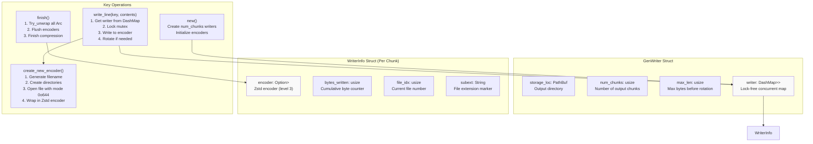
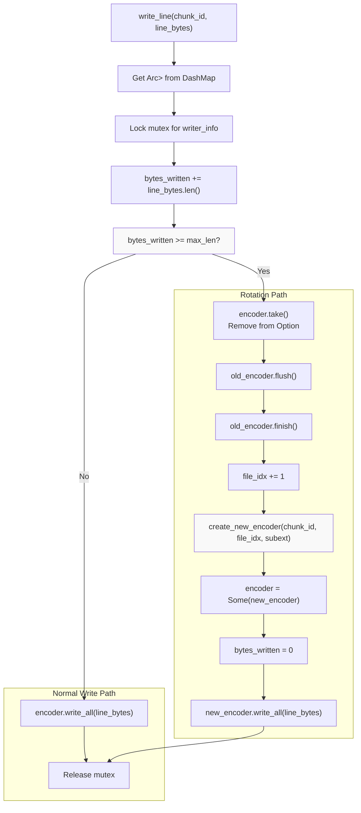
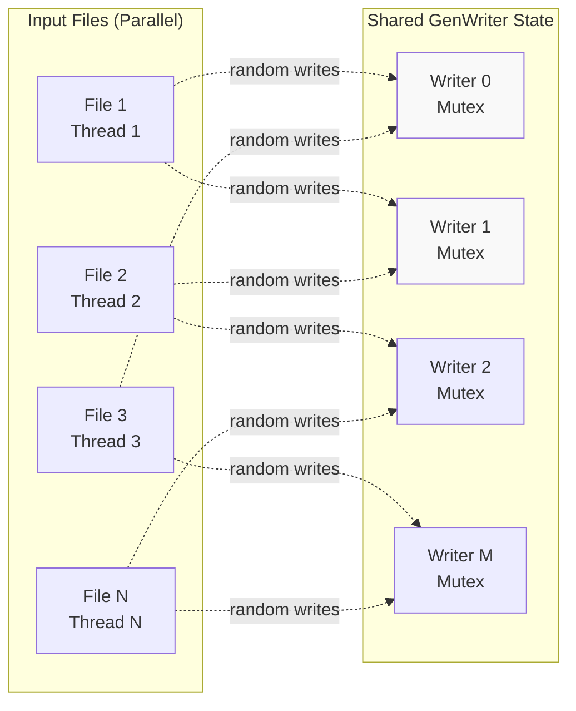
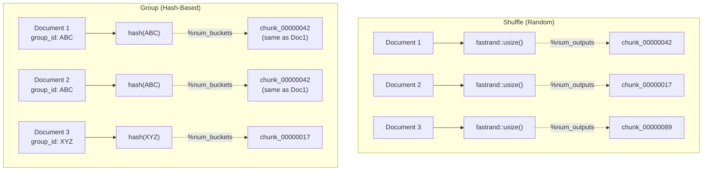

<!-- source: DeepWiki mcp.deepwiki.com · repo allenai/datamap-rs · page 4.6 Shuffle Command · fetched 2026-10-26 -->

# Shuffle Command

<details>
<summary>Relevant source files</summary>

The following files were used as context for generating this wiki page:

- [docs/shuffle.md](docs/shuffle.md)
- [src/groupfilter.rs](src/groupfilter.rs)
- [src/lib.rs](src/lib.rs)
- [src/shuffle.rs](src/shuffle.rs)

</details>


## Overview

The Shuffle command randomly redistributes documents from input JSONL files across a specified number of output files. Each document is assigned to a random output chunk using fast pseudo-random number generation, providing coarse-grained file-level shuffling suitable for parallel processing workflows. This command does **not** perform true document-level shuffling within output files—it only redistributes documents across multiple files.

For fine-grained data reorganization by field values, see [Discrete Partition](#4.2) and [Range Partition](#4.3). For co-locating documents by ID, see [Group](#4.4). For normalizing file sizes without redistribution, see [Reshard](#4.1).

**Sources**: [src/shuffle.rs:1-201](), [docs/shuffle.md:1-135]()

---

## Command Usage

### CLI Syntax

```bash
datamap shuffle \
  --input_dir <INPUT_DIR> \
  --output_dir <OUTPUT_DIR> \
  --num_outputs <NUM_OUTPUTS> \
  [--max_len <MAX_LEN>] \
  [--delete_after_read] \
  [--threads <THREADS>]
```

### Arguments

| Argument | Required | Default | Description |
|----------|----------|---------|-------------|
| `--input_dir` | Yes | - | Directory containing input JSONL files (any compression) |
| `--output_dir` | Yes | - | Directory for shuffled output files |
| `--num_outputs` | Yes | - | Number of output chunks (determines distribution granularity) |
| `--max_len` | No | 268435456 | Maximum uncompressed bytes per file before rotation (256MB) |
| `--delete_after_read` | No | false | Delete input files after successful processing |
| `--threads` | No | All cores | Number of parallel threads for processing |

**Sources**: [src/shuffle.rs:20](), [docs/shuffle.md:8-26]()

---

## Execution Architecture

### High-Level Execution Flow

```mermaid
graph TB
    Input["Input JSONL Files<br/>(any compression)"]
    Expand["expand_dirs()<br/>Discover all input files"]
    ParIter["par_iter()<br/>Rayon parallel iterator"]
    
    subgraph "Per-File Processing (Parallel)"
        ReadFile["read_pathbuf_to_mem()<br/>Read file contents"]
        StreamLines["Stream lines<br/>Line-by-line iteration"]
        
        subgraph "Per-Document Assignment"
            FastRand["fastrand::usize(0..usize::MAX)<br/>Generate random number"]
            Modulo["hash % num_outputs<br/>Assign to chunk"]
            WriteCall["gen_writer.write_line()<br/>Write to chunk"]
        end
        
        ReadFile --> StreamLines
        StreamLines --> FastRand
        FastRand --> Modulo
        Modulo --> WriteCall
    end
    
    subgraph "GenWriter (Shared State)"
        DashMapWriters["DashMap<usize, Arc<Mutex<WriterInfo>>><br/>Thread-safe writer registry"]
        GetWriter["Get writer for chunk_id"]
        CheckSize["bytes_written >= max_len?"]
        Rotate["Rotate to new file<br/>Increment file_idx"]
        WriteData["Write to encoder<br/>Zstd compression level 3"]
        
        GetWriter --> CheckSize
        CheckSize -->|No| WriteData
        CheckSize -->|Yes| Rotate
        Rotate --> WriteData
    end
    
    Finish["gen_writer.finish()<br/>Flush all encoders"]
    Stats["Print statistics:<br/>docs shuffled, files created, time"]
    
    Input --> Expand
    Expand --> ParIter
    ParIter --> Per-File Processing
    WriteCall --> DashMapWriters
    DashMapWriters --> GetWriter
    Per-File Processing --> Finish
    Finish --> Stats
    
    style FastRand fill:#f9f9f9
    style DashMapWriters fill:#f9f9f9
```

**Key Implementation Details**:
- File-level parallelism via `par_iter()` at [src/shuffle.rs:30]()
- Random assignment using `fastrand::usize()` at [src/shuffle.rs:37]()
- Modulo operation to map random number to chunk at [src/shuffle.rs:37]()
- `GenWriter::write_line()` handles thread-safe writing at [src/shuffle.rs:159-180]()
- Atomic counter tracks total documents at [src/shuffle.rs:28,41]()

**Sources**: [src/shuffle.rs:20-57](), [src/shuffle.rs:30-47]()

---

## GenWriter Infrastructure

The Shuffle command uses `GenWriter`, a shared parallel file writing infrastructure also used by the Group command ([#4.4](#4.4)). This component manages concurrent writes to multiple output files with automatic rotation.

### GenWriter Architecture



**Concurrency Strategy**:
- `DashMap` provides lock-free reads for writer lookup at [src/shuffle.rs:65,162]()
- `Arc<Mutex<WriterInfo>>` protects per-writer state at [src/shuffle.rs:65]()
- Multiple threads can write to **different chunks** simultaneously without contention
- Writes to the **same chunk** serialize via the mutex

**Initialization**: At [src/shuffle.rs:81-108](), `GenWriter::new()` pre-creates `num_chunks` encoder instances, each with its own mutex-protected state.

**Sources**: [src/shuffle.rs:64-200](), [src/shuffle.rs:80-108]()

---

## File Rotation Mechanism

### Rotation Logic Flow



**Rotation Trigger**: When `bytes_written >= max_len` at [src/shuffle.rs:167]()

**File Naming**: `chunk_{CHUNK_ID:08}.{FILE_IDX:08}.{subext}.jsonl.zst` at [src/shuffle.rs:111-114]()

**Sources**: [src/shuffle.rs:159-180](), [src/shuffle.rs:167-175]()

---

## Output File Organization

### File Naming Convention

```
output_dir/
├── chunk_00000000.00000000.shuffled.jsonl.zst  (chunk 0, first file)
├── chunk_00000000.00000001.shuffled.jsonl.zst  (chunk 0, second file after rotation)
├── chunk_00000001.00000000.shuffled.jsonl.zst  (chunk 1, first file)
├── chunk_00000002.00000000.shuffled.jsonl.zst  (chunk 2, first file)
├── ...
└── chunk_00000099.00000000.shuffled.jsonl.zst  (chunk 99, first file)
```

### Filename Components

| Component | Format | Description |
|-----------|--------|-------------|
| Chunk ID | `{:08}` (8 digits) | Output chunk number (0 to num_outputs-1) |
| File Index | `{:08}` (8 digits) | Sequential index for rotated files (0, 1, 2, ...) |
| Subextension | `shuffled` | Hard-coded identifier for shuffle operations |
| Compression | `.jsonl.zst` | Zstandard compressed JSONL |

**Generation**: `get_filename()` at [src/shuffle.rs:111-114]()

**Sources**: [src/shuffle.rs:111-114](), [docs/shuffle.md:34-47]()

---

## Performance Characteristics

### Parallelism Model



**Key Metrics**:
- **Parallelism Level**: Number of CPU cores (or `--threads` value)
- **Contention**: Low when `num_outputs >> threads` (many chunks reduce contention)
- **I/O Pattern**: Random writes across `num_outputs` files
- **Memory Usage**: ~`num_outputs * buffer_size` for encoder buffers
- **CPU Usage**: Minimal (fast random number generation, no JSON parsing)

**Bottlenecks**:
- Mutex contention when multiple threads write to same chunk frequently
- File system overhead for many small writes
- System file handle limit (`ulimit -n`)

**Sources**: [src/shuffle.rs:30](), [docs/shuffle.md:68-75]()

---

## Comparison with Related Commands

### Shuffle vs. Other Organization Commands

| Command | Purpose | Deterministic | Requires Field | Configuration |
|---------|---------|---------------|----------------|---------------|
| **Shuffle** | Random redistribution | No | No | `num_outputs` only |
| **Reshard** ([#4.1](#4.1)) | Normalize file sizes | Yes | No | `max_len` only |
| **Discrete Partition** ([#4.2](#4.2)) | Split by category | Yes | Yes | Field + choices |
| **Range Partition** ([#4.3](#4.3)) | Split by numeric range | Yes | Yes | Field + boundaries |
| **Group** ([#4.4](#4.4)) | Co-locate by ID | Yes (by hash) | Yes | Group keys + buckets |

### Random Assignment vs. Hash-Based Assignment



**Shuffle**: Same document → different chunks on different runs (non-deterministic)

**Group**: Same `group_id` → same chunk always (deterministic)

**Sources**: [src/shuffle.rs:37](), [src/groupfilter.rs:119-124]()

---

## Use Cases and Limitations

### Common Use Cases

1. **Preparing Data for Distributed Training**
   - Redistribute data across many files for parallel data loaders
   - Break up sequential patterns in original data organization
   - Recommended: `num_outputs = 10-100x number of training workers`

2. **Breaking Up Correlated Batches**
   - Shuffle files that were organized by source/domain/time
   - Reduce bias from sequential processing
   - Improves downstream sampling quality

3. **Load Balancing**
   - Redistribute skewed file sizes across uniform chunks
   - Enable better parallel processing utilization
   - Combine with Reshard ([#4.1](#4.1)) for optimal file sizes

### Limitations

#### Not a True Shuffle

This command performs **coarse file-level redistribution only**. It does not:
- Shuffle document order within output files
- Guarantee uniform distribution (depends on random number generator)
- Provide deterministic output (different runs produce different results)

#### For True Document-Level Shuffling

Use external tools:
```bash
# Decompress, shuffle, recompress
zstdcat input/*.jsonl.zst | shuf | zstd -3 > shuffled.jsonl.zst

# Or use sort with random key
zstdcat input/*.jsonl.zst | sort -R | zstd -3 > shuffled.jsonl.zst
```

#### Resource Constraints

**File Handles**: System limits on open files may constrain `num_outputs`
```bash
# Check current limit
ulimit -n

# Increase limit temporarily
ulimit -n 4096
```

**Memory**: Scales with `num_outputs` due to encoder buffers (~4MB per encoder)

**Contention**: High `num_outputs` with few threads reduces mutex contention, but increases file system overhead

**Sources**: [docs/shuffle.md:77-104](), [docs/shuffle.md:113-135]()

---

## Implementation Details

### Key Functions and Structures

| Symbol | Location | Purpose |
|--------|----------|---------|
| `shuffle()` | [src/shuffle.rs:20-57]() | Main entry point, orchestrates parallel processing |
| `GenWriter` | [src/shuffle.rs:64-70]() | Thread-safe parallel writer with rotation |
| `WriterInfo` | [src/shuffle.rs:72-77]() | Per-chunk state (encoder, bytes, file index) |
| `GenWriter::new()` | [src/shuffle.rs:81-108]() | Initializes `num_chunks` encoder instances |
| `GenWriter::write_line()` | [src/shuffle.rs:159-180]() | Thread-safe write with rotation check |
| `GenWriter::create_new_encoder()` | [src/shuffle.rs:116-132]() | Creates new file after rotation |
| `GenWriter::finish()` | [src/shuffle.rs:182-199]() | Flushes and closes all encoders |

### Dependencies

- **fastrand**: Fast PRNG for random chunk assignment at [src/shuffle.rs:17,37]()
- **rayon**: Parallel iterator for file processing at [src/shuffle.rs:13,30]()
- **dashmap**: Lock-free concurrent map at [src/shuffle.rs:3,65]()
- **zstd**: Compression (level 3) at [src/shuffle.rs:15,100]()
- **mj_io**: File I/O utilities at [src/shuffle.rs:14]()

**Sources**: [src/shuffle.rs:1-201]()

---

## Statistics Output

After completion, the command prints:
```
Shuffled <N> docs into <M> new files in <T> seconds
```

- **N**: Total documents processed (from `AtomicUsize` counter)
- **M**: Total output files created (including rotated files)
- **T**: Wall-clock time in seconds

**Implementation**: [src/shuffle.rs:54]()

**Sources**: [src/shuffle.rs:28-54]()

---

