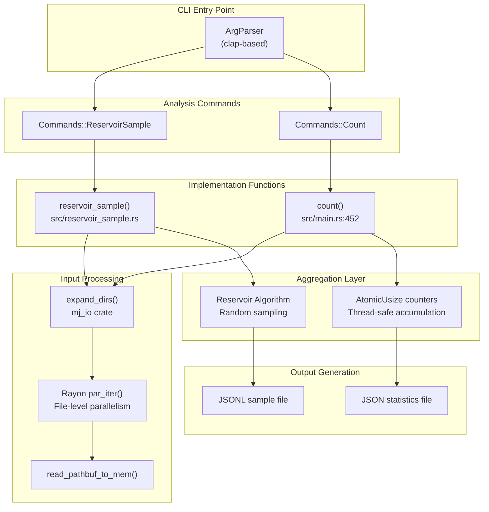
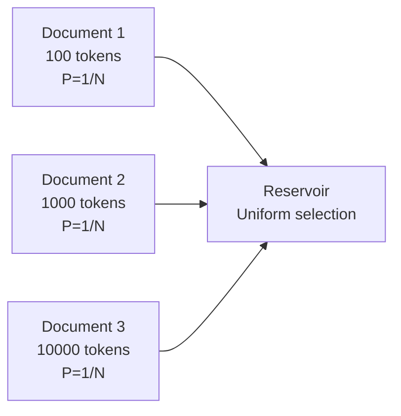
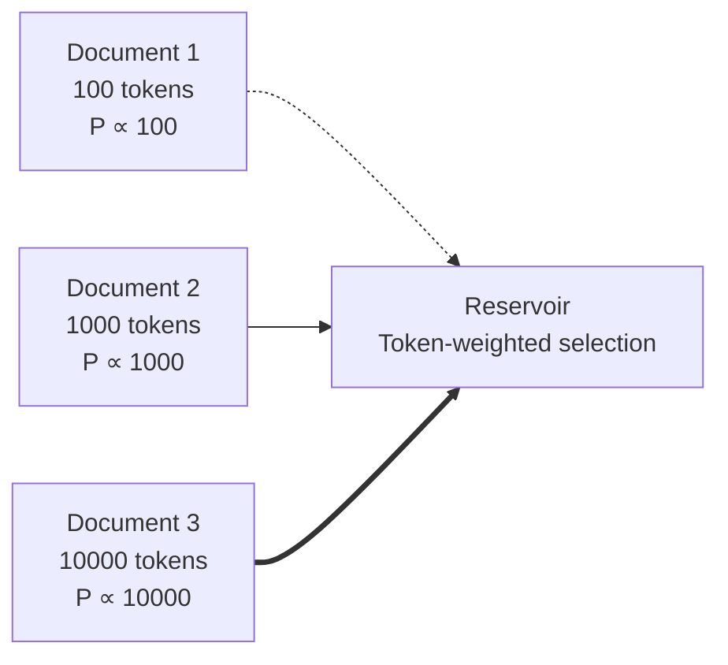
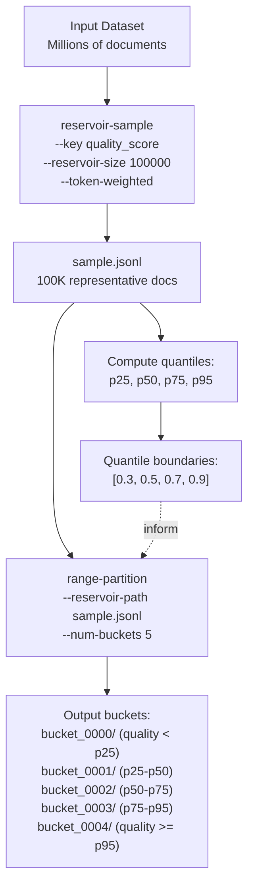
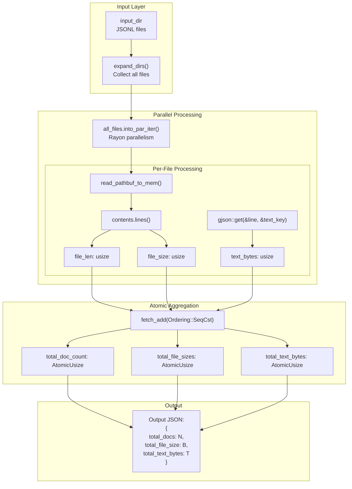
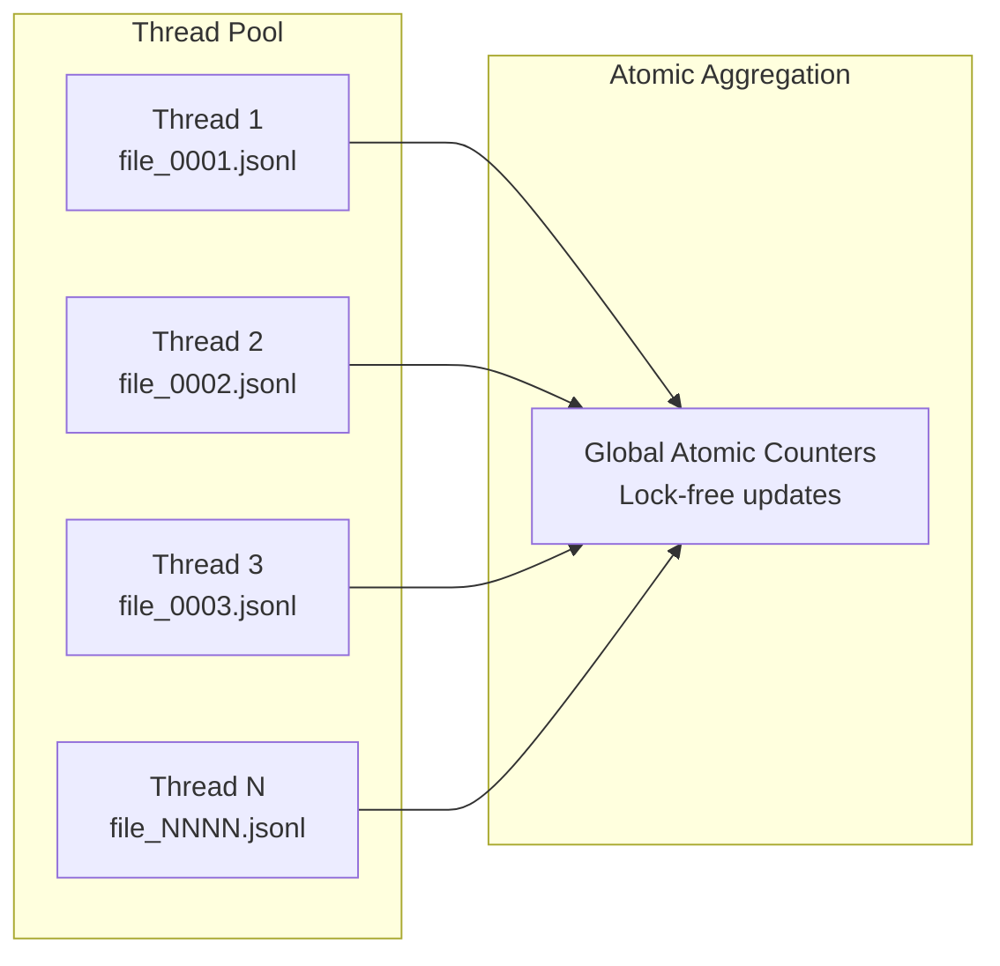
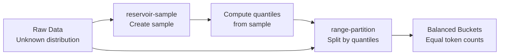
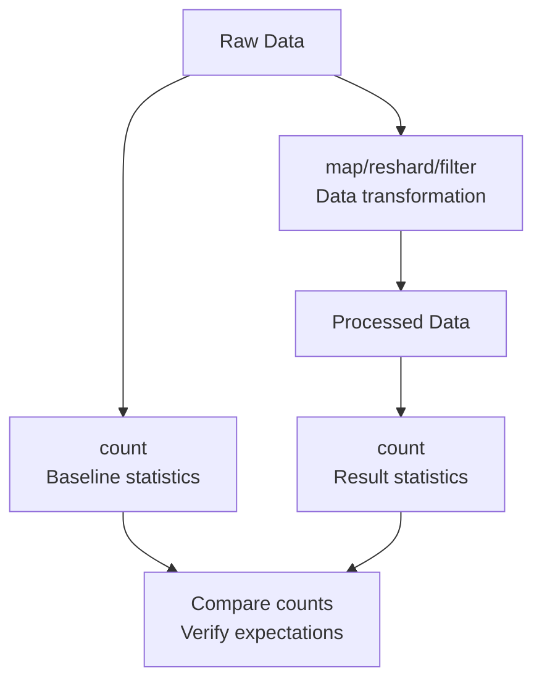

<!-- source: DeepWiki mcp.deepwiki.com · repo allenai/datamap-rs · page 5 Analysis Commands · fetched 2026-10-26 -->

# Analysis Commands

<details>
<summary>Relevant source files</summary>

The following files were used as context for generating this wiki page:

- [README.md](README.md)
- [src/main.rs](src/main.rs)

</details>


## Purpose and Scope

This document describes the **Analysis Commands** in datamap-rs, which provide statistical sampling and dataset measurement capabilities. These commands gather metadata about datasets without transforming the underlying data.

The two analysis commands are:
- **Reservoir Sample**: Creates statistically representative samples for distribution analysis and quantile calculation
- **Count**: Computes dataset-wide statistics including document counts, file sizes, and text byte totals

For data transformation operations, see [Map Command (Pipeline Processing)](#3). For data organization operations, see [Data Organization Commands](#4).

---

## Command Overview

Analysis commands serve distinct purposes in data processing workflows:

| Command | Primary Purpose | Key Output | Typical Use Case |
|---------|----------------|------------|------------------|
| `reservoir-sample` | Statistical sampling | Sample JSONL file | Compute quantile boundaries for range partitioning |
| `count` | Dataset statistics | JSON statistics file | Measure dataset size and text volume |

Both commands process data in parallel but produce aggregated results rather than transformed datasets. They are **read-only operations** that do not modify input data.

Sources: [src/main.rs:102-121](), [src/main.rs:211-220]()

---

## Analysis Command Architecture

### Command Flow Diagram



Sources: [src/main.rs:49-57](), [src/main.rs:102-121](), [src/main.rs:211-220]()

---

## Reservoir Sample Command

### Overview

The `reservoir-sample` command implements **distributed reservoir sampling** to create statistically representative samples from large datasets. The primary use case is computing quantile boundaries for range partitioning operations.

**Key characteristics:**
- Implements reservoir sampling algorithm for uniform random sampling
- Supports **token-weighted sampling** for text-length-aware samples
- Processes files in parallel with thread-safe sample merging
- Outputs a single JSONL file containing sampled documents

### Command Signature

```bash
datamap reservoir-sample \
    --input-dir <PATH> \
    --output-file <PATH> \
    --key <FIELD_NAME> \
    --reservoir-size <N> \
    [--token-weighted] \
    [--text-key <FIELD_NAME>]
```

### Arguments Reference

| Argument | Required | Default | Description |
|----------|----------|---------|-------------|
| `--input-dir` | Yes | - | Directory containing JSONL files to sample |
| `--output-file` | Yes | - | Output path for sample JSONL file |
| `--key` | Yes | - | JSON field to extract from each sampled document |
| `--reservoir-size` | Yes | 100,000 | Number of samples to collect |
| `--token-weighted` | No | false | Weight sampling by text length (token count) |
| `--text-key` | No | "text" | JSON field containing text for token counting |

Sources: [src/main.rs:102-121]()

### Sampling Modes

#### Uniform Sampling (Default)

Each document has **equal probability** of selection regardless of length:



#### Token-Weighted Sampling

Selection probability is **proportional to token count**, ensuring longer documents are more likely to be sampled:



Token-weighted sampling is critical when computing quantile boundaries for perplexity or quality scores, as it ensures the sample represents the **token distribution** rather than the document distribution.

Sources: [src/main.rs:102-121]()

### Integration with Range Partition

The reservoir sample command is designed to feed into range partition operations:



Sources: [src/main.rs:539-546](), [src/main.rs:555-561]()

### Output Format

The reservoir sample command produces a **JSONL file** where each line contains a sampled value:

```json
{"quality_score": 0.823}
{"quality_score": 0.456}
{"quality_score": 0.912}
```

This format is consumed directly by the `range-partition` command with the `--reservoir-path` argument.

Sources: [src/main.rs:102-121]()

### Usage Example

Sample 100,000 documents weighted by token count to compute perplexity quantiles:

```bash
# Step 1: Create token-weighted sample
datamap reservoir-sample \
    --input-dir /data/raw/ \
    --output-file /data/perplexity_sample.jsonl \
    --key perplexity_score \
    --reservoir-size 100000 \
    --token-weighted \
    --text-key text

# Step 2: Partition by quantiles
datamap range-partition \
    --input-dir /data/raw/ \
    --output-dir /data/partitioned/ \
    --value perplexity_score \
    --reservoir-path /data/perplexity_sample.jsonl \
    --num-buckets 10
```

Sources: [src/main.rs:539-546](), [src/main.rs:555-561]()

---

## Count Command

### Overview

The `count` command computes **dataset-wide statistics** by aggregating measurements across all documents. It provides essential metrics for understanding dataset size and composition.

**Key characteristics:**
- Parallel processing with atomic counters for thread-safe aggregation
- Computes document count, uncompressed file sizes, and text byte totals
- Outputs a single JSON file with aggregated statistics
- Read-only operation that does not modify input data

### Command Signature

```bash
datamap count \
    --input-dir <PATH> \
    --output-file <PATH> \
    [--count-bytes <FIELD_NAME>]
```

### Arguments Reference

| Argument | Required | Default | Description |
|----------|----------|---------|-------------|
| `--input-dir` | Yes | - | Directory containing JSONL files to analyze |
| `--output-file` | Yes | - | Output path for statistics JSON file |
| `--count-bytes` | No | - | JSON field to sum text bytes (typically "text") |

Sources: [src/main.rs:211-220]()

### Computed Metrics

The count command aggregates three key statistics:

| Metric | Description | Computation Method |
|--------|-------------|-------------------|
| `total_docs` | Total document count | Count JSONL lines across all files |
| `total_file_size` | Uncompressed data size (bytes) | Sum of all line lengths |
| `total_text_bytes` | Text field size (bytes) | Sum of specified field string lengths |

Sources: [src/main.rs:452-499]()

### Implementation Architecture



Sources: [src/main.rs:452-499]()

### Code-Level Details

The count function uses **atomic operations** for thread-safe accumulation:

| Component | Code Entity | Purpose |
|-----------|-------------|---------|
| File discovery | `expand_dirs(vec![input_dir.clone()], None)` [src/main.rs:454]() | Collect all input files |
| Atomic counters | `AtomicUsize::new(0)` [src/main.rs:456-458]() | Thread-safe aggregation |
| Parallel iteration | `all_files.into_par_iter()` [src/main.rs:468]() | File-level parallelism |
| Text extraction | `gjson::get(&line, &text_key)` [src/main.rs:478]() | Parse JSON field |
| Atomic update | `fetch_add(file_len, Ordering::SeqCst)` [src/main.rs:484]() | Accumulate counts |
| JSON output | `json!({"total_docs": ..., ...})` [src/main.rs:492]() | Format results |

Sources: [src/main.rs:452-499]()

### Output Format

The count command produces a **JSON file** with three fields:

```json
{
  "total_docs": 15234567,
  "total_file_size": 234567890123,
  "total_text_bytes": 198765432109
}
```

**Field descriptions:**
- `total_docs`: Number of JSONL lines (documents) across all files
- `total_file_size`: Sum of all line lengths in bytes (uncompressed)
- `total_text_bytes`: Sum of text field string lengths (if `--count-bytes` specified)

The `total_text_bytes` field is only populated when `--count-bytes` is provided. This measures the actual text content size, which may be substantially smaller than `total_file_size` due to JSON overhead.

Sources: [src/main.rs:492-494]()

### Usage Examples

#### Basic Document Count

Count documents and measure dataset size:

```bash
datamap count \
    --input-dir /data/processed/ \
    --output-file /data/stats.json
```

Output:
```json
{
  "total_docs": 10000000,
  "total_file_size": 150000000000,
  "total_text_bytes": 0
}
```

#### Text Byte Measurement

Count documents and measure text content volume:

```bash
datamap count \
    --input-dir /data/processed/ \
    --output-file /data/stats.json \
    --count-bytes text
```

Output:
```json
{
  "total_docs": 10000000,
  "total_file_size": 150000000000,
  "total_text_bytes": 127500000000
}
```

The difference between `total_file_size` and `total_text_bytes` (22.5GB in this example) represents JSON structure overhead.

Sources: [src/main.rs:578-580]()

---

## Performance Characteristics

### Parallelism Model

Both analysis commands use **file-level parallelism** via Rayon:



Each thread processes one file at a time, accumulating results in thread-safe atomic counters. This approach:
- **Scales linearly** with available CPU cores
- **Minimizes lock contention** through atomic operations
- **Avoids memory overhead** by streaming through files

Sources: [src/main.rs:16](), [src/main.rs:468]()

### Memory Efficiency

Both commands process data in a **streaming fashion**:

| Operation | Memory Pattern | Scaling |
|-----------|----------------|---------|
| File reading | One file decompressed in memory per thread | O(threads × file_size) |
| Line processing | Sequential iteration, no buffering | O(1) per document |
| Aggregation | Fixed-size atomic counters | O(1) |

The primary memory cost is decompressing input files. With default settings, memory usage is approximately:

```
Memory ≈ (CPU cores) × (avg file size)
```

For 256MB files on a 64-core machine: ~16GB memory usage.

Sources: [src/main.rs:469-488]()

---

## Integration Patterns

### Pattern 1: Sample-Informed Partitioning

Use reservoir sampling to automatically compute quantile boundaries:



This pattern ensures balanced partitions when the data distribution is unknown.

Sources: [src/main.rs:539-561]()

### Pattern 2: Validation and Verification

Use count to validate processing results:



Example workflow:
```bash
# Measure input
datamap count --input-dir /raw/ --output-file /stats/raw.json --count-bytes text

# Process data
datamap map --input-dir /raw/ --output-dir /filtered/ --config filter.yaml

# Measure output
datamap count --input-dir /filtered/step_final/ --output-file /stats/filtered.json --count-bytes text

# Compare results
python compare_stats.py /stats/raw.json /stats/filtered.json
```

Sources: [src/main.rs:578-580]()

### Pattern 3: Multi-Stage Sampling

Create hierarchical samples for complex analysis:

```bash
# Stage 1: Coarse sample (fast)
datamap reservoir-sample \
    --input-dir /data/raw/ \
    --output-file /samples/coarse.jsonl \
    --key quality_score \
    --reservoir-size 1000000

# Stage 2: Analyze coarse sample
python analyze_distribution.py /samples/coarse.jsonl

# Stage 3: Refined sample (slower, token-weighted)
datamap reservoir-sample \
    --input-dir /data/raw/ \
    --output-file /samples/refined.jsonl \
    --key quality_score \
    --reservoir-size 500000 \
    --token-weighted \
    --text-key text

# Stage 4: Compute final boundaries
python compute_quantiles.py /samples/refined.jsonl --output boundaries.json
```

Sources: [src/main.rs:539-546]()

---

## Common Issues and Solutions

### Issue: Insufficient Sample Size

**Problem**: Reservoir sample too small for accurate quantile estimation.

**Solution**: Increase `--reservoir-size`. For 10-bucket partitioning, use at least 100,000 samples:

```bash
datamap reservoir-sample \
    --reservoir-size 100000  # 10K samples per bucket
```

### Issue: Count Mismatch After Processing

**Problem**: Output document count differs from expected value.

**Solution**: Count documents at each filtering step to identify where documents were removed:

```bash
# Count each step_XX directory
for step in /output/step_*/; do
    datamap count --input-dir "$step" --output-file "${step}/count.json"
done
```

### Issue: Text Bytes Larger Than File Size

**Problem**: `total_text_bytes > total_file_size` in count output.

**Solution**: This indicates the `--count-bytes` key points to non-string data or multiple fields. Verify the JSON structure and ensure the key points to a single text field.

Sources: [src/main.rs:477-482]()

---

## Thread Control

Both commands respect the global `--threads` argument for limiting parallelism:

```bash
# Use 32 threads instead of all available cores
datamap --threads 32 count --input-dir /data/ --output-file stats.json

# Use 16 threads for reservoir sampling
datamap --threads 16 reservoir-sample \
    --input-dir /data/ \
    --output-file sample.jsonl \
    --key quality_score \
    --reservoir-size 100000
```

This is useful for:
- **Memory-constrained environments**: Fewer threads = less memory
- **Shared systems**: Avoid monopolizing CPU resources
- **I/O bottlenecks**: More threads may not improve speed if disk is saturated

Sources: [src/main.rs:55-56](), [src/main.rs:508-511]()

---

## Summary

The analysis commands provide essential capabilities for understanding and preparing datasets:

| Command | Purpose | Output | Typical Workflow Position |
|---------|---------|--------|---------------------------|
| `reservoir-sample` | Statistical sampling | Sample JSONL | Before range partitioning |
| `count` | Dataset statistics | Statistics JSON | Before/after any operation |

Both commands are **read-only**, **parallelized**, and **memory-efficient**, making them suitable for analyzing terabyte-scale datasets. They integrate seamlessly with organization commands to enable data-driven partitioning and validation workflows.

Sources: [src/main.rs:102-121](), [src/main.rs:211-220](), [src/main.rs:452-499]()

---

