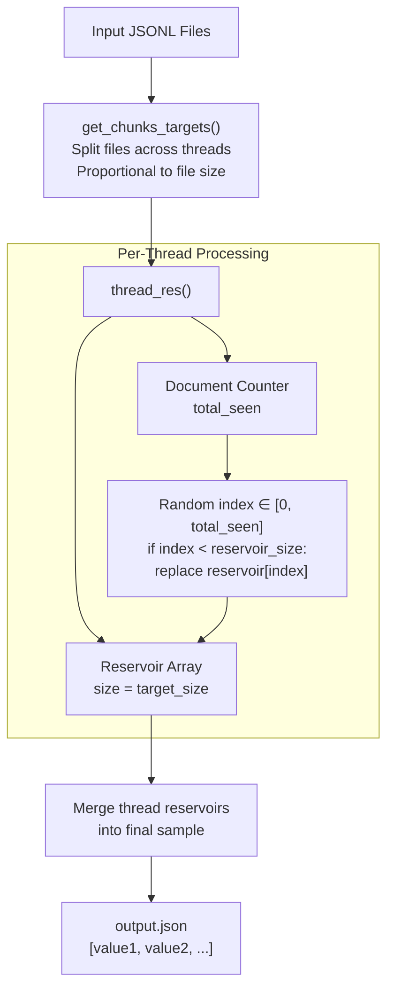
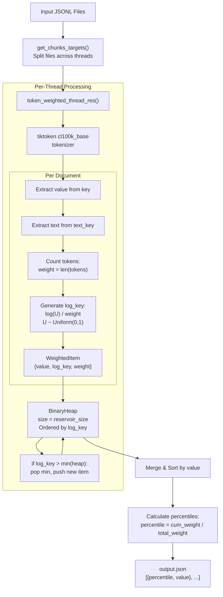
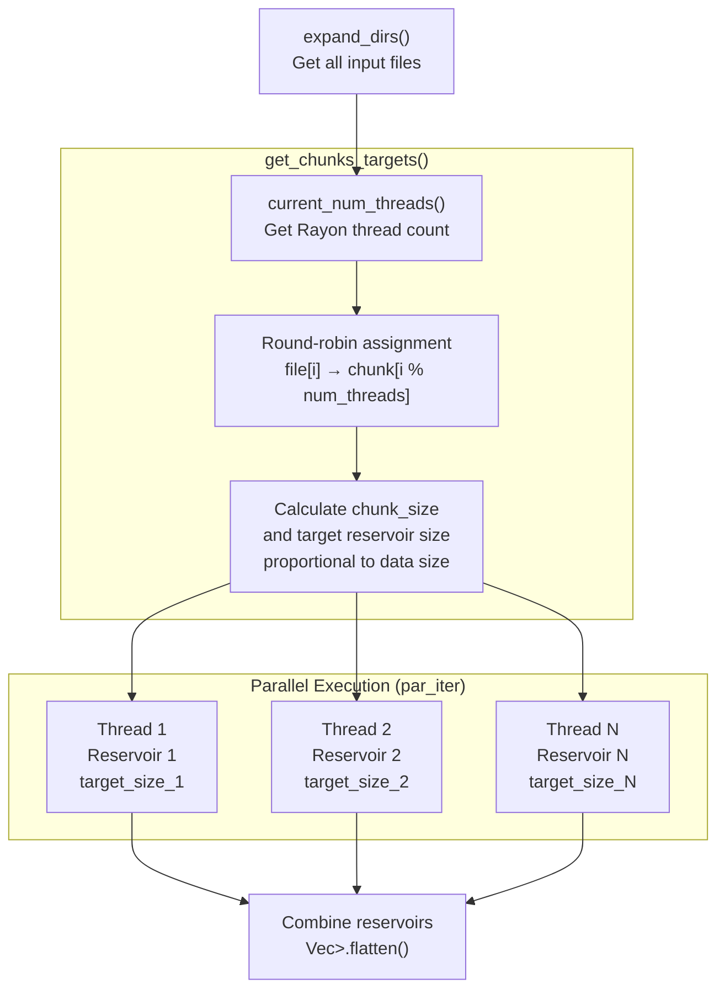
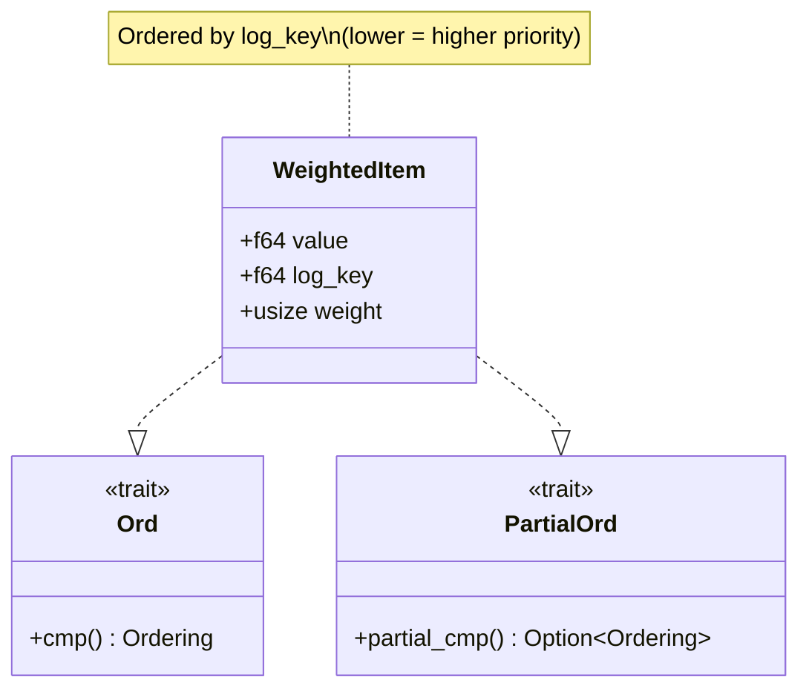
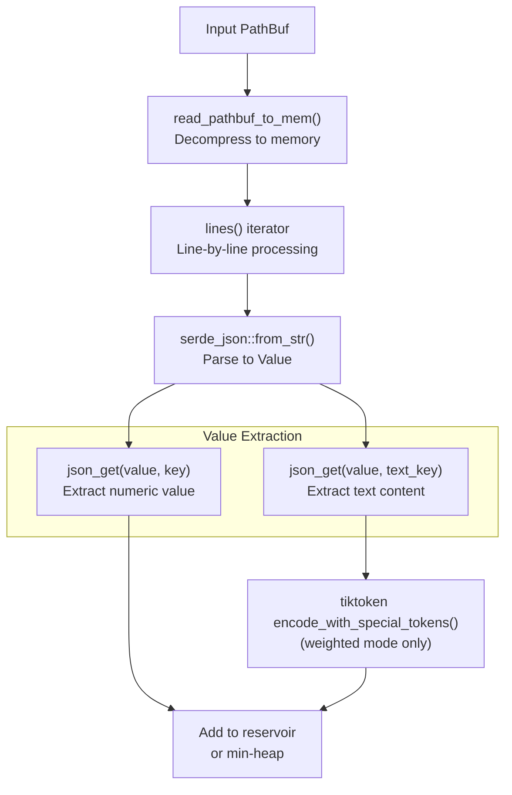
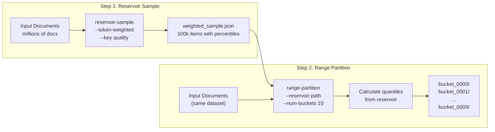

<!-- source: DeepWiki mcp.deepwiki.com · repo allenai/datamap-rs · page 5.1 Reservoir Sample Command · fetched 2026-10-26 -->

# Reservoir Sample Command

<details>
<summary>Relevant source files</summary>

The following files were used as context for generating this wiki page:

- [src/main.rs](src/main.rs)
- [src/partition.rs](src/partition.rs)
- [src/reservoir_sample.rs](src/reservoir_sample.rs)

</details>


## Purpose and Scope

The Reservoir Sample command creates statistical samples from large datasets using reservoir sampling algorithms. It extracts a fixed-size sample from an arbitrarily large input dataset while maintaining statistical properties. This command supports two sampling modes: **unweighted sampling** (uniform random selection) and **token-weighted sampling** (selection probability proportional to document token count). Token-weighted sampling is particularly useful for calculating quantiles that will feed into range partitioning operations.

For information about using reservoir samples to inform partition boundaries, see [Range Partition Command](#4.3). For counting dataset statistics without sampling, see [Count Command](#5.2).

---

## Overview

The reservoir sample command implements classic reservoir sampling algorithms to create representative samples from datasets too large to fit in memory. The command processes input files in parallel, with each thread maintaining its own reservoir, then combines results to produce the final sample.

**Primary use cases:**
- **Quantile calculation**: Create token-weighted samples to determine bucket boundaries for range partitioning
- **Dataset preview**: Extract representative documents for analysis
- **Distribution estimation**: Understand the distribution of numeric values across a large corpus

The command is specifically designed to integrate with the Range Partition command, which can consume reservoir sample output to automatically calculate bucket boundaries based on quantiles.

**Sources:** [src/reservoir_sample.rs:1-31]()

---

## Command Syntax and Arguments

```bash
datamap reservoir-sample \
  --input-dir <PATH> \
  --output-file <PATH> \
  --key <JSON_PATH> \
  --reservoir-size <SIZE> \
  [--token-weighted] \
  [--text-key <JSON_PATH>]
```

### Required Arguments

| Argument | Type | Description |
|----------|------|-------------|
| `--input-dir` | PathBuf | Directory containing input JSONL files |
| `--output-file` | PathBuf | Output JSON file containing sampled values |
| `--key` | String | JSON path to the field being sampled (e.g., "metadata.quality_score") |
| `--reservoir-size` | usize | Number of items to include in the sample (default: 100,000) |

### Optional Arguments

| Argument | Type | Description |
|----------|------|-------------|
| `--token-weighted` | flag | Enable token-weighted sampling instead of uniform sampling |
| `--text-key` | String | JSON path to text field for token counting (default: "text") |

**Token-weighted mode**: When enabled, documents are sampled with probability proportional to their token count rather than uniformly. This is critical for quantile estimation when documents vary significantly in length, ensuring that quantiles reflect token-weighted distributions rather than document counts.

**Sources:** [src/main.rs:102-121](), [src/main.rs:539-546]()

---

## Sampling Modes

### Unweighted Reservoir Sampling

Implements Algorithm R, the classic reservoir sampling algorithm. Each document has equal probability of being included in the final sample, regardless of document length.



**Algorithm details:**
1. Divide input files across threads based on file size
2. Each thread maintains a reservoir of fixed size
3. For each document i, generate random index in [0, i]
4. If index < reservoir_size, include document (replace if reservoir full)
5. Probability of inclusion = min(1, reservoir_size / i)

**Sources:** [src/reservoir_sample.rs:38-87](), [src/reservoir_sample.rs:90-105]()

---

### Token-Weighted Reservoir Sampling

Implements weighted reservoir sampling using the A-ES algorithm with exponential keys. Documents are sampled with probability proportional to their token count, making this ideal for quantile calculation when documents have varying lengths.



**Algorithm details:**
1. Use tiktoken's cl100k_base tokenizer to count tokens in document
2. Generate exponential key: `log_key = log(U) / weight` where U ~ Uniform(0,1)
3. Maintain min-heap of items with largest log_keys (highest priority)
4. After sampling, sort by value and compute percentiles based on cumulative token weight
5. Probability of inclusion ∝ token count

**Why log-space keys?** The A-ES algorithm uses exponential random variates as priorities. Computing in log-space (`log(U) / weight` instead of `U^(1/weight)`) avoids numerical underflow and is computationally efficient.

**Sources:** [src/reservoir_sample.rs:113-212](), [src/reservoir_sample.rs:143-166]()

---

## Implementation Architecture

### Parallel Processing Strategy



**Parallelization approach:**
- Files are distributed across threads in round-robin fashion
- Each thread gets a target reservoir size proportional to the fraction of total data it processes
- This maintains overall sampling probability while allowing embarrassingly parallel execution
- Thread reservoirs are merged by flattening into a single collection

**Sources:** [src/reservoir_sample.rs:90-105](), [src/reservoir_sample.rs:47-49](), [src/reservoir_sample.rs:119-121]()

---

### Data Structures

#### WeightedItem Structure



The `WeightedItem` struct holds:
- `value`: The actual numeric value being sampled (from the specified key)
- `log_key`: Priority for min-heap (log(U) / weight)
- `weight`: Token count for this document

The `Ord` implementation compares by `log_key`, enabling use in `BinaryHeap` with `MinComparator`.

**Sources:** [src/reservoir_sample.rs:143-166]()

---

### File and JSON Processing Flow



**Key functions:**
- `read_pathbuf_to_mem()`: From mj_io crate, handles decompression and buffering
- `json_get()`: Utility function from `src/utils.rs` for nested JSON path extraction
- `lines()`: Standard Rust iterator for line-by-line processing (memory efficient)

**Sources:** [src/reservoir_sample.rs:68-85](), [src/reservoir_sample.rs:183-209]()

---

## Output Format

### Unweighted Mode Output

The output is a JSON array containing the sampled values:

```json
[0.234, 0.567, 0.891, 0.123, ...]
```

Each element is the raw value extracted from the specified key path.

**Example**: Sampling quality scores
```bash
datamap reservoir-sample \
  --input-dir ./documents/ \
  --output-file quality_sample.json \
  --key "metadata.quality_score" \
  --reservoir-size 50000
```

Output: `[0.82, 0.91, 0.45, ...]` (50,000 quality scores)

**Sources:** [src/reservoir_sample.rs:54-57]()

---

### Token-Weighted Mode Output

The output is a JSON array of objects containing percentile and value pairs:

```json
[
  {"percentile": 0.05, "value": 0.123},
  {"percentile": 0.52, "value": 0.456},
  {"percentile": 2.31, "value": 0.789},
  {"percentile": 5.67, "value": 0.892},
  ...
]
```

**Percentile calculation:**
```
percentile = ((cumulative_weight - weight/2) / total_weight) × 100
```

This gives each document a percentile representing the midpoint of its token-weight span in the cumulative distribution.

**Example**: Token-weighted quality score sampling
```bash
datamap reservoir-sample \
  --input-dir ./documents/ \
  --output-file weighted_sample.json \
  --key "metadata.quality_score" \
  --reservoir-size 100000 \
  --token-weighted \
  --text-key "text"
```

Output: 100,000 items sorted by value, each with its token-weighted percentile.

**Sources:** [src/reservoir_sample.rs:123-137]()

---

## Integration with Range Partition

The token-weighted reservoir sample is specifically designed to feed into the Range Partition command for automatic bucket boundary calculation.



**Workflow:**
1. Run reservoir sample with `--token-weighted` to create sample
2. Pass sample to range partition via `--reservoir-path`
3. Range partition calculates bucket boundaries from quantiles
4. Documents are partitioned based on these boundaries

**Why token-weighting matters:** If documents vary in length (e.g., 100-token vs 10,000-token documents), unweighted sampling would under-represent the distribution of tokens. Token-weighted sampling ensures bucket boundaries reflect the actual distribution of tokens across values, critical for balanced dataset partitioning.

**Sources:** [src/partition.rs:206-222]()

---

## Performance Characteristics

### Computational Complexity

| Operation | Unweighted | Token-Weighted |
|-----------|------------|----------------|
| Per document | O(1) random number + O(1) insertion | O(n) tokenization + O(log k) heap operation |
| Memory per thread | O(k) where k = reservoir size | O(k) heap + tokenizer overhead |
| Total time | O(n) where n = total documents | O(n × avg_doc_length + n × log k) |

**Memory usage:**
- Unweighted: ~8 bytes × reservoir_size per thread (for f64 values)
- Token-weighted: ~24 bytes × reservoir_size per thread (WeightedItem struct)
- Tokenizer: ~10 MB for cl100k_base model (shared across threads)

### Parallelism

The command achieves parallelism at the **file group level**:
- Files divided across available threads
- Each thread maintains independent reservoir
- No synchronization needed during sampling
- Final merge is fast (already in memory)

**Scaling:** Performance scales linearly with CPU cores, limited only by I/O bandwidth when reading files.

**Sources:** [src/reservoir_sample.rs:90-105](), [src/reservoir_sample.rs:178-181]()

---

## Example Usage Scenarios

### Scenario 1: Calculate Quality Score Quantiles

Create 10 quality buckets based on token-weighted distribution:

```bash
# Step 1: Sample documents weighted by token count
datamap reservoir-sample \
  --input-dir /data/raw_documents/ \
  --output-file quality_sample.json \
  --key "quality_score" \
  --reservoir-size 100000 \
  --token-weighted \
  --text-key "text"

# Step 2: Use sample to create buckets
datamap range-partition \
  --input-dir /data/raw_documents/ \
  --output-dir /data/quality_buckets/ \
  --value "quality_score" \
  --reservoir-path quality_sample.json \
  --num-buckets 10
```

Result: Documents partitioned into 10 buckets where each bucket contains approximately 1/10th of the total tokens.

---

### Scenario 2: Preview Dataset Distribution

Extract uniform sample for exploratory analysis:

```bash
datamap reservoir-sample \
  --input-dir /data/large_corpus/ \
  --output-file url_lengths.json \
  --key "url_length" \
  --reservoir-size 50000
```

Result: 50,000 randomly selected URL length values for statistical analysis.

---

### Scenario 3: Multi-Level Partitioning

Create nested partitions using multiple sampling passes:

```bash
# Sample perplexity scores
datamap reservoir-sample \
  --input-dir /data/documents/ \
  --output-file perplexity_sample.json \
  --key "perplexity" \
  --reservoir-size 100000 \
  --token-weighted

# Partition by perplexity
datamap range-partition \
  --input-dir /data/documents/ \
  --output-dir /data/perp_buckets/ \
  --value "perplexity" \
  --reservoir-path perplexity_sample.json \
  --num-buckets 5

# Within each bucket, partition by domain
for bucket in /data/perp_buckets/bucket_*; do
  datamap discrete-partition \
    --input-dir "$bucket" \
    --output-dir "${bucket}_by_domain" \
    --partition-key "metadata.domain"
done
```

Result: Documents organized by both perplexity quantile and domain.

**Sources:** [src/main.rs:539-546](), [src/reservoir_sample.rs:23-31]()

---

## Technical Notes

### Random Number Generation

- **Unweighted mode**: Uses `rand::rng()` for thread-local RNG
- **Token-weighted mode**: Generates uniform random values in [0,1) for exponential keys
- Thread-local RNG avoids contention and provides good performance

### JSON Path Extraction

The `--key` argument uses `json_get()` utility function which supports nested paths:
- Simple key: `"quality_score"`
- Nested: `"metadata.quality_score"`
- Works with any JSON structure

### Tokenizer Choice

Token-weighted mode uses tiktoken's `cl100k_base` tokenizer:
- Same tokenizer used by GPT-3.5/GPT-4
- Fast Rust implementation
- Handles special tokens consistently
- ~10 MB model loaded once per process

**Note**: The tokenizer is not configurable; cl100k_base is hardcoded at [src/reservoir_sample.rs:181]().

**Sources:** [src/reservoir_sample.rs:181](), [src/utils.rs]() (json_get function)

---

