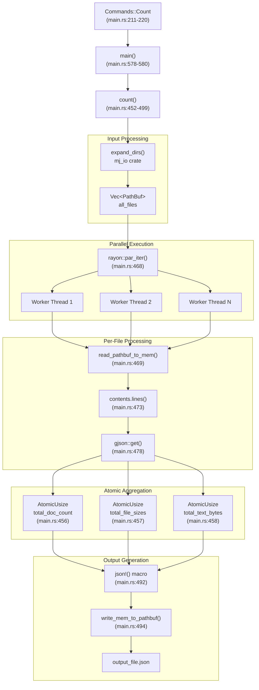
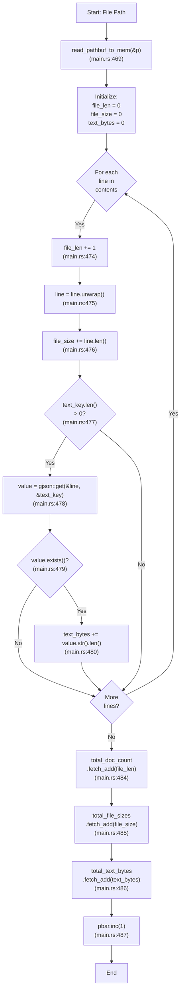
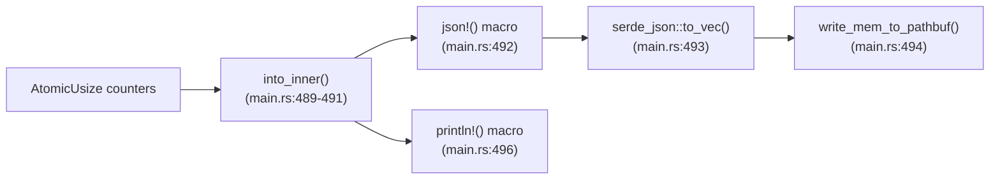

<!-- source: DeepWiki mcp.deepwiki.com · repo allenai/datamap-rs · page 5.2 Count Command · fetched 2026-10-26 -->

# Count Command

<details>
<summary>Relevant source files</summary>

The following files were used as context for generating this wiki page:

- [docs/count.md](docs/count.md)
- [src/main.rs](src/main.rs)

</details>


## Purpose and Scope

The Count command calculates aggregate statistics about JSONL datasets, including document counts, total file sizes, and optional text field byte totals. This command is used for dataset validation, capacity planning, and tracking data volume changes through processing pipelines.

For creating statistical samples of data, see [Reservoir Sample Command](#5.1). For filtering and transforming data content, see [Map Command (Pipeline Processing)](#3).

Sources: [src/main.rs:211-220](), [src/main.rs:452-499]()

## Command Interface

### CLI Arguments

The Count command is invoked via the `Commands::Count` enum variant and accepts the following arguments:

| Argument | Type | Required | Default | Description |
|----------|------|----------|---------|-------------|
| `--input_dir` | PathBuf | Yes | - | Directory containing input JSONL files |
| `--output_file` | PathBuf | Yes | - | Path where JSON statistics will be written |
| `--count_bytes` | Option\<String\> | No | None | JSON key path to count text bytes (e.g., "text") |
| `--threads` | usize | No | 0 | Thread limit (0 = use all cores) |

Sources: [src/main.rs:211-220](), [src/main.rs:578-580]()

### Command Invocation Example

```bash
datamap count \
  --input_dir ./dataset \
  --output_file ./stats.json \
  --count_bytes "text" \
  --threads 16
```

Sources: [docs/count.md:8-14]()

## Implementation Architecture

### System Components

The Count command uses a simple but efficient architecture based on parallel file processing with atomic aggregation.



**Diagram: Count Command Architecture**

The system uses three `AtomicUsize` counters for thread-safe aggregation across parallel file processing. Each worker thread independently processes files and atomically increments shared counters.

Sources: [src/main.rs:452-499](), [src/main.rs:456-458](), [src/main.rs:468]()

## Processing Flow

### Per-File Processing Logic



**Diagram: Per-File Processing Flow**

Each file is processed independently by accumulating three counters locally, then atomically adding them to the global counters at the end. This minimizes contention on the atomic variables.

Sources: [src/main.rs:468-488]()

## Statistics Calculation

### Three Tracked Metrics

The Count command tracks three separate statistics:

#### 1. Document Count (`total_doc_count`)

- **Purpose**: Total number of JSONL documents
- **Calculation**: Increments by 1 for each line in all files
- **Implementation**: [src/main.rs:474]()
- **Note**: Assumes one document per line; does not validate JSON

#### 2. File Size (`total_file_sizes`)

- **Purpose**: Total uncompressed byte size of all JSONL data
- **Calculation**: Sums the byte length of each line string
- **Implementation**: [src/main.rs:476]()
- **Note**: Measures uncompressed size regardless of input compression

#### 3. Text Bytes (`total_text_bytes`)

- **Purpose**: Total byte size of a specific JSON field across all documents
- **Calculation**: Extracts field via `gjson::get()` and sums string lengths
- **Implementation**: [src/main.rs:477-482]()
- **Activation**: Only calculated when `--count_bytes` argument provided
- **Field Extraction**: Uses gjson path syntax (e.g., "text", "metadata.content")

Sources: [src/main.rs:456-487]()

### Atomic Counter Mechanism

The implementation uses `AtomicUsize` with `fetch_add()` operations for thread-safe aggregation:

```rust
let total_doc_count = AtomicUsize::new(0);
let total_file_sizes = AtomicUsize::new(0);
let total_text_bytes = AtomicUsize::new(0);

// Later, in parallel processing:
total_doc_count.fetch_add(file_len, Ordering::SeqCst);
total_file_sizes.fetch_add(file_size, Ordering::SeqCst);
total_text_bytes.fetch_add(text_bytes, Ordering::SeqCst);
```

The `Ordering::SeqCst` (sequentially consistent) ordering ensures all threads see a consistent view of the counter values.

Sources: [src/main.rs:456-458](), [src/main.rs:484-486]()

## Output Format

### JSON Output Structure

The command writes a JSON file with three fields:

```json
{
  "total_docs": <number>,
  "total_file_size": <number>,
  "total_text_bytes": <number>
}
```

| Field | Type | Description |
|-------|------|-------------|
| `total_docs` | usize | Total document count across all files |
| `total_file_size` | usize | Total uncompressed bytes of all JSONL data |
| `total_text_bytes` | usize | Total bytes in specified field (0 if not specified) |

Sources: [src/main.rs:492-494]()

### Console Output

In addition to the JSON file, the command prints a summary to stdout:

```
Saw <docs> docs (<bytes> bytes)| <text_bytes> text bytes | in <secs> secs
```

Example:
```
Saw 1234567 docs (10737418240 bytes)| 8589934592 text bytes | in 45 secs
```

This provides immediate feedback during execution and includes timing information from `Instant::now()` and `.elapsed()`.

Sources: [src/main.rs:496](), [src/main.rs:453]()

### Output Generation Code Path



**Diagram: Output Generation Flow**

Sources: [src/main.rs:489-496]()

## Performance Characteristics

### Parallelism Model

The Count command exhibits **embarrassingly parallel** behavior:

- **File-level parallelism**: Each file is processed independently via `all_files.into_par_iter()`
- **Thread count**: Controlled by `--threads` argument or defaults to all available cores
- **No synchronization**: Workers only synchronize via atomic counters at end of each file
- **Scalability**: Linear speedup with core count (I/O permitting)

Sources: [src/main.rs:468](), [src/main.rs:508-511]()

### Memory Efficiency

- **Streaming**: Files are read into memory but processed line-by-line
- **No accumulation**: Only three counters held in memory regardless of dataset size
- **Per-file buffering**: Uses `read_pathbuf_to_mem()` which loads entire file
- **Memory footprint**: Approximately (largest_file_size × num_threads) + overhead

Sources: [src/main.rs:469]()

### Performance Bottlenecks

| Resource | Impact | Mitigation |
|----------|--------|------------|
| **Disk I/O** | Primary bottleneck | Use fast NVMe storage (see [Data Flow and Storage Strategy](#2.3)) |
| **Decompression** | Secondary bottleneck | Transparent via `mj_io` crate, benefits from parallelism |
| **JSON Parsing** | Minimal | Uses lightweight `gjson` for field extraction only |
| **Atomic Operations** | Negligible | Only three atomic increments per file |

Sources: [src/main.rs:468-488]()

## Use Cases and Examples

### Use Case 1: Dataset Validation

Verify expected document counts after processing:

```bash
# Before processing
datamap count --input_dir ./raw --output_file ./stats_before.json

# After processing (e.g., after map command)
datamap count --input_dir ./processed/step_final --output_file ./stats_after.json

# Compare results to detect unexpected data loss
```

### Use Case 2: Capacity Planning

Calculate storage requirements and token counts:

```bash
# Get total text bytes for tokenization planning
datamap count \
  --input_dir ./dataset \
  --output_file ./capacity.json \
  --count_bytes "text"

# If 1 token ≈ 4 bytes, estimate token count from total_text_bytes
```

### Use Case 3: Pipeline Monitoring

Track data volume through multi-stage pipelines:

```bash
# Count at each stage
datamap count --input_dir ./stage1 --output_file ./count_stage1.json
datamap count --input_dir ./stage2 --output_file ./count_stage2.json
datamap count --input_dir ./stage3 --output_file ./count_stage3.json
```

Sources: [docs/count.md:69-103]()

## Relationship to Other Commands

### Comparison with Reservoir Sample

| Aspect | Count | Reservoir Sample |
|--------|-------|------------------|
| **Purpose** | Aggregate statistics | Statistical sampling |
| **Output** | Single JSON file | JSONL sample file |
| **Memory** | Constant (~3 counters) | O(reservoir_size) |
| **Processing** | All documents | Weighted random selection |
| **Use Case** | Validation, monitoring | Quantile calculation, preview |

The Reservoir Sample command ([#5.1](#5.1)) can feed into Range Partition ([#4.3](#4.3)) for quantile-based partitioning, while Count is used for validation only.

Sources: [src/main.rs:102-121](), [src/main.rs:211-220]()

### Integration with Map Command

Count is often used before and after Map command execution to track filtering effects:

```bash
# Before filtering
datamap count --input_dir ./input --output_file ./count_before.json

# Run map pipeline
datamap map --input_dir ./input --output_dir ./output --config pipeline.yaml

# After filtering - count final output
datamap count --input_dir ./output/step_final --output_file ./count_after.json

# Can also count intermediate filtering stages
datamap count --input_dir ./output/step_00 --output_file ./count_filtered_step0.json
```

The Map command ([#3](#3)) already provides filtering statistics internally via `print_global_stats_stuff()`, but Count provides independent verification.

Sources: [src/main.rs:264-321](), [src/main.rs:452-499]()

## Implementation Notes

### Field Extraction via gjson

When `--count_bytes` is specified, the command uses the `gjson` crate for efficient JSON path queries:

- **Path syntax**: Simple dot notation (e.g., "text", "metadata.content")
- **Existence check**: `value.exists()` before accessing [src/main.rs:479]()
- **Type assumption**: Assumes field is a string via `value.str()` [src/main.rs:480]()
- **Non-existent fields**: Silently skipped (contributes 0 bytes)

This approach avoids full JSON parsing via `serde_json`, providing significant performance gains for large documents.

Sources: [src/main.rs:477-482]()

### Thread Configuration

The `--threads` argument is handled in `main()`:

```rust
if threads != 0 {
    std::env::set_var("RAYON_NUM_THREADS", threads.to_string());
}
```

Setting the environment variable affects all Rayon parallel iterators globally. A value of 0 (default) uses all available CPU cores.

Sources: [src/main.rs:508-511]()

### Progress Tracking

The command uses `build_pbar()` from the `mj_io` crate to display a progress bar:

- **Granularity**: One tick per file processed
- **Label**: "files"
- **Total**: Number of input files discovered

Sources: [src/main.rs:466](), [src/main.rs:487]()

---

