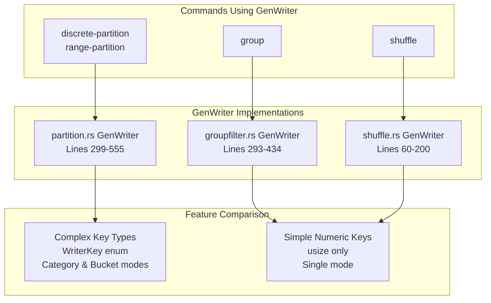
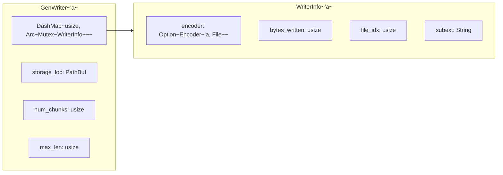
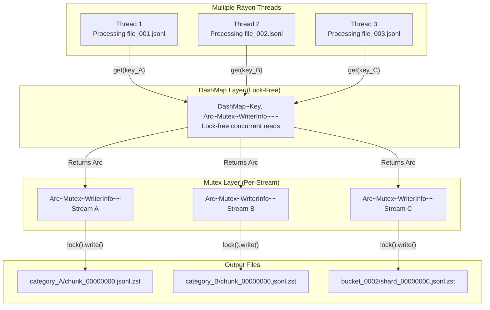
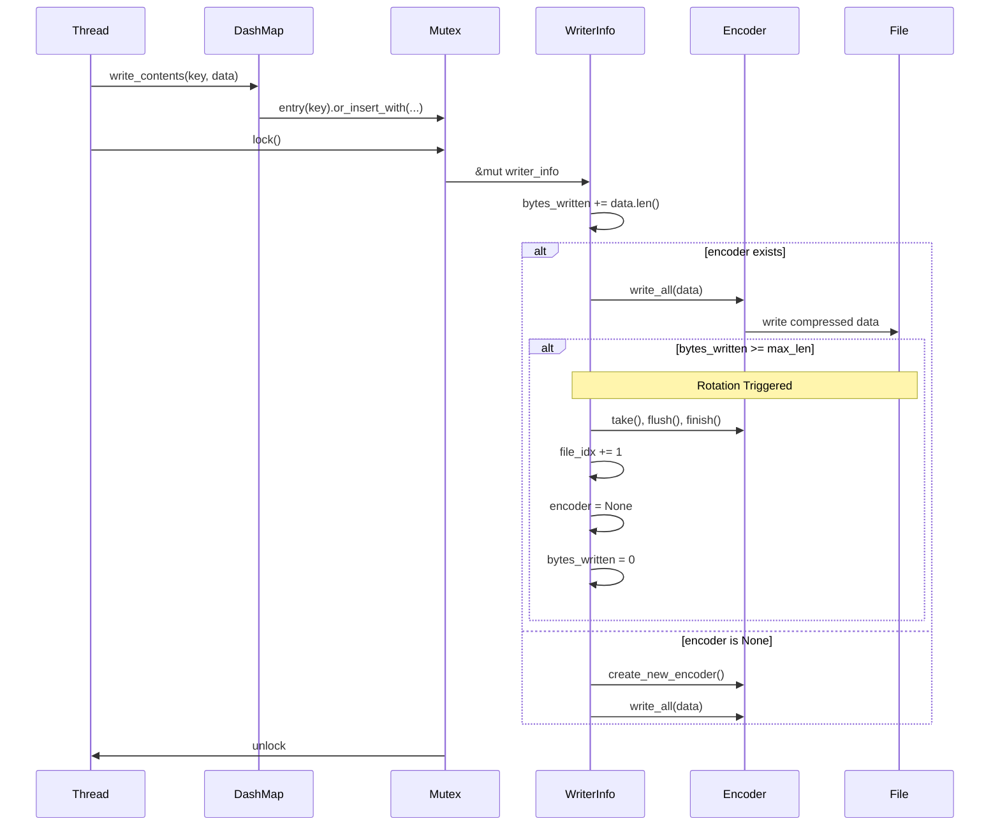
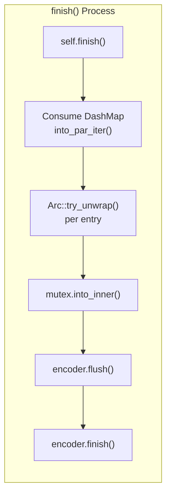
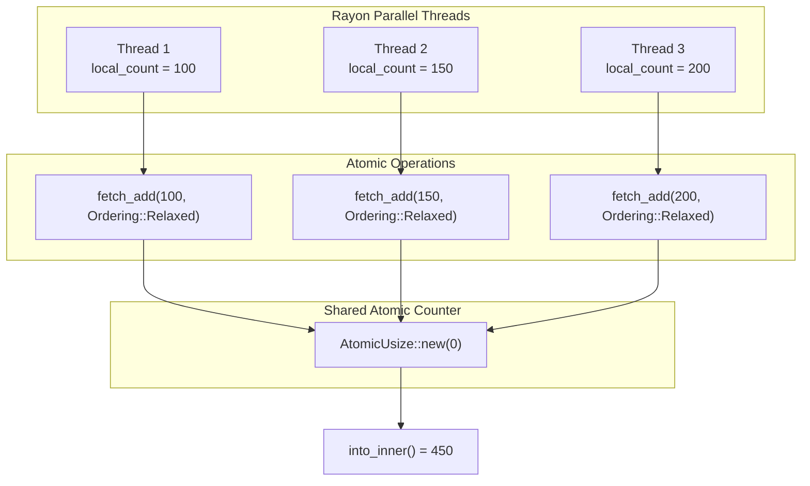
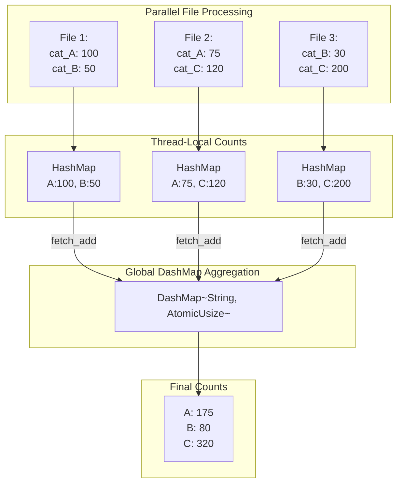
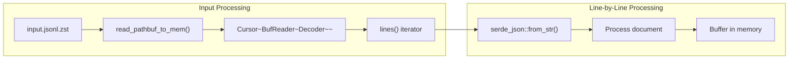
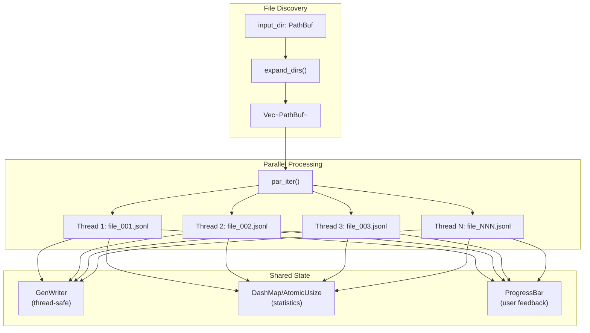
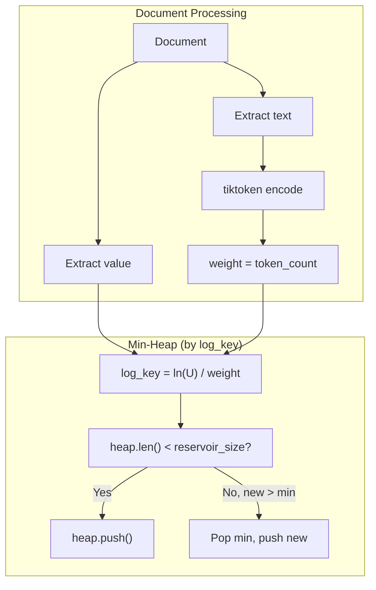

<!-- source: DeepWiki mcp.deepwiki.com · repo allenai/datamap-rs · page 6 Infrastructure Components · fetched 2026-10-26 -->

# Infrastructure Components

<details>
<summary>Relevant source files</summary>

The following files were used as context for generating this wiki page:

- [src/groupfilter.rs](src/groupfilter.rs)
- [src/lib.rs](src/lib.rs)
- [src/partition.rs](src/partition.rs)
- [src/reservoir_sample.rs](src/reservoir_sample.rs)
- [src/shuffle.rs](src/shuffle.rs)

</details>


This page documents the shared infrastructure components used across multiple datamap-rs commands. These components provide common functionality for concurrent file I/O, statistics collection, and data processing utilities.

For information about specific commands that use this infrastructure, see:
- Data Organization Commands ([4](#4)) - covers reshard, partition, group, shuffle
- Analysis Commands ([5](#5)) - covers reservoir sampling and counting
- Map Command ([3](#3)) - covers pipeline processing

---

## Overview

The datamap-rs infrastructure consists of several reusable components that enable high-performance, parallel data processing:

| Component | Purpose | Used By |
|-----------|---------|---------|
| `GenWriter` | Thread-safe file writing with rotation and compression | partition, group, shuffle |
| `DashMap` | Lock-free concurrent hash maps | All commands with statistics |
| `AtomicUsize` | Thread-safe counters | All commands tracking counts |
| Progress bars | User feedback during processing | All commands |
| File I/O utilities | Memory-mapped reading, compressed writing | All commands |

---

## GenWriter Architecture

### Purpose and Design

`GenWriter` is a specialized component for writing JSONL data to multiple output files concurrently from multiple threads. It provides:

1. **Thread-safe concurrent writes** to multiple output streams
2. **Automatic file rotation** when size thresholds are reached
3. **Built-in Zstandard compression** (level 3)
4. **Dynamic stream creation** as new keys are encountered

There are two distinct implementations of `GenWriter` in the codebase, optimized for different use cases.

### Implementation Variants



**Sources:** [src/partition.rs:299-555](), [src/groupfilter.rs:293-434](), [src/shuffle.rs:60-200]()

---

## Partition GenWriter (Complex Variant)

The partition implementation supports two distinct modes via the `WriterConfig` enum.

### WriterKey and WriterConfig Enums

```mermaid
classDiagram
    class WriterKey {
        <<enum>>
        Category(Option~String~)
        Bucket(usize)
    }
    
    class WriterConfig {
        <<enum>>
        Category { full_choices }
        Bucket { bucket_name }
    }
    
    class GenWriter {
        +DashMap~WriterKey, Arc~Mutex~WriterInfo~~~
        +storage_loc: PathBuf
        +max_len: usize
        +config: WriterConfig
        +new_category_writer()
        +new_bucket_writer()
        +write_contents()
        +finish()
    }
    
    class WriterInfo {
        +encoder: Option~Encoder~
        +bytes_written: usize
        +file_idx: usize
    }
    
    GenWriter --> WriterKey
    GenWriter --> WriterConfig
    GenWriter --> WriterInfo
```

**Sources:** [src/partition.rs:304-332]()

### Constructor Methods

The partition `GenWriter` provides two constructor methods:

| Constructor | Purpose | Output Structure |
|-------------|---------|------------------|
| `new_category_writer()` | Discrete partition by string values | `{category}/chunk_{:08}.jsonl.zst` or `no_category/` |
| `new_bucket_writer()` | Range partition by numeric buckets | `bucket_{:04}/shard_{:08}.jsonl.zst` |

**Category Writer Construction:**
- [src/partition.rs:335-386]() - Pre-creates writers for known categories if `choices` is provided
- [src/partition.rs:408-416]() - Generates filenames with category subdirectories

**Bucket Writer Construction:**
- [src/partition.rs:388-404]() - Creates writers on-demand as buckets are encountered
- [src/partition.rs:418-422]() - Generates filenames with bucket subdirectories

**Sources:** [src/partition.rs:335-425]()

---

## Group/Shuffle GenWriter (Simple Variant)

The simpler variant used by `group` and `shuffle` commands uses numeric keys directly without the enum abstraction.

### Structure



**Key Differences from Partition Variant:**
- Uses `usize` keys directly instead of `WriterKey` enum
- Single constructor `new()` instead of mode-specific constructors
- Includes `subext` field for file extension differentiation
- Simpler filename pattern: `chunk_{:08}.{:08}.{subext}.jsonl.zst`

**Sources:** [src/groupfilter.rs:297-311](), [src/shuffle.rs:64-77]()

---

## Concurrency Model

### DashMap and Arc<Mutex> Pattern

All `GenWriter` implementations use a two-level locking strategy:



**Why This Design:**

1. **DashMap**: Lock-free concurrent hash map allows multiple threads to look up different keys simultaneously without contention
2. **Arc**: Atomic reference counting allows multiple threads to hold references to the same `WriterInfo`
3. **Mutex**: Per-stream locks ensure only one thread writes to a specific file at a time

This design maximizes parallelism while preventing data corruption. Threads only block when writing to the *same* output stream.

**Sources:** [src/partition.rs:311-312](), [src/groupfilter.rs:297-298]()

---

## File Writing and Rotation

### WriterInfo Structure

The `WriterInfo` structure tracks the state of each output stream:

| Field | Type | Purpose |
|-------|------|---------|
| `encoder` | `Option<Encoder<'a, File>>` | Zstd encoder wrapping file handle |
| `bytes_written` | `usize` | Uncompressed bytes written to current file |
| `file_idx` | `usize` | Current file index for rotation |
| `subext` | `String` | Subextension for filename (group/shuffle only) |

**Sources:** [src/partition.rs:318-322](), [src/groupfilter.rs:305-310]()

### Write and Rotation Logic



**Key Rotation Logic:**
- [src/partition.rs:505-512]() - Partition variant rotation
- [src/groupfilter.rs:376-386]() - Group variant rotation
- Rotation occurs when `bytes_written >= max_len` (default 256 MB)
- Old encoder is flushed, finished, and dropped
- New encoder created with incremented `file_idx`
- `bytes_written` reset to zero

**Sources:** [src/partition.rs:448-516](), [src/groupfilter.rs:367-389]()

---

## Compression Configuration

All `GenWriter` implementations use Zstandard compression with consistent settings:

```rust
Encoder::new(file_handle, 3).unwrap()
```

**Compression Parameters:**
- **Algorithm**: Zstandard (zstd)
- **Level**: 3 (balanced speed/compression)
- **Extension**: `.jsonl.zst`
- **Mode**: 0o644 (rw-r--r--)

The level 3 compression provides good compression ratios (~70-80% size reduction) while maintaining high throughput suitable for parallel processing.

**Sources:** [src/partition.rs:436-445](), [src/groupfilter.rs:326-333](), [src/shuffle.rs:93-100]()

---

## Cleanup and Finalization

### Finish Method

The `finish()` method ensures all buffers are flushed and files are properly closed:



**Implementation Details:**
- Uses `into_par_iter()` to process all streams in parallel
- `Arc::try_unwrap()` ensures no other references exist
- Only flushes if `bytes_written > 0`
- Panics if multiple Arc references remain (programming error)

**Sources:** [src/partition.rs:537-553](), [src/groupfilter.rs:415-432](), [src/shuffle.rs:182-199]()

---

## Statistics Collection with Atomics

### AtomicUsize Pattern

Commands use `AtomicUsize` for thread-safe counter aggregation:



**Common Uses:**
- Document counts: [src/groupfilter.rs:215-216]()
- Bytes processed: [src/shuffle.rs:28-41]()
- Filtered vs kept statistics: [src/groupfilter.rs:221-222]()

**Ordering Semantics:**
- Most uses employ `Ordering::Relaxed` or `Ordering::SeqCst`
- Relaxed sufficient when only final total matters
- SeqCst used when intermediate values need global consistency

**Sources:** [src/partition.rs:1-2](), [src/groupfilter.rs:3-4](), [src/shuffle.rs:1]()

---

## DashMap for Parallel Aggregation

### Statistics Aggregation Pattern

`DashMap` is used to collect per-category or per-bucket statistics:



**Two-Level Aggregation Pattern:**

1. **Thread-local HashMap**: Each thread accumulates counts for documents in its file(s)
2. **Global DashMap update**: After processing a file, thread atomically updates global counts

This minimizes contention on the shared `DashMap` by batching updates.

**Example from Discrete Partition:**
```rust
// Thread-local accumulation
let mut counts: HashMap<Option<String>, usize> = HashMap::new();
*counts.entry(key.clone()).or_insert(0) += 1;

// Global aggregation
global_counts.entry(k)
    .or_insert_with(|| AtomicUsize::new(0))
    .fetch_add(v, Ordering::Relaxed);
```

**Sources:** [src/partition.rs:83-98](), [src/partition.rs:114-154]()

---

## File I/O Utilities

### mj_io Crate Functions

The `mj_io` crate provides specialized I/O utilities used throughout the codebase:

| Function | Purpose | Used For |
|----------|---------|----------|
| `expand_dirs()` | Recursively find all files matching patterns | Input discovery |
| `read_pathbuf_to_mem()` | Memory-map file for fast reading | Reading JSONL files |
| `write_mem_to_pathbuf()` | Write bytes to file with compression | Single-file output |
| `build_pbar()` | Create progress bar | User feedback |
| `get_output_filename()` | Map input path to output path | Preserving structure |

### Memory-Mapped Reading



**Memory Efficiency:**
- Files are read as compressed streams
- Documents processed line-by-line
- Only active documents held in memory
- No need to load entire file at once

**Sources:** [src/partition.rs:17](), [src/groupfilter.rs:20](), [src/shuffle.rs:14]()

---

## Progress Tracking

### build_pbar Function

All commands use `build_pbar()` to create consistent progress indicators:

```rust
let pbar = build_pbar(input_paths.len(), "Paths");
input_paths.par_iter().for_each(|p| {
    // ... process file ...
    pbar.inc(1);
});
```

**Features:**
- Shows current progress (files processed / total files)
- Displays rate (files per second)
- Estimates time remaining
- Thread-safe increments via `pbar.inc(1)`

**Sources:** [src/partition.rs:84-90](), [src/groupfilter.rs:97-101](), [src/shuffle.rs:29-46]()

---

## Common Infrastructure Patterns

### File-Level Parallelism

All commands follow this pattern for parallel processing:



**Key Characteristics:**
- Each thread processes complete files independently
- No coordination needed during processing
- Shared state accessed via lock-free or fine-grained locking
- Embarrassingly parallel at file level

**Sources:** [src/partition.rs:85-92](), [src/groupfilter.rs:98-104](), [src/shuffle.rs:30-47]()

---

## Reservoir Sampling Infrastructure

The `reservoir_sample` command uses different infrastructure patterns optimized for statistical sampling:

### Chunk-Based Parallelism

Instead of file-level parallelism, reservoir sampling divides work by estimated sample size:

```rust
let chunks_targets = get_chunks_targets(all_paths, reservoir_size).unwrap();
let full_res: Vec<(Vec<Value>, usize)> = chunks_targets
    .into_par_iter()
    .map(|(pvec, target_size)| {
        thread_res(&pvec, key, target_size, &pbar).unwrap()
    }).collect();
```

**Why Different:**
- Each thread needs to maintain a reservoir of specified size
- Work must be balanced based on file sizes, not just file count
- Threads accumulate independent reservoirs, then merge

**Sources:** [src/reservoir_sample.rs:90-105]()

### Token-Weighted Sampling

For token-weighted sampling, uses `binary_heap_plus` for efficient min-heap:



**Sources:** [src/reservoir_sample.rs:169-211]()

---

## Summary of Infrastructure Components

| Component | Location | Primary Users | Key Feature |
|-----------|----------|---------------|-------------|
| Partition GenWriter | [src/partition.rs:299-555]() | discrete-partition, range-partition | Category/bucket modes |
| Group GenWriter | [src/groupfilter.rs:293-434]() | group | Numeric keys, simpler |
| Shuffle GenWriter | [src/shuffle.rs:60-200]() | shuffle | Identical to group variant |
| DashMap statistics | Multiple files | All commands | Lock-free aggregation |
| AtomicUsize counters | Multiple files | All commands | Thread-safe counting |
| mj_io utilities | Multiple files | All commands | File discovery, I/O |
| Progress bars | Multiple files | All commands | User feedback |

These infrastructure components enable datamap-rs to achieve high performance through:
1. **Lock-free reads** (DashMap)
2. **Fine-grained locking** (per-stream Mutex)
3. **Automatic resource management** (Arc, file rotation)
4. **Streaming I/O** (line-by-line processing)
5. **File-level parallelism** (Rayon)

---

