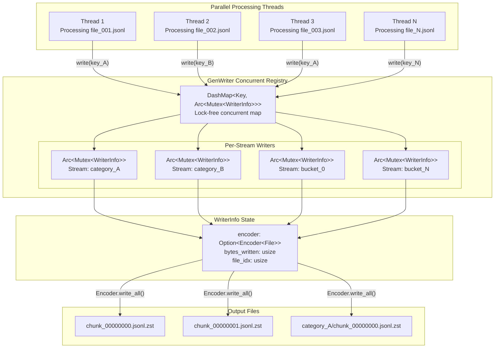
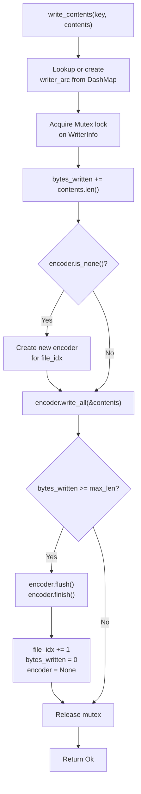
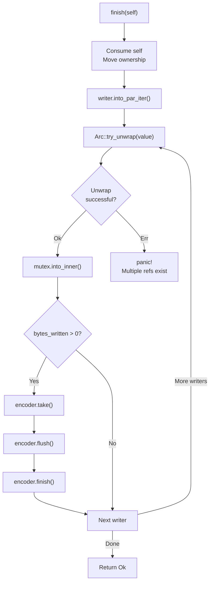

<!-- source: DeepWiki mcp.deepwiki.com · repo allenai/datamap-rs · page 6.1 GenWriter: Parallel File Writing · fetched 2026-10-26 -->

# GenWriter: Parallel File Writing

<details>
<summary>Relevant source files</summary>

The following files were used as context for generating this wiki page:

- [src/groupfilter.rs](src/groupfilter.rs)
- [src/lib.rs](src/lib.rs)
- [src/partition.rs](src/partition.rs)
- [src/reservoir_sample.rs](src/reservoir_sample.rs)
- [src/shuffle.rs](src/shuffle.rs)

</details>


## Purpose and Scope

`GenWriter` is a core infrastructure component that provides thread-safe, concurrent file writing with automatic compression and size-based rotation. It is used by data organization commands to efficiently write output files from multiple parallel threads without contention or data corruption.

This document covers the GenWriter architecture, implementation variants, and usage patterns. For information about specific commands that use GenWriter, see [Discrete Partition Command](#4.2), [Range Partition Command](#4.3), [Group Command](#4.4), and [Shuffle Command](#4.6). For details on compression formats, see [File Formats and Compression](#6.2).

**Sources:** [src/partition.rs:300-554](), [src/groupfilter.rs:293-434](), [src/shuffle.rs:60-200]()

---

## Overview

GenWriter solves the problem of multiple threads needing to write to the same logical output streams concurrently. Rather than serializing all writes through a single thread, GenWriter maintains a registry of independent writers, one per output stream, each protected by its own lock. This allows parallel threads to write to different output streams simultaneously while safely handling writes to the same stream.

**Key Features:**
- **Lock-free stream registry** using `DashMap` for concurrent access without global locks
- **Per-stream locking** using `Arc<Mutex<WriterInfo>>` to serialize writes to individual files
- **Automatic file rotation** when output files exceed a configurable size threshold
- **Zstandard compression** at level 3 for all output
- **Lazy writer creation** (in partition variant) or **eager pre-creation** (in group/shuffle variants)

**Sources:** [src/partition.rs:311-322](), [src/groupfilter.rs:297-310]()

---

## Concurrency Architecture



**Two-Level Locking Strategy:**
1. **DashMap Registry** - Lock-free concurrent map allowing multiple threads to look up writers simultaneously
2. **Per-Stream Mutex** - Each `WriterInfo` is wrapped in `Arc<Mutex<>>`, serializing writes to individual output streams

This design maximizes parallelism: threads writing to different output streams proceed concurrently, while threads writing to the same stream queue on that stream's mutex rather than blocking all other writers.

**Sources:** [src/partition.rs:311-316](), [src/groupfilter.rs:297-303]()

---

## Implementation Variants

There are three GenWriter implementations in the codebase, each specialized for different use cases:

| Variant | File | Key Type | Pre-Creation | Use Case |
|---------|------|----------|--------------|----------|
| **Partition GenWriter** | `src/partition.rs` | `WriterKey` enum | Conditional | Discrete/range partitioning |
| **GroupFilter GenWriter** | `src/groupfilter.rs` | `usize` | Always | Grouping operations |
| **Shuffle GenWriter** | `src/shuffle.rs` | `usize` | Always | Random shuffling |

### Partition GenWriter

The most sophisticated variant, supporting two modes via `WriterConfig` and `WriterKey`:

**WriterKey Enum:**
```rust
enum WriterKey {
    Category(Option<String>),  // For discrete partition
    Bucket(usize),             // For range partition
}
```

**WriterConfig Enum:**
```rust
enum WriterConfig {
    Category { full_choices: Option<HashSet<Option<String>>> },
    Bucket { bucket_name: String },
}
```

**Constructors:**
- `new_category_writer()` - Pre-creates writers if choices are known, otherwise creates lazily
- `new_bucket_writer()` - Always creates writers lazily on first write

**Sources:** [src/partition.rs:305-309](), [src/partition.rs:324-332](), [src/partition.rs:334-404]()

### GroupFilter/Shuffle GenWriter

Simpler variant with fixed writer count:

**Key Characteristics:**
- Uses `usize` keys directly (no enum)
- Always pre-creates all writers in constructor
- Simpler filename generation
- Includes `subext` field for filename customization

**Constructor:**
```rust
pub fn new(storage_loc: &PathBuf, num_chunks: usize, subext: &str, max_len: usize)
```

**Sources:** [src/groupfilter.rs:314-341](), [src/shuffle.rs:81-108]()

---

## Core Data Structures

### GenWriter Struct (Partition Variant)

```rust
pub struct GenWriter<'a> {
    pub writer: DashMap<WriterKey, Arc<Mutex<WriterInfo<'a>>>>,
    storage_loc: PathBuf,
    max_len: usize,
    config: WriterConfig,
}
```

| Field | Type | Purpose |
|-------|------|---------|
| `writer` | `DashMap<WriterKey, Arc<Mutex<WriterInfo>>>` | Lock-free registry mapping keys to writers |
| `storage_loc` | `PathBuf` | Base directory for output files |
| `max_len` | `usize` | Rotation threshold in bytes (typically 256MB) |
| `config` | `WriterConfig` | Mode-specific configuration |

**Sources:** [src/partition.rs:311-316]()

### WriterInfo Struct

```rust
pub struct WriterInfo<'a> {
    encoder: Option<Encoder<'a, File>>,
    bytes_written: usize,
    file_idx: usize,
}
```

| Field | Type | Purpose |
|-------|------|---------|
| `encoder` | `Option<Encoder<'a, File>>` | Zstd encoder wrapping file handle, `None` after rotation |
| `bytes_written` | `usize` | Uncompressed bytes written to current file |
| `file_idx` | `usize` | Current file index for rotation |

The `encoder` field is `Option` to allow taking ownership during rotation without borrowing issues.

**Sources:** [src/partition.rs:318-322](), [src/groupfilter.rs:305-310]()

---

## Write Operation Flow



**Critical Sections:**

1. **DashMap Lookup** - Lock-free, allows concurrent access by multiple threads
2. **Mutex Lock** - Serializes writes to individual stream, held for duration of write
3. **Rotation Decision** - Made while holding lock, ensures atomic file transitions

**Sources:** [src/partition.rs:448-516](), [src/groupfilter.rs:367-389]()

---

## File Rotation Mechanism

File rotation occurs when `bytes_written >= max_len`. The rotation process:

**Rotation Steps:**
1. Take ownership of encoder via `encoder.take()` (leaves `None` in its place)
2. Flush encoder buffer: `encoder.flush()`
3. Finalize compression: `encoder.finish()`
4. Increment `file_idx`
5. Reset `bytes_written` to 0
6. Leave `encoder` as `None` (will be recreated on next write)

**Design Rationale:**

Setting `encoder` to `None` rather than immediately creating a new encoder avoids creating empty files. The next write to this stream will detect `None` and create a new encoder for `file_idx + 1`.

**Example:** If `max_len = 256_000_000` bytes:
- Writes go to `chunk_00000000.jsonl.zst` until reaching 256MB
- Rotation triggers, file finalized
- Next write creates and uses `chunk_00000001.jsonl.zst`

**Sources:** [src/partition.rs:505-513](), [src/groupfilter.rs:377-385]()

---

## Output File Naming Conventions

Different GenWriter variants produce different output structures:

### Partition Category Mode

**Pattern:** `{category}/chunk_{file_idx:08}.jsonl.zst` or `no_category/chunk_{file_idx:08}.jsonl.zst`

**Example Structure:**
```
output_dir/
├── lang_en/
│   ├── chunk_00000000.jsonl.zst
│   ├── chunk_00000001.jsonl.zst
│   └── chunk_00000002.jsonl.zst
├── lang_es/
│   └── chunk_00000000.jsonl.zst
└── no_category/
    └── chunk_00000000.jsonl.zst
```

**Sources:** [src/partition.rs:406-417]()

### Partition Bucket Mode

**Pattern:** `{bucket_name}_{bucket_num:04}/shard_{file_idx:08}.jsonl.zst`

**Example Structure:**
```
output_dir/
├── bucket_0000/
│   ├── shard_00000000.jsonl.zst
│   └── shard_00000001.jsonl.zst
├── bucket_0001/
│   └── shard_00000000.jsonl.zst
└── bucket_0002/
    └── shard_00000000.jsonl.zst
```

**Sources:** [src/partition.rs:418-422]()

### GroupFilter/Shuffle Mode

**Pattern:** `chunk_{chunk_num:08}.{file_idx:08}.{subext}.jsonl.zst`

**Example Structure:**
```
output_dir/
├── chunk_00000000.00000000.group.jsonl.zst
├── chunk_00000000.00000001.group.jsonl.zst
├── chunk_00000001.00000000.group.jsonl.zst
└── chunk_00000002.00000000.shuffled.jsonl.zst
```

**Sources:** [src/groupfilter.rs:344-346](), [src/shuffle.rs:111-113]()

---

## Compression Details

All GenWriter implementations use **Zstandard (zstd) compression at level 3**.

### Encoder Creation

```rust
Encoder::new(
    OpenOptions::new()
        .append(true)
        .create(true)
        .mode(0o644)
        .open(filename)
        .unwrap(),
    3  // Compression level
).unwrap()
```

**Compression Level 3 Choice:**
- **Speed:** Fast enough for real-time processing
- **Ratio:** Achieves ~3-5x compression on text data
- **CPU Usage:** Modest CPU overhead suitable for parallel processing
- **Industry Standard:** Common level for balanced performance

**File Permissions:** `0o644` (owner read/write, group/others read)

**Sources:** [src/partition.rs:436-445](), [src/groupfilter.rs:326-333](), [src/shuffle.rs:93-100]()

---

## Writer Finalization

All writers must be finalized via the `finish()` method to ensure data integrity:



**Critical Aspects:**

1. **Ownership Consumption:** `finish(self)` takes ownership, preventing further writes
2. **Parallel Finalization:** Uses `into_par_iter()` to flush multiple writers concurrently
3. **Arc Unwrapping:** `Arc::try_unwrap()` verifies no other references exist (sanity check)
4. **Conditional Flush:** Only flushes if `bytes_written > 0` to avoid unnecessary I/O

**Panic Conditions:**
- If `Arc::try_unwrap()` fails, it indicates multiple references still exist, which should never happen if GenWriter is used correctly

**Sources:** [src/partition.rs:537-553](), [src/groupfilter.rs:415-432]()

---

## Usage Patterns by Command

### Discrete Partition

```rust
let writer = GenWriter::new_category_writer(
    output_dir, 
    &config.choices,  // Optional predefined categories
    config.max_file_size
);

// Per-file processing in parallel
input_paths.par_iter().for_each(|p| {
    // ... process file, accumulate per-category buffers ...
    partitioned_bytes.into_iter().for_each(|(key, val)| {
        writer.write_contents(WriterKey::Category(key), val).unwrap();
    });
});

writer.finish().unwrap();
```

**Key Pattern:** Accumulates per-category buffers per file, then batch-writes to GenWriter.

**Sources:** [src/partition.rs:82-92](), [src/partition.rs:114-154]()

### Range Partition

```rust
let writer = GenWriter::new_bucket_writer(
    output_dir, 
    config.max_file_size, 
    &config.bucket_name
);

input_paths.par_iter().for_each(|p| {
    // ... process file, determine bucket for each document ...
    partitioned_contents.into_iter().for_each(|(k, v)| {
        writer.write_contents(WriterKey::Bucket(k), v).unwrap();
    });
});

writer.finish().unwrap();
```

**Key Pattern:** Similar to discrete, but uses numeric bucket indices instead of category strings.

**Sources:** [src/partition.rs:227-234](), [src/partition.rs:254-281]()

### Group Operation

```rust
let writer = GenWriter::new(
    group_dir, 
    num_buckets, 
    &subext, 
    config.max_file_size
);

input_paths.par_iter().for_each(|p| {
    // ... hash group keys, accumulate per-bucket buffers ...
    for (bucket_id, contents) in buckets.into_iter().enumerate() {
        if !contents.is_empty() {
            writer.write_batch(bucket_id, contents).unwrap();
        }
    }
});

writer.finish().unwrap();
```

**Key Pattern:** Pre-creates fixed number of writers, accumulates full-file buffers per bucket.

**Sources:** [src/groupfilter.rs:96-104](), [src/groupfilter.rs:110-140]()

### Shuffle Operation

```rust
let gen_writer = GenWriter::new(
    output_dir, 
    num_outputs, 
    &subext, 
    max_len
);

input_paths.into_par_iter().for_each(|p| {
    // ... process file line-by-line ...
    for line in contents.lines() {
        let chunk_num = fastrand::usize(0..usize::MAX) % num_outputs;
        gen_writer.write_line(chunk_num, &line_bytes).unwrap();
    }
});

gen_writer.finish().unwrap();
```

**Key Pattern:** Writes individual lines directly to GenWriter, one at a time with random bucket selection.

**Sources:** [src/shuffle.rs:25-49](), [src/shuffle.rs:30-47]()

---

## Memory and Performance Characteristics

### Memory Usage

**Per-Stream Overhead:**
- `WriterInfo` struct: ~24-32 bytes (encoder pointer, two usizes)
- Zstd encoder internal buffer: ~128KB default
- File descriptor: OS-dependent

**Total Memory:** `num_streams × ~150KB + DashMap overhead`

**Example:** 1000 output streams ≈ 150MB memory

### Performance Characteristics

**Bottlenecks:**
1. **Mutex Contention:** Multiple threads writing to same stream serialize on that stream's mutex
2. **I/O Throughput:** Limited by disk write speed
3. **Compression CPU:** Level 3 zstd is fast but still uses CPU

**Optimization Strategies:**
1. **Batch Writes:** Accumulate data per thread before writing (as in partition commands)
2. **Stream Distribution:** Ensure balanced distribution across output streams
3. **NVMe Storage:** Critical for high-throughput writes (see [Data Flow and Storage Strategy](#2.3))

**Typical Throughput:** On AWS i4i instances with NVMe, achieves 500MB/s+ uncompressed write throughput with adequate parallelism.

**Sources:** [src/partition.rs:85-91](), [src/groupfilter.rs:98-101]()

---

## Thread Safety Guarantees

GenWriter provides the following thread safety guarantees:

| Operation | Thread Safety | Mechanism |
|-----------|---------------|-----------|
| **Stream Lookup** | Lock-free concurrent | `DashMap` internal locking |
| **Stream Creation** | Atomic | `DashMap::entry().or_insert_with()` |
| **Writing to Stream** | Serialized per stream | `Mutex` around `WriterInfo` |
| **File Rotation** | Atomic | Performed while holding stream's mutex |
| **Finalization** | Parallel | Each stream finalized independently |

**Correctness Properties:**
- **No Data Loss:** All writes are flushed via `finish()`
- **No Corruption:** Writes to same stream are serialized
- **No Deadlock:** Single-level locking (no lock ordering issues)
- **Progress:** Lock-free lookups ensure threads make progress

**Sources:** [src/partition.rs:448-516](), [src/groupfilter.rs:367-389]()

---

## Error Handling

GenWriter operations can fail in several ways:

**Failure Modes:**
1. **Filesystem Errors:** Disk full, permission denied, I/O errors
2. **Compression Errors:** Zstd encoder failures (rare)
3. **Logic Errors:** Multiple Arc references during finalization (panics)

**Error Propagation:**
- Write methods return `Result<(), Box<dyn std::error::Error>>`
- Filesystem/compression errors propagate via `?` operator
- Panics on logic errors (e.g., leftover Arc references)

**Recovery:** GenWriter does not implement retry logic. Callers should handle errors and potentially restart operations.

**Sources:** [src/partition.rs:448](), [src/groupfilter.rs:367]()

---

