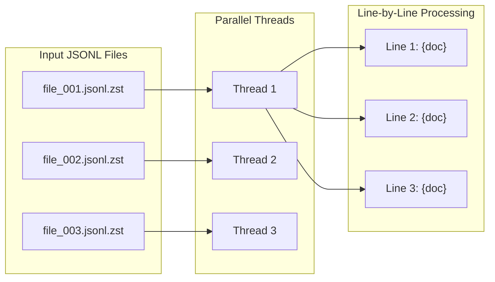
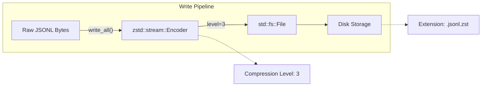
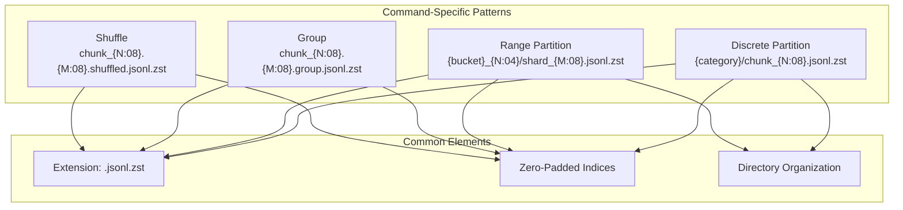
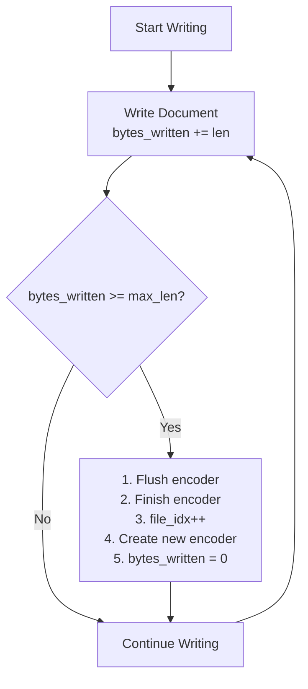
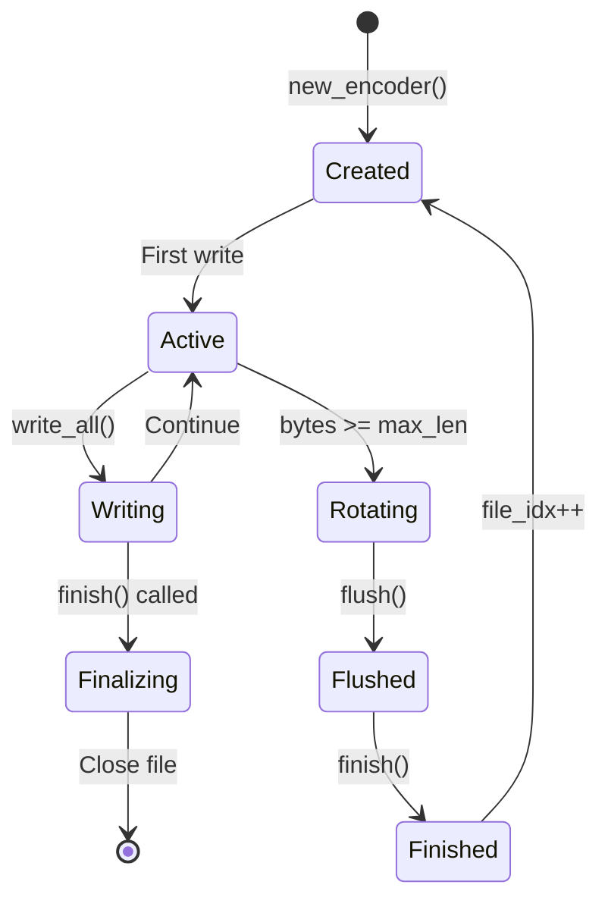
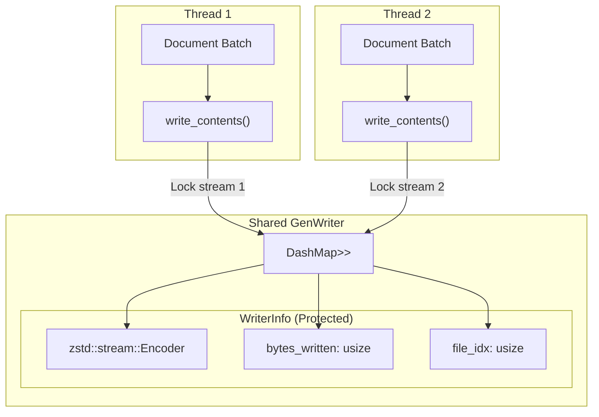

<!-- source: DeepWiki mcp.deepwiki.com · repo allenai/datamap-rs · page 6.2 File Formats and Compression · fetched 2026-10-26 -->

# File Formats and Compression

<details>
<summary>Relevant source files</summary>

The following files were used as context for generating this wiki page:

- [README.md](README.md)
- [src/groupfilter.rs](src/groupfilter.rs)
- [src/lib.rs](src/lib.rs)
- [src/partition.rs](src/partition.rs)
- [src/reservoir_sample.rs](src/reservoir_sample.rs)
- [src/shuffle.rs](src/shuffle.rs)

</details>


This page documents the file formats, compression strategies, and naming conventions used throughout datamap-rs. All data processing commands consume and produce JSONL files with Zstandard compression, maintaining consistency across the entire pipeline.

For details on how files are written in parallel across multiple streams, see [GenWriter: Parallel File Writing](#6.1). For information about configuring file sizes and the rationale behind the 256MB target, see [Data Flow and Storage Strategy](#2.3).

---

## JSONL Format Standard

### Input and Output Format

All datamap-rs commands operate on **JSONL (JSON Lines)** format, where each line is a complete, valid JSON document. This format is chosen for its streaming-friendly properties and line-by-line processing capabilities.

```jsonl
{"id": "doc1", "text": "First document", "metadata": {"lang": "en"}}
{"id": "doc2", "text": "Second document", "metadata": {"lang": "es"}}
{"id": "doc3", "text": "Third document", "metadata": {"lang": "en"}}
```

**Key characteristics:**
- One JSON object per line
- No commas between lines
- Each line is independently parseable
- Documents can be processed in streaming fashion
- Line boundaries enable efficient parallel processing

### Document Independence

The JSONL format ensures that documents can be processed independently at the file level and line level:



Sources: [src/partition.rs:118-154](), [src/groupfilter.rs:110-140](), [src/shuffle.rs:30-47]()

---

## Zstandard Compression

### Compression Configuration

All output files use **Zstandard (zstd)** compression with a fixed compression level of **3**. This level is hardcoded throughout the codebase and provides a good balance between compression ratio and speed.

| Attribute | Value |
|-----------|-------|
| **Algorithm** | Zstandard (zstd) |
| **Compression Level** | 3 (fixed) |
| **File Extension** | `.jsonl.zst` |
| **Library** | `zstd` crate |
| **Mode** | Streaming |

### Compression Implementation

The compression is applied via the `zstd::stream::Encoder` which wraps file handles and compresses data as it's written:



**Encoder creation pattern:**
```rust
Encoder::new(
    OpenOptions::new()
        .append(true)
        .create(true)
        .mode(0o644)
        .open(filename)
        .unwrap(),
    3  // Compression level
).unwrap()
```

Sources: [src/partition.rs:436-445](), [src/groupfilter.rs:326-333](), [src/shuffle.rs:93-100]()

### Compression Level Rationale

Level 3 is chosen as a pragmatic middle ground:
- **Fast enough** for real-time streaming writes
- **Good compression ratio** (~5-10x for text data)
- **Low CPU overhead** compared to higher levels
- **Deterministic performance** across different data types

### Decompression

Input files are transparently decompressed by the `mj_io::read_pathbuf_to_mem()` function, which automatically detects `.zst` extensions and decompresses on read.

Sources: [src/partition.rs:18](), [src/partition.rs:436-445](), [src/groupfilter.rs:21](), [src/groupfilter.rs:326-333](), [src/shuffle.rs:15](), [src/shuffle.rs:93-100]()

---

## File Naming Conventions

Different commands use distinct naming patterns to organize output data. All patterns include zero-padded indices and the `.jsonl.zst` extension.

### Discrete Partition Files

**Pattern:** `{category}/chunk_{filenum:08}.jsonl.zst`

For documents matching known categories:
```
lang_en/chunk_00000000.jsonl.zst
lang_en/chunk_00000001.jsonl.zst
lang_es/chunk_00000000.jsonl.zst
```

For documents without a category or not matching predefined choices:
```
no_category/chunk_00000000.jsonl.zst
no_category/chunk_00000001.jsonl.zst
```

**Code reference:**
```rust
// From partition.rs:408-416
if choice.is_none() {
    storage_loc.join("no_category")
        .join(format!("chunk_{:08}.jsonl.zst", file_idx))
} else {
    storage_loc.join(format!("{}", choice.as_ref().unwrap()))
        .join(format!("chunk_{:08}.jsonl.zst", file_idx))
}
```

Sources: [src/partition.rs:406-425]()

### Range Partition Files

**Pattern:** `{bucket_name}_{bucket_num:04}/shard_{filenum:08}.jsonl.zst`

Default bucket name is "bucket":
```
bucket_0000/shard_00000000.jsonl.zst
bucket_0000/shard_00000001.jsonl.zst
bucket_0001/shard_00000000.jsonl.zst
bucket_0025/shard_00000000.jsonl.zst
```

Custom bucket names supported:
```
quality_score_0000/shard_00000000.jsonl.zst
quality_score_0001/shard_00000000.jsonl.zst
```

**Code reference:**
```rust
// From partition.rs:418-422
storage_loc
    .join(format!("{}_{:04}", bucket_name, bucket_num))
    .join(format!("shard_{:08}.jsonl.zst", file_idx))
```

Sources: [src/partition.rs:418-422](), [src/partition.rs:169-178]()

### Group Files

**Pattern:** `chunk_{chunk_num:08}.{file_idx:08}.{subext}.jsonl.zst`

Default subext is "group":
```
chunk_00000000.00000000.group.jsonl.zst
chunk_00000000.00000001.group.jsonl.zst
chunk_00000001.00000000.group.jsonl.zst
```

Custom subext supported:
```
chunk_00000000.00000000.custom.jsonl.zst
```

**Code reference:**
```rust
// From groupfilter.rs:344-346
storage_loc.clone()
    .join(format!("chunk_{:08}.{:08}.{}.jsonl.zst", chunk, file_idx, subext))
```

Sources: [src/groupfilter.rs:344-347]()

### Shuffle Files

**Pattern:** `chunk_{chunk_num:08}.{file_idx:08}.shuffled.jsonl.zst`

Files use "shuffled" as the subext:
```
chunk_00000000.00000000.shuffled.jsonl.zst
chunk_00000000.00000001.shuffled.jsonl.zst
chunk_00000001.00000000.shuffled.jsonl.zst
```

**Code reference:**
```rust
// From shuffle.rs:111-113
storage_loc.clone()
    .join(format!("chunk_{:08}.{:08}.{}.jsonl.zst", chunk, file_idx, subext))
```

Sources: [src/shuffle.rs:111-113](), [src/shuffle.rs:23]()

### Naming Pattern Summary



Sources: [src/partition.rs:406-425](), [src/groupfilter.rs:344-347](), [src/shuffle.rs:111-113]()

---

## File Size Management and Rotation

### Maximum File Size Target

All commands support a configurable `max_file_size` parameter (or `max_len`) that controls when files are rotated. The default is **256MB** (256,000,000 bytes) of uncompressed data.

| Parameter | Default Value | Purpose |
|-----------|--------------|---------|
| `max_file_size` | 256,000,000 bytes | Trigger file rotation |
| Measurement | Uncompressed bytes | Before zstd compression |
| Rotation Behavior | Create new numbered file | Increment file_idx |

### File Rotation Mechanism

When the accumulated uncompressed bytes exceed `max_len`, the current file is finalized and a new file is created with an incremented index:



**Code pattern:**
```rust
// From partition.rs:505-512
if writer_info.bytes_written >= self.max_len {
    let mut old_encoder = writer_info.encoder.take().unwrap();
    old_encoder.flush()?;
    old_encoder.finish()?;
    writer_info.file_idx += 1;
    writer_info.encoder = None;
    writer_info.bytes_written = 0;
}
```

### Rotation Across Commands

Each command implements rotation identically through their GenWriter implementations:

| Command | Rotation Trigger | File Index Format |
|---------|------------------|-------------------|
| Discrete Partition | 256MB default | `chunk_{idx:08}` |
| Range Partition | 256MB default | `shard_{idx:08}` |
| Group | 256MB default | `{chunk}.{idx:08}.{ext}` |
| Shuffle | 256MB default | `{chunk}.{idx:08}.{ext}` |

Sources: [src/partition.rs:505-512](), [src/groupfilter.rs:377-385](), [src/shuffle.rs:144-152]()

---

## Compression in the Write Pipeline

### Encoder Lifecycle

The `zstd::stream::Encoder` follows a strict lifecycle within the GenWriter infrastructure:



### Thread Safety and Concurrent Writes

Multiple threads write to different streams concurrently. Each stream is protected by an `Arc<Mutex<WriterInfo>>`:



**Lock acquisition pattern:**
```rust
// From partition.rs:495
let mut writer_info = writer_arc.lock().unwrap();
writer_info.bytes_written += contents.len();
```

Sources: [src/partition.rs:311-323](), [src/partition.rs:495-515](), [src/groupfilter.rs:297-311]()

---

## Special Cases and Exceptions

### Reservoir Sample Output

The reservoir sample command is the **only exception** to the compressed JSONL output format. It produces a single uncompressed JSON file containing an array:

**Output format:**
```json
[
  {"percentile": 0.5, "value": 12.34},
  {"percentile": 1.5, "value": 15.67},
  {"percentile": 2.5, "value": 18.90}
]
```

**File extension:** `.json` (not `.jsonl.zst`)

This format is chosen because:
- Reservoir samples are small (typically <100K items)
- They're often consumed by scripts that expect JSON arrays
- They're intermediate data for range partitioning

Sources: [src/reservoir_sample.rs:55-56](), [src/reservoir_sample.rs:136-137]()

### Map Pipeline Output

The map command creates a step-based directory structure but follows the same `.jsonl.zst` compression pattern:

```
step_00/shard_00000000.jsonl.zst  # Filtered at step 0
step_01/shard_00000001.jsonl.zst  # Filtered at step 1
step_final/shard_00000000.jsonl.zst  # Passed all filters
```

See [Output Organization and Statistics](#3.7) for details on map output structure.

---

## File Extension Detection

Input files are automatically decompressed based on extension detection. The `mj_io` crate handles this transparently:

| Extension | Handling |
|-----------|----------|
| `.jsonl.zst` | Zstd decompression |
| `.jsonl.gz` | Gzip decompression (if supported) |
| `.jsonl` | No decompression |

**All output always uses `.jsonl.zst`** regardless of input extension.

Sources: [src/partition.rs:118](), [src/groupfilter.rs:112](), [src/shuffle.rs:32]()

---

## Compression Performance Characteristics

### Typical Compression Ratios

For text-heavy JSONL data, Zstandard level 3 typically achieves:

| Data Type | Compression Ratio | Example |
|-----------|------------------|---------|
| Plain text documents | 5-10x | 256MB → 25-50MB |
| JSON with metadata | 3-7x | 256MB → 35-85MB |
| Highly repetitive | 10-20x | 256MB → 12-25MB |

### Write Throughput

The streaming encoder maintains high throughput:
- **No buffering delays:** Data is compressed as written
- **Parallel writes:** Different streams compress independently
- **Level 3 speed:** ~300-500 MB/s per thread on modern CPUs

### File Size Impact

The 256MB uncompressed target becomes **~30-80MB compressed** on disk for typical text data, which:
- Reduces disk I/O during data transfer
- Maintains reasonable file counts for parallel processing
- Balances decompression overhead with file management overhead

Sources: [src/partition.rs:59-61](), [src/groupfilter.rs:69-71]()

---

