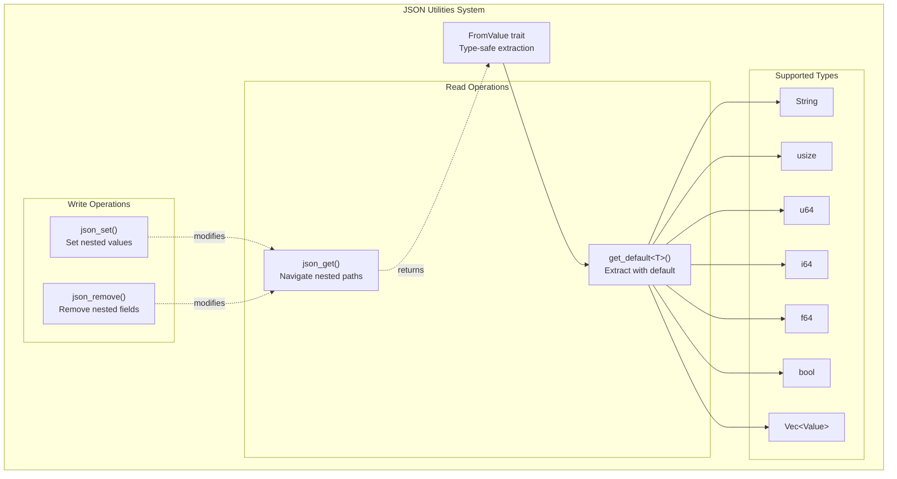
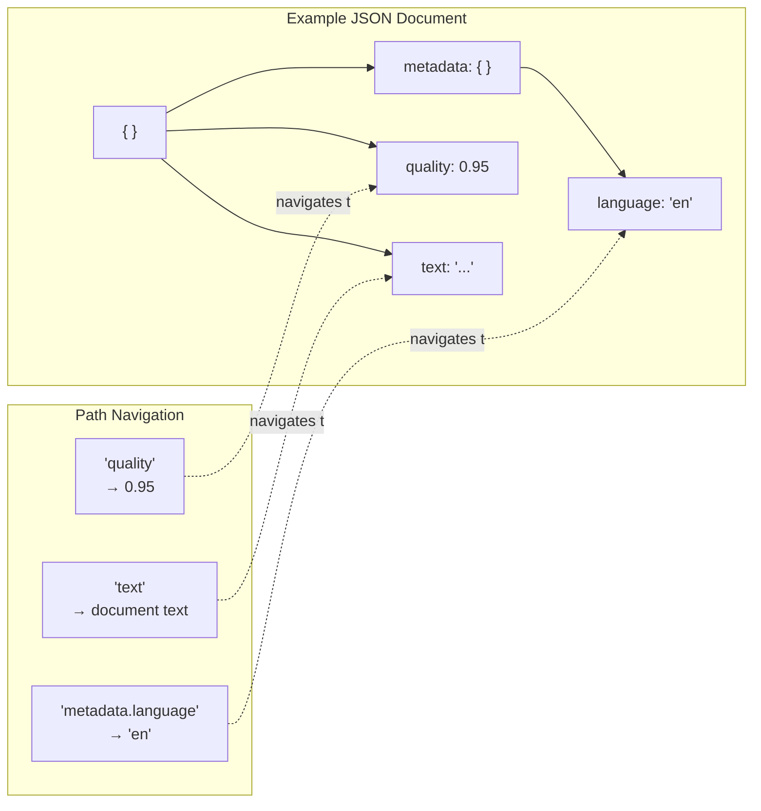
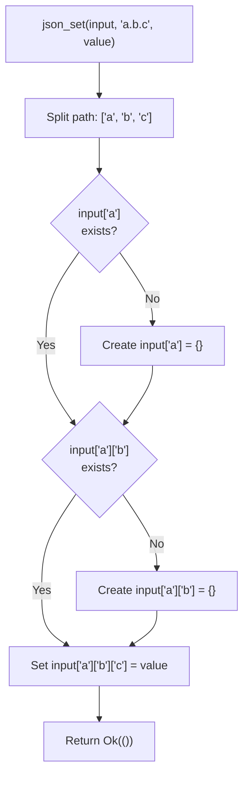
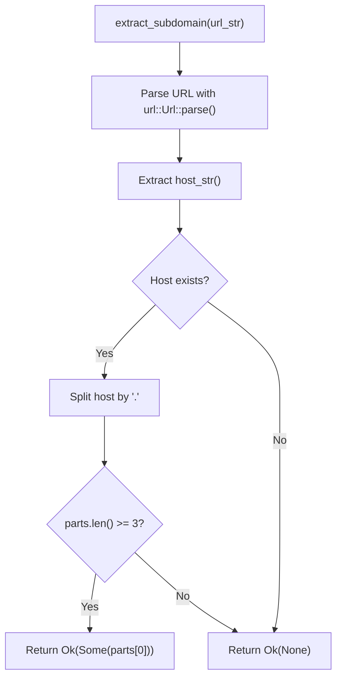
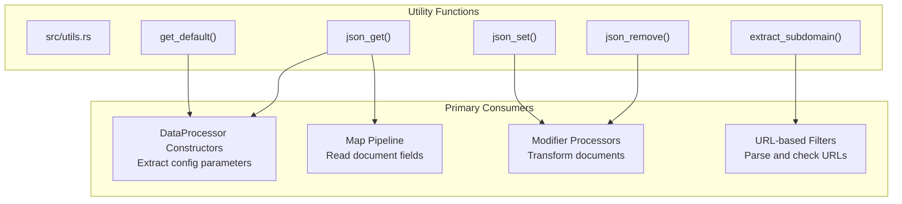

<!-- source: DeepWiki mcp.deepwiki.com · repo allenai/datamap-rs · page 6.3 Utility Functions · fetched 2026-10-26 -->

# Utility Functions

<details>
<summary>Relevant source files</summary>

The following files were used as context for generating this wiki page:

- [src/utils.rs](src/utils.rs)

</details>


## Purpose and Scope

This document describes the utility functions provided by the `utils` module, which contains shared helper functions for JSON manipulation and URL parsing. These utilities are used throughout the datamap-rs codebase to simplify common operations on JSON documents and URL strings.

For information about file I/O operations and compression, see [File Formats and Compression](#6.2). For information about the parallel file writing infrastructure, see [GenWriter: Parallel File Writing](#6.1).

**Sources:** [src/utils.rs:1-159]()

---

## JSON Manipulation Functions

The utilities module provides a comprehensive set of functions for working with JSON values, including type-safe extraction, nested path navigation, and mutation operations. All JSON functions operate on `serde_json::Value` objects and use dot notation for nested field access.

### Overview of JSON Utilities



**Diagram: JSON utility functions and their relationships**

**Sources:** [src/utils.rs:5-133]()

---

### FromValue Trait and Type Conversion

The `FromValue` trait provides a consistent interface for converting `serde_json::Value` objects to Rust types. This trait is implemented for common primitive types and enables type-safe extraction from JSON documents.

#### FromValue Trait Definition

| Component | Description | Location |
|-----------|-------------|----------|
| `FromValue` trait | Core trait for type conversion from JSON values | [src/utils.rs:10-13]() |
| `from_value()` method | Attempts to convert a JSON value to the implementing type | [src/utils.rs:12]() |

#### Supported Type Conversions

| Rust Type | JSON Type | Implementation | Conversion Logic |
|-----------|-----------|----------------|------------------|
| `String` | String | [src/utils.rs:16-20]() | Uses `as_str()` and converts to owned String |
| `usize` | Number | [src/utils.rs:22-26]() | Extracts `u64` and casts to `usize` |
| `u64` | Number | [src/utils.rs:28-32]() | Direct extraction via `as_u64()` |
| `i64` | Number | [src/utils.rs:34-38]() | Direct extraction via `as_i64()` |
| `f64` | Number | [src/utils.rs:40-44]() | Direct extraction via `as_f64()` |
| `bool` | Boolean | [src/utils.rs:46-50]() | Direct extraction via `as_bool()` |
| `Vec<Value>` | Array | [src/utils.rs:52-56]() | Extracts array and clones all elements |

**Sources:** [src/utils.rs:10-56]()

---

### Nested Path Navigation with Dot Notation

All JSON manipulation functions use **dot notation** to navigate nested JSON structures. A path like `"metadata.language"` navigates into the `metadata` object and retrieves the `language` field.



**Diagram: Dot notation path navigation in nested JSON**

**Sources:** [src/utils.rs:66-78](), [src/utils.rs:80-102](), [src/utils.rs:104-133]()

---

### get_default Function

The `get_default<T>` function extracts a value from a JSON configuration object with a fallback default value. This is used extensively in processor constructors to provide sensible defaults for optional configuration parameters.

**Function Signature:**
```rust
pub fn get_default<T: FromValue>(config: &Value, key: &str, default: T) -> T
```

**Behavior:**
- If `key` exists in `config`: attempts to convert value to type `T`
- If conversion succeeds: returns converted value
- If conversion fails or key doesn't exist: returns `default`

**Usage Pattern:**
```rust
// In a processor constructor
let threshold = utils::get_default(config, "threshold", 0.5);
let max_count = utils::get_default(config, "max_count", 100);
```

**Sources:** [src/utils.rs:58-64]()

---

### json_get Function

The `json_get` function navigates nested JSON structures using dot-separated paths and returns a reference to the value if found.

**Function Signature:**
```rust
pub fn json_get<'a>(data: &'a serde_json::Value, key: &str) -> Option<&'a Value>
```

**Behavior:**
- Splits `key` by `'.'` to get path components
- Navigates through nested objects following the path
- Returns `Some(&Value)` if path exists, `None` otherwise

**Implementation Details:**
| Step | Code Location | Description |
|------|---------------|-------------|
| Split path | [src/utils.rs:67]() | Splits key into vector of path segments |
| Navigate | [src/utils.rs:70-75]() | Iteratively traverses nested objects |
| Return | [src/utils.rs:77]() | Returns reference to final value |

**Example Paths:**
- `"text"` - top-level field
- `"metadata.language"` - nested field
- `"annotations.quality.score"` - deeply nested field

**Sources:** [src/utils.rs:66-78]()

---

### json_set Function

The `json_set` function sets a value at a nested path in a JSON structure, creating intermediate objects as needed.

**Function Signature:**
```rust
pub fn json_set(input: &mut Value, key: &String, val: Value) -> Result<(), Error>
```

**Behavior:**
- Splits `key` by `'.'` to get path components
- Creates intermediate objects if they don't exist
- Sets the value at the final path component
- Returns error if attempting to set on non-object values

**Path Creation Logic:**



**Diagram: Automatic intermediate object creation in json_set**

**Error Conditions:**
| Condition | Error Message | Code Location |
|-----------|---------------|---------------|
| Setting on non-object | "Weird nesting for setting json values" | [src/utils.rs:90-91]() |
| Navigating through non-object | "Weird nesting for setting json values" | [src/utils.rs:93-95]() |

**Sources:** [src/utils.rs:80-102]()

---

### json_remove Function

The `json_remove` function removes a field from a nested JSON structure and returns the removed value if it existed.

**Function Signature:**
```rust
pub fn json_remove(input: &mut Value, key: &str) -> Result<Option<Value>, Error>
```

**Behavior:**
- Splits `key` by `'.'` to get path components
- Navigates to the parent of the target field
- Removes the field from the parent object
- Returns `Ok(Some(value))` if removed, `Ok(None)` if path didn't exist, `Err` on invalid structure

**Navigation and Removal:**

| Step | Description | Code Location |
|------|-------------|---------------|
| Split path | Divides key into path segments | [src/utils.rs:105]() |
| Navigate to parent | Iterates through all but last segment | [src/utils.rs:109-130]() |
| Remove field | Removes final segment from parent object | [src/utils.rs:111-116]() |
| Handle missing path | Returns `Ok(None)` if path doesn't exist | [src/utils.rs:124-127]() |

**Error Conditions:**
| Condition | Error Message | Code Location |
|-----------|---------------|---------------|
| Removing from non-object | "Cannot remove field from non-object" | [src/utils.rs:115]() |
| Navigating through non-object | "Cannot navigate through non-object" | [src/utils.rs:120-122]() |

**Sources:** [src/utils.rs:104-133]()

---

## URL Parsing Functions

The utilities module provides URL parsing functionality for extracting structured information from URL strings. Currently, this includes subdomain extraction.

### extract_subdomain Function

The `extract_subdomain` function extracts the subdomain component from a URL string, if present.

**Function Signature:**
```rust
pub fn extract_subdomain(url_str: &str) -> Result<Option<String>, Error>
```

**Behavior:**
- Parses the URL string using the `url` crate
- Extracts the host component
- Splits the host by dots
- Returns the first component if there are 3+ parts

**Subdomain Detection Logic:**



**Diagram: Subdomain extraction decision flow**

**Examples:**

| Input URL | Host | Parts | Result | Explanation |
|-----------|------|-------|--------|-------------|
| `https://www.example.com/path` | `www.example.com` | `["www", "example", "com"]` | `Some("www")` | 3 parts: www is subdomain |
| `https://blog.site.co.uk/page` | `blog.site.co.uk` | `["blog", "site", "co", "uk"]` | `Some("blog")` | 4+ parts: blog is subdomain |
| `https://example.com/path` | `example.com` | `["example", "com"]` | `None` | 2 parts: no subdomain |
| `https://localhost:8080/` | `localhost` | `["localhost"]` | `None` | 1 part: no subdomain |

**Implementation Details:**
| Step | Code Location | Description |
|------|---------------|-------------|
| URL parsing | [src/utils.rs:141]() | Uses `url::Url::parse()` to parse URL |
| Host extraction | [src/utils.rs:144-147]() | Gets host string or returns `Ok(None)` |
| Split by dots | [src/utils.rs:150]() | Splits host into domain components |
| Subdomain check | [src/utils.rs:153-157]() | Returns first component if 3+ parts |

**Sources:** [src/utils.rs:140-158]()

---

## Usage Patterns Across Codebase

The utility functions are used extensively throughout the datamap-rs codebase, particularly in processor implementations and command handlers.

### Common Usage Contexts



**Diagram: Primary consumers of utility functions**

**Typical Usage Patterns:**

1. **Processor Configuration** - Most processors use `get_default()` to extract optional parameters with sensible defaults
2. **Document Field Access** - `json_get()` is used to read specific fields from JSONL documents during processing
3. **Document Transformation** - Modifier processors use `json_set()` and `json_remove()` to transform document structure
4. **URL Filtering** - URL-based filters use `extract_subdomain()` to analyze URL patterns

**Sources:** [src/utils.rs:1-159]()

---

