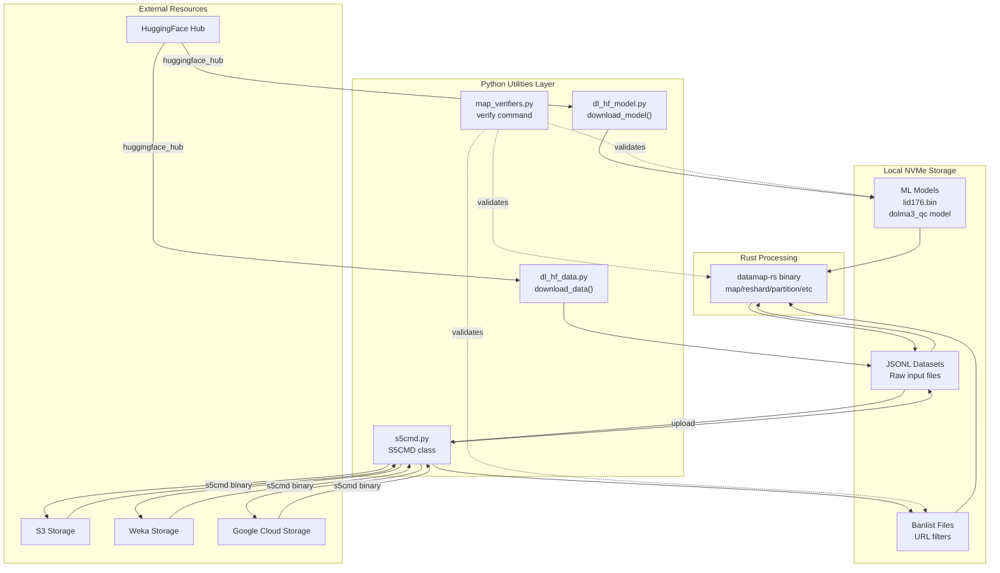
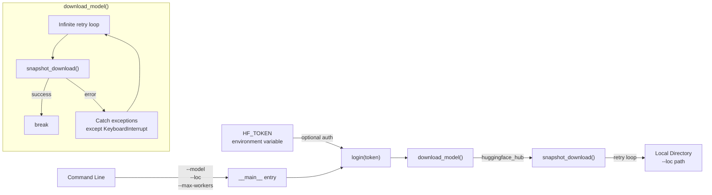
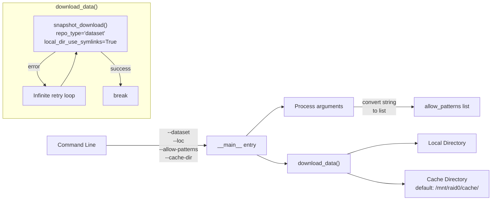
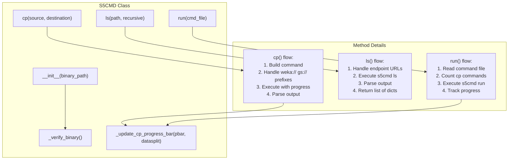
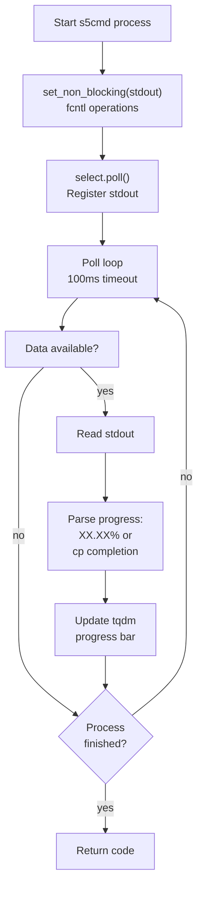
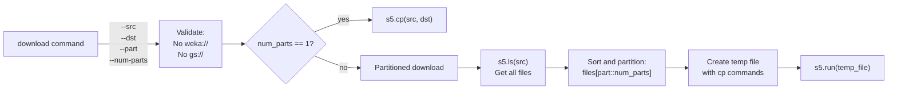
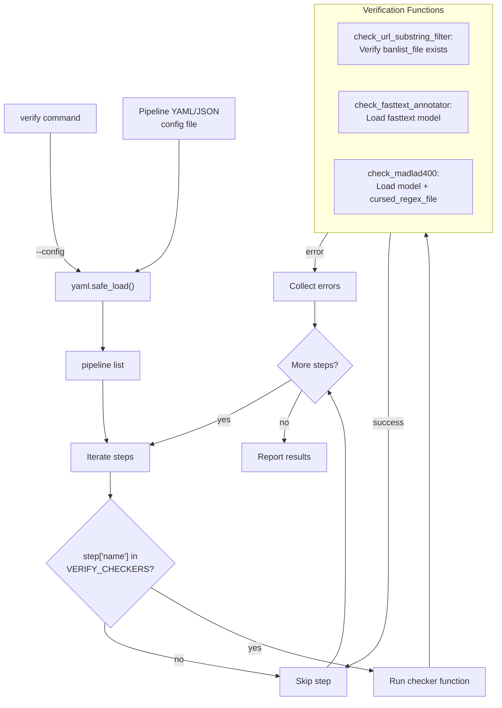
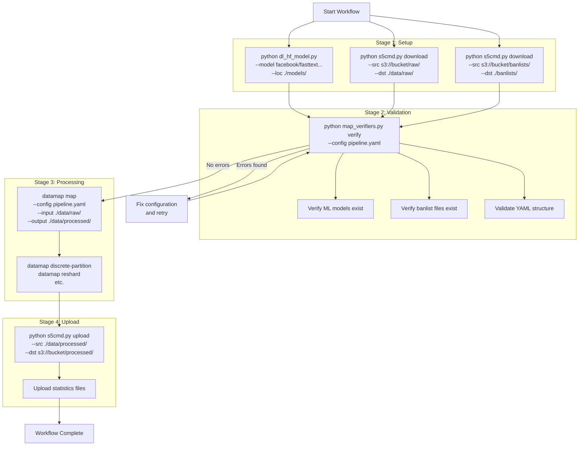

<!-- source: DeepWiki mcp.deepwiki.com · repo allenai/datamap-rs · page 7 Python Utilities · fetched 2026-10-26 -->

# Python Utilities

<details>
<summary>Relevant source files</summary>

The following files were used as context for generating this wiki page:

- [.gitignore](.gitignore)
- [python/__pycache__/s5cmd.cpython-312.pyc](python/__pycache__/s5cmd.cpython-312.pyc)
- [python/dl_hf_data.py](python/dl_hf_data.py)
- [python/dl_hf_model.py](python/dl_hf_model.py)
- [python/map_verifiers.py](python/map_verifiers.py)
- [python/s5cmd.py](python/s5cmd.py)

</details>


## Purpose and Scope

This document covers the Python utility scripts that handle cloud integration, data transfer, and pipeline verification in the datamap-rs ecosystem. These utilities complement the core Rust binary by managing external I/O operations and pre-flight validation checks.

The Python utilities handle three main responsibilities:
1. **HuggingFace Integration**: Downloading ML models and datasets from HuggingFace Hub
2. **Cloud Storage Operations**: High-performance transfer to/from S3, Weka, and Google Cloud Storage
3. **Pipeline Verification**: Pre-flight validation of pipeline configurations and resource availability

For information about the core data processing operations that use these utilities, see [Map Command (Pipeline Processing)](#3). For details on the local-first architecture that these utilities support, see [Data Flow and Storage Strategy](#2.3).

Sources: [python/dl_hf_model.py:1-46](), [python/dl_hf_data.py:1-61](), [python/s5cmd.py:1-402](), [python/map_verifiers.py:1-76]()

---

## Architecture Overview

The Python utilities form an I/O layer between external resources and the local NVMe storage where the Rust binary operates. All utilities are designed for the local-first workflow pattern: download resources to local storage, process with Rust binary, then upload results.



**Figure 1: Python Utilities Architecture**

The utilities operate independently but follow a common workflow pattern. HuggingFace downloaders fetch ML models and datasets, the S5CMD wrapper handles bulk data transfer, and the verification tool validates that all required resources exist before invoking the Rust binary.

Sources: [python/dl_hf_model.py:1-46](), [python/dl_hf_data.py:1-61](), [python/s5cmd.py:1-402](), [python/map_verifiers.py:1-76]()

---

## HuggingFace Downloaders

Two scripts handle downloads from HuggingFace Hub: `dl_hf_model.py` for ML models and `dl_hf_data.py` for datasets. Both use the `huggingface_hub` library and support authentication via the `HF_TOKEN` environment variable.

### dl_hf_model.py

Downloads ML models from HuggingFace Hub to local storage. Used primarily for FastText models required by annotators and filters.



**Figure 2: dl_hf_model.py Function Flow**

**Key Components:**

| Component | Line Range | Purpose |
|-----------|------------|---------|
| `download_model()` | [9-24]() | Core download function with retry logic |
| CLI parser | [27-45]() | Argument parsing and execution |
| HF_TOKEN handling | [28-30]() | Optional authentication setup |

**Usage:**

```bash
export HF_TOKEN=your_token_here  # Optional for private models
python dl_hf_model.py \
    --model "facebook/fasttext-language-identification" \
    --loc "./ft_classifiers/" \
    --max-workers 8
```

**Parameters:**
- `--model`: HuggingFace model path (e.g., `"username/model-name"`)
- `--loc`: Local destination directory (required)
- `--max-workers`: Number of parallel download threads (defaults to CPU count - 1)

**Retry Behavior:**

The `download_model()` function implements an infinite retry loop [10-22](). On any exception except `KeyboardInterrupt`, it prints the traceback and retries. This handles transient network failures during large model downloads.

Sources: [python/dl_hf_model.py:1-46]()

### dl_hf_data.py

Downloads datasets from HuggingFace Hub with support for pattern filtering. Similar to `dl_hf_model.py` but uses `repo_type="dataset"` and supports `allow_patterns` for selective downloads.



**Figure 3: dl_hf_data.py Function Flow**

**Key Components:**

| Component | Line Range | Purpose |
|-----------|------------|---------|
| `download_data()` | [9-29]() | Core download function with retry logic |
| CLI parser | [35-60]() | Argument parsing with pattern support |
| Pattern conversion | [49-50]() | Converts string to list for single pattern |

**Usage:**

```bash
python dl_hf_data.py \
    --dataset "allenai/c4" \
    --loc "./datasets/c4/" \
    --allow-patterns "en/c4-train.*.json.gz" \
    --cache-dir "/mnt/raid0/cache/" \
    --max-workers 8
```

**Parameters:**
- `--dataset`: HuggingFace dataset path (required)
- `--loc`: Local destination directory (required)
- `--allow-patterns`: Glob pattern for selective download (optional, single pattern only)
- `--cache-dir`: HuggingFace cache location (default: `"/mnt/raid0/cache/"`)
- `--max-workers`: Parallel download threads (defaults to CPU count - 1)

**Symlink Behavior:**

Both downloaders use `local_dir_use_symlinks=True` [15, 19](). This creates symlinks to the HuggingFace cache rather than duplicating files, saving disk space when downloading large models or datasets.

Sources: [python/dl_hf_data.py:1-61]()

---

## S5CMD Wrapper

The `s5cmd.py` module provides a Python interface to the `s5cmd` command-line tool for high-performance S3-compatible storage operations. It supports AWS S3, Weka storage, and Google Cloud Storage through endpoint URL configuration.

### S5CMD Class

The `S5CMD` class wraps the `s5cmd` binary and provides methods for common operations with progress tracking.



**Figure 4: S5CMD Class Structure**

**Core Methods:**

| Method | Line Range | Purpose |
|--------|------------|---------|
| `__init__()` | [56-66]() | Initialize with binary path, defaults to `"s5cmd"` in PATH |
| `_verify_binary()` | [71-80]() | Verify s5cmd binary is executable |
| `cp()` | [82-200]() | Copy files with progress tracking |
| `ls()` | [215-265]() | List files and parse output |
| `run()` | [267-351]() | Execute batch operations from command file |
| `_update_cp_progress_bar()` | [201-213]() | Parse s5cmd progress output |

**Endpoint URL Handling:**

The wrapper supports three storage backends by converting URI schemes and adding endpoint URLs:

| Backend | URI Prefix | Endpoint URL | Function |
|---------|------------|--------------|----------|
| Weka | `weka://` | `https://weka-aus.beaker.org:9000` | `weka_endpoint_args()` [35-41]() |
| Google Cloud Storage | `gs://` | `https://storage.googleapis.com` | `gs_endpoint_args()` [44-48]() |
| AWS S3 | `s3://` | (default) | No conversion needed |

The conversion happens in `cp()` [114-122]() and `ls()` [233-238]() methods by:
1. Detecting URI prefix in source/destination paths
2. Replacing prefix with `s3://`
3. Adding appropriate `--profile` and `--endpoint-url` arguments

### Progress Tracking

Both `cp()` and `run()` methods implement real-time progress tracking using non-blocking I/O.



**Figure 5: Progress Tracking Implementation**

The progress tracking uses `fcntl` to set non-blocking mode [28-32]() and `select.poll()` for efficient I/O monitoring [150-172](), [290-323](). This allows reading stdout without blocking the process while maintaining responsiveness.

Sources: [python/s5cmd.py:1-402]()

### CLI Commands

The module provides two CLI commands for common operations.

**download command:**



**Figure 6: Download Command Flow**

The `download` command [359-388]() supports partitioned downloads for parallel execution across multiple processes:

**Single-part download:**
```bash
python s5cmd.py download --src "s3://bucket/data/*" --dst "./local/"
```

**Multi-part download (e.g., part 0 of 4):**
```bash
python s5cmd.py download \
    --src "s3://bucket/data/*" \
    --dst "./local/" \
    --part 0 \
    --num-parts 4
```

The partitioning works by:
1. Listing all files in the source [381]()
2. Sorting the file list [382]()
3. Selecting every `num_parts`-th file starting at `part` [382]()
4. Writing a batch command file [384-387]()
5. Executing via `s5cmd run` [388]()

**upload command:**

```bash
python s5cmd.py upload --src "./local/" --dst "s3://bucket/results/"
```

The `upload` command [391-397]() is a simple wrapper around `s5.cp()` for uploading processed results back to cloud storage.

Sources: [python/s5cmd.py:359-402]()

---

## Pipeline Verification Tool

The `map_verifiers.py` script performs pre-flight checks on pipeline configurations to ensure all required resources exist before invoking the Rust binary. This catches configuration errors early and provides clear error messages.

### Verification Architecture



**Figure 7: Pipeline Verification Flow**

### Verification Functions

The tool validates processor-specific requirements by checking file existence and attempting to load resources.

| Processor Name | Verification Function | Checks | Line Range |
|----------------|----------------------|--------|------------|
| `url_substring_filter` | `check_url_substring_filter()` | Banlist file readable | [21-26]() |
| `fasttext_annotator` | `check_fasttext_annotator()` | FastText model loads | [29-30]() |
| `madlad400_sentence_filter` | `check_madlad400()` | FastText model + regex file | [33-40]() |

**Registry Mapping:**

```python
VERIFY_CHECKERS = {
    "url_substring_filter": check_url_substring_filter,
    "fasttext_annotator": check_fasttext_annotator,
    "madlad400_sentence_filter": check_madlad400,
}
```

Defined at [47-51](). The registry maps processor names (as they appear in YAML config) to verification functions.

### Usage

**Command:**
```bash
python map_verifiers.py verify --config pipeline_config.yaml
```

**Example output (success):**
```
No errors! Good to run the pipeline!
```

**Example output (failure):**
```
Found 2 errors:
Could not find banlist file: /path/to/missing_banlist.txt
Could not find cursed regex file: /path/to/missing_regex.txt
```

**Implementation Details:**

1. Load configuration file [58]()
2. Extract pipeline steps [58]()
3. For each step, check if verification exists [60-61]()
4. Execute verification function with step kwargs [63]()
5. Collect exceptions [64-65]()
6. Report results [66-71]()

The verification functions use try-except blocks to catch any errors during resource loading. For file-based checks, they attempt to open and read the file [24-26](), [36-39](). For model checks, they call `fasttext.load_model()` [30, 34](), which will raise an exception if the model file is missing or invalid.

Sources: [python/map_verifiers.py:1-76]()

---

## Workflow Integration

The Python utilities integrate into the standard datamap-rs workflow at specific stages, handling all external I/O while the Rust binary focuses on data processing.



**Figure 8: Complete Workflow Integration**

### Typical Workflow Script

A complete workflow script might look like:

```bash
#!/bin/bash
set -e  # Exit on error

# Stage 1: Download resources
echo "Downloading models..."
python python/dl_hf_model.py \
    --model "facebook/fasttext-language-identification" \
    --loc "./models/lid176/"

echo "Downloading data..."
python python/s5cmd.py download \
    --src "s3://my-bucket/raw-data/*" \
    --dst "./data/raw/"

# Stage 2: Verify pipeline
echo "Verifying pipeline configuration..."
python python/map_verifiers.py verify \
    --config ./configs/my_pipeline.yaml

# Stage 3: Process data
echo "Running map pipeline..."
./target/release/datamap map \
    --config ./configs/my_pipeline.yaml \
    --input ./data/raw/ \
    --output ./data/processed/

# Stage 4: Upload results
echo "Uploading results..."
python python/s5cmd.py upload \
    --src "./data/processed/" \
    --dst "s3://my-bucket/processed/"

echo "Workflow complete!"
```

### Parallel Download Pattern

For large datasets, downloads can be parallelized by partitioning:

```bash
# Split download across 4 parallel processes
python python/s5cmd.py download --src "s3://bucket/data/*" --dst "./data/" --part 0 --num-parts 4 &
python python/s5cmd.py download --src "s3://bucket/data/*" --dst "./data/" --part 1 --num-parts 4 &
python python/s5cmd.py download --src "s3://bucket/data/*" --dst "./data/" --part 2 --num-parts 4 &
python python/s5cmd.py download --src "s3://bucket/data/*" --dst "./data/" --part 3 --num-parts 4 &
wait
```

Each process downloads a different subset of files [382](), enabling efficient use of network bandwidth.

### Error Handling

All Python utilities implement retry logic for transient failures:

- **HuggingFace downloaders**: Infinite retry loop with exception printing [10-22](), [12-28]()
- **S5CMD wrapper**: Graceful termination on `KeyboardInterrupt` [177-188](), [327-338]()
- **Verification tool**: Collects all errors before reporting [64-71]()

This design ensures robustness during long-running operations while allowing manual interruption when needed.

Sources: [python/dl_hf_model.py:1-46](), [python/dl_hf_data.py:1-61](), [python/s5cmd.py:1-402](), [python/map_verifiers.py:1-76]()

---

