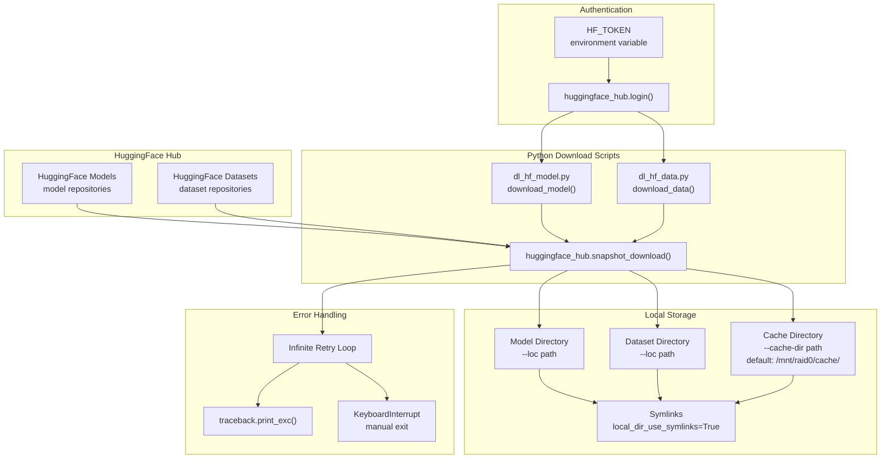
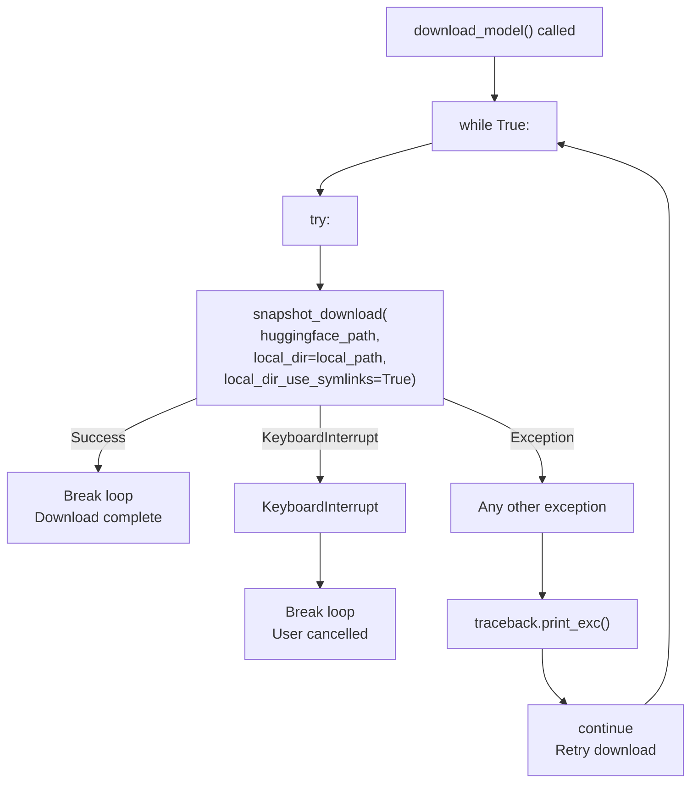
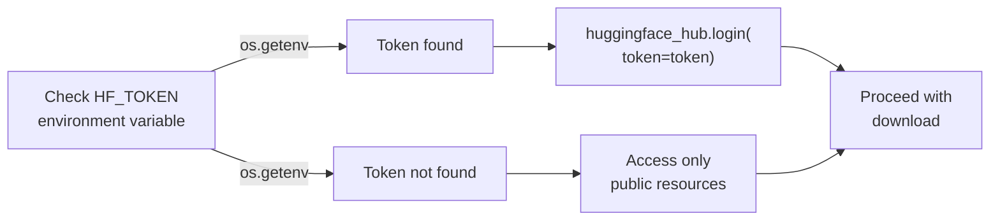
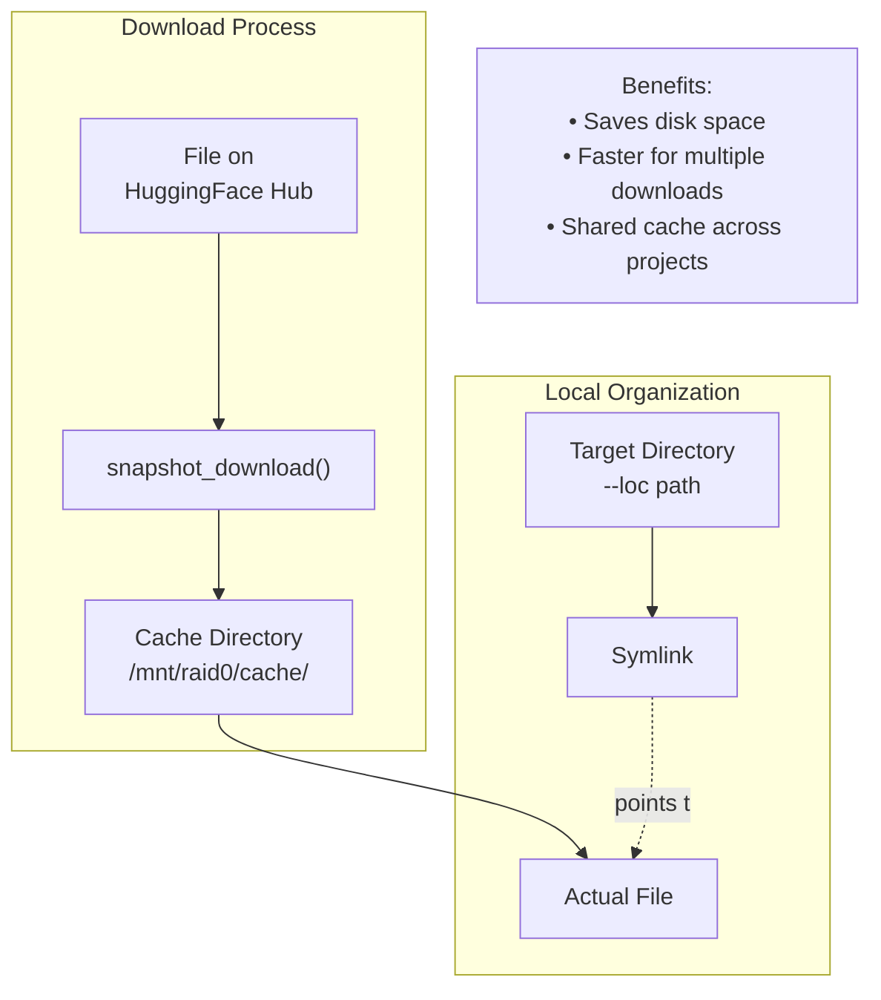
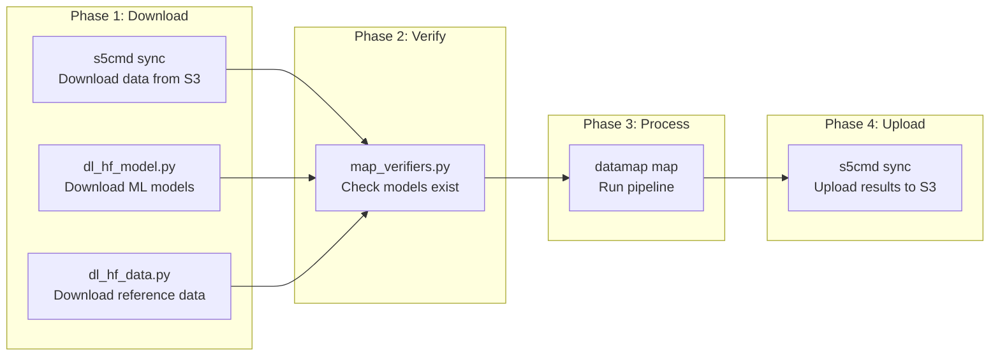

<!-- source: DeepWiki mcp.deepwiki.com · repo allenai/datamap-rs · page 7.1 HuggingFace Downloaders · fetched 2026-10-26 -->

# HuggingFace Downloaders

<details>
<summary>Relevant source files</summary>

The following files were used as context for generating this wiki page:

- [python/__pycache__/s5cmd.cpython-312.pyc](python/__pycache__/s5cmd.cpython-312.pyc)
- [python/dl_hf_data.py](python/dl_hf_data.py)
- [python/dl_hf_model.py](python/dl_hf_model.py)

</details>


## Purpose and Scope

The HuggingFace downloaders are Python utilities that download ML models and datasets from the HuggingFace Hub to local storage. These tools are part of the external integration layer that supports the datamap-rs local-first processing architecture. They handle authentication, retry logic, and efficient storage management when downloading resources required by datamap processors.

For cloud storage downloads (S3, Weka, GCS), see [S5CMD Wrapper for Cloud Storage](#7.2). For validating downloaded resources before processing, see [Pipeline Verification Tool](#7.3).

---

## Overview

The HuggingFace download system consists of two specialized Python scripts:

| Script | Purpose | Typical Use Case |
|--------|---------|------------------|
| `dl_hf_model.py` | Download ML models | FastText language ID models, classification models |
| `dl_hf_data.py` | Download datasets | Training data, evaluation sets, benchmark datasets |

Both scripts are designed for the **download phase** of the typical datamap-rs workflow: download → process → upload. They populate local NVMe storage with resources needed before running the Rust binary.

**Sources:** [python/dl_hf_model.py:1-46](), [python/dl_hf_data.py:1-61]()

---

## System Architecture



**Sources:** [python/dl_hf_model.py:9-24](), [python/dl_hf_data.py:9-29]()

---

## dl_hf_model.py - Model Downloader

### Function Signature

The `download_model()` function downloads a complete model repository from HuggingFace Hub:

```python
def download_model(huggingface_path, local_path, max_workers=8)
```

**Parameters:**
- `huggingface_path` (str): HuggingFace model identifier (e.g., `"facebook/fasttext-language-identification"`)
- `local_path` (str): Local directory where model files will be stored
- `max_workers` (int): Number of parallel download workers (default: CPU count - 1)

**Sources:** [python/dl_hf_model.py:9-24]()

### Core Implementation



**Sources:** [python/dl_hf_model.py:10-23]()

### Command-Line Interface

The script is invoked directly from the command line:

```bash
python dl_hf_model.py --model <huggingface_model_id> --loc <local_path> [--max-workers <N>]
```

**Required Arguments:**
- `--model`: HuggingFace model identifier
- `--loc`: Local destination directory

**Optional Arguments:**
- `--max-workers`: Number of parallel download workers (default: CPU count - 1)

**Environment Variables:**
- `HF_TOKEN`: Authentication token for private models

**Sources:** [python/dl_hf_model.py:27-45]()

---

## dl_hf_data.py - Dataset Downloader

### Function Signature

The `download_data()` function downloads datasets with additional filtering options:

```python
def download_data(huggingface_path, local_path, cache_dir, 
                  allow_patterns=None, max_workers=8)
```

**Parameters:**
- `huggingface_path` (str): HuggingFace dataset identifier
- `local_path` (str): Local directory for dataset
- `cache_dir` (str): Cache directory for temporary files (default: `/mnt/raid0/cache/`)
- `allow_patterns` (list): File patterns to include (e.g., `["*.jsonl"]`)
- `max_workers` (int): Number of parallel download workers

**Sources:** [python/dl_hf_data.py:9-29]()

### Key Differences from Model Downloader

| Feature | dl_hf_model.py | dl_hf_data.py |
|---------|----------------|---------------|
| `repo_type` | Defaults to "model" | `repo_type="dataset"` |
| Filtering | Not supported | `allow_patterns` parameter |
| Cache directory | Uses default | Explicit `cache_dir` parameter |
| Use case | Complete model files | Selective dataset files |

**Sources:** [python/dl_hf_data.py:12-22]()

### Command-Line Interface

```bash
python dl_hf_data.py --dataset <dataset_id> --loc <local_path> \
    [--cache-dir <cache_path>] [--allow-patterns <pattern>] [--max-workers <N>]
```

**Required Arguments:**
- `--dataset`: HuggingFace dataset identifier
- `--loc`: Local destination directory

**Optional Arguments:**
- `--cache-dir`: Cache directory (default: `/mnt/raid0/cache/`)
- `--allow-patterns`: Single file pattern to include (e.g., `"*.jsonl"`)
- `--max-workers`: Number of parallel workers (default: CPU count - 1)

**Sources:** [python/dl_hf_data.py:35-60]()

---

## Authentication

Both scripts use the same authentication mechanism:



**Authentication Setup:**

1. Obtain a HuggingFace token from https://huggingface.co/settings/tokens
2. Set environment variable:
   ```bash
   export HF_TOKEN="hf_..."
   ```
3. Run the download script

**Private Model Access:** The `HF_TOKEN` is required for:
- Private models/datasets
- Gated models requiring acceptance of terms
- Models with download rate limits

**Sources:** [python/dl_hf_model.py:28-30](), [python/dl_hf_data.py:36-38]()

---

## Error Handling and Resilience

### Infinite Retry Loop

Both scripts implement an infinite retry loop for resilience against transient failures:

```python
while True:
    try:
        snapshot_download(...)
        break  # Success - exit loop
    except KeyboardInterrupt:
        break  # User cancelled - exit loop
    except:
        traceback.print_exc()  # Log error
        continue  # Retry
```

**Handled Failure Cases:**
- Network interruptions
- Temporary HuggingFace Hub outages
- Incomplete downloads
- Connection timeouts
- Rate limiting

**Manual Intervention:**
- Press `Ctrl+C` to cancel download
- `KeyboardInterrupt` exits cleanly without retry

**Sources:** [python/dl_hf_model.py:10-22](), [python/dl_hf_data.py:12-28]()

---

## Storage Optimization with Symlinks

Both scripts use `local_dir_use_symlinks=True` for efficient storage:



**Advantages:**
- Multiple downloads of same model share single cached copy
- Saves disk space on large models (FastText models can be several GB)
- Faster subsequent downloads use cached files
- Consistent with HuggingFace Hub library best practices

**Sources:** [python/dl_hf_model.py:15](), [python/dl_hf_data.py:19]()

---

## Common Usage Examples

### Example 1: Download FastText Language ID Model

```bash
# Set authentication
export HF_TOKEN="hf_your_token_here"

# Download model
python python/dl_hf_model.py \
    --model facebook/fasttext-language-identification \
    --loc /mnt/nvme/models/lid176/ \
    --max-workers 8
```

**Use Case:** Required for `FastTextAnnotator` processor in map pipelines.

**Sources:** [python/dl_hf_model.py:27-45]()

### Example 2: Download Dataset with Pattern Filter

```bash
# Download only JSONL files from dataset
python python/dl_hf_data.py \
    --dataset allenai/c4 \
    --loc /mnt/nvme/data/c4/ \
    --cache-dir /mnt/raid0/cache/ \
    --allow-patterns "*.jsonl.gz" \
    --max-workers 16
```

**Use Case:** Download specific file types from large datasets.

**Sources:** [python/dl_hf_data.py:35-60]()

### Example 3: Download Private Gated Model

```bash
# Authentication required for gated models
export HF_TOKEN="hf_..."

# Download (will retry if rate limited)
python python/dl_hf_model.py \
    --model meta-llama/Llama-2-7b \
    --loc /mnt/nvme/models/llama2/
```

**Use Case:** Access models requiring license agreement.

---

## Integration with datamap-rs Workflow

The downloaders fit into the standard datamap-rs workflow:



**Workflow Steps:**

1. **Download ML Models:** Use `dl_hf_model.py` for models required by processors
2. **Download Reference Data:** Use `dl_hf_data.py` for banlist files, evaluation sets
3. **Verify Resources:** Run `map_verifiers.py` to ensure all resources present
4. **Process Data:** Run `datamap map` with downloaded models
5. **Upload Results:** Use `s5cmd` to upload processed data

**Sources:** High-level architecture diagrams, [python/dl_hf_model.py:1-46](), [python/dl_hf_data.py:1-61]()

---

## Comparison: Model vs Dataset Downloader

| Aspect | dl_hf_model.py | dl_hf_data.py |
|--------|----------------|---------------|
| **Primary function** | `download_model()` | `download_data()` |
| **Repository type** | Implicitly "model" | Explicitly `repo_type="dataset"` |
| **Filtering support** | No | Yes (`allow_patterns`) |
| **Cache directory** | Uses library default | Explicit parameter with default |
| **Typical file size** | Large (100MB-10GB) | Variable (can be TB+) |
| **CLI argument** | `--model` | `--dataset` |
| **Max workers default** | CPU count - 1 | CPU count - 1 |
| **Common use case** | FastText, classification models | Training data, evaluation sets |

**Sources:** [python/dl_hf_model.py:9-45](), [python/dl_hf_data.py:9-60]()

---

## Troubleshooting

### Download Hangs or Fails

**Symptom:** Download stops progressing or repeatedly fails

**Solutions:**
1. Check network connectivity
2. Verify `HF_TOKEN` is set and valid for private models
3. Check HuggingFace Hub status page
4. Reduce `--max-workers` to avoid rate limiting
5. Clear cache directory and retry

### Authentication Errors

**Symptom:** `401 Unauthorized` or access denied errors

**Solutions:**
1. Verify `HF_TOKEN` environment variable is set
2. Check token has required permissions
3. For gated models, ensure you've accepted terms on HuggingFace Hub
4. Generate new token if expired

### Disk Space Issues

**Symptom:** Download fails with "No space left on device"

**Solutions:**
1. Check available space in target directory
2. Check available space in cache directory (`--cache-dir`)
3. Clear old cached models
4. Use symlink feature to share storage across downloads

**Sources:** [python/dl_hf_model.py:10-22](), [python/dl_hf_data.py:12-28]()

---

