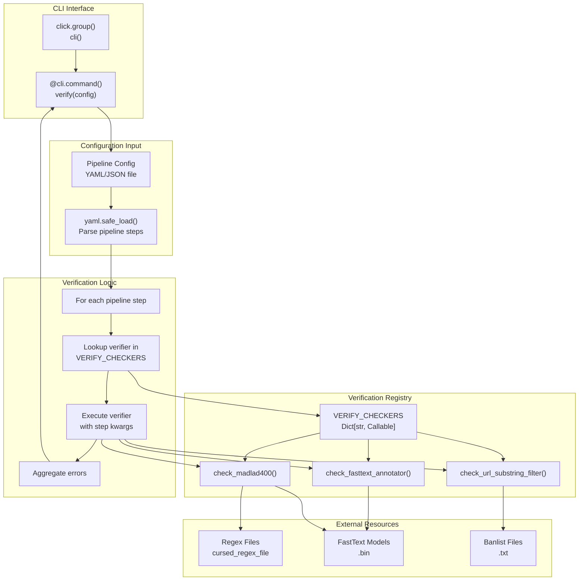
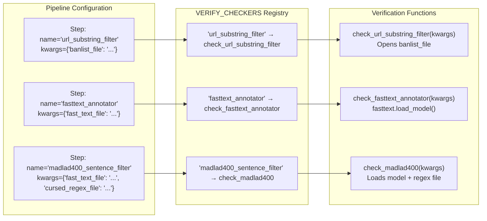
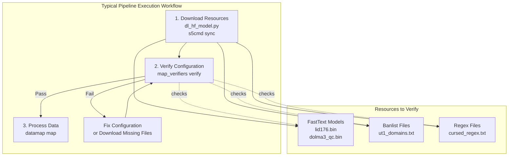

<!-- source: DeepWiki mcp.deepwiki.com · repo allenai/datamap-rs · page 7.3 Pipeline Verification Tool · fetched 2026-10-26 -->

# Pipeline Verification Tool

<details>
<summary>Relevant source files</summary>

The following files were used as context for generating this wiki page:

- [python/map_verifiers.py](python/map_verifiers.py)

</details>


## Purpose and Scope

The Pipeline Verification Tool is a Python utility that performs pre-flight validation checks on map command pipeline configurations. It verifies that all required resources (ML models, banlist files, regex files) exist and are accessible before attempting to process data, preventing costly runtime failures after processing has begun.

This page documents the verification tool's architecture, available verification functions, and usage patterns. For information about the map command itself, see [Map Command (Pipeline Processing)](#3). For configuration format details, see [Configuration Format Reference](#8.1).

**Sources:** [python/map_verifiers.py:1-76]()

---

## Overview

The Pipeline Verification Tool provides a safety check layer between configuration and execution. When processing terabyte-scale datasets with the map command, resource failures (missing models, invalid file paths) can waste hours of computation. The verifier catches these issues before processing begins.

### Key Features

| Feature | Description |
|---------|-------------|
| **Pre-flight Validation** | Checks resource availability before data processing |
| **Model Loading** | Verifies FastText models can be loaded successfully |
| **File Existence** | Confirms banlist files and regex files are accessible |
| **Configuration Parsing** | Reads YAML/JSON pipeline configurations |
| **Error Reporting** | Aggregates all errors found during validation |
| **Extensible Registry** | Simple pattern for adding new verifiers |

The tool is designed to be run immediately after downloading models and before launching the map command in a typical workflow (see [External Integrations and Data Lifecycle](#2.3)).

**Sources:** [python/map_verifiers.py:1-76]()

---

## Architecture

### System Components



**Diagram: Verification Process Flow and Code Entities**

The tool follows a registry pattern where processor names map to verification functions. The `verify()` command reads the pipeline configuration, iterates through each step, and executes the corresponding verifier from `VERIFY_CHECKERS` if one exists.

**Sources:** [python/map_verifiers.py:47-72]()

---

### Registry Pattern



**Diagram: Processor Name to Verification Function Mapping**

The `VERIFY_CHECKERS` dictionary [python/map_verifiers.py:47-51]() defines the static mapping. Only processors that require external resources need verifiers—simple processors like `NonNullFilter` have no entry in the registry and are silently skipped.

**Sources:** [python/map_verifiers.py:47-51]()

---

## Verification Functions

### check_url_substring_filter

**Purpose:** Validates that the banlist file for URL filtering exists and is readable.

**Implementation:** [python/map_verifiers.py:21-26]()

```python
def check_url_substring_filter(kwargs):
    banlist_file = kwargs["banlist_file"]
    try:
        open(banlist_file, "r").read()
    except:
        raise Exception("Could not find banlist file: %s" % banlist_file)
```

**Validated Resources:**
- `banlist_file`: Path to text file containing URL substrings to filter

**Use Case:** The `URLSubstringFilter` processor (see [Filter Processors Reference](#3.3)) uses AhoCorasick pattern matching with large banlist files. This verifier ensures the file is accessible before processing begins.

**Sources:** [python/map_verifiers.py:21-26]()

---

### check_fasttext_annotator

**Purpose:** Validates that the FastText model can be loaded successfully.

**Implementation:** [python/map_verifiers.py:29-30]()

```python
def check_fasttext_annotator(kwargs):
    fasttext.load_model(kwargs["fast_text_file"])
```

**Validated Resources:**
- `fast_text_file`: Path to FastText `.bin` model file

**Use Case:** The `FastTextAnnotator` processor (see [Annotator Processors Reference](#3.5)) requires FastText models for document classification. Models can be gigabytes in size and must be loaded into memory. This verifier catches missing or corrupted model files early.

**Sources:** [python/map_verifiers.py:29-30]()

---

### check_madlad400

**Purpose:** Validates both the FastText model and cursed regex file required by Madlad400 sentence filtering.

**Implementation:** [python/map_verifiers.py:33-40]()

```python
def check_madlad400(kwargs):
    fasttext.load_model(kwargs["fast_text_file"])
    try:
        open(kwargs["cursed_regex_file"], "r").read()
    except:
        raise Exception(
            "Could not find cursed regex file: %s" % kwargs["cursed_regex_file"]
        )
```

**Validated Resources:**
- `fast_text_file`: Path to FastText model for language identification
- `cursed_regex_file`: Path to regex pattern file for quality checks

**Use Case:** The `Madlad400SentenceAnnotator` processor (see [Annotator Processors Reference](#3.5)) implements a 5-rule quality check system requiring both resources. This verifier ensures both dependencies are available.

**Sources:** [python/map_verifiers.py:33-40]()

---

## Usage

### Command Syntax

```bash
python -m map_verifiers verify --config <path/to/config.yaml>
```

### Parameters

| Parameter | Required | Description |
|-----------|----------|-------------|
| `--config` | Yes | Path to YAML or JSON pipeline configuration file |

**Sources:** [python/map_verifiers.py:54-56]()

---

### Example: Successful Verification

Given a pipeline configuration:

```yaml
pipeline:
  - name: url_substring_filter
    kwargs:
      banlist_file: /path/to/banlist.txt
  - name: fasttext_annotator
    kwargs:
      fast_text_file: /path/to/lid176.bin
```

Running verification:

```bash
$ python -m map_verifiers verify --config pipeline.yaml
No errors! Good to run the pipeline!
```

**Sources:** [python/map_verifiers.py:66-67]()

---

### Example: Failed Verification

If resources are missing:

```bash
$ python -m map_verifiers verify --config pipeline.yaml
Found 2 errors:
Could not find banlist file: /path/to/banlist.txt
Warning : `load_model` does not return WordVectorModel or SupervisedModel any more, but a `FastText` object which is very similar.
```

The tool collects all errors before reporting, allowing you to fix multiple issues in one pass.

**Sources:** [python/map_verifiers.py:68-71]()

---

### Example: Skipping Unregistered Processors

Configuration with mixed processor types:

```yaml
pipeline:
  - name: non_null_filter  # No verifier - skipped
    kwargs: {}
  - name: fasttext_annotator  # Has verifier - checked
    kwargs:
      fast_text_file: /path/to/model.bin
  - name: regex_filter  # No verifier - skipped
    kwargs:
      pattern: ".*test.*"
```

Only `fasttext_annotator` is verified; other steps are silently skipped [python/map_verifiers.py:60-61]().

**Sources:** [python/map_verifiers.py:58-71]()

---

## Integration with Workflow



**Diagram: Verification in the Data Processing Workflow**

The verification step is positioned between resource download and data processing. This placement is critical: verification happens after downloading models but before launching expensive map operations.

**Recommended Workflow:**

1. **Download data and models** using [HuggingFace Downloaders](#7.1) and [S5CMD Wrapper](#7.2)
2. **Run verification** to catch configuration errors
3. **Launch map command** with confidence that resources exist
4. **Upload results** after successful processing

This workflow prevents scenarios where processing runs for hours only to fail when encountering a missing model file.

**Sources:** [python/map_verifiers.py:1-76]()

---

## Adding New Verifiers

### Process

To add verification for a new processor:

1. **Implement verification function** in [python/map_verifiers.py]()
2. **Register in VERIFY_CHECKERS** dictionary [python/map_verifiers.py:47-51]()
3. **Match processor name** exactly as it appears in configuration

### Example: Adding Tiktoken Verifier

```python
def check_tiktoken_annotator(kwargs):
    """Verify tiktoken encoding is available"""
    import tiktoken
    try:
        tiktoken.get_encoding(kwargs["encoding_name"])
    except:
        raise Exception(
            "Could not load tiktoken encoding: %s" % kwargs["encoding_name"]
        )

VERIFY_CHECKERS = {
    "url_substring_filter": check_url_substring_filter,
    "fasttext_annotator": check_fasttext_annotator,
    "madlad400_sentence_filter": check_madlad400,
    "tiktoken_annotator": check_tiktoken_annotator,  # New entry
}
```

### Pattern Requirements

All verification functions must:
- Accept a single `kwargs` dictionary parameter
- Raise an `Exception` on validation failure
- Load/access the resource to truly validate availability (not just check file existence)

The exception message should clearly indicate what resource is missing and where it was expected.

**Sources:** [python/map_verifiers.py:21-51]()

---

## Error Handling

### Error Aggregation

The verification tool collects all errors before reporting [python/map_verifiers.py:57-71](). This design allows fixing multiple issues simultaneously rather than discovering them one at a time.

```python
errs = []
pipeline_steps = yaml.safe_load(open(config, "r"))["pipeline"]
for step in pipeline_steps:
    if step["name"] not in VERIFY_CHECKERS:
        continue
    try:
        VERIFY_CHECKERS[step["name"]](step["kwargs"])
    except Exception as err:
        errs.append(err)
```

### Exit Behavior

The tool prints error messages but does not exit with a specific error code. Users must inspect the output to determine verification success. A successful run displays: `"No errors! Good to run the pipeline!"`

**Sources:** [python/map_verifiers.py:57-71]()

---

## Limitations

### Current Limitations

| Limitation | Impact |
|------------|--------|
| **Limited Processor Coverage** | Only 3 of 31+ processors have verifiers |
| **No Schema Validation** | Does not validate YAML structure or processor arguments |
| **No Type Checking** | Arguments are not validated for correct types |
| **Silent Skipping** | Processors without verifiers are silently skipped |
| **No Exit Codes** | Must parse output text to determine success/failure |

### Processors Without Verifiers

Most processors require no external resources and thus have no verifiers:
- Simple filters: `NonNullFilter`, `RegexFilter`, `ContainsFilter`
- Modifiers: `RemoveFieldsModifier`, `AddFieldsModifier`
- Many annotators: `LengthAnnotator`, `DomainAnnotator`

These processors fail at runtime if misconfigured, but failures are immediate and obvious.

**Sources:** [python/map_verifiers.py:47-51]()

---

## Dependencies

### Python Dependencies

| Package | Purpose | Version Requirements |
|---------|---------|---------------------|
| `click` | CLI framework | Standard library or PyPI |
| `fasttext` | FastText model loading | Must match Rust binding version |
| `pyyaml` | YAML parsing | Standard PyPI package |

### Installation

Typically installed as part of the datamap-rs development environment. See [Installation and Setup](#1.1) for complete dependency installation instructions.

**Sources:** [python/map_verifiers.py:6-8]()

---

## Best Practices

### When to Run Verification

| Scenario | Recommendation |
|----------|----------------|
| **First Time Configuration** | Always verify before running |
| **After Updating Models** | Verify to confirm new model paths |
| **Before Large Batch Jobs** | Mandatory to prevent wasted compute |
| **After Configuration Changes** | Verify any pipeline modifications |
| **CI/CD Pipelines** | Include as automated pre-processing step |

### Verification as CI Step

The tool can be integrated into automated workflows:

```bash
#!/bin/bash
# Pre-processing validation script

# Download resources
python dl_hf_model.py --model lid176 --output ./models/

# Verify configuration
python -m map_verifiers verify --config pipeline.yaml
if grep -q "No errors" <<< "$output"; then
    # Launch processing
    datamap map --config pipeline.yaml --input ./data/ --output ./results/
else
    echo "Verification failed!"
    exit 1
fi
```

This pattern prevents expensive failed processing runs in automated environments.

**Sources:** [python/map_verifiers.py:1-76]()

---

