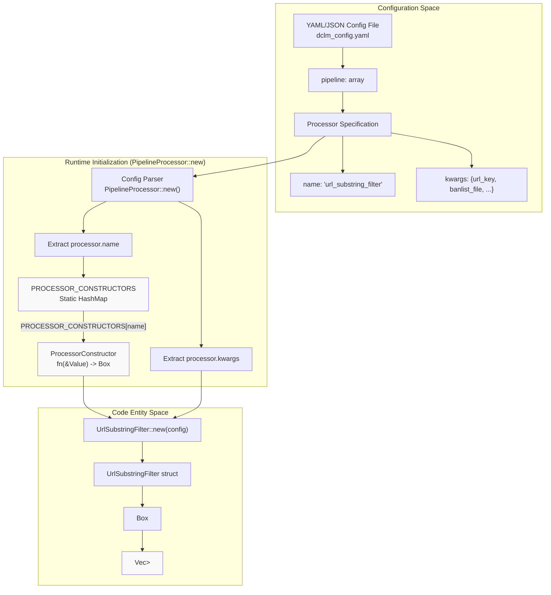
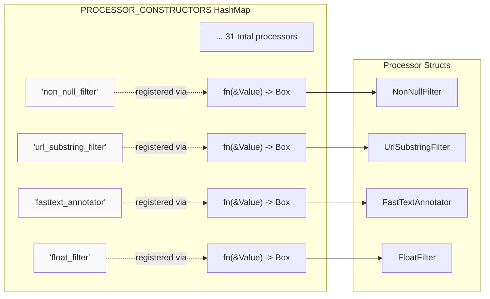
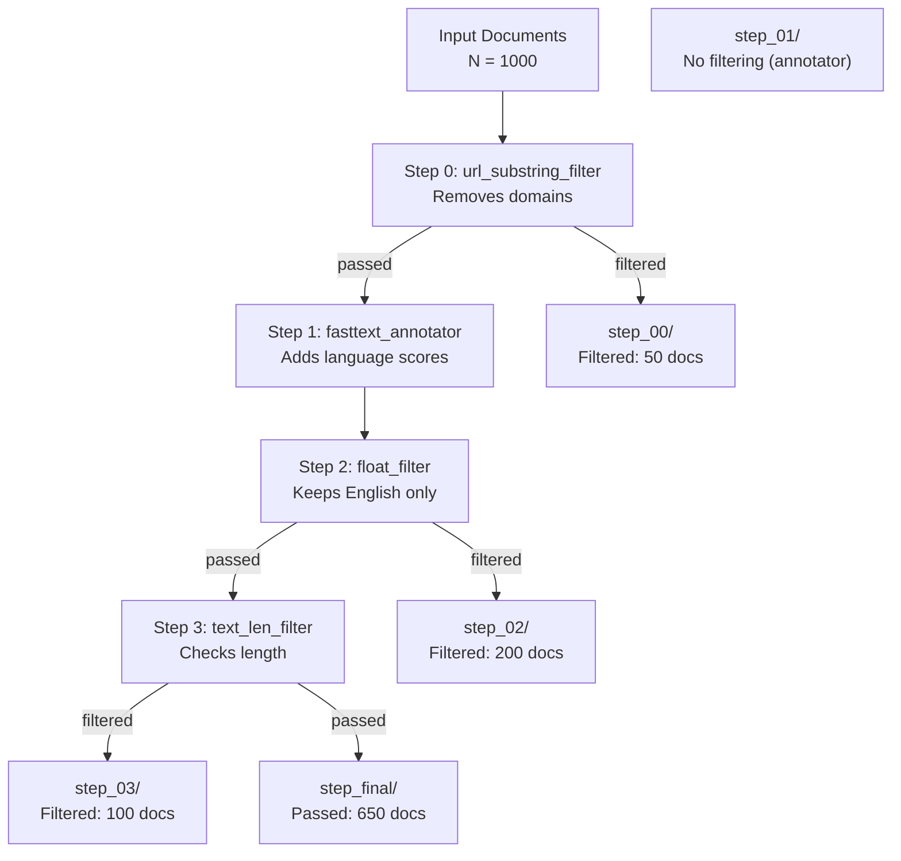
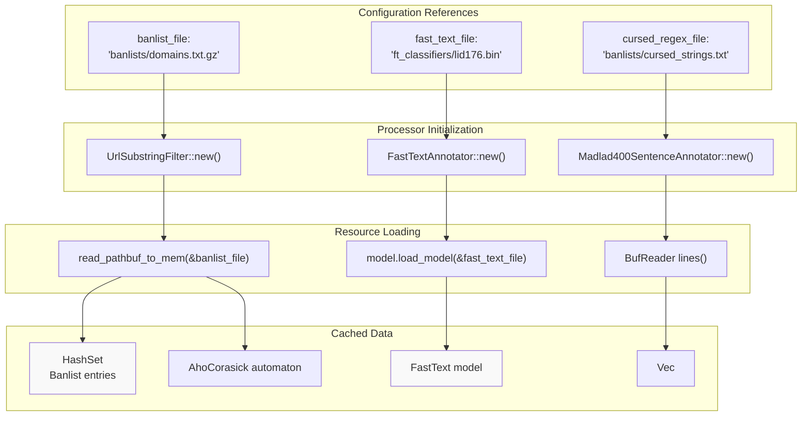
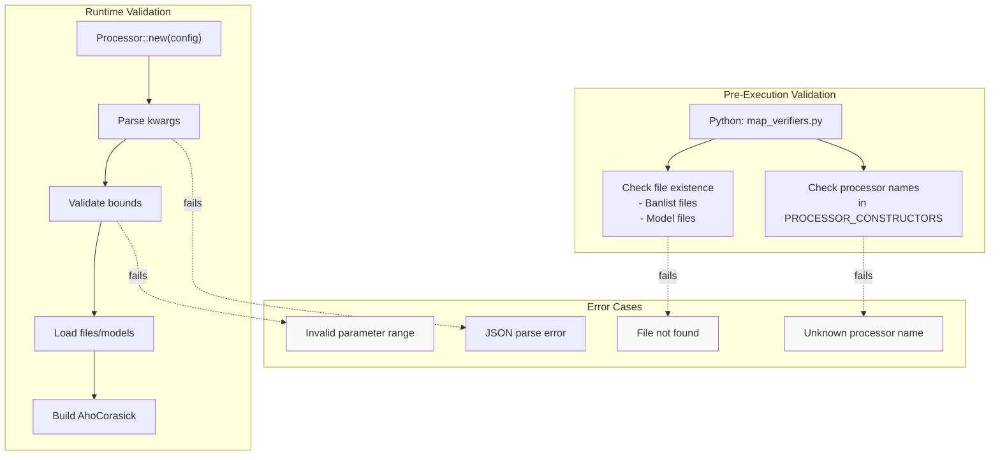

<!-- source: DeepWiki mcp.deepwiki.com · repo allenai/datamap-rs · page 8 Configuration and Examples · fetched 2026-10-26 -->

# Configuration and Examples

<details>
<summary>Relevant source files</summary>

The following files were used as context for generating this wiki page:

- [configs/all_dressed/mixing_classifiers.yaml](configs/all_dressed/mixing_classifiers.yaml)
- [configs/dclm/dclm_config.yaml](configs/dclm/dclm_config.yaml)
- [src/map_fxn.rs](src/map_fxn.rs)

</details>


## Purpose and Scope

This document explains how to write configuration files for datamap-rs pipelines and provides practical examples. Configuration files define the sequence of data processing operations (filters, modifiers, annotators) that documents pass through during the `map` command execution.

For detailed syntax reference of all configuration options, see [Configuration Format Reference](#8.1). For complete walkthrough examples, see [Example: DCLM Pipeline](#8.2) and [Example: Classification and Annotation](#8.3).

---

## Configuration Architecture

Configuration files in datamap-rs use a declarative approach where YAML or JSON specifications are dynamically instantiated into Rust processor objects at runtime.

### Configuration to Code Mapping



**Sources:** [src/map_fxn.rs:48-88](), [src/map_fxn.rs:109-135]()

### Processor Registration System

The `PROCESSOR_CONSTRUCTORS` static map provides the bridge between string names in configuration files and actual Rust types:



The `register_processor!` macro at [src/map_fxn.rs:38-45]() generates the registration code:

| Processor Name (Config) | Rust Struct | Registration Line |
|------------------------|-------------|-------------------|
| `non_null_filter` | `NonNullFilter` | [src/map_fxn.rs:51]() |
| `url_substring_filter` | `UrlSubstringFilter` | [src/map_fxn.rs:55]() |
| `fasttext_annotator` | `FastTextAnnotator` | [src/map_fxn.rs:57]() |
| `float_filter` | `FloatFilter` | [src/map_fxn.rs:58]() |
| `text_len_filter` | `TextLenFilter` | [src/map_fxn.rs:52]() |
| `massive_web_repetition_filter` | `MassiveWebRepetitionFilter` | [src/map_fxn.rs:67-71]() |

**Sources:** [src/map_fxn.rs:38-88]()

---

## Basic Configuration Structure

### Minimal Configuration

Every configuration file must specify two top-level fields:

```yaml
name: my_pipeline
text_field: text
pipeline:
  - name: processor_name
    kwargs:
      param1: value1
      param2: value2
```

| Field | Type | Purpose | Default |
|-------|------|---------|---------|
| `name` | string | Pipeline identifier (for logging) | Required |
| `text_field` | string | JSON key containing document text | `"text"` |
| `pipeline` | array | Ordered list of processors | Required |

The `text_field` value is automatically injected into each processor's kwargs at [src/map_fxn.rs:123-129]():

```rust
json_set(
    &mut subconfig_kwargs,
    &String::from("text_field"),
    serde_json::Value::String(text_field.clone()),
).unwrap();
```

**Sources:** [src/map_fxn.rs:111-135]()

### Processor Specification Format

Each pipeline entry follows this structure:

```yaml
- name: processor_type        # String key in PROCESSOR_CONSTRUCTORS
  kwargs:                     # Optional configuration object
    param1: value
    param2: value
```

When `kwargs` is omitted, an empty JSON object is used [src/map_fxn.rs:118-123]():

```rust
let default_json = json!({});
let mut subconfig_kwargs: Value = subconfig
    .get("kwargs")
    .or(Some(&default_json))
    .unwrap()
    .clone();
```

**Sources:** [src/map_fxn.rs:115-132]()

---

## Pipeline Composition Patterns

### Sequential Filtering Pattern

Filters execute in order and create a funnel where each step may remove documents:



This pattern is implemented in [src/map_fxn.rs:143-171]() where each processor returns `Option<Value>`:
- `Some(data)` → continue to next step
- `None` → document filtered, written to `step_XX/` directory

**Sources:** [src/map_fxn.rs:143-171](), [configs/dclm/dclm_config.yaml:1-102]()

### Filter-Modify-Filter Pattern

Common pattern: filter → modify text → filter again based on modifications:

```yaml
pipeline:
  - name: word_count_adder              # Annotate original count
    kwargs:
      word_count_field: original_word_count
      
  - name: substring_line_modifier       # Modify: remove lines
    kwargs:
      banlist: "Read more..."
      remove_substring_only: true
      
  - name: word_removal_ratio_filter     # Filter: check modification impact
    kwargs:
      word_count_field: original_word_count
      upper_bound: 0.05                 # Max 5% word removal
```

This ensures documents aren't damaged too much by modification steps.

**Sources:** [configs/dclm/dclm_config.yaml:65-102]()

### Multi-Annotator Pattern

Apply multiple FastText models to add different metadata:

```yaml
pipeline:
  - name: fasttext_annotator
    kwargs:
      fast_text_file: ft_classifiers/dolma3_qc/model.bin
      output_field: metadata.dolma3_qc
      
  - name: fasttext_annotator
    kwargs:
      fast_text_file: ft_classifiers/weborganizer/model.bin
      output_field: metadata.weborganizer
      
  - name: max_extractor
    kwargs:
      main_attribute: metadata.weborganizer
      output_attribute: metadata.wo_topic
```

Each annotator writes to a different field, then `max_extractor` extracts the top category.

**Sources:** [configs/all_dressed/mixing_classifiers.yaml:1-16]()

---

## Configuration Parameters by Processor Type

### Filter Processors

Filters return `None` (remove document) when conditions aren't met:

| Processor | Key Parameters | Example |
|-----------|---------------|---------|
| `url_substring_filter` | `url_key`, `banlist_file`, `exact_domain_match` | [configs/dclm/dclm_config.yaml:4-9]() |
| `float_filter` | `float_field`, `lower_bound`, `upper_bound` | [configs/dclm/dclm_config.yaml:33-37]() |
| `text_len_filter` | `lower_bound`, `upper_bound` | [src/map_fxn.rs:264-291]() |
| `page_len_filter` | `length_type`, `lower_bound`, `upper_bound` | [configs/dclm/dclm_config.yaml:38-43]() |
| `massive_web_repetition_filter` | (no parameters) | [configs/dclm/dclm_config.yaml:64]() |

**Sources:** [src/map_fxn.rs:243-1192]()

### Modifier Processors

Modifiers transform document content and always return `Some(modified_data)`:

| Processor | Key Parameters | Effect |
|-----------|---------------|--------|
| `newline_removal_modifier` | `max_consecutive` | Limits consecutive newlines | 
| `ratio_line_modifier` | `upper_bound`, `check` | Removes lines with too many uppercase/digits |
| `substring_line_modifier` | `banlist`, `location` | Removes or filters lines with substrings |
| `line_len_modifier` | `lower_bound` | Removes short lines |

Example from DCLM pipeline [configs/dclm/dclm_config.yaml:68-75]():

```yaml
- name: ratio_line_modifier
  kwargs:
    upper_bound: 0.5
    check: uppercase        # Remove lines >50% uppercase
```

**Sources:** [src/map_fxn.rs:550-1707]()

### Annotator Processors

Annotators add metadata fields without filtering:

| Processor | Key Parameters | Output |
|-----------|---------------|--------|
| `fasttext_annotator` | `fast_text_file`, `output_field`, `k`, `threshold` | Adds classification scores |
| `word_count_adder` | `word_count_field` | Adds word count integer |
| `hash_annotator` | `hash_field`, `text_field` | Adds hash of text |
| `constant_annotator` | `output_field`, `value` | Adds constant value |

Example FastText annotation [configs/dclm/dclm_config.yaml:29-32]():

```yaml
- name: fasttext_annotator
  kwargs:
    fast_text_file: ft_classifiers/lid176.bin
    output_field: metadata.lang          # Writes to nested field
```

The annotator creates nested JSON structure like:
```json
{
  "text": "...",
  "metadata": {
    "lang": {
      "__label__en": 0.95,
      "__label__es": 0.03
    }
  }
}
```

**Sources:** [src/map_fxn.rs:586-647]()

---

## File Path and Resource References

Configuration files often reference external resources that must exist before pipeline execution:

### Resource Types and Paths



### Path Resolution

All paths in configuration files are resolved relative to the current working directory when running `datamap map`. The loading happens during processor construction:

**Banlist Loading** [src/map_fxn.rs:382-393]():
```rust
let banlist_file = PathBuf::from(config.get("banlist_file").unwrap().as_str().unwrap());
let banlist_data = read_pathbuf_to_mem(&banlist_file).unwrap();
let banlist: HashSet<String> = banlist_data
    .lines()
    .map(|line| {
        if case_sensitive {
            line.unwrap().to_lowercase()
        } else {
            line.unwrap()
        }
    })
    .collect();
```

**FastText Model Loading** [src/map_fxn.rs:600-611]():
```rust
let fast_text_file = config
    .get("fast_text_file")
    .unwrap()
    .as_str()
    .unwrap()
    .to_string();
let mut model = FastText::new();
model.load_model(&fast_text_file).unwrap();
```

### Pre-flight Verification

The Python utility `map_verifiers.py` checks for file existence before starting expensive pipeline execution. See [Pipeline Verification Tool](#7.3) for details.

**Sources:** [src/map_fxn.rs:378-396](), [src/map_fxn.rs:599-619]()

---

## Default Values and Optional Parameters

Most processor parameters have sensible defaults implemented via the `get_default()` utility function:

### Common Defaults Table

| Parameter | Default | Used By | Source |
|-----------|---------|---------|--------|
| `text_field` | `"text"` | All processors | [src/map_fxn.rs:113]() |
| `lower_bound` | `0` | Numeric filters | [src/map_fxn.rs:272]() |
| `upper_bound` | `usize::MAX` / `f32::MAX` | Numeric filters | [src/map_fxn.rs:273]() |
| `case_sensitive` | `false` | URL filters | [src/map_fxn.rs:380]() |
| `k` | `10` | FastText annotator | [src/map_fxn.rs:608]() |
| `threshold` | `0.0` | FastText annotator | [src/map_fxn.rs:609]() |
| `max_consecutive` | `2` | Newline removal | [src/map_fxn.rs:559]() |

### Default Value Implementation

The `get_default()` function extracts values from config or provides fallback [src/utils.rs]():

```rust
pub fn get_default<T: serde::de::DeserializeOwned>(
    config: &Value, 
    key: &str, 
    default: T
) -> T {
    if let Some(val) = config.get(key) {
        serde_json::from_value(val.clone()).unwrap_or(default)
    } else {
        default
    }
}
```

This allows minimal configuration specifications. For example, these are equivalent:

**Explicit:**
```yaml
- name: text_len_filter
  kwargs:
    text_field: text
    lower_bound: 0
    upper_bound: 1000000
```

**Minimal (using defaults):**
```yaml
- name: text_len_filter
  kwargs:
    upper_bound: 1000000
```

**Sources:** [src/map_fxn.rs:270-280](), [src/utils.rs]()

---

## Example Configuration Walkthroughs

### Simple Language Filtering

Minimal pipeline to keep only English documents:

```yaml
name: english_only
text_field: text
pipeline:
  - name: fasttext_annotator           # Annotate with language predictions
    kwargs:
      fast_text_file: ft_classifiers/lid176.bin
      output_field: metadata.lang
      
  - name: float_filter                 # Keep if English score >= 0.65
    kwargs:
      float_field: metadata.lang.__label__en
      lower_bound: 0.65
      default: 0.0                     # If field missing, use 0.0
```

**Processing Flow:**
1. `FastTextAnnotator` runs model, adds `metadata.lang.__label__en` field
2. `FloatFilter` checks if value ≥ 0.65
3. Documents with low English probability filtered to `step_02/`
4. High English probability documents written to `step_final/`

**Sources:** [configs/dclm/dclm_config.yaml:29-37]()

### Complex URL Filtering

The DCLM pipeline uses four `url_substring_filter` processors with different modes [configs/dclm/dclm_config.yaml:4-25]():

```yaml
# Mode 1: Exact domain match
- name: url_substring_filter
  kwargs:
    url_key: metadata.warc_url
    banlist_file: banlists/refinedweb_banned_domains_curated.txt.gz
    exact_domain_match: true           # Only check domain exactly
    ignore_chars: ['www']              # Strip 'www' before checking

# Mode 2: Substring match with character ignoring  
- name: url_substring_filter
  kwargs:
    url_key: metadata.warc_url
    banlist_file: banlists/refinedweb_banned_words_strict.txt.gz
    ignore_chars: ['-', '.']           # Remove hyphens/dots

# Mode 3: Word boundary match (strict)
- name: url_substring_filter
  kwargs:
    url_key: metadata.warc_url
    banlist_file: banlists/refinedweb_banned_words_hard.txt.gz
    match_substrings: false            # Require word boundaries

# Mode 4: Multiple hits required (soft filtering)
- name: url_substring_filter
  kwargs:
    url_key: metadata.warc_url
    banlist_file: banlists/refinedweb_banned_words_soft.txt.gz
    num_banned_substrs: 2              # Need 2+ matches to filter
    match_substrings: false
```

Each mode is implemented by different code paths in [src/map_fxn.rs:398-496]().

**Sources:** [configs/dclm/dclm_config.yaml:4-25](), [src/map_fxn.rs:378-497]()

---

## Configuration Validation

### Compile-Time vs Runtime Validation



### Common Validation Errors

The `PipelineProcessor::new()` method performs several validations [src/map_fxn.rs:111-135]():

1. **Unknown processor name:** Panics if name not in `PROCESSOR_CONSTRUCTORS`
2. **Missing required parameters:** Each processor's `new()` method validates required fields
3. **Invalid parameter types:** JSON deserialization fails if types don't match
4. **File access errors:** Resource loading fails if paths incorrect

Example validation in `FloatFilter::new()` [src/map_fxn.rs:660-679]():
```rust
fn new(config: &Value) -> Result<Self, Error> {
    let float_field = config
        .get("float_field")
        .unwrap()                    // Panics if missing
        .as_str()
        .unwrap()
        .to_string();
    // ... bounds validation happens implicitly via types
}
```

**Sources:** [src/map_fxn.rs:111-135](), [src/map_fxn.rs:660-679]()

---

## Configuration Examples Index

For complete, production-ready configuration examples, see:

- **[Example: DCLM Pipeline](#8.2)** - Full 20+ step web data cleaning pipeline with URL filtering, language detection, text quality filters, and line-level modifications
- **[Example: Classification and Annotation](#8.3)** - Multi-model document classification using FastText annotators
- **[Configuration Format Reference](#8.1)** - Complete syntax reference for all processor types and parameters

**Sources:** [configs/dclm/dclm_config.yaml:1-102](), [configs/all_dressed/mixing_classifiers.yaml:1-16]()

---

