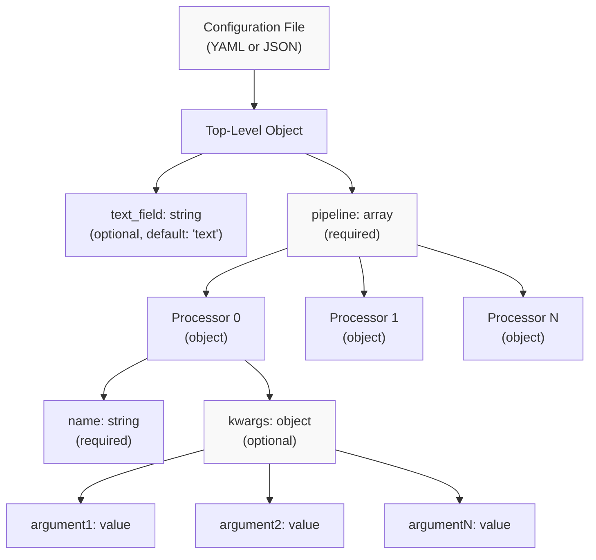
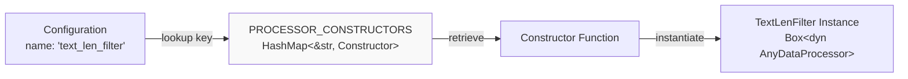
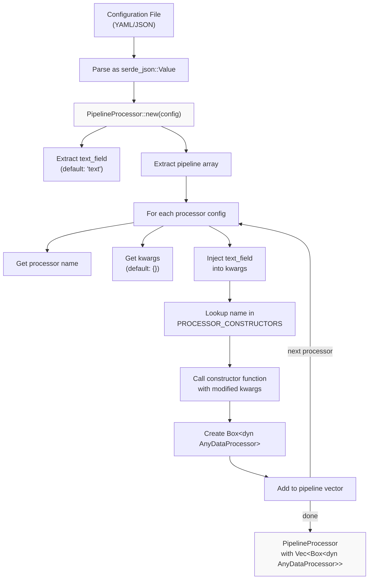
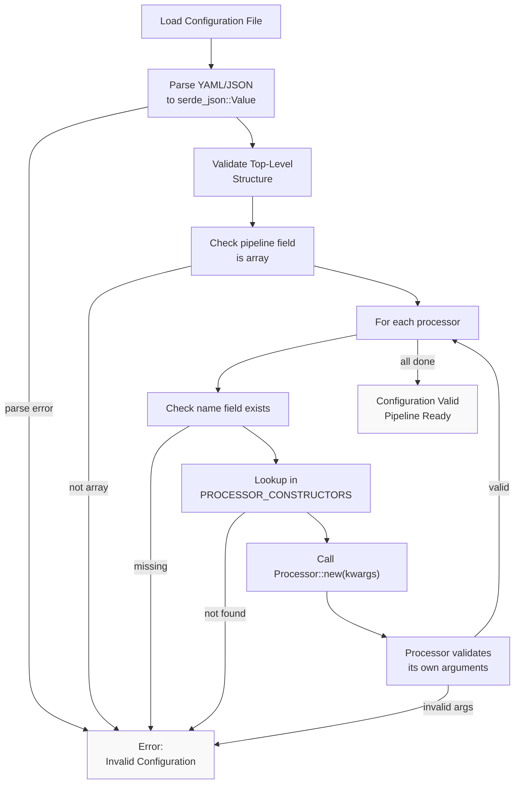

<!-- source: DeepWiki mcp.deepwiki.com · repo allenai/datamap-rs · page 8.1 Configuration Format Reference · fetched 2026-10-26 -->

# Configuration Format Reference

<details>
<summary>Relevant source files</summary>

The following files were used as context for generating this wiki page:

- [configs/dclm/dclm_config.yaml](configs/dclm/dclm_config.yaml)
- [docs/map.md](docs/map.md)
- [src/map_fxn.rs](src/map_fxn.rs)

</details>


This document provides a complete reference for the YAML and JSON configuration file formats used by datamap-rs commands. While pipeline configurations are primarily used by the Map command, the same configuration patterns apply to other commands that accept configuration files.

For information about specific processors and their parameters, see [Filter Processors Reference](#3.3), [Modifier Processors Reference](#3.4), and [Annotator Processors Reference](#3.5). For general pipeline architecture concepts, see [Pipeline Architecture](#3.1).

---

## Configuration File Formats

datamap-rs accepts configuration in both **YAML** and **JSON** formats. YAML is recommended for human readability and maintainability, while JSON is useful for programmatic generation.

### YAML Format (Recommended)

```yaml
text_field: "text"
pipeline:
  - name: "text_len_filter"
    kwargs:
      lower_bound: 100
      upper_bound: 50000
  - name: "stop_word_filter"
    kwargs:
      min_stop_word: 3
```

### JSON Format

```json
{
  "text_field": "text",
  "pipeline": [
    {
      "name": "text_len_filter",
      "kwargs": {
        "lower_bound": 100,
        "upper_bound": 50000
      }
    },
    {
      "name": "stop_word_filter",
      "kwargs": {
        "min_stop_word": 3
      }
    }
  ]
}
```

**Sources:** [src/map_fxn.rs:111-135]()

---

## Configuration Structure Hierarchy



**Sources:** [src/map_fxn.rs:111-135](), [configs/dclm/dclm_config.yaml:1-102]()

---

## Top-Level Configuration Fields

| Field | Type | Required | Default | Description |
|-------|------|----------|---------|-------------|
| `text_field` | string | No | `"text"` | Specifies which JSON field contains the document text. This value is automatically injected into all processor configurations. |
| `pipeline` | array | Yes | - | Ordered list of processors to apply sequentially to each document. |
| `name` | string | No | - | Optional descriptive name for the configuration (used for documentation). |

### text_field Behavior

The `text_field` value defined at the top level is **automatically injected** into the `kwargs` of every processor in the pipeline. Individual processors can override this by explicitly specifying their own `text_field` parameter.

```yaml
text_field: "content"  # Global default
pipeline:
  - name: "text_len_filter"
    kwargs:
      lower_bound: 100
      # text_field automatically set to "content"
  
  - name: "fasttext_annotator"
    kwargs:
      text_field: "text"  # Explicitly override to use "text" field
      fast_text_file: "./models/lid176.bin"
```

**Sources:** [src/map_fxn.rs:113-129]()

---

## Pipeline Configuration Structure

The `pipeline` field contains an **ordered array** of processor configurations. Documents flow through processors sequentially in the order defined.

### Processor Configuration Object

Each processor in the pipeline array must be an object with the following structure:

| Field | Type | Required | Description |
|-------|------|----------|-------------|
| `name` | string | Yes | Name of the processor type (must match a registered processor). |
| `kwargs` | object | No | Named arguments for processor initialization. If omitted, defaults to empty object `{}`. |

### Example

```yaml
pipeline:
  - name: "text_len_filter"
    kwargs:
      lower_bound: 100
      upper_bound: 50000
      
  - name: "subsample"
    kwargs:
      subsample_rate: 0.8
      
  - name: "stop_word_filter"
    # kwargs is optional - processor will use all defaults
```

**Sources:** [src/map_fxn.rs:115-132]()

---

## Processor Registration and Name Mapping

Processor names in configuration files must exactly match entries in the `PROCESSOR_CONSTRUCTORS` static registry. The system uses these names to dynamically instantiate the correct processor type.



### Available Processor Names

The complete list of registered processor names is defined in the `PROCESSOR_CONSTRUCTORS` static map:

| Processor Name | Rust Type | Category |
|----------------|-----------|----------|
| `non_null_filter` | `NonNullFilter` | Filter |
| `text_len_filter` | `TextLenFilter` | Filter |
| `subsample` | `SubsampleFilter` | Filter |
| `add_id` | `AddIdModifier` | Modifier |
| `url_substring_filter` | `UrlSubstringFilter` | Filter |
| `newline_removal_modifier` | `NewlineRemovalModifier` | Modifier |
| `fasttext_annotator` | `FastTextAnnotator` | Annotator |
| `float_filter` | `FloatFilter` | Filter |
| `string_eq_filter` | `StringEqFilter` | Filter |
| `page_len_filter` | `PageLenFilter` | Filter |
| `word_len_filter` | `WordLenFilter` | Filter |
| `symbol_ratio_filter` | `SymbolRatioFilter` | Filter |
| `bullet_filter` | `BulletFilter` | Filter |
| `ellipsis_line_ratio_filter` | `EllipsisLineRatioFilter` | Filter |
| `alphabetic_word_ratio_filter` | `AlphabeticWordRatioFilter` | Filter |
| `stop_word_filter` | `StopWordFilter` | Filter |
| `massive_web_repetition_filter` | `MassiveWebRepetitionFilter` | Filter |
| `word_count_adder` | `WordCountAdder` | Modifier |
| `ratio_line_modifier` | `RatioLineModifier` | Modifier |
| `regex_line_modifier` | `RegexLineModifier` | Modifier |
| `line_len_modifier` | `LineLenModifier` | Modifier |
| `substring_line_modifier` | `SubstringLineModifier` | Modifier |
| `word_removal_ratio_filter` | `WordRemovalRatioFilter` | Filter |
| `madlad400_sentence_annotator` | `Madlad400SentenceAnnotator` | Annotator |
| `madlad400_rule_filter` | `Madlad400RuleFilter` | Filter |
| `interval_filter` | `IntervalFilter` | Filter |
| `dd_max_getter` | `DDMaxGetter` | Annotator |
| `hash_annotator` | `HashAnnotator` | Annotator |
| `max_extractor` | `MaxExtractor` | Annotator |
| `constant_annotator` | `ConstantAnnotator` | Annotator |
| `rename_modifier` | `RenameModifier` | Modifier |

**Sources:** [src/map_fxn.rs:48-88]()

---

## Configuration Parsing Flow



**Sources:** [src/map_fxn.rs:111-135]()

---

## Common Configuration Patterns

### Pattern 1: Field Path Notation

Many processors use **dot notation** to reference nested JSON fields:

```yaml
pipeline:
  - name: "fasttext_annotator"
    kwargs:
      output_field: "metadata.language"  # Creates nested structure
      
  - name: "float_filter"
    kwargs:
      float_field: "metadata.language.__label__en"  # Access nested value
```

The `json_get()` and `json_set()` utility functions parse these paths and traverse the JSON structure.

**Sources:** [src/utils.rs](), [src/map_fxn.rs:124-128]()

### Pattern 2: Default Value Handling

Processors use the `get_default()` utility function to provide sensible defaults for optional parameters:

```yaml
pipeline:
  - name: "text_len_filter"
    kwargs:
      lower_bound: 100
      # upper_bound not specified, defaults to usize::MAX
```

The defaults are defined in each processor's `new()` implementation.

**Sources:** [src/map_fxn.rs:272-279](), [src/utils.rs]()

### Pattern 3: File Path References

Processors that load external data (banlists, models) accept file paths as strings:

```yaml
pipeline:
  - name: "url_substring_filter"
    kwargs:
      url_key: "metadata.warc_url"
      banlist_file: "banlists/refinedweb_banned_domains.txt.gz"
      
  - name: "fasttext_annotator"
    kwargs:
      fast_text_file: "ft_classifiers/lid176.bin"
```

**Paths are relative to the working directory** where the datamap command is executed. Compressed files (`.gz`, `.zst`) are automatically decompressed.

**Sources:** [src/map_fxn.rs:382-396](), [src/map_fxn.rs:600-611]()

### Pattern 4: Sequential Modification with Tracking

A common pattern is to track the original state before modification, then filter based on how much changed:

```yaml
pipeline:
  # Step 1: Record original state
  - name: "word_count_adder"
    kwargs:
      word_count_field: "original_word_count"
  
  # Step 2: Modify content
  - name: "line_len_modifier"
    kwargs:
      lower_bound: 5
  
  # Step 3: Filter if too much was removed
  - name: "word_removal_ratio_filter"
    kwargs:
      word_count_field: "original_word_count"
      upper_bound: 0.3  # Reject if >30% of words removed
```

**Sources:** [configs/dclm/dclm_config.yaml:65-102](), [docs/map.md:165-178]()

### Pattern 5: Multiple Filters with Same Type

You can use the same processor type multiple times with different configurations:

```yaml
pipeline:
  # Strict domain-level filtering
  - name: "url_substring_filter"
    kwargs:
      url_key: "metadata.warc_url"
      banlist_file: "banlists/strict.txt"
      exact_domain_match: true
      
  # Substring-level filtering with different rules
  - name: "url_substring_filter"
    kwargs:
      url_key: "metadata.warc_url"
      banlist_file: "banlists/soft.txt"
      num_banned_substrs: 2
      match_substrings: false
```

**Sources:** [configs/dclm/dclm_config.yaml:4-25]()

---

## Configuration Parameter Types

### Numeric Types

Configuration values are parsed as JSON types and converted as needed:

```yaml
pipeline:
  - name: "text_len_filter"
    kwargs:
      lower_bound: 100        # Parsed as integer (usize)
      upper_bound: 50000
      
  - name: "float_filter"
    kwargs:
      lower_bound: 0.65       # Parsed as float (f32/f64)
      upper_bound: 1.0
```

**Type conversion notes:**
- Integer values may be converted between `usize`, `i32`, `u64` as needed
- Float values are typically converted to `f32` for processing
- Values exceeding type limits will cause errors during parsing

**Sources:** [src/map_fxn.rs:272-279](), [src/map_fxn.rs:660-678]()

### String Types

Strings can represent various data types:

```yaml
pipeline:
  - name: "page_len_filter"
    kwargs:
      length_type: "word"     # Enum parsed from string
      
  - name: "string_eq_filter"
    kwargs:
      str_field: "language"
      eq: "en"                # Literal string value
```

**Sources:** [src/map_fxn.rs:761-776](), [src/map_fxn.rs:714-729]()

### Boolean Types

Booleans control processor behavior:

```yaml
pipeline:
  - name: "float_filter"
    kwargs:
      negate: true            # Inverts filter logic
      
  - name: "page_len_filter"
    kwargs:
      ignore_punctuation: false
```

**Sources:** [src/map_fxn.rs:655-678](), [src/map_fxn.rs:792-800]()

### Array Types

Arrays represent lists of values:

```yaml
pipeline:
  - name: "url_substring_filter"
    kwargs:
      ignore_chars: ['-', '.', 'www']  # Vec<String>
      
  - name: "madlad400_sentence_annotator"
    kwargs:
      rules_to_include: [0, 2, 4]      # Vec<usize>
```

**Sources:** [src/map_fxn.rs:506-509](), [src/map_fxn.rs:1803-1804]()

---

## Configuration Validation

### Runtime Validation

Configuration validation occurs in two phases:

1. **Parse-time validation**: Checks JSON/YAML syntax and structure
2. **Initialization-time validation**: Each processor's `new()` method validates its specific parameters



### Common Validation Errors

| Error Type | Cause | Example |
|------------|-------|---------|
| **Unknown processor** | `name` not in `PROCESSOR_CONSTRUCTORS` | `name: "invalid_filter"` |
| **Missing required field** | Processor requires a parameter not provided | `url_substring_filter` without `url_key` |
| **Type mismatch** | Parameter has wrong type | `lower_bound: "not a number"` |
| **Invalid enum value** | String doesn't match enum variants | `length_type: "invalid"` |
| **File not found** | Referenced file doesn't exist | `banlist_file: "nonexistent.txt"` |
| **Invalid range** | `lower_bound > upper_bound` | `lower_bound: 100, upper_bound: 50` |

**Sources:** [src/map_fxn.rs:111-135](), [src/map_fxn.rs:379-396]()

---

## Minimal Configuration Examples

### Minimal Valid Configuration

The simplest valid configuration:

```yaml
pipeline: []
```

This creates an empty pipeline that passes all documents through unchanged.

### Single Processor

```yaml
pipeline:
  - name: "non_null_filter"
```

No `kwargs` needed for processors with no required parameters.

### With Text Field Override

```yaml
text_field: "content"
pipeline:
  - name: "text_len_filter"
    kwargs:
      lower_bound: 100
```

**Sources:** [src/map_fxn.rs:111-135]()

---

## Complete Configuration Example

The following is a real-world configuration from the DCLM pipeline, demonstrating advanced usage:

```yaml
name: dclm
text_field: text
pipeline:
  # Domain-level URL filtering
  - name: url_substring_filter
    kwargs:
      url_key: metadata.warc_url
      banlist_file: banlists/refinedweb_banned_domains_curated.txt.gz
      exact_domain_match: true
      ignore_chars: ['www']
  
  # Substring-based URL filtering with soft threshold
  - name: url_substring_filter
    kwargs:
      url_key: metadata.warc_url
      banlist_file: banlists/refinedweb_banned_words_soft_reverse_engineered.txt.gz
      num_banned_substrs: 2
      match_substrings: false
  
  # Content normalization
  - name: newline_removal_modifier
    kwargs:
      max_consecutive: 2
  
  # Language identification and filtering
  - name: fasttext_annotator
    kwargs:
      fast_text_file: ft_classifiers/lid176.bin
      output_field: metadata.lang
  
  - name: float_filter
    kwargs:
      float_field: metadata.lang.__label__en
      lower_bound: 0.65
      default: 0.0
  
  # Document-level quality filters
  - name: page_len_filter
    kwargs:
      length_type: word
      lower_bound: 50
      upper_bound: 100000
      ignore_punctuation: true
  
  - name: word_len_filter
    kwargs:
      lower_bound: 3
      upper_bound: 10
  
  - name: symbol_ratio_filter
    kwargs:
      max_symbol_to_word_ratio: 0.1
  
  - name: massive_web_repetition_filter
  
  # Track original word count before line-level modifications
  - name: word_count_adder
    kwargs:
      word_count_field: original_word_count
  
  # Line-level cleaning
  - name: ratio_line_modifier
    kwargs:
      upper_bound: 0.5
      check: uppercase
  
  - name: regex_line_modifier
    kwargs: 
      regex_string: '^\W*\d(?:,|\.|\d)*(?:K|k|M|m|B|b)?\s+(?:likes|shares|comments|retweets|reposts|quotes|bookmarks|upvotes|downvotes|downloads|views|followers)\W*'
  
  - name: line_len_modifier
    kwargs:
      lower_bound: 2
  
  # Ensure we didn't remove too much content
  - name: word_removal_ratio_filter
    kwargs:
      word_count_field: original_word_count
      upper_bound: 0.05
```

**Sources:** [configs/dclm/dclm_config.yaml:1-102]()

---

## Configuration Best Practices

### 1. Order Matters

Place expensive operations (FastText, repetition detection) **after** cheap filters to minimize processing:

```yaml
pipeline:
  # Cheap filters first
  - name: "text_len_filter"
    kwargs:
      lower_bound: 100
  
  # Expensive operations last
  - name: "fasttext_annotator"
    kwargs:
      fast_text_file: "./models/lid176.bin"
```

### 2. Use Descriptive Configuration Names

Include a `name` field at the top level for documentation:

```yaml
name: "quality_filter_v2_english_only"
text_field: "text"
pipeline:
  # ...
```

### 3. Comment Your Configurations

YAML supports comments, use them to explain non-obvious choices:

```yaml
pipeline:
  - name: "float_filter"
    kwargs:
      float_field: "metadata.quality_score"
      lower_bound: 0.65  # Threshold determined from manual eval on 10k docs
```

### 4. Modularize Complex Configurations

For large pipelines, consider breaking into logical sections with comments:

```yaml
pipeline:
  # === URL Filtering ===
  - name: "url_substring_filter"
    # ...
  
  # === Language Detection ===
  - name: "fasttext_annotator"
    # ...
  
  # === Quality Filters ===
  - name: "stop_word_filter"
    # ...
```

### 5. Version Control Your Configurations

Store configurations in version control alongside code. Use meaningful commit messages when changing thresholds or adding/removing processors.

**Sources:** [configs/dclm/dclm_config.yaml:1-102](), [docs/map.md:66-84]()

---

## Configuration Debugging

### Testing Individual Processors

Test processors in isolation by creating minimal configurations:

```yaml
pipeline:
  - name: "text_len_filter"
    kwargs:
      lower_bound: 0
      upper_bound: 10
```

Run on a small sample and examine the `step_00` vs `step_final` directories to see what was filtered.

### Incremental Pipeline Building

Add processors one at a time and examine statistics after each addition:

```yaml
# Version 1: Just length filter
pipeline:
  - name: "text_len_filter"
    kwargs:
      lower_bound: 100

# Version 2: Add stop word filter
pipeline:
  - name: "text_len_filter"
    kwargs:
      lower_bound: 100
  - name: "stop_word_filter"
    kwargs:
      min_stop_word: 3
```

Compare the number of documents filtered at each step.

### Examining Filtered Output

The Map command outputs filtered documents to `step_XX` directories, allowing you to inspect **why** documents were removed:

```bash
# See what was filtered at step 2
cat output_dir/step_02/*.jsonl | jq . | head -n 20

# Count documents per step
find output_dir -name "*.jsonl" -exec wc -l {} \; | sort -k2
```

**Sources:** [docs/map.md:35-53](), [docs/map.md:54-63]()

---

## Summary

Configuration files in datamap-rs use a simple, declarative syntax:

1. **Top-level `text_field`** sets the default field for all processors
2. **`pipeline` array** defines the ordered sequence of processors
3. **Each processor** has a `name` (string) and optional `kwargs` (object)
4. **Processor names** must match entries in `PROCESSOR_CONSTRUCTORS`
5. **Field paths** use dot notation to access nested JSON structures
6. **External files** are referenced with relative paths from working directory
7. **Validation** occurs at parse-time and initialization-time

For complete details on available processors and their parameters, see:
- [Filter Processors Reference](#3.3)
- [Modifier Processors Reference](#3.4)
- [Annotator Processors Reference](#3.5)

**Sources:** [src/map_fxn.rs:30-217](), [configs/dclm/dclm_config.yaml:1-102](), [docs/map.md:66-192]()

---

