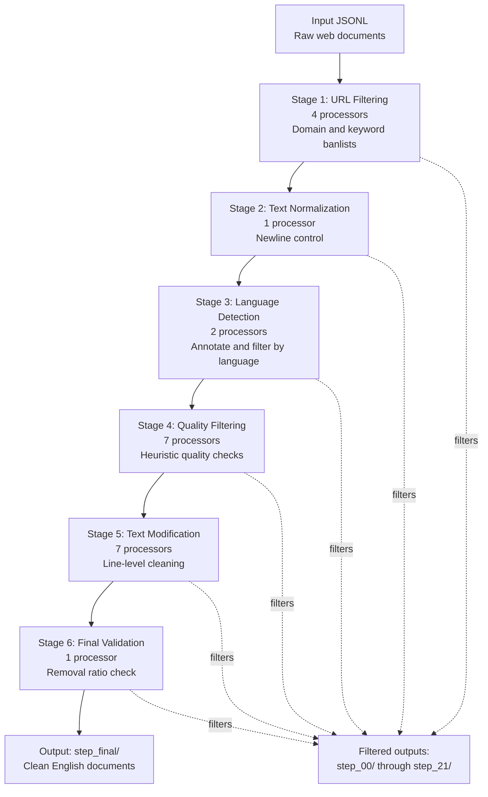
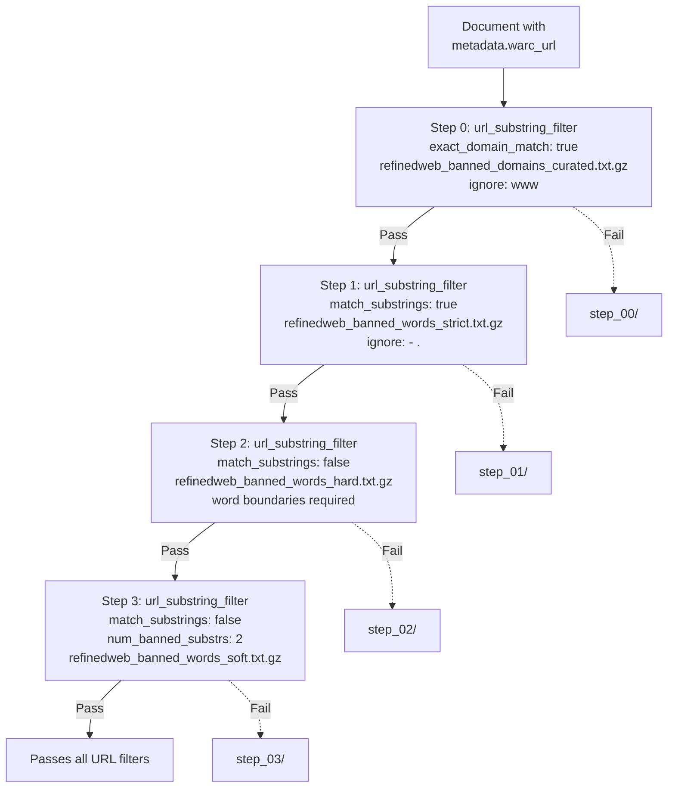
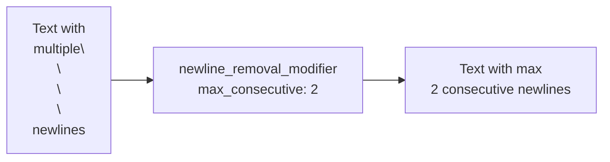
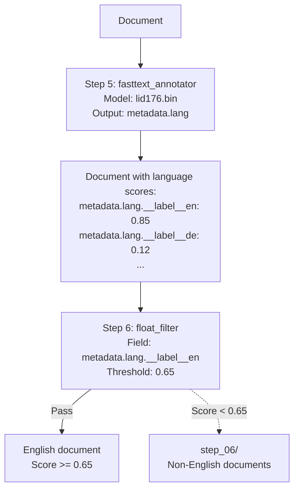
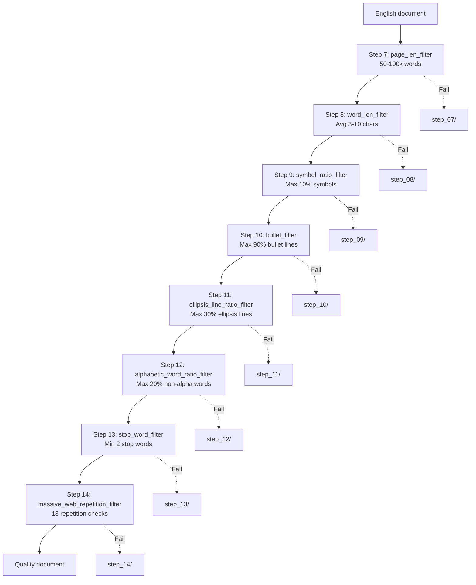
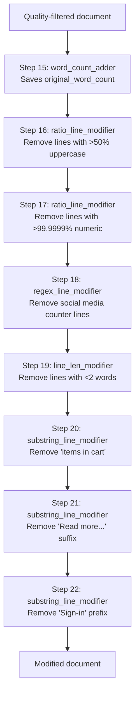
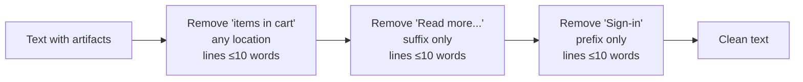
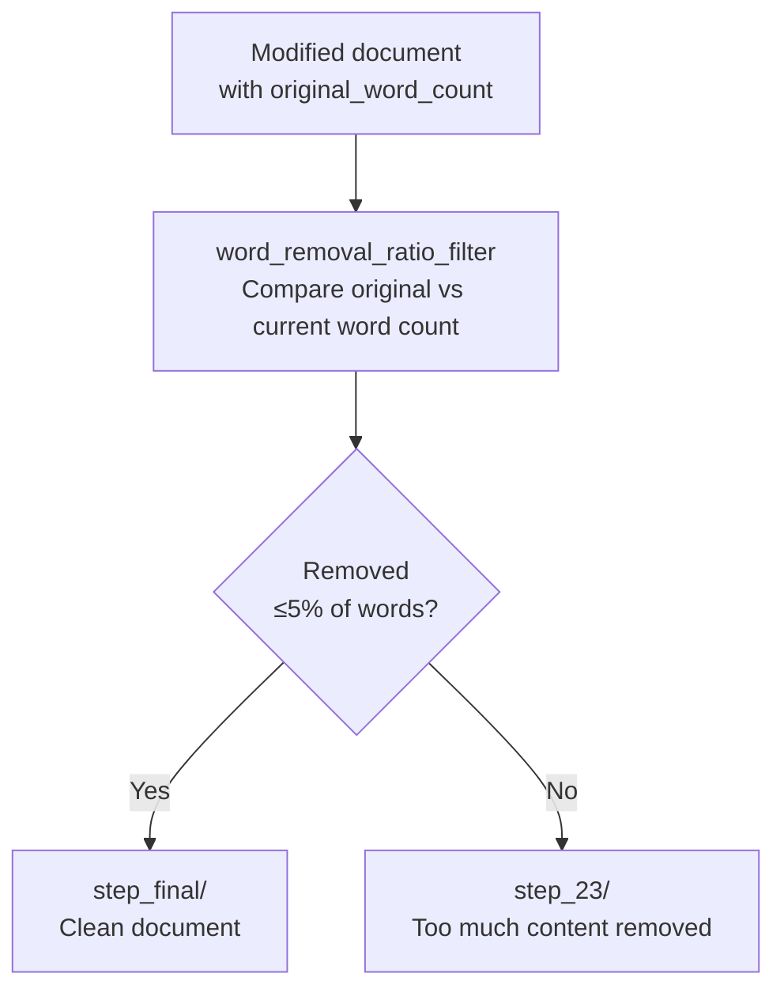

<!-- source: DeepWiki mcp.deepwiki.com · repo allenai/datamap-rs · page 8.2 Example: DCLM Pipeline · fetched 2026-10-26 -->

# Example: DCLM Pipeline

<details>
<summary>Relevant source files</summary>

The following files were used as context for generating this wiki page:

- [configs/dclm/dclm_config.yaml](configs/dclm/dclm_config.yaml)
- [src/map_fxn.rs](src/map_fxn.rs)

</details>


## Purpose

This page provides a detailed walkthrough of the DCLM (DataComp Language Models) pipeline configuration, which serves as a comprehensive example of how to construct a multi-stage data cleaning pipeline using datamap-rs. The DCLM pipeline implements industry-standard web text filtering heuristics derived from RefinedWeb and other high-quality datasets.

For general information about pipeline configuration syntax, see [Configuration Format Reference](#8.1). For processor implementation details, see [Filter Processors Reference](#3.3), [Modifier Processors Reference](#3.4), and [Annotator Processors Reference](#3.5).

**Sources:** [configs/dclm/dclm_config.yaml:1-102]()

## Pipeline Overview

The DCLM pipeline consists of 22 sequential processors organized into five functional stages. Each document flows through all processors in order, and can be filtered out at any stage by returning `None`.



**Configuration Structure:**

| Field | Value | Description |
|-------|-------|-------------|
| `name` | `dclm` | Pipeline identifier |
| `text_field` | `text` | Document text field (propagated to all processors) |
| `pipeline` | Array of 22 processors | Sequential processor list |

**Sources:** [configs/dclm/dclm_config.yaml:1-102]()

## Stage 1: URL Filtering (Steps 0-3)

The pipeline begins with four URL filtering stages using the `url_substring_filter` processor with progressively relaxed matching strategies. This implements the RefinedWeb banlist approach.



### Step 0: Exact Domain Match

Filters documents from banned domains with exact matching on the domain component.

```yaml
- name: url_substring_filter
  kwargs:
    url_key: metadata.warc_url
    banlist_file: banlists/refinedweb_banned_domains_curated.txt.gz
    exact_domain_match: true
    ignore_chars: ['www']
```

**Behavior:**
- Extracts domain from URL (e.g., `example.com` from `https://www.example.com/page`)
- Removes `www` prefix before matching
- Checks for exact domain presence in banlist
- Catches known low-quality domains

**Sources:** [configs/dclm/dclm_config.yaml:4-9](), [src/map_fxn.rs:336-497]()

### Steps 1-3: Keyword-Based URL Filtering

Three progressively softer keyword-based filters:

| Step | Strategy | Description |
|------|----------|-------------|
| 1 | Strict substring | Bans URLs containing any banned word as substring (ignores `-` and `.`) |
| 2 | Hard word boundary | Requires banned words at word boundaries (not substring) |
| 3 | Soft (2 matches) | Requires 2+ banned words at word boundaries |

The progression from strict to soft allows granular control: hardcore pornography terms use strict matching, while ambiguous terms like "escort" or "webcam" use soft matching to avoid false positives.

**Sources:** [configs/dclm/dclm_config.yaml:10-24](), [src/map_fxn.rs:336-497]()

## Stage 2: Text Normalization (Step 4)



The `NewlineRemovalModifier` reduces excessive newlines to a maximum of 2 consecutive newlines, normalizing document formatting.

**Configuration:**
```yaml
- name: newline_removal_modifier
  kwargs:
    max_consecutive: 2
```

**Example Transformation:**
```
Before: "Line 1\n\n\n\n\nLine 2"
After:  "Line 1\n\nLine 2"
```

**Sources:** [configs/dclm/dclm_config.yaml:26-28](), [src/map_fxn.rs:550-584]()

## Stage 3: Language Detection and Filtering (Steps 5-6)

This two-step stage identifies document language and filters for English content.



### Step 5: FastText Language Annotation

Uses the FastText `lid176.bin` model to classify document language, producing probability scores for 176 languages.

**Configuration:**
```yaml
- name: fasttext_annotator
  kwargs:
    fast_text_file: ft_classifiers/lid176.bin
    output_field: metadata.lang
```

**Output Structure:**
```json
{
  "text": "This is an English document...",
  "metadata": {
    "lang": {
      "__label__en": 0.9234,
      "__label__de": 0.0512,
      "__label__fr": 0.0254
    }
  }
}
```

**Sources:** [configs/dclm/dclm_config.yaml:29-32](), [src/map_fxn.rs:586-647]()

### Step 6: English Language Filter

Filters documents to keep only those with English probability >= 0.65.

**Configuration:**
```yaml
- name: float_filter
  kwargs:
    float_field: metadata.lang.__label__en
    lower_bound: 0.65
    default: 0.0
```

The `default: 0.0` ensures documents missing the language annotation are filtered out rather than causing errors.

**Sources:** [configs/dclm/dclm_config.yaml:33-37](), [src/map_fxn.rs:649-702]()

## Stage 4: Quality Filtering (Steps 7-13)

This stage applies seven document-level quality heuristics without modifying text content.



### Quality Filter Details

| Step | Processor | Threshold | Purpose |
|------|-----------|-----------|---------|
| 7 | `page_len_filter` | 50-100,000 words | Remove snippets and extremely long documents |
| 8 | `word_len_filter` | 3-10 char average | Filter character-level spam and overly verbose text |
| 9 | `symbol_ratio_filter` | ≤10% symbols | Remove documents with excessive `#`, `...`, ellipsis |
| 10 | `bullet_filter` | ≤90% bullet lines | Filter list-heavy documents |
| 11 | `ellipsis_line_ratio_filter` | ≤30% ellipsis endings | Remove truncated/teaser content |
| 12 | `alphabetic_word_ratio_filter` | ≤20% non-alpha | Filter numeric/symbol-heavy content |
| 13 | `stop_word_filter` | ≥2 stop words | Ensure natural language (not code/data) |
| 14 | `massive_web_repetition_filter` | 13 thresholds | Detect template repetition using rolling hash |

**Step 14 Configuration:** The `massive_web_repetition_filter` requires no kwargs as it uses fixed thresholds internally. It checks:
- Line-level repetition (1-gram, weighted and unweighted)
- Paragraph-level repetition (1-gram, weighted and unweighted)
- Word n-gram repetition (2-10 grams)

**Sources:** [configs/dclm/dclm_config.yaml:38-64](), [src/map_fxn.rs:743-894]() (page_len), [src/map_fxn.rs:897-933]() (word_len), [src/map_fxn.rs:935-978]() (symbol), [src/map_fxn.rs:980-1019]() (bullet), [src/map_fxn.rs:1021-1060]() (ellipsis), [src/map_fxn.rs:1062-1104]() (alpha), [src/map_fxn.rs:1107-1191]() (stop_word), [src/map_fxn.rs:1195-1352]() (repetition)

## Stage 5: Text Modification (Steps 15-21)

After quality filtering, the pipeline modifies text by removing low-quality lines. The `word_count_adder` first records the original word count for later validation.



### Step 15: Original Word Count Tracking

Before any modifications, the pipeline records the original word count to later verify that modifications didn't remove too much content.

```yaml
- name: word_count_adder
  kwargs:
    word_count_field: original_word_count
```

This adds a field `original_word_count` to each document, which is used by the final `word_removal_ratio_filter`.

**Sources:** [configs/dclm/dclm_config.yaml:65-67](), [src/map_fxn.rs:1405-1436]()

### Steps 16-17: Ratio Line Modifiers

Remove lines with abnormal character ratios:

**Step 16 - Uppercase:**
```yaml
- name: ratio_line_modifier
  kwargs:
    upper_bound: 0.5
    check: uppercase
```
Removes lines where >50% of characters are uppercase (likely headers or spam).

**Step 17 - Numeric:**
```yaml
- name: ratio_line_modifier
  kwargs:
    upper_bound: 0.999999
    check: numeric
```
Removes lines that are almost entirely numeric (tables, data dumps).

**Sources:** [configs/dclm/dclm_config.yaml:68-75](), [src/map_fxn.rs:1438-1510]()

### Step 18: Social Media Counter Removal

Removes lines matching social media engagement patterns:

```yaml
- name: regex_line_modifier
  kwargs: 
    regex_string: '^\W*\d(?:,|\.|\d)*(?:K|k|M|m|B|b)?\s+(?:likes|shares|comments|retweets|reposts|quotes|bookmarks|upvotes|downvotes|downloads|views|followers)\W*$'
```

**Matches patterns like:**
- "1,234 likes"
- "5.6M views"
- "892K followers"

The entire line is removed if it matches this pattern. The regex anchors (`^` and `$`) ensure the entire line is just a counter.

**Sources:** [configs/dclm/dclm_config.yaml:76-78](), [src/map_fxn.rs:1512-1562]()

### Step 19: Line Length Filter

Removes lines with fewer than 2 words:

```yaml
- name: line_len_modifier
  kwargs:
    lower_bound: 2
```

This removes very short lines that typically contain navigation elements or formatting artifacts.

**Sources:** [configs/dclm/dclm_config.yaml:79-81](), [src/map_fxn.rs:1564-1608]()

### Steps 20-22: Substring Removal

Three substring removal operations targeting common web UI elements:



**Step 20 - Cart removal:**
```yaml
- name: substring_line_modifier
  kwargs:
    banlist: "items in cart"
    max_length: 10
    remove_substring_only: true
```

**Step 21 - Read more suffix:**
```yaml
- name: substring_line_modifier
  kwargs:
    banlist: "Read more..."
    max_length: 10
    remove_substring_only: true
    location: suffix
```

**Step 22 - Sign-in prefix:**
```yaml
- name: substring_line_modifier
  kwargs:
    banlist: "Sign-in"
    max_length: 10
    remove_substring_only: true
    location: prefix
```

All three use `max_length: 10` to only process short lines (≤10 words) where these artifacts typically appear. The `remove_substring_only: true` option removes just the substring rather than the entire line.

**Sources:** [configs/dclm/dclm_config.yaml:82-98](), [src/map_fxn.rs:1610-1706]()

## Stage 6: Final Validation (Step 23)

The final processor ensures that text modifications haven't removed too much content:



**Configuration:**
```yaml
- name: word_removal_ratio_filter
  kwargs:
    word_count_field: original_word_count
    upper_bound: 0.05
```

This processor:
1. Reads `original_word_count` saved at step 15
2. Counts current words in the text field
3. Calculates removal ratio: `(original - current) / original`
4. Filters document if ratio > 0.05 (5%)

Documents filtered here had so much low-quality content that the cleaning removed most of the text, suggesting the entire document is low-quality.

**Sources:** [configs/dclm/dclm_config.yaml:99-102](), [src/map_fxn.rs:1708-1751]()

## Configuration Patterns and Best Practices

### Pattern 1: Progressive Filtering Strictness

The URL filtering stages demonstrate a pattern of starting with strict filters and progressively relaxing:

```
Step 0: Exact domain match (strictest)
  ↓
Step 1: Substring match with char ignoring
  ↓
Step 2: Word boundary match
  ↓
Step 3: Word boundary with 2+ matches required (softest)
```

This allows different sensitivity levels for different types of banned content.

### Pattern 2: Annotate-Then-Filter

Language detection uses the two-step pattern:

```
1. fasttext_annotator  (adds metadata.lang)
2. float_filter        (uses metadata.lang.__label__en)
```

This pattern:
- Preserves annotation data in filtered documents (useful for analysis)
- Allows reusing annotations in multiple filters
- Enables debugging by examining annotation values

### Pattern 3: Save-Modify-Validate

Text modification uses a three-phase pattern:

```
1. word_count_adder           (saves original_word_count)
2. Multiple line modifiers     (modify text)
3. word_removal_ratio_filter  (validates using original_word_count)
```

This ensures modifications are bounded and don't destroy document content.

### Pattern 4: Field Propagation

The top-level `text_field: text` is automatically propagated to all processors through the `PipelineProcessor` constructor:

```rust
// From PipelineProcessor::new
json_set(
    &mut subconfig_kwargs,
    &String::from("text_field"),
    serde_json::Value::String(text_field.clone()),
).unwrap();
```

This allows global configuration while permitting per-processor overrides via kwargs.

**Sources:** [src/map_fxn.rs:111-135]()

## Output Structure

Running the DCLM pipeline generates a directory structure showing where documents were filtered:

```
output/
├── step_00/          # Filtered by exact domain match
├── step_01/          # Filtered by strict keyword match
├── step_02/          # Filtered by hard keyword match
├── step_03/          # Filtered by soft keyword match (2+ matches)
├── step_04/          # (newline_removal_modifier doesn't filter)
├── step_05/          # (fasttext_annotator doesn't filter)
├── step_06/          # Filtered by language (not English)
├── step_07/          # Filtered by page length
├── step_08/          # Filtered by word length
├── step_09/          # Filtered by symbol ratio
├── step_10/          # Filtered by bullet ratio
├── step_11/          # Filtered by ellipsis ratio
├── step_12/          # Filtered by alphabetic ratio
├── step_13/          # Filtered by stop word count
├── step_14/          # Filtered by repetition
├── step_15/          # (word_count_adder doesn't filter)
├── step_16/          # (ratio_line_modifier doesn't filter)
├── step_17/          # (ratio_line_modifier doesn't filter)
├── step_18/          # Filtered by regex_line_modifier (all lines removed)
├── step_19/          # Filtered by line_len_modifier (all lines removed)
├── step_20/          # (substring_line_modifier doesn't filter)
├── step_21/          # (substring_line_modifier doesn't filter)
├── step_22/          # (substring_line_modifier doesn't filter)
├── step_23/          # Filtered by word_removal_ratio (>5% removed)
└── step_final/       # Passed all filters
```

**Note:** Modifier and annotator processors only write to intermediate steps if they cause the document to be entirely empty (e.g., all lines removed), in which case they return `None` and the document is filtered.

Each step directory contains compressed JSONL files with documents that failed at that specific stage. The `step_final/` directory contains the clean dataset.

**Sources:** [src/map_fxn.rs:142-171]() (process method)

## Running the DCLM Pipeline

### Basic Command

```bash
datamap map \
  --input-dir /path/to/raw/data \
  --output-dir /path/to/output \
  --config configs/dclm/dclm_config.yaml \
  --threads 32
```

### Required External Resources

Before running, ensure these resources exist:

**Banlists:**
- `banlists/refinedweb_banned_domains_curated.txt.gz`
- `banlists/refinedweb_banned_words_strict_reverse_engineered.txt.gz`
- `banlists/refinedweb_banned_words_hard_reverse_engineered.txt.gz`
- `banlists/refinedweb_banned_words_soft_reverse_engineered.txt.gz`

**Models:**
- `ft_classifiers/lid176.bin` (FastText language identification model)

Download the language model using:
```bash
python python_utils/dl_hf_model.py \
  --model_id facebook/fasttext-language-identification \
  --output_dir ft_classifiers/
```

### Pre-flight Validation

Use the pipeline verifier to check configuration and resources:

```bash
python python_utils/map_verifiers.py verify \
  --config configs/dclm/dclm_config.yaml \
  --verify-resources
```

This validates:
- Configuration syntax
- Processor names are registered
- Required kwargs are present
- Banlist files exist
- Model files exist

**Sources:** [python_utils/map_verifiers.py]()

## Performance Characteristics

The DCLM pipeline demonstrates the following performance characteristics:

| Characteristic | Behavior |
|----------------|----------|
| **Parallelism** | File-level parallel (Rayon), sequential per-document |
| **Memory** | Streaming line-by-line, models loaded once per worker |
| **I/O** | Local NVMe required, compressed output (zstd level 3) |
| **Throughput** | ~5-10 GB/hour per core (varies by filter selectivity) |

**FastText Model Loading:** The `lid176.bin` model (~130MB) is loaded once per worker thread at initialization, not per document. With 32 threads, expect ~4GB memory overhead for model replicas.

**Banlist Loading:** The `UrlSubstringFilter` loads banlists into memory as `HashSet<String>` (for exact match) or `AhoCorasick` automaton (for substring match). Large banlists are shared across documents but replicated per worker.

**Sources:** [src/map_fxn.rs:586-647]() (FastText loading), [src/map_fxn.rs:378-396]() (banlist loading)

---

