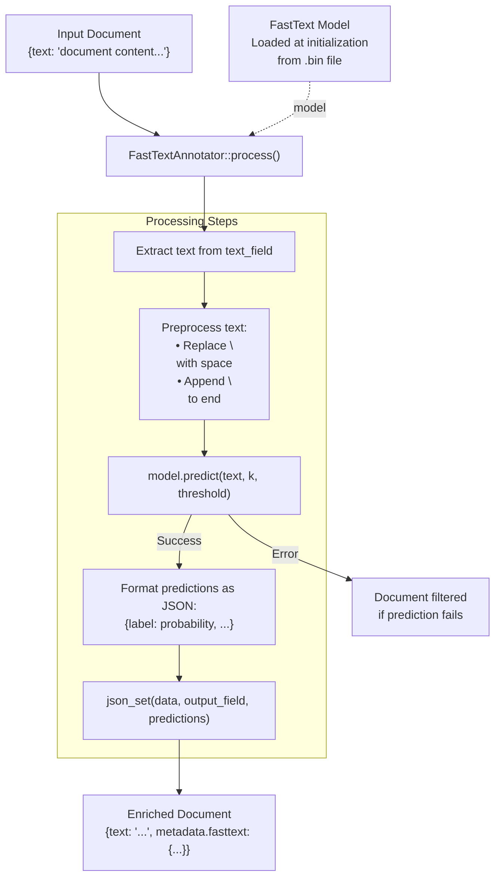
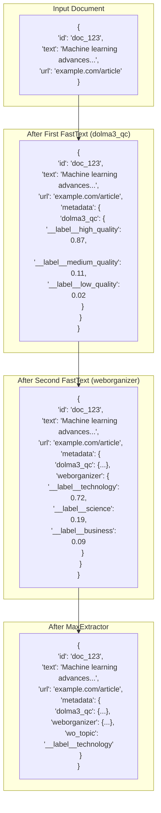
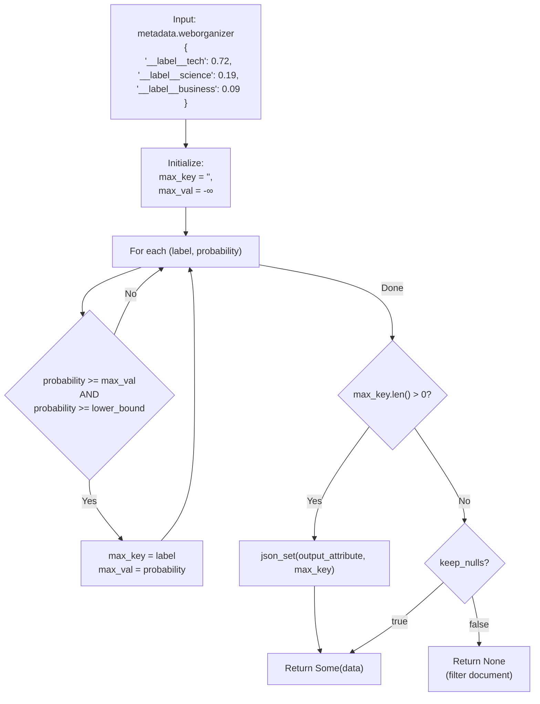
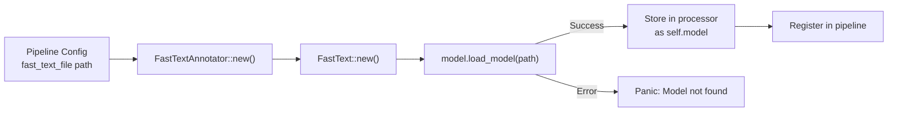

<!-- source: DeepWiki mcp.deepwiki.com · repo allenai/datamap-rs · page 8.3 Example: Classification and Annotation · fetched 2026-10-26 -->

# Example: Classification and Annotation

<details>
<summary>Relevant source files</summary>

The following files were used as context for generating this wiki page:

- [configs/all_dressed/mixing_classifiers.yaml](configs/all_dressed/mixing_classifiers.yaml)
- [src/map_fxn.rs](src/map_fxn.rs)

</details>


This page demonstrates how to use FastText machine learning models to classify and annotate documents in datamap-rs pipelines. Classification adds predicted labels and confidence scores to documents without filtering them, making it an essential tool for enriching datasets with metadata like topic categories, quality scores, or language domains.

For general pipeline configuration concepts, see [8.1](#8.1). For a comprehensive list of all annotators, see [3.5](#3.5). For an example of complex filtering pipelines, see [8.2](#8.2).

---

## FastTextAnnotator Processor

The `FastTextAnnotator` is an annotator processor that runs FastText binary classification models on document text and stores the predictions as metadata. Unlike filters that remove documents, annotators always return the document with additional fields populated.

### Processor Configuration Fields

| Field | Type | Required | Default | Description |
|-------|------|----------|---------|-------------|
| `fast_text_file` | String | Yes | - | Path to FastText `.bin` model file |
| `text_field` | String | No | `"text"` | Field containing text to classify |
| `output_field` | String | No | `"metadata.fasttext"` | Destination for classification results |
| `k` | Integer | No | `10` | Number of top predictions to return |
| `threshold` | Float | No | `0.0` | Minimum probability threshold for predictions |

The processor loads the FastText model at initialization and keeps it in memory for efficient prediction across all documents.

**Sources:** [src/map_fxn.rs:587-647]()

---

## How FastTextAnnotator Works

The following diagram shows the data flow through the FastTextAnnotator processor:



**Sources:** [src/map_fxn.rs:622-646]()

---

## Real-World Example: Multi-Classifier Pipeline

The following configuration demonstrates a practical pattern: applying multiple FastText classifiers to documents and extracting the most confident prediction.

### Configuration File

```yaml
name: dolma3_classifiers
text_field: text
pipeline:
  - name: fasttext_annotator
    kwargs:
      fast_text_file: ft_classifiers/dolma3_qc/model.bin
      output_field: metadata.dolma3_qc
  - name: fasttext_annotator
    kwargs:
      fast_text_file: ft_classifiers/weborganizer/model.bin
      output_field: metadata.weborganizer
  - name: max_extractor
    kwargs:
      main_attribute: metadata.weborganizer
      output_attribute: metadata.wo_topic
```

### Pipeline Component Breakdown

| Step | Processor | Purpose |
|------|-----------|---------|
| 1 | `fasttext_annotator` | Quality classification using dolma3_qc model |
| 2 | `fasttext_annotator` | Topic classification using weborganizer model |
| 3 | `max_extractor` | Extract highest-confidence topic label |

**Sources:** [configs/all_dressed/mixing_classifiers.yaml:1-16]()

---

## Document Transformation Example

The following diagram shows how a document is transformed through the multi-classifier pipeline:



Each processor in the pipeline adds new fields without modifying existing data, allowing you to preserve both detailed predictions and extracted labels.

**Sources:** [configs/all_dressed/mixing_classifiers.yaml:1-16](), [src/map_fxn.rs:587-647]()

---

## MaxExtractor: Simplifying Classification Output

The `MaxExtractor` processor extracts the label with the highest probability from classification results. This is useful when you need a single categorical label rather than a probability distribution.

### MaxExtractor Configuration

| Field | Type | Required | Default | Description |
|-------|------|----------|---------|-------------|
| `main_attribute` | String | Yes | - | Field containing label→probability map |
| `output_attribute` | String | Yes | - | Destination for extracted label |
| `lower_bound` | Float | No | `0.0` | Minimum probability to extract (else empty) |
| `keep_nulls` | Boolean | No | `true` | Keep documents with no qualifying label |

### MaxExtractor Logic



**Sources:** [src/map_fxn.rs:2345-2393]()

---

## FastText Model Requirements

### Model File Format

FastText models must be in the `.bin` binary format, not `.ftz` (compressed) format. The model is loaded once at pipeline initialization and kept in memory.

### Model Loading Process



### Obtaining FastText Models

| Source | Method | Example Path |
|--------|--------|--------------|
| Pre-trained | Download from HuggingFace | `ft_classifiers/dolma3_qc/model.bin` |
| Custom | Train with FastText library | `custom_models/my_classifier.bin` |
| Python script | Use `dl_hf_model.py` | See [7.1](#7.1) for details |

**Sources:** [src/map_fxn.rs:599-619]()

---

## Prediction Output Format

### JSON Structure

FastText predictions are stored as a JSON object mapping labels to probabilities:

```json
{
  "metadata": {
    "fasttext": {
      "__label__category1": 0.75,
      "__label__category2": 0.20,
      "__label__category3": 0.05
    }
  }
}
```

### Label Prefix Convention

FastText models typically prefix labels with `__label__`. This prefix is preserved in the output, so downstream processing should account for it when comparing or filtering labels.

### Prediction Count

The `k` parameter controls how many top predictions are returned. For a 100-class model with `k=5`, only the top 5 predictions are included, even if their probabilities sum to less than 1.0.

**Sources:** [src/map_fxn.rs:639-644]()

---

## Common Usage Patterns

### Pattern 1: Single Classifier with Filtering

Use classification scores as input to subsequent filter processors:

```yaml
pipeline:
  - name: fasttext_annotator
    kwargs:
      fast_text_file: models/quality_classifier.bin
      output_field: metadata.quality
  - name: float_filter
    kwargs:
      float_field: metadata.quality.__label__high
      lower_bound: 0.7
```

This pipeline annotates documents with quality scores, then filters to keep only those with high-quality probability ≥ 0.7.

### Pattern 2: Multiple Independent Classifiers

Apply different classification models for different purposes:

```yaml
pipeline:
  - name: fasttext_annotator
    kwargs:
      fast_text_file: models/language.bin
      output_field: metadata.language
  - name: fasttext_annotator
    kwargs:
      fast_text_file: models/domain.bin
      output_field: metadata.domain
  - name: fasttext_annotator
    kwargs:
      fast_text_file: models/quality.bin
      output_field: metadata.quality
```

Each classifier's predictions are stored in separate metadata fields without interference.

### Pattern 3: Classification → Extraction → Partitioning

Classify documents, extract the top category, then partition by category:

```yaml
# 1. Map pipeline with classification
pipeline:
  - name: fasttext_annotator
    kwargs:
      fast_text_file: models/topic.bin
      output_field: metadata.topics
  - name: max_extractor
    kwargs:
      main_attribute: metadata.topics
      output_attribute: metadata.primary_topic
```

```bash
# 2. Run map command
datamap map config.yaml input/ output/

# 3. Partition by extracted topic
datamap discrete-partition output/step_final/ partitioned/ \
  --partition-field metadata.primary_topic
```

This creates separate directories for each topic classification.

**Sources:** [src/map_fxn.rs:587-647](), [configs/all_dressed/mixing_classifiers.yaml:1-16]()

---

## Error Handling

### Prediction Failures

If FastText prediction fails (e.g., due to invalid UTF-8 bytes), the `FastTextAnnotator` filters the document by returning `None`:

```rust
let predictions = match self.model.predict(&text, self.k, self.threshold) {
    Ok(preds) => preds,
    Err(_e) => {
        // If prediction fails, drop this document by returning None
        return Ok(None);
    }
};
```

This behavior protects the pipeline from corrupted documents that would crash the FastText model.

### Model Loading Failures

If the model file doesn't exist or is corrupted, the pipeline construction fails immediately with a panic. This fail-fast behavior prevents running a pipeline with missing dependencies.

### Missing Text Fields

If the `text_field` doesn't exist in a document, the pipeline will panic. Ensure all documents have the required text field, or use a `non_null_filter` earlier in the pipeline to remove documents with missing fields.

**Sources:** [src/map_fxn.rs:631-637]()

---

## Performance Considerations

### Model Memory Usage

FastText models are loaded entirely into memory and kept there for the duration of pipeline processing. Large models (e.g., 1GB+) multiply across all parallel threads:

| Threads | Model Size | Total Memory |
|---------|------------|--------------|
| 16 | 500 MB | ~8 GB |
| 32 | 500 MB | ~16 GB |
| 64 | 1 GB | ~64 GB |

Plan memory allocation accordingly when running on high-core-count instances.

### Text Preprocessing Cost

The annotator replaces all newlines with spaces before prediction, which requires string allocation. For very long documents (>1MB text), this can become a bottleneck.

### Prediction Throughput

FastText predictions are generally fast (microseconds per document), but the throughput depends on:
- Model size and complexity
- Document length
- Value of `k` (more predictions = more processing)

For most use cases, classification is not the bottleneck; file I/O dominates processing time.

**Sources:** [src/map_fxn.rs:587-619]()

---

## Complete Workflow Example

### Step 1: Prepare FastText Models

```bash
# Download pre-trained models using HuggingFace downloader
python python_utils/dl_hf_model.py \
  --repo-id ai2/dolma3_qc \
  --output-dir ft_classifiers/dolma3_qc

python python_utils/dl_hf_model.py \
  --repo-id ai2/weborganizer \
  --output-dir ft_classifiers/weborganizer
```

### Step 2: Create Pipeline Configuration

Save the following as `classification_pipeline.yaml`:

```yaml
name: document_classification
text_field: text
pipeline:
  - name: fasttext_annotator
    kwargs:
      fast_text_file: ft_classifiers/dolma3_qc/model.bin
      output_field: metadata.quality
      k: 3
      threshold: 0.1
  - name: fasttext_annotator
    kwargs:
      fast_text_file: ft_classifiers/weborganizer/model.bin
      output_field: metadata.topic
      k: 5
      threshold: 0.05
  - name: max_extractor
    kwargs:
      main_attribute: metadata.topic
      output_attribute: metadata.primary_topic
      lower_bound: 0.3
```

### Step 3: Run Pipeline

```bash
datamap map classification_pipeline.yaml \
  /path/to/input/ \
  /path/to/output/ \
  --threads 32
```

### Step 4: Analyze Results

```bash
# Count documents by primary topic
datamap count /path/to/output/step_final/ \
  --group-by metadata.primary_topic

# Partition by quality classification
datamap discrete-partition \
  /path/to/output/step_final/ \
  /path/to/quality_partitions/ \
  --partition-field metadata.quality.__label__high
```

**Sources:** [configs/all_dressed/mixing_classifiers.yaml:1-16]()

---

## Summary

The `FastTextAnnotator` enables efficient document classification at scale:

| Capability | Implementation |
|------------|----------------|
| **Multiple Models** | Chain multiple `fasttext_annotator` processors |
| **Selective Output** | Use `max_extractor` to simplify predictions |
| **Threshold Control** | Set `threshold` to filter low-confidence predictions |
| **Downstream Use** | Classification metadata feeds into filters and partitioning |
| **Error Safety** | Failed predictions filter documents, not crash pipeline |

Classification is typically followed by either filtering (remove low-quality documents) or partitioning (split by category) to organize datasets by their predicted characteristics.

**Sources:** [src/map_fxn.rs:587-647](), [src/map_fxn.rs:2345-2393](), [configs/all_dressed/mixing_classifiers.yaml:1-16]()

---

