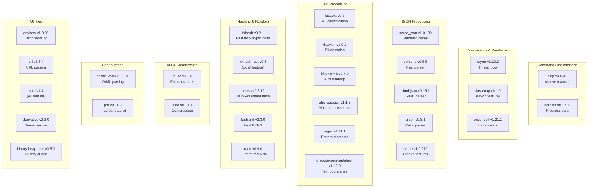
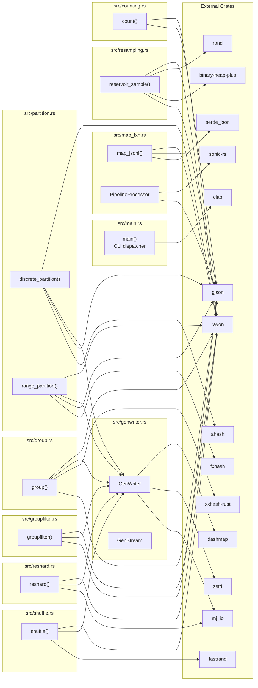
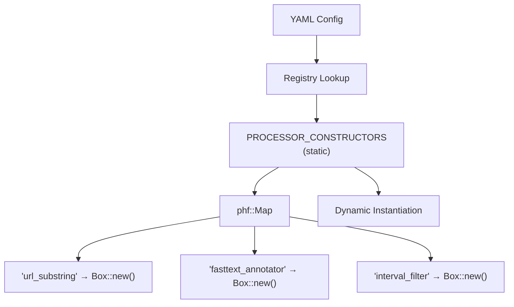

<!-- source: DeepWiki mcp.deepwiki.com · repo allenai/datamap-rs · page 9 Technology Stack · fetched 2026-10-26 -->

# Technology Stack

<details>
<summary>Relevant source files</summary>

The following files were used as context for generating this wiki page:

- [Cargo.toml](Cargo.toml)
- [README.md](README.md)

</details>


## Purpose and Scope

This page documents the external libraries, crates, and dependencies used by datamap-rs, explaining the technical choices and performance considerations behind each selection. It provides an overview of all major dependencies organized by functional category.

For detailed information about specific technology categories, see:
- **Concurrency infrastructure**: [Concurrency Libraries](#9.1)
- **JSON parsing strategies**: [JSON Processing Stack](#9.2)
- **Text and NLP operations**: [Text Processing and NLP](#9.3)

For the overall system design and how these technologies integrate, see [System Architecture](#2).

---

## Technology Philosophy

datamap-rs is built on three core principles that guide technology choices:

1. **Local-First Processing**: All operations assume fast local NVMe storage rather than streaming from cloud storage. This architectural decision influences every library choice.

2. **Embarrassingly Parallel**: File-level parallelism (not document-level) allows independent processing of files with no inter-thread coordination beyond shared concurrent data structures.

3. **Zero-Copy Where Possible**: Streaming line-by-line processing with minimal allocations. JSON parsers are chosen for performance, and text operations avoid unnecessary copies.

Sources: [README.md:104-112](), [README.md:20]()

---

## Dependency Categories

The following diagram maps all major dependencies in `Cargo.toml` to their functional categories:



Sources: [Cargo.toml:10-40]()

---

## Core Dependencies Overview

The following table provides a comprehensive view of all production dependencies, their versions, enabled features, and primary use cases:

| Category | Crate | Version | Features | Primary Use Case |
|----------|-------|---------|----------|------------------|
| **CLI** | `clap` | 4.5.31 | `derive` | Command-line argument parsing and subcommand dispatch |
| **CLI** | `indicatif` | 0.17.11 | - | Progress bars for long-running operations |
| **Concurrency** | `rayon` | 1.10.0 | - | File-level parallelism via thread pool |
| **Concurrency** | `dashmap` | 6.1.0 | `rayon` | Lock-free concurrent HashMap for GenWriter registry |
| **Concurrency** | `once_cell` | 1.21.1 | - | Lazy static initialization for processor registry |
| **JSON** | `serde_json` | 1.0.139 | - | Standard JSON serialization/deserialization |
| **JSON** | `sonic-rs` | 0.5.5 | - | High-performance JSON parsing |
| **JSON** | `simd-json` | 0.15.1 | - | SIMD-accelerated JSON parsing |
| **JSON** | `gjson` | 0.8.1 | - | Fast JSON path queries without full parsing |
| **JSON** | `serde` | 1.0.219 | `derive` | Serialization framework (used with serde_json/serde_yaml) |
| **Text/NLP** | `fasttext` | 0.7 | - | Language identification and text classification |
| **Text/NLP** | `tiktoken` | 1.0.1 | - | Tokenization for token counting |
| **Text/NLP** | `tiktoken-rs` | 0.7.0 | - | Rust bindings for tiktoken |
| **Text/NLP** | `aho-corasick` | 1.1.3 | - | Multi-pattern string matching for URL filters |
| **Text/NLP** | `regex` | 1.11.1 | - | Regular expression matching |
| **Text/NLP** | `unicode-segmentation` | 1.12.0 | - | Word/grapheme boundary detection |
| **Hashing** | `fxhash` | 0.2.1 | - | Fast non-cryptographic hash for HashMaps |
| **Hashing** | `xxhash-rust` | 0.8 | `xxh3` | XXH3 hash algorithm for document fingerprinting |
| **Hashing** | `ahash` | 0.8.12 | - | DDoS-resistant hash for user-controlled keys |
| **Hashing** | `fastrand` | 2.3.0 | - | Fast PRNG for shuffle operations |
| **Hashing** | `rand` | 0.9.0 | - | Full-featured RNG for reservoir sampling |
| **I/O** | `mj_io` | 0.1.5 | - | File operations and path utilities |
| **I/O** | `zstd` | 0.13.3 | - | Zstandard compression (level 3) for all output |
| **Config** | `serde_yaml` | 0.9.34 | - | YAML configuration file parsing |
| **Config** | `phf` | 0.11.3 | `macros` | Perfect hash functions for static processor registry |
| **Utilities** | `anyhow` | 1.0.96 | - | Ergonomic error handling and propagation |
| **Utilities** | `url` | 2.5.4 | - | URL parsing and manipulation |
| **Utilities** | `uuid` | 1.4 | `v4` | UUID generation for temp files |
| **Utilities** | `derivative` | 2.2.0 | - | Custom derive macro attributes |
| **Utilities** | `binary-heap-plus` | 0.5.0 | - | Custom-comparator priority queue for reservoir sampling |

Sources: [Cargo.toml:10-40]()

---

## Performance-Critical Technology Choices

### Parallelism: Rayon

**Decision**: Use `rayon` for embarrassingly parallel file processing.

**Rationale**: 
- File-level parallelism is embarrassingly parallel (no coordination needed)
- Documents within a file are processed sequentially (maintains pipeline semantics)
- Automatic work-stealing load balancing
- Default to all CPU cores, controllable via `--threads` flag

**Code Location**: Used throughout all commands via `par_iter()` on file collections.

### JSON Parsing: Multiple Strategies

**Decision**: Use four different JSON libraries for different scenarios.

**Rationale**:
- `serde_json`: Standard, safe, feature-complete for config parsing
- `sonic-rs`: 2-3x faster than serde_json for common cases
- `simd-json`: SIMD acceleration for throughput-critical paths
- `gjson`: Zero-copy path queries without full deserialization

**Code Entities**: Processors choose appropriate parser based on access patterns.

### Concurrent Collections: DashMap

**Decision**: Use `dashmap` for GenWriter's file handle registry.

**Rationale**:
- Lock-free concurrent HashMap with sharded locks
- Better than `std::sync::Mutex<HashMap>` for high contention
- Rayon feature enables parallel iteration
- Critical for GenWriter where many threads write to shared output streams

**Code Location**: [src/genwriter.rs]() - `DashMap<String, Arc<Mutex<GenStream>>>` registry

### Hashing: Multiple Algorithms

**Decision**: Provide three hash algorithms with different tradeoffs.

| Algorithm | Crate | Use Case | Security | Speed |
|-----------|-------|----------|----------|-------|
| FxHash | `fxhash` | Internal HashMaps | None | Fastest |
| XXH3 | `xxhash-rust` | Document fingerprinting | Non-crypto | Very Fast |
| AHash | `ahash` | User-controlled keys | DDoS-resistant | Fast |

**Rationale**: Different operations have different security/speed requirements. Internal maps can use FxHash, while user-provided keys need AHash.

### Text Processing: Specialized Libraries

**Decision**: Use specialized libraries rather than general-purpose tools.

- `aho-corasick`: Multi-pattern matching is 10-100x faster than regex union for URL filtering
- `fasttext`: Proven language ID model (lid176.bin), compact and fast
- `tiktoken`: Standard tokenizer for counting tokens (GPT-style)
- `unicode-segmentation`: Correct word boundary detection for Unicode text

**Rationale**: Each tool is best-in-class for its specific task.

Sources: [Cargo.toml:10-40](), [README.md:14](), [README.md:20]()

---

## Dependency Resolution: Code to Library Mapping

The following diagram shows how major datamap-rs code modules depend on external crates:



Sources: [Cargo.toml:10-40]()

---

## Processor-Specific Dependencies

Many processors in the map pipeline have specialized dependencies. The following table maps processor types to their required external crates:

| Processor | File Location | External Crates | Purpose |
|-----------|---------------|-----------------|---------|
| `URLSubstringFilter` | [src/processors/url_substring.rs]() | `aho-corasick`, `url` | Multi-pattern URL banlist matching |
| `FastTextAnnotator` | [src/processors/fasttext_annotator.rs]() | `fasttext` | ML-based text classification |
| `LanguageIDFilter` | [src/processors/language_id.rs]() | `fasttext` | Language identification filtering |
| `Madlad400SentenceAnnotator` | [src/processors/madlad400_sentence.rs]() | `regex`, `unicode-segmentation` | Quality annotation with 5 rules |
| `MassiveWebRepetitionFilter` | [src/processors/massive_web_repetition.rs]() | `regex`, `unicode-segmentation`, `fxhash` | Rolling hash repetition detection |
| `IntervalFilter` | [src/processors/interval_filter.rs]() | - | Complex interval merging logic |
| `TiktokenTokenCounter` | [src/processors/tiktoken_token_counter.rs]() | `tiktoken`, `tiktoken-rs` | Token counting annotation |
| `RegexFilter` | [src/processors/regex_filter.rs]() | `regex` | Pattern-based filtering |
| `TextNormalizer` | [src/processors/text_normalizer.rs]() | `unicode-segmentation` | Unicode normalization |

Each processor is self-contained and declares its own dependencies, making the processor system modular and extensible.

Sources: [Cargo.toml:10-40]()

---

## Static vs Dynamic Dependencies

datamap-rs uses a hybrid approach to dependency management:

### Static Dependencies (Compile-Time)

**Processor Registry**: Uses `phf` (perfect hash functions) to create compile-time processor constructors.



**Benefits**:
- Zero runtime overhead for lookup
- Compile-time validation of registered processors
- Type-safe factory pattern

**Code Location**: Processor registration in each processor module.

### Dynamic Dependencies (Runtime)

**ML Models**: FastText models (`lid176.bin`, etc.) loaded at runtime from disk.

**Banlists**: URL filter lists and regex patterns loaded from configuration files.

**Configuration**: YAML/JSON pipeline configs parsed at runtime via `serde_yaml`.

Sources: [Cargo.toml:18]()

---

## Compression Strategy

**Decision**: Use Zstandard (zstd) compression at level 3 for all output.

**Rationale**:
- Level 3 provides good compression ratio (~2.5-3x) with minimal CPU overhead
- Faster than gzip at similar compression ratios
- Decompression is very fast (~500 MB/s per core)
- Industry standard for big data (Kafka, Parquet, etc.)

**Implementation**: All GenWriter output streams are wrapped with `zstd::Encoder`.

**Code Location**: [src/genwriter.rs]() - `zstd::Encoder::new()` with level 3

Sources: [Cargo.toml:32]()

---

## Error Handling Philosophy

**Decision**: Use `anyhow` for ergonomic error handling throughout the codebase.

**Rationale**:
- Simple error propagation with `?` operator
- Context can be added with `.context()` method
- No need to define custom error types for application-level errors
- Stack traces available with `RUST_BACKTRACE=1`

**Pattern**:
```rust
use anyhow::{Context, Result};

fn process_file(path: &Path) -> Result<()> {
    let data = std::fs::read_to_string(path)
        .context("Failed to read input file")?;
    // ... process data ...
    Ok(())
}
```

**Limitation**: Library code that needs specific error types should use `thiserror` instead (not currently used).

Sources: [Cargo.toml:12]()

---

## Development vs Production Dependencies

The `[dev-dependencies]` section is minimal, containing only self-reference for integration tests:

```toml
[dev-dependencies]
datamap-rs = { path = "." }
```

**Implication**: Tests use the same production dependencies. No test-specific frameworks (like `proptest`, `criterion`, etc.) are currently used.

**Test Location**: [tests/main.rs]() contains integration tests.

Sources: [Cargo.toml:6-7](), [Cargo.toml:42-44]()

---

## Optional Features

Several crates use optional features to enable additional functionality:

| Crate | Feature | Purpose |
|-------|---------|---------|
| `clap` | `derive` | Procedural macro for deriving CLI from structs |
| `dashmap` | `rayon` | Parallel iteration support |
| `serde` | `derive` | Procedural macro for deriving serialization |
| `xxhash-rust` | `xxh3` | XXH3 algorithm (faster than XXH64) |
| `uuid` | `v4` | Random UUID generation |
| `phf` | `macros` | Compile-time perfect hash function macros |

These features are explicitly enabled to reduce binary size and compilation time by excluding unused functionality.

Sources: [Cargo.toml:13-18]()

---

## Absence of Async

**Notable Decision**: datamap-rs does not use async/await (`tokio`, `async-std`, etc.).

**Rationale**:
- Processing is CPU-bound, not I/O-bound
- File-level parallelism with Rayon is simpler and sufficient
- Local NVMe I/O is fast enough that async provides no benefit
- Simpler mental model: no async coloring, no runtime overhead

**Implication**: All I/O is blocking. This is acceptable because the system is designed for batch processing on local fast storage, not interactive workloads.

Sources: [Cargo.toml:10-40]()

---

## Version Pinning Strategy

Most dependencies use minor version pinning (e.g., `1.0.96` rather than `^1.0` or `1`):

**Benefits**:
- Reproducible builds across different machines
- No unexpected breakage from semver-compatible updates
- Easier to reason about dependency changes

**Drawback**:
- Requires manual updates to get bug fixes and performance improvements
- Security updates require active maintenance

**Recommendation**: Periodically run `cargo update` and test to pick up patches.

Sources: [Cargo.toml:10-40]()

---

## Summary

The datamap-rs technology stack reflects a "best tool for the job" philosophy:

1. **Rayon** provides embarrassingly parallel file processing
2. **Multiple JSON parsers** optimize for different access patterns
3. **DashMap** enables lock-free concurrent file writing
4. **Specialized text libraries** outperform general-purpose alternatives
5. **Zstandard compression** balances ratio and speed
6. **Local-first architecture** eliminates need for async I/O

For detailed documentation on specific technology categories:
- [Concurrency Libraries](#9.1) - Deep dive into Rayon, DashMap, and concurrency patterns
- [JSON Processing Stack](#9.2) - When to use each JSON parser
- [Text Processing and NLP](#9.3) - FastText, tiktoken, AhoCorasick, and Unicode handling

Sources: [Cargo.toml:1-45](), [README.md:1-151]()

---

