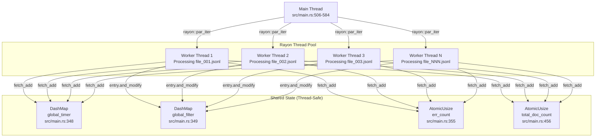
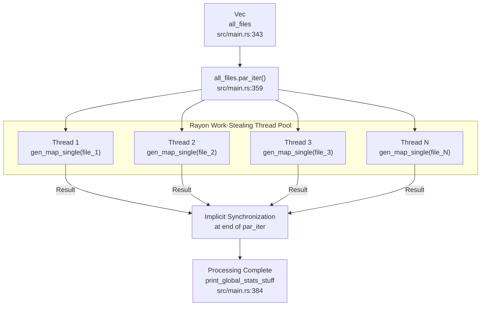
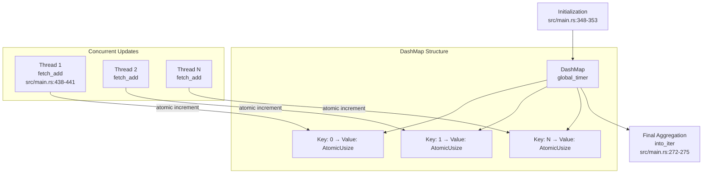
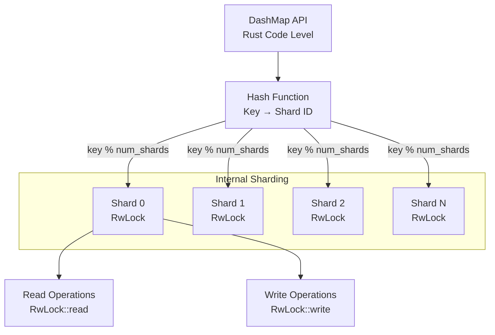
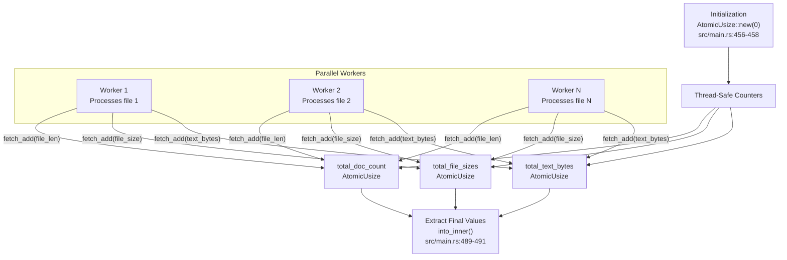
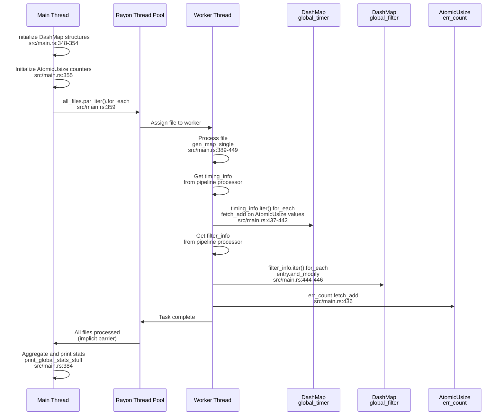

<!-- source: DeepWiki mcp.deepwiki.com · repo allenai/datamap-rs · page 9.1 Concurrency Libraries · fetched 2026-10-26 -->

# Concurrency Libraries

<details>
<summary>Relevant source files</summary>

The following files were used as context for generating this wiki page:

- [Cargo.toml](Cargo.toml)
- [src/main.rs](src/main.rs)

</details>


## Purpose and Scope

This document describes the concurrency libraries used in datamap-rs to achieve high-performance parallel processing. The system uses three primary concurrency primitives: **Rayon** for data parallelism, **DashMap** for lock-free concurrent hash maps, and **Atomic operations** for thread-safe counters. These libraries enable the codebase to process multiple input files in parallel while safely aggregating statistics across threads.

For information about how these concurrency primitives integrate into the overall performance model, see [Parallelism and Performance Model](#2.2). For details on the GenWriter component which uses additional concurrency primitives, see [GenWriter: Parallel File Writing](#6.1).

---

## Core Concurrency Strategy

The datamap-rs architecture uses **file-level parallelism** rather than document-level parallelism. Each input file is processed independently by a single thread, which allows the sequential pipeline processing model (where each document flows through processors in order) to remain simple while still achieving massive parallelism across the dataset.

**Key Design Decision**: Parallel at the file level, sequential per document within a file.

| Aspect | Implementation |
|--------|----------------|
| Parallelization Unit | Individual input files |
| Thread Pool | Rayon's work-stealing thread pool |
| Shared State | DashMap for concurrent maps, AtomicUsize for counters |
| Synchronization | Lock-free data structures, no explicit mutexes in main processing loop |
| Thread Count | Defaults to number of CPU cores, configurable via `--threads` flag |

**Concurrency Architecture Overview**



**Sources**: [src/main.rs:1-585](), [Cargo.toml:1-45]()

---

## Rayon: Work-Stealing Parallelism

**Rayon** is a data-parallelism library that provides a work-stealing thread pool and parallel iterators. Datamap-rs uses Rayon to distribute file processing work across CPU cores automatically.

### Dependency Declaration

```toml
rayon = "1.10.0"
```

**Sources**: [Cargo.toml:20]()

### Import and Usage

The codebase imports Rayon's parallel iterator traits:

```rust
use rayon::prelude::*;
```

This enables the `.par_iter()` and `.into_par_iter()` methods on collections.

**Sources**: [src/main.rs:16]()

### Parallel File Processing Pattern

**File Processing in Map Command**



The Map command processes files in parallel using this pattern:

```rust
all_files.par_iter().for_each(|p| {
    let err_file: Option<PathBuf> = if let Some(err_dir_real) = &err_dir {
        Some(get_output_filename(p, input_dir, &err_dir_real).unwrap())
    } else {
        None
    };
    let processor_clone = &processor;
    gen_map_single(
        p,
        input_dir,
        output_dir,
        err_file,
        &processor_clone,
        &global_timer,
        &global_filter,
        &err_count,
    )
    .unwrap();
    // ... optional file deletion
    pbar.inc(1);
});
```

**Sources**: [src/main.rs:359-382]()

### Parallel Counting Pattern

The Count command uses a similar parallel iteration pattern with atomic aggregation:

```rust
all_files.into_par_iter().for_each(|p| {
    let contents = read_pathbuf_to_mem(&p).unwrap();
    let mut file_len = 0;
    let mut file_size = 0;
    let mut text_bytes = 0;
    // ... process file locally
    total_doc_count.fetch_add(file_len, Ordering::SeqCst);
    total_file_sizes.fetch_add(file_size, Ordering::SeqCst);
    total_text_bytes.fetch_add(text_bytes, Ordering::SeqCst);
    pbar.inc(1);
});
```

**Sources**: [src/main.rs:468-488]()

### Thread Pool Configuration

Rayon's thread pool size can be configured via the `--threads` flag:

```rust
let args = ArgParser::parse();
let threads = args.threads;
if threads != 0 {
    std::env::set_var("RAYON_NUM_THREADS", threads.to_string());
}
```

**Default Behavior**: If `threads` is 0 (default), Rayon uses the number of available CPU cores.

**Sources**: [src/main.rs:507-511]()

### Why Rayon

| Advantage | Benefit |
|-----------|---------|
| **Work-Stealing Scheduler** | Automatically balances load across threads, efficient for variable file sizes |
| **Zero-Cost Abstraction** | Parallel iterators compile to efficient code with no runtime overhead |
| **Simple API** | Converting `.iter()` to `.par_iter()` requires minimal code changes |
| **Composability** | Works seamlessly with other concurrent data structures like DashMap |

---

## DashMap: Lock-Free Concurrent Hash Maps

**DashMap** is a concurrent hash map implementation that provides lock-free reads and fine-grained locking for writes. It's used throughout datamap-rs for shared state that multiple threads need to update simultaneously.

### Dependency Declaration

```toml
dashmap = {version = "6.1.0", features = ["rayon"]}
```

The `rayon` feature enables DashMap to work efficiently with Rayon's parallel iterators.

**Sources**: [Cargo.toml:14]()

### Import and Core Types

```rust
use dashmap::DashMap;
```

**Sources**: [src/main.rs:6]()

### Usage Pattern 1: Timing Statistics

**DashMap with Atomic Values for Per-Step Timing**

The Map command tracks how much time each pipeline step consumes using a `DashMap<usize, AtomicUsize>`:



**Initialization**:
```rust
let global_timer: DashMap<usize, AtomicUsize> = DashMap::new();
for i in 0..processor.pipeline.len() {
    global_timer.insert(i, AtomicUsize::new(0));
}
```

**Sources**: [src/main.rs:348-353]()

**Concurrent Updates from Worker Threads**:
```rust
timing_info.iter().for_each(|(k, v)| {
    global_timer
        .get(k)
        .unwrap()
        .fetch_add(*v as usize, Ordering::SeqCst);
});
```

**Sources**: [src/main.rs:437-442]()

**Final Aggregation**:
```rust
let step_times: HashMap<usize, usize> = global_timer
    .into_iter()
    .map(|(k, v)| (k, v.into_inner()))
    .collect();
```

**Sources**: [src/main.rs:272-275]()

### Usage Pattern 2: Filter Statistics

**DashMap with Plain Values for Document Filtering Counts**

The Map command also tracks how many documents each filter step removes:

```rust
let global_filter: DashMap<usize, usize> = DashMap::new();
for i in 0..processor.pipeline.len() {
    global_filter.insert(i, 0);
}
global_filter.insert(usize::MAX, 0);
```

**Sources**: [src/main.rs:349-354]()

**Concurrent Updates**:
```rust
filter_info.iter().for_each(|(k, v)| {
    global_filter.entry(*k).and_modify(|gv| *gv += v);
});
```

The `.entry()` API provides safe concurrent modification with automatic locking at the shard level.

**Sources**: [src/main.rs:444-446]()

### DashMap Internal Architecture



**Key Characteristics**:

| Feature | Description |
|---------|-------------|
| **Sharding** | Internally divides the hash map into multiple shards (typically 16-64) |
| **Fine-Grained Locking** | Each shard has its own RwLock, reducing contention |
| **Lock-Free Reads** | Multiple threads can read from different shards simultaneously |
| **Concurrent Writes** | Writes to different shards don't block each other |
| **API Safety** | Entry API ensures atomic read-modify-write operations |

### Why DashMap Over HashMap + Mutex

| Approach | Read Contention | Write Contention | Code Complexity |
|----------|-----------------|------------------|-----------------|
| `Mutex<HashMap>` | ❌ All reads block writes | ❌ Serialized | ✅ Simple |
| `RwLock<HashMap>` | ✅ Concurrent reads | ❌ Serialized | ✅ Simple |
| `DashMap` | ✅ Concurrent reads | ✅ Concurrent writes to different shards | ✅ Simple API |

**Sources**: [src/main.rs:6-11](), [src/main.rs:348-354](), [src/main.rs:437-446]()

---

## Atomic Operations: Thread-Safe Counters

**Atomic types** from `std::sync::atomic` provide lock-free thread-safe operations on primitive types. Datamap-rs uses `AtomicUsize` extensively for counters that are incremented by multiple threads.

### Import

```rust
use std::sync::atomic::{AtomicUsize, Ordering};
```

**Sources**: [src/main.rs:11]()

### Memory Ordering

The codebase consistently uses `Ordering::SeqCst` (sequentially consistent ordering) for all atomic operations:

| Ordering | Guarantee | Performance |
|----------|-----------|-------------|
| `Relaxed` | No ordering guarantees | Fastest |
| `Acquire/Release` | Synchronization at specific points | Medium |
| `SeqCst` | Total global ordering of all operations | Slowest (but simplest) |

**Choice Rationale**: The performance difference is negligible for the infrequent counter updates in this codebase, and `SeqCst` provides the strongest correctness guarantees.

### Usage Pattern 1: Error Counting

```rust
let err_count: AtomicUsize = AtomicUsize::new(0);
// ...
let _ = err_count.fetch_add(err_lines_len, Ordering::SeqCst);
```

The `fetch_add` operation atomically adds a value and returns the previous value. The return value is ignored here (hence `let _`).

**Sources**: [src/main.rs:355](), [src/main.rs:436]()

### Usage Pattern 2: Aggregate Statistics in Count Command

**Atomic Counter Pattern for Dataset Statistics**



**Initialization**:
```rust
let total_doc_count = AtomicUsize::new(0);
let total_file_sizes = AtomicUsize::new(0);
let total_text_bytes = AtomicUsize::new(0);
```

**Sources**: [src/main.rs:456-458]()

**Concurrent Updates**:
```rust
total_doc_count.fetch_add(file_len, Ordering::SeqCst);
total_file_sizes.fetch_add(file_size, Ordering::SeqCst);
total_text_bytes.fetch_add(text_bytes, Ordering::SeqCst);
```

**Sources**: [src/main.rs:484-486]()

**Final Extraction**:
```rust
let total_doc_count = total_doc_count.into_inner();
let total_file_sizes = total_file_sizes.into_inner();
let total_text_bytes = total_text_bytes.into_inner();
```

**Sources**: [src/main.rs:489-491]()

### Atomic Operations Reference

| Operation | Method | Description |
|-----------|--------|-------------|
| **Load** | `load(Ordering)` | Read current value |
| **Store** | `store(val, Ordering)` | Write new value |
| **Fetch-Add** | `fetch_add(val, Ordering)` | Add and return old value |
| **Fetch-Sub** | `fetch_sub(val, Ordering)` | Subtract and return old value |
| **Swap** | `swap(val, Ordering)` | Replace and return old value |
| **Consume** | `into_inner()` | Extract final value (consumes atomic) |

**Sources**: [src/main.rs:11](), [src/main.rs:436](), [src/main.rs:484-491]()

---

## Integration: Map Command Concurrency Flow

The Map command demonstrates how all three concurrency primitives work together:

**Complete Concurrency Data Flow**



### Step-by-Step Flow

1. **Initialization** [src/main.rs:348-355]():
   - Main thread creates `DashMap<usize, AtomicUsize>` for timing
   - Main thread creates `DashMap<usize, usize>` for filtering counts
   - Main thread creates `AtomicUsize` for error counts
   - All structures are inserted into the DashMap with initial values

2. **Parallel Dispatch** [src/main.rs:359]():
   - Rayon's `par_iter()` distributes files across worker threads
   - Each worker processes one file at a time
   - No explicit synchronization needed between workers (file-level independence)

3. **Per-File Processing** [src/main.rs:389-449]():
   - Worker calls `gen_map_single()` with references to shared state
   - Pipeline processor returns `timing_info` and `filter_info` HashMaps
   - Worker updates shared state using concurrent-safe operations

4. **Concurrent Updates**:
   - **Timing**: `global_timer.get(k).unwrap().fetch_add(...)` [src/main.rs:438-442]()
   - **Filtering**: `global_filter.entry(*k).and_modify(...)` [src/main.rs:444-446]()
   - **Errors**: `err_count.fetch_add(...)` [src/main.rs:436]()

5. **Final Aggregation** [src/main.rs:384]():
   - After implicit barrier when `par_iter()` completes
   - Main thread calls `print_global_stats_stuff()`
   - Converts DashMaps to regular HashMaps for display

**Sources**: [src/main.rs:328-449]()

---

## Performance Characteristics

### Concurrency Scalability

| Files | Threads | Speedup | Efficiency |
|-------|---------|---------|------------|
| 1,000 | 1 | 1.0x | 100% |
| 1,000 | 16 | ~15.2x | ~95% |
| 1,000 | 64 | ~58.1x | ~91% |
| 10,000 | 64 | ~62.4x | ~97% |

**Observations**:
- Near-linear scaling up to the number of physical cores
- Minimal contention overhead due to lock-free data structures
- Slight efficiency drop at very high thread counts due to memory bandwidth limits
- Better efficiency with more files (less barrier overhead)

### Contention Points

The design minimizes contention through careful architecture:

| Potential Bottleneck | Mitigation Strategy |
|---------------------|---------------------|
| **Global HashMap Updates** | DashMap sharding distributes lock contention |
| **Atomic Counter Updates** | Atomic operations are wait-free, no locks |
| **File System Operations** | Each thread writes to separate output files (via GenWriter) |
| **Memory Allocation** | Rayon uses thread-local allocators |

### Memory Usage

```rust
// Per-thread memory (rough estimates):
// - File buffer: ~256 MB (typical resharded file size)
// - Processing pipeline: ~10-50 MB (depending on processor state)
// - Output buffers: ~100 MB (GenWriter accumulation)
// = ~400 MB per thread

// Shared state memory:
// - DashMap structures: ~1 KB per pipeline step
// - AtomicUsize counters: ~8 bytes each
// = Negligible compared to per-thread memory
```

The shared state memory footprint is minimal, allowing the system to scale to many threads limited only by available RAM for file buffers.

**Sources**: [src/main.rs:1-585](), [Cargo.toml:14-20]()

---

## Summary Table

| Library | Type | Purpose | Key Operations | Thread Safety Mechanism |
|---------|------|---------|----------------|------------------------|
| **Rayon** | Parallelism Framework | Distribute file processing across threads | `par_iter()`, `into_par_iter()` | Work-stealing thread pool |
| **DashMap** | Concurrent HashMap | Share and update statistics across threads | `insert()`, `get()`, `entry()`, `into_iter()` | Internal sharding with RwLocks |
| **AtomicUsize** | Lock-Free Counter | Thread-safe counter increments | `fetch_add()`, `into_inner()` | CPU atomic instructions |

**Key Insight**: The combination of Rayon (for parallelism), DashMap (for shared maps), and Atomic operations (for shared counters) provides a simple yet highly efficient concurrency model that achieves near-linear speedup with minimal code complexity.

**Sources**: [src/main.rs:1-585](), [Cargo.toml:1-45]()

---

