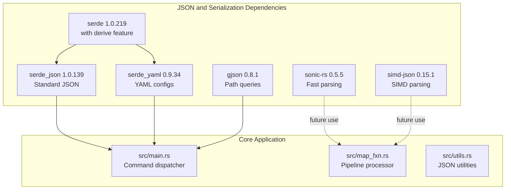
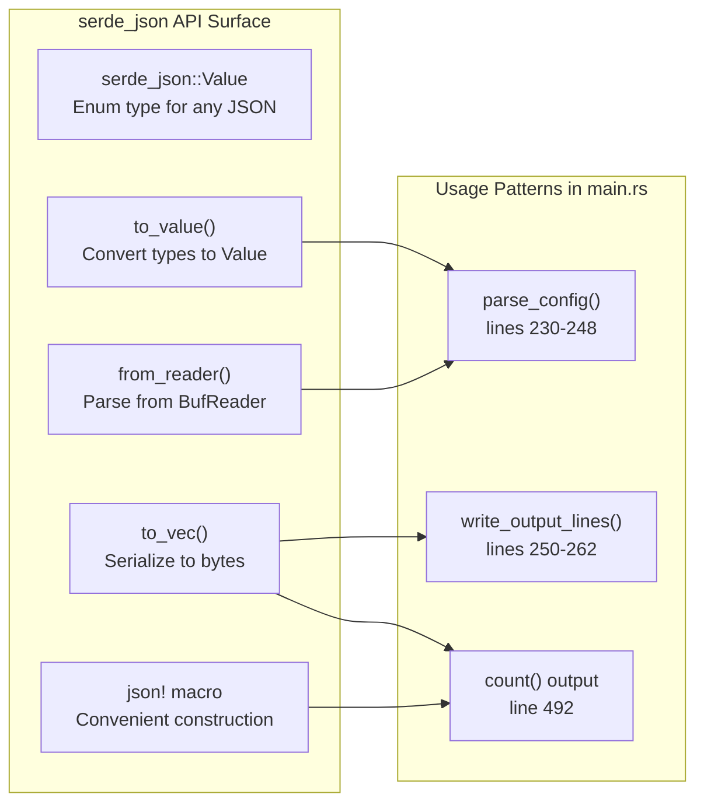
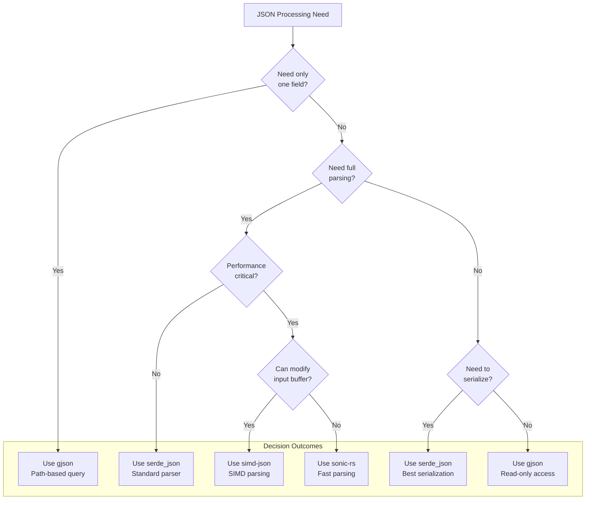
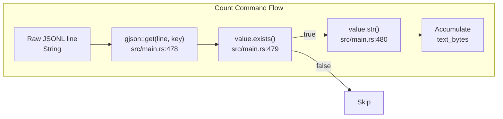
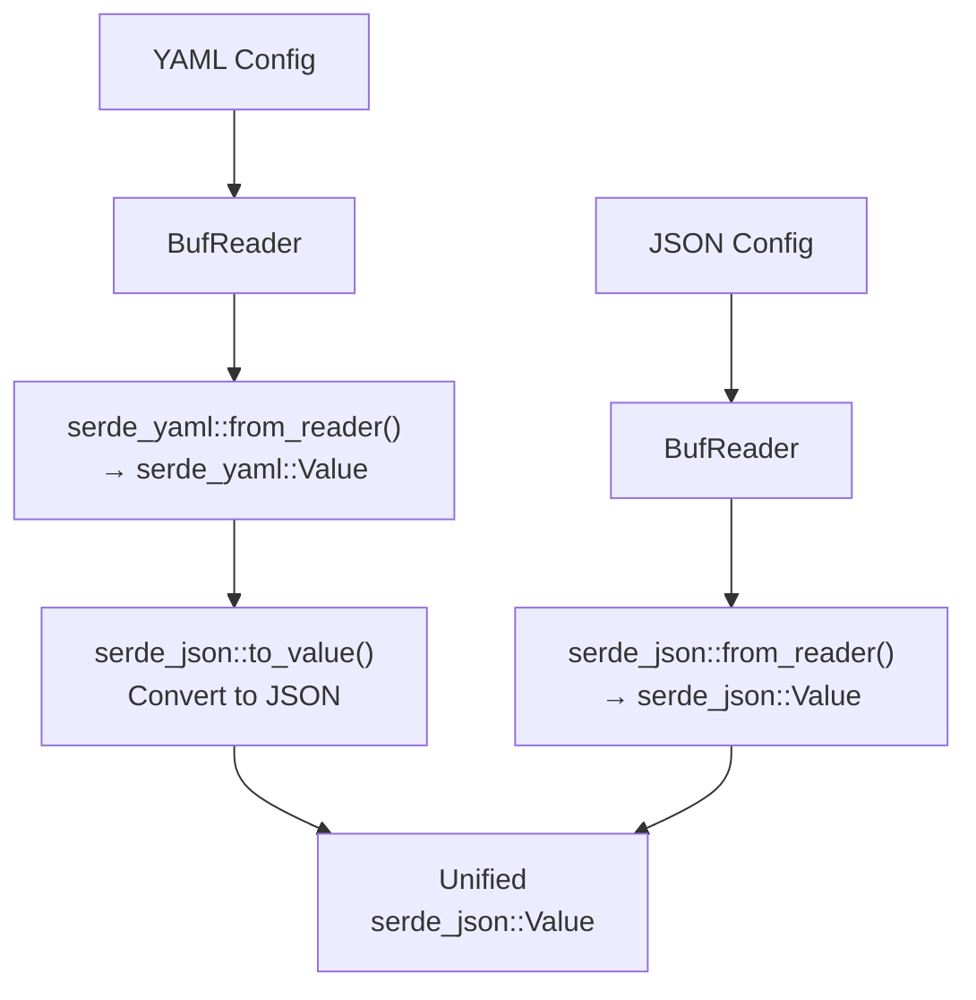

<!-- source: DeepWiki mcp.deepwiki.com · repo allenai/datamap-rs · page 9.2 JSON Processing Stack · fetched 2026-10-26 -->

# JSON Processing Stack

<details>
<summary>Relevant source files</summary>

The following files were used as context for generating this wiki page:

- [Cargo.toml](Cargo.toml)
- [src/main.rs](src/main.rs)

</details>


## Purpose and Scope

This document describes the JSON parsing and manipulation libraries used in datamap-rs. The system employs four different JSON libraries, each optimized for specific use cases: `serde_json` for standard parsing and serialization, `sonic-rs` for high-speed parsing, `simd-json` for SIMD-accelerated operations, and `gjson` for efficient path-based queries. Understanding when to use each library is essential for maintaining optimal performance across the various data processing commands.

For information about the broader technology stack, see [Technology Stack](#9). For details on text processing libraries, see [Text Processing and NLP](#9.3).

---

## Parser Overview

The following table summarizes the four JSON libraries available in datamap-rs:

| Library | Version | Primary Use Case | Key Strength | Trade-off |
|---------|---------|------------------|--------------|-----------|
| `serde_json` | 1.0.139 | Standard parsing/serialization | Stable, well-tested, ergonomic API | Moderate performance |
| `sonic-rs` | 0.5.5 | High-speed parsing | Fast parsing for hot paths | Less mature ecosystem |
| `simd-json` | 0.15.1 | SIMD-accelerated operations | Maximum throughput on modern CPUs | Requires mutable input |
| `gjson` | 0.8.1 | Path-based field extraction | Fast single-field access | Limited to read operations |

**Sources:** [Cargo.toml:22-40]()

---

## Library Dependency Declaration

The JSON processing dependencies are declared in the project's `Cargo.toml` alongside other parsing and serialization tools:



**Sources:** [Cargo.toml:21-40](), [src/main.rs:1-19]()

---

## serde_json: The Standard Parser

### Overview

`serde_json` is the primary JSON library used throughout datamap-rs. It provides a complete, stable implementation of JSON parsing and serialization with strong type safety through the Serde framework.

### Core Types and Functions



### Configuration Parsing

The `parse_config` function demonstrates standard `serde_json` usage for parsing both JSON and YAML configuration files:

[src/main.rs:230-248]()

```rust
fn parse_config(config: &PathBuf) -> Result<serde_json::Value, Error> {
    let file = File::open(config).unwrap();
    let reader = BufReader::new(file);
    
    let ext = config.extension().unwrap().to_str().unwrap();
    let parsed_config: serde_json::Value = match ext {
        "json" => serde_json::from_reader(reader).unwrap(),
        "yaml" => {
            let yaml_value: serde_yaml::Value = serde_yaml::from_reader(reader).unwrap();
            serde_json::to_value(yaml_value).unwrap()
        }
        _ => return Err(Error::msg(format!("Weird config format: {:?}", config))),
    };
    Ok(parsed_config.into())
}
```

This function:
1. Uses `serde_json::from_reader()` for direct JSON parsing
2. Uses `serde_yaml::from_reader()` followed by `serde_json::to_value()` for YAML conversion
3. Returns a unified `serde_json::Value` regardless of input format

### Serialization for Output

The `write_output_lines` function demonstrates JSON serialization:

[src/main.rs:250-262]()

```rust
fn write_output_lines(output_values: Vec<Value>, output_file: &PathBuf) -> Result<(), Error> {
    if output_values.len() == 0 {
        return Ok(());
    }
    
    let mut output_bytes: Vec<u8> = Vec::new();
    output_values.into_iter().for_each(|v| {
        output_bytes.extend(serde_json::to_vec(&v).unwrap());
        output_bytes.push(b'\n')
    });
    
    write_mem_to_pathbuf(&output_bytes, output_file)
}
```

Each `Value` is serialized using `serde_json::to_vec()`, which produces a compact byte representation. A newline byte is appended to maintain JSONL format.

### JSON Construction with Macros

The `json!` macro provides ergonomic JSON construction for output data:

[src/main.rs:492]()

```rust
let output_json = json!({
    "total_docs": total_doc_count, 
    "total_file_size": total_file_sizes, 
    "total_text_bytes": total_text_bytes
});
let output_contents = serde_json::to_vec(&output_json).unwrap();
```

This pattern is used in the `count` command to produce structured statistics output.

**Sources:** [src/main.rs:3](), [src/main.rs:5](), [src/main.rs:17](), [src/main.rs:230-248](), [src/main.rs:250-262](), [src/main.rs:492-494]()

---

## sonic-rs: High-Speed Parsing

### Purpose

`sonic-rs` is a high-performance JSON parser designed to be faster than `serde_json` for parsing operations. It is particularly useful in hot paths where parsing speed is critical.

### Integration Status

While `sonic-rs` is declared as a dependency, its usage in the provided source files is not evident. Based on the architecture diagrams and dependency declaration, it is likely used in processor implementations for high-throughput document parsing.

### Typical Use Cases

According to the architecture documentation, `sonic-rs` would be appropriate for:
- Pipeline processors that parse thousands of documents per second
- Scenarios where parsing speed dominates processing time
- Read-heavy workloads where serialization is less common

### Performance Characteristics

`sonic-rs` achieves higher throughput by:
- Optimized parsing algorithms
- Reduced allocations during parsing
- Streamlined API for common parsing patterns

**Sources:** [Cargo.toml:37]()

---

## simd-json: SIMD-Accelerated Parsing

### Purpose

`simd-json` leverages SIMD (Single Instruction, Multiple Data) CPU instructions to achieve maximum JSON parsing throughput on modern processors.

### Integration Status

Like `sonic-rs`, `simd-json` is declared but not visibly used in the provided main.rs. It would be employed in performance-critical sections of the pipeline processors.

### Key Constraint

`simd-json` requires mutable access to the input buffer for in-place parsing. This constraint means it's most suitable for:
- Owned data buffers
- Scenarios where the input can be modified
- Maximum-throughput requirements where the API constraint is acceptable

### Performance Profile

`simd-json` offers:
- Highest possible parsing throughput using CPU SIMD instructions
- Particularly effective on large documents
- Best performance on CPUs with AVX2 or AVX512 support

**Sources:** [Cargo.toml:39]()

---

## gjson: Path-Based Queries

### Purpose

`gjson` provides fast, path-based extraction of specific fields from JSON documents without full parsing. This is crucial for operations that only need to examine one or two fields.

### Query Syntax

`gjson` uses a simple path syntax for field access:
- `"text"` - accesses the top-level "text" field
- `"metadata.language"` - accesses nested fields with dot notation
- `"items.0"` - accesses array elements by index

### Usage in Count Command

The `count` command uses `gjson` to efficiently extract text content for byte counting:

[src/main.rs:473-483]()

```rust
for line in contents.lines() {
    file_len += 1;
    let line = line.unwrap();
    file_size += line.len();
    if text_key.len() > 0 {
        let value = gjson::get(&line, &text_key);
        if value.exists() {
            text_bytes += value.str().len();
        }
    }
}
```

This pattern:
1. Calls `gjson::get(&line, &text_key)` to extract the specified field
2. Checks `value.exists()` to handle missing fields gracefully
3. Uses `value.str()` to access the string content
4. Avoids parsing the entire JSON document

### Performance Advantage

For the count operation, which processes potentially millions of documents, `gjson` provides significant performance benefits:
- No allocation for unused fields
- Direct string access without intermediate Value objects
- Fast path for simple field access patterns

**Sources:** [src/main.rs:19](), [src/main.rs:452-499](), [src/main.rs:478-481]()

---

## JSON Processing Decision Flow

The following diagram illustrates the decision criteria for selecting a JSON library:



**Sources:** Derived from [Cargo.toml:21-40]() and usage patterns in [src/main.rs]()

---

## Integration Patterns in the Codebase

### Configuration and Serialization: serde_json

```mermaid
graph TB
    subgraph "Configuration Flow"
        yaml_file["YAML/JSON<br/>Config File"]
        parse_config["parse_config()<br/>src/main.rs:230"]
        serde_json_value["serde_json::Value"]
        processor["PipelineProcessor::new()"]
    end
    
    subgraph "Output Flow"
        processed_docs["Processed<br/>Documents"]
        output_values["Vec&lt;Value&gt;"]
        write_output["write_output_lines()<br/>src/main.rs:250"]
        jsonl_bytes["JSONL bytes<br/>with newlines"]
        file_output["Output Files<br/>.jsonl.zst"]
    end
    
    yaml_file --> parse_config
    parse_config --> serde_json_value
    serde_json_value --> processor
    
    processed_docs --> output_values
    output_values --> write_output
    write_output --> jsonl_bytes
    jsonl_bytes --> file_output
```



### Field Extraction: gjson



### YAML to JSON Conversion

The configuration parsing demonstrates a common pattern of converting YAML to `serde_json::Value` for unified handling:



**Sources:** [src/main.rs:230-248](), [src/main.rs:250-262](), [src/main.rs:478-481]()

---

## Performance Characteristics Comparison

| Operation | serde_json | sonic-rs | simd-json | gjson |
|-----------|------------|----------|-----------|-------|
| Full parsing | Baseline | ~1.5-2x faster | ~2-3x faster | N/A |
| Single field access | Slow (full parse) | Slow (full parse) | Slow (full parse) | Very fast |
| Serialization | Excellent | Good | Limited | Not supported |
| Memory allocation | Moderate | Lower | Lowest (in-place) | Minimal |
| API ergonomics | Excellent | Good | Moderate | Excellent for queries |
| Stability | Very stable | Stable | Stable | Stable |
| Mutation requirement | No | No | Yes (input buffer) | No |

### Selection Guidelines

**Use `serde_json` when:**
- Writing configuration parsing logic
- Serializing output data
- Working with complex nested structures
- API ergonomics and stability are priorities

**Use `sonic-rs` when:**
- Parsing speed is critical
- Processing high-volume document streams
- Full JSON structure access is needed
- Input buffer cannot be modified

**Use `simd-json` when:**
- Maximum parsing throughput is required
- Input buffer can be modified (owned data)
- Processing large documents on modern CPUs
- Trading API convenience for performance

**Use `gjson` when:**
- Only one or two fields need extraction
- Full parsing overhead is unacceptable
- Read-only field access is sufficient
- Processing millions of documents per run

**Sources:** Derived from architecture documentation and [Cargo.toml:21-40]()

---

## Type System Integration

### The Value Type

All parsers ultimately work with or produce `serde_json::Value`, which is an enum representing any valid JSON:

```rust
pub enum Value {
    Null,
    Bool(bool),
    Number(Number),
    String(String),
    Array(Vec<Value>),
    Object(Map<String, Value>),
}
```

This type appears throughout the codebase:
- [src/main.rs:5]() - imported as a core type
- [src/main.rs:230]() - return type of `parse_config`
- [src/main.rs:250]() - parameter type in `write_output_lines`

### Conversion Paths

```mermaid
graph TB
    subgraph "Input Formats"
        yaml["YAML bytes"]
        json_bytes["JSON bytes"]
        gjson_query["gjson path query"]
    end
    
    subgraph "Intermediate Types"
        yaml_value["serde_yaml::Value"]
        gjson_value["gjson::Value"]
    end
    
    subgraph "Unified Type"
        serde_value["serde_json::Value"]
    end
    
    subgraph "Output Formats"
        json_out["JSON bytes"]
        string_out["String fields"]
    end
    
    yaml --> yaml_value
    yaml_value -->|to_value()| serde_value
    json_bytes -->|from_reader()| serde_value
    gjson_query --> gjson_value
    gjson_value -->|str()| string_out
    
    serde_value -->|to_vec()| json_out
```

**Sources:** [src/main.rs:5](), [src/main.rs:230-248]()

---

## Error Handling Patterns

### Unwrap Usage in Production Code

The codebase uses `unwrap()` extensively in JSON operations, which is appropriate for this use case because:

1. **Structural guarantees**: Configuration files are validated before processing
2. **Data format assumptions**: Input is expected to be valid JSONL
3. **Fail-fast philosophy**: Invalid JSON should stop processing immediately

Examples:
- [src/main.rs:233]() - Config file opening
- [src/main.rs:238]() - JSON deserialization
- [src/main.rs:257]() - Output serialization

### Graceful Field Access with gjson

In contrast, `gjson` queries handle missing fields gracefully:

[src/main.rs:479-481]()

```rust
let value = gjson::get(&line, &text_key);
if value.exists() {
    text_bytes += value.str().len();
}
```

The `exists()` check prevents errors when documents lack the queried field, making it suitable for heterogeneous datasets.

**Sources:** [src/main.rs:233](), [src/main.rs:238](), [src/main.rs:257](), [src/main.rs:479-481]()

---

## Summary

The JSON processing stack in datamap-rs provides a flexible, performance-oriented approach to handling JSON data at scale:

1. **serde_json** serves as the stable, ergonomic foundation for configuration and output
2. **sonic-rs** and **simd-json** offer performance upgrades for hot parsing paths
3. **gjson** provides fast, targeted field extraction for streaming operations
4. All libraries converge on `serde_json::Value` for interoperability

The architecture prioritizes performance through library selection while maintaining code clarity through consistent type usage. The combination of multiple JSON libraries allows the system to optimize different operations independently while presenting a unified interface to higher-level components.

**Sources:** [Cargo.toml:21-40](), [src/main.rs:1-19](), [src/main.rs:230-262](), [src/main.rs:452-499]()

---

