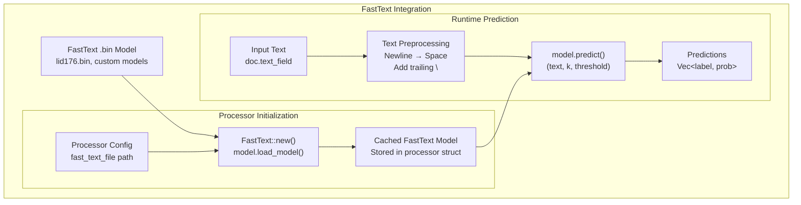
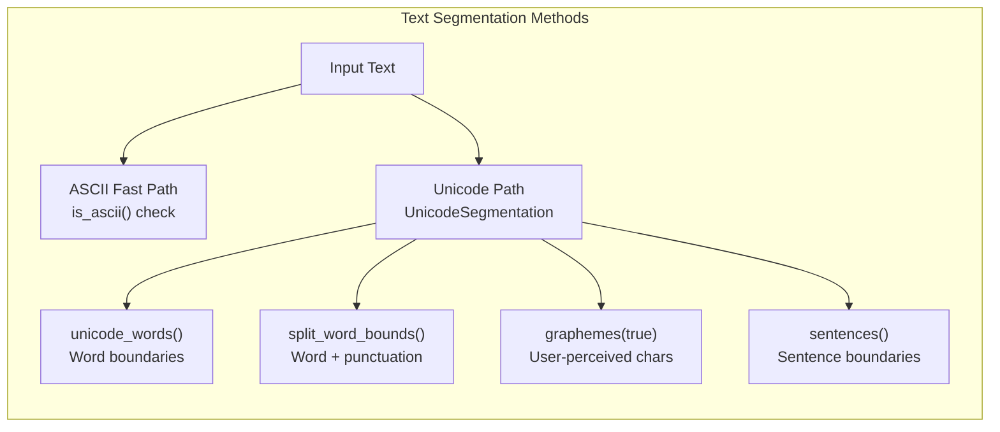
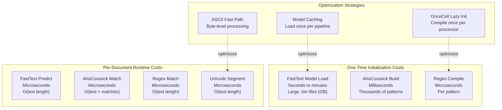

<!-- source: DeepWiki mcp.deepwiki.com · repo allenai/datamap-rs · page 9.3 Text Processing and NLP · fetched 2026-10-26 -->

# Text Processing and NLP

<details>
<summary>Relevant source files</summary>

The following files were used as context for generating this wiki page:

- [Cargo.toml](Cargo.toml)
- [src/map_fxn.rs](src/map_fxn.rs)

</details>


This page documents the text processing and natural language processing (NLP) libraries used in datamap-rs. These dependencies enable sophisticated text analysis, classification, pattern matching, and manipulation capabilities across the processor pipeline. For information about JSON processing libraries, see [JSON Processing Stack](#9.2). For information about the processors that use these libraries, see [Processor Types Overview](#3.2).

## Overview

The text processing stack in datamap-rs consists of five primary libraries, each serving a specific purpose in the data processing pipeline:

| Library | Purpose | Primary Use Cases |
|---------|---------|-------------------|
| `fasttext` | ML-based text classification | Language identification, quality scoring, multi-label classification |
| `aho-corasick` | Multi-pattern substring matching | URL banlist filtering, pattern detection in large text |
| `regex` | Single-pattern matching and replacement | Line filtering, text transformation, counter removal |
| `unicode-segmentation` | Unicode-aware text boundary detection | Word counting, sentence splitting, grapheme clustering |
| `tiktoken-rs` | Token counting for LLM models | Token-based sampling, length calculation |

**Sources:** [Cargo.toml:26-40](), [src/map_fxn.rs:5,20,23-24]()

## FastText ML Classification

### Library Overview

`fasttext` provides Rust bindings to the Facebook FastText library, enabling efficient text classification and word representation learning. Models are loaded once at processor initialization and persist for the lifetime of the pipeline.



**Diagram: FastText Model Lifecycle and Prediction Flow**

**Sources:** [src/map_fxn.rs:587-647](), [src/map_fxn.rs:1766-1812]()

### FastTextAnnotator Processor

The `FastTextAnnotator` enriches documents with top-k predictions from a FastText model without filtering. Configuration parameters:

| Parameter | Type | Default | Description |
|-----------|------|---------|-------------|
| `fast_text_file` | String | *required* | Path to `.bin` model file |
| `text_field` | String | `"text"` | JSON field containing input text |
| `output_field` | String | `"metadata.fasttext"` | Where predictions are written |
| `k` | i32 | `10` | Number of top predictions to return |
| `threshold` | f32 | `0.0` | Minimum probability threshold |

**Implementation Details:**
- Text preprocessing: newlines replaced with spaces, trailing newline added [src/map_fxn.rs:623-629]()
- Error handling: documents with prediction failures (invalid UTF-8, model errors) are filtered (return `None`) [src/map_fxn.rs:632-636]()
- Output format: JSON object mapping labels to probabilities [src/map_fxn.rs:639-644]()

Example output structure:
```json
{
  "metadata": {
    "fasttext": {
      "__label__en": 0.9876,
      "__label__es": 0.0084,
      "__label__fr": 0.0023
    }
  }
}
```

**Sources:** [src/map_fxn.rs:587-647]()

### Madlad400SentenceAnnotator Processor

Complex quality checking processor that uses FastText for sentence-level language identification as part of a 5-rule filtering system. This processor implements the MADLAD-400 quality filtering methodology.

**FastText Usage:** Document consistency checking compares sentence-level language predictions against document-level language to detect mixed-language content [src/map_fxn.rs:2019-2038]().

**Configuration:**
```yaml
fast_text_file: "path/to/lid176.bin"
langid_field: "metadata.fasttext"
annotation_key: "metadata.madlad"
```

The processor runs FastText prediction on each sentence and compares the predicted language to the document's primary language. Sentences with mismatched languages are flagged in the annotation output.

**Sources:** [src/map_fxn.rs:1753-2039](), [src/map_fxn.rs:2019-2038]()

## AhoCorasick Multi-Pattern Matching

### Library Overview

`aho-corasick` implements the Aho-Corasick algorithm for efficient multi-pattern substring matching. This is significantly faster than checking each pattern individually, with O(n + m) complexity where n is text length and m is total pattern length.

```mermaid
graph TB
    subgraph "AhoCorasick Construction and Usage"
        Banlist["Banlist File<br/>One pattern per line<br/>Thousands of entries"]
        
        subgraph "Initialization Phase"
            ReadFile["read_pathbuf_to_mem()<br/>Load banlist"]
            Transform["Optional Transform<br/>Lowercase, strip chars"]
            BuildAC["AhoCorasick::new()<br/>Build automaton"]
            CachedAC["Cached AhoCorasick<br/>ac_banlist: Option&lt;AhoCorasick&gt;"]
        end
        
        subgraph "Matching Phase"
            InputURL["Input URL or Text"]
            Normalize["Normalization<br/>Lowercase, strip ignore_chars"]
            FindIter["ac_banlist.find_iter()<br/>All matches"]
            
            subgraph "Match Filtering"
                AllMatches["All Matches"]
                BoundaryCheck["Word Boundary Check<br/>If !match_substrings"]
                ValidMatches["Valid Matches"]
            end
            
            CountCheck["Count >= num_banned_substrs?"]
            FilterDecision["Filter or Pass"]
        end
    end
    
    Banlist --> ReadFile
    ReadFile --> Transform
    Transform --> BuildAC
    BuildAC --> CachedAC
    
    InputURL --> Normalize
    Normalize --> FindIter
    CachedAC --> FindIter
    FindIter --> AllMatches
    AllMatches --> BoundaryCheck
    BoundaryCheck --> ValidMatches
    ValidMatches --> CountCheck
    CountCheck --> FilterDecision
```



**Diagram: AhoCorasick Pattern Matching Pipeline**

**Sources:** [src/map_fxn.rs:336-548]()

### UrlSubstringFilter Implementation

The most sophisticated use of AhoCorasick in the codebase, supporting multiple matching modes and modifiers:

**Matching Modes:**
- `exact_domain_match`: Extract domain, check exact match against banlist [src/map_fxn.rs:413-418]()
- `exact_subdomain_match`: Extract subdomain, check exact match [src/map_fxn.rs:419-428]()
- `exact_url_match`: Check full URL for exact match [src/map_fxn.rs:441-447]()
- `exact_part_match`: Split by regex, check each part for exact match [src/map_fxn.rs:449-459]()
- `match_substrings`: AhoCorasick substring matching (default) [src/map_fxn.rs:464-495]()

**Modifiers:**
- `case_sensitive`: Control case sensitivity (applied during banlist construction) [src/map_fxn.rs:380-393]()
- `ignore_chars`: Characters to strip before matching [src/map_fxn.rs:436-438]()
- `num_banned_substrs`: Number of matches required to filter (threshold) [src/map_fxn.rs:466-470]()

**Word Boundary Detection:**
When `match_substrings=false`, the processor filters matches to only those at word boundaries:
```rust
let valid_matches = matches
    .into_iter()
    .filter(|mat| {
        let start = mat.start();
        let end = mat.end();
        let is_start_boundary = start == 0 || !url[..start].chars().last().unwrap().is_alphanumeric();
        let is_end_boundary = end == url.len() || !url[end..].chars().next().unwrap().is_alphanumeric();
        is_start_boundary && is_end_boundary
    })
```
[src/map_fxn.rs:475-488]()

**Construction Pattern:**
AhoCorasick is only constructed for non-exact matching modes. For exact matches, the banlist is stored as a `HashSet<String>` for O(1) lookup [src/map_fxn.rs:518-524]().

**Sources:** [src/map_fxn.rs:336-548](), [src/map_fxn.rs:378-396](), [src/map_fxn.rs:518-524]()

### Madlad400 Cursed Patterns

The `Madlad400SentenceAnnotator` also uses AhoCorasick for detecting "cursed" patterns (inappropriate or low-quality indicators):

```rust
let cursed_regex_data = read_pathbuf_to_mem(&PathBuf::from(cursed_regex_file.clone())).unwrap();
let cursed_regex_lines: Vec<_> = cursed_regex_data.lines().map(|l| l.unwrap()).collect();
let cursed_inclusions = AhoCorasick::new(&cursed_regex_lines[..cursed_regex_lines.len() - 4]).unwrap();
```
[src/map_fxn.rs:1839-1842]()

The cursed patterns file contains substring patterns (processed by AhoCorasick) followed by 4 regex patterns (processed separately).

**Sources:** [src/map_fxn.rs:1786-1847](), [src/map_fxn.rs:2005-2017]()

## Regex Pattern Matching

### Library Overview

The `regex` crate provides regex matching with guaranteed linear-time execution (no catastrophic backtracking). Regexes are compiled once and cached using `OnceCell` or stored in processor structs.

### Processor Usage Table

| Processor | Regex Purpose | Pattern Example |
|-----------|---------------|-----------------|
| `NewlineRemovalModifier` | Limit consecutive newlines | `r"\n{3,}"` (for max_consecutive=2) |
| `RegexLineModifier` | Remove lines matching pattern | Counter regex: `r"^\W*\d(?:,|\.|\d)*(?:K|k|M|m|B|b)?\s+(?:likes|shares|...)\W*$"` |
| `SubstringLineModifier` | Remove/filter lines with substrings | Configurable patterns for prefix/suffix/any location |
| `Madlad400SentenceAnnotator` | Sentence splitting | `r"[.!?]+\s+"` |
| `Madlad400SentenceAnnotator` | Cursed pattern detection | 4 regex patterns from cursed_regex_file |
| `UrlSubstringFilter` | Part splitting for exact_part_match | `r"[^a-zA-Z0-9]+"` |

**Sources:** [src/map_fxn.rs:551-584](), [src/map_fxn.rs:1513-1562](), [src/map_fxn.rs:1611-1706](), [src/map_fxn.rs:1876](), [src/map_fxn.rs:1843-1847](), [src/map_fxn.rs:526-528]()

### NewlineRemovalModifier

Limits consecutive newlines using regex replacement:

```rust
let pattern = Regex::new(&format!(r"\n{{{},}}", self.max_consecutive + 1)).unwrap();
let replacement = "\n".repeat(self.max_consecutive);
let new_text = pattern.replace_all(&text, replacement.as_str()).to_string();
```
[src/map_fxn.rs:572-574]()

**Sources:** [src/map_fxn.rs:551-584]()

### RegexLineModifier

Filters lines that match a regex pattern (case-insensitive matching). Default pattern removes social media counter lines:

```rust
let counter_regex = r"^\W*\d(?:,|\.|\d)*(?:K|k|M|m|B|b)?\s+(?:likes|shares|comments|retweets|reposts|quotes|bookmarks|upvotes|downvotes|downloads|views|followers)\W*$";
```
[src/map_fxn.rs:1524]()

This removes lines like "1.2K likes", "500 comments", etc.

**Sources:** [src/map_fxn.rs:1513-1562]()

### SubstringLineModifier

Uses `OnceCell` for lazy regex compilation to avoid compiling on every document:

```rust
regex: OnceCell<Regex>

let regex = self.regex.get_or_try_init(|| {
    let (pattern, _) = match self.location.as_str() {
        "prefix" => (format!(r"^(?:{})\s?", self.banlist), ""),
        "suffix" => (format!(r"\s?(?:{})$", self.banlist), ""),
        _ => (format!(r"\s?(?:{})\s?", self.banlist), " "),
    };
    Regex::new(&pattern)
})?;
```
[src/map_fxn.rs:1619,1648-1655]()

**Sources:** [src/map_fxn.rs:1611-1706]()

## Unicode Segmentation

### Library Overview

`unicode-segmentation` provides Unicode-aware text segmentation following UAX #29 standards. This is essential for correct word counting in non-ASCII text (Chinese, Arabic, emoji, etc.).



**Diagram: Unicode Segmentation Methods**

**Sources:** [src/map_fxn.rs:24](), [src/map_fxn.rs:831-879]()

### Word Counting Implementations

The codebase uses two approaches depending on ASCII status:

**ASCII Fast Path:**
```rust
fn count_words(&self, text: &str) -> usize {
    if !text.is_ascii() {
        return self.count_words_uni(text);
    }
    // Byte-level processing for ASCII
    let mut count = 0;
    let mut in_word = false;
    for &byte in text.as_bytes() {
        // ... alphanumeric boundary detection
    }
    count
}
```
[src/map_fxn.rs:831-867]()

**Unicode Path:**
```rust
fn count_words_uni(&self, text: &str) -> usize {
    if self.ignore_punctuation {
        text.unicode_words().count()
    } else {
        text.split_word_bounds()
            .filter(|s| !s.trim().is_empty())
            .count()
    }
}
```
[src/map_fxn.rs:871-879]()

**Sources:** [src/map_fxn.rs:817-894]()

### Processor Usage

| Processor | Method | Purpose |
|-----------|--------|---------|
| `PageLenFilter` | `unicode_words()` | Count words for length filtering [src/map_fxn.rs:873]() |
| `MassiveWebRepetitionFilter` | `unicode_words()` | Word-level repetition detection [src/map_fxn.rs:1214]() |
| `WordCountAdder` | `unicode_words()` | Add word count annotation [src/map_fxn.rs:1431]() |
| `LineLenModifier` | `unicode_words()` | Filter lines by word count [src/map_fxn.rs:1592]() |
| `SubstringLineModifier` | `unicode_words()` | Check word count constraints [src/map_fxn.rs:1674]() |
| `WordRemovalRatioFilter` | `unicode_words()` | Calculate word removal ratio [src/map_fxn.rs:1742]() |
| `Madlad400SentenceAnnotator` | `unicode_words()` | Sentence-level word counting [src/map_fxn.rs:1987]() |

**Sources:** [src/map_fxn.rs:1214](), [src/map_fxn.rs:1431](), [src/map_fxn.rs:1592](), [src/map_fxn.rs:1742](), [src/map_fxn.rs:1987]()

### PageLenFilter Length Types

The `PageLenFilter` supports multiple length calculation methods:

```rust
pub enum LengthType {
    Word,      // unicode_words().count()
    Sentence,  // Count of [.!?]
    Line,      // lines().count()
    Paragraph, // split("\n\n").count()
    Char,      // chars().count() (optionally alphanumeric only)
}
```
[src/map_fxn.rs:752-759]()

**Sources:** [src/map_fxn.rs:743-894]()

## Tiktoken Tokenization

### Library Overview

`tiktoken-rs` provides Rust bindings to OpenAI's tiktoken library for BPE tokenization. This is used for token-based length calculations and sampling.

**Dependencies in Cargo.toml:**
```toml
tiktoken = "1.0.1"
tiktoken-rs = "0.7.0"
```
[Cargo.toml:33-34]()

### Usage Context

While tiktoken is included as a dependency, its usage is primarily in commands outside the main processor pipeline (reservoir sampling with token-weighting). The library enables:

- Token counting for LLM-compatible length measurements
- Token-weighted sampling for representative dataset construction
- Compatibility with OpenAI tokenization schemes (cl100k_base, p50k_base, etc.)

For detailed usage patterns, see [Reservoir Sample Command](#5.1).

**Sources:** [Cargo.toml:33-34]()

## Performance Characteristics

### Initialization vs Runtime Costs



**Diagram: Text Processing Performance Profile**

### Key Optimizations

1. **Model Caching:** FastText models loaded once at initialization, stored in processor struct [src/map_fxn.rs:595,611]()

2. **AhoCorasick Construction:** Automaton built once during processor initialization, not per-document [src/map_fxn.rs:518-524]()

3. **Lazy Regex Compilation:** `OnceCell` used in `SubstringLineModifier` to compile regex only once [src/map_fxn.rs:1619,1648]()

4. **ASCII Fast Path:** Byte-level processing for ASCII text avoids Unicode segmentation overhead [src/map_fxn.rs:832-834]()

5. **Early Returns:** Word boundary checks and threshold comparisons exit early when conditions met [src/map_fxn.rs:1169-1170,1184-1186]()

**Sources:** [src/map_fxn.rs:595,611](), [src/map_fxn.rs:518-524](), [src/map_fxn.rs:1619,1648](), [src/map_fxn.rs:832-834](), [src/map_fxn.rs:1169-1170,1184-1186]()

## Error Handling Patterns

### FastText Prediction Failures

Documents with invalid UTF-8 or model errors are filtered out rather than failing the entire pipeline:

```rust
let predictions = match self.model.predict(&text, self.k, self.threshold) {
    Ok(preds) => preds,
    Err(_e) => {
        // If prediction fails, drop this document by returning None
        return Ok(None);
    }
};
```
[src/map_fxn.rs:631-637]()

### URL Parsing Failures

URL parsing errors in `UrlSubstringFilter` propagate using `?` operator, causing document to be filtered:

```rust
let parsed_url = Url::parse(&url)?;
let host_str = parsed_url
    .host_str()
    .ok_or_else(|| anyhow!("URL has no host component"))?;
```
[src/map_fxn.rs:414-417]()

### Missing Fields

Missing JSON fields typically result in filtering (returning `None`) or using default values depending on configuration [src/map_fxn.rs:400-409]().

**Sources:** [src/map_fxn.rs:631-637](), [src/map_fxn.rs:414-417](), [src/map_fxn.rs:400-409]()

---

