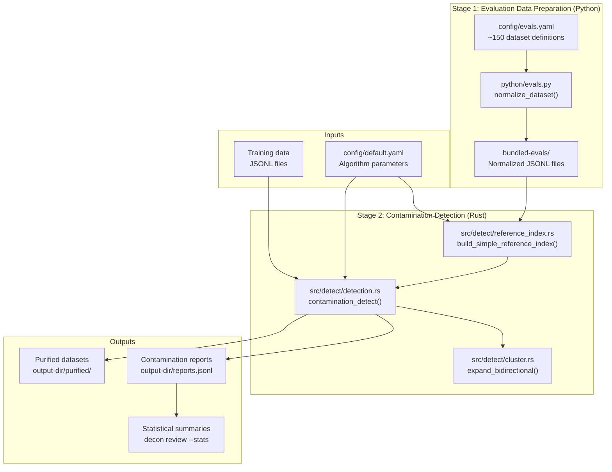
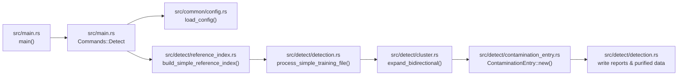
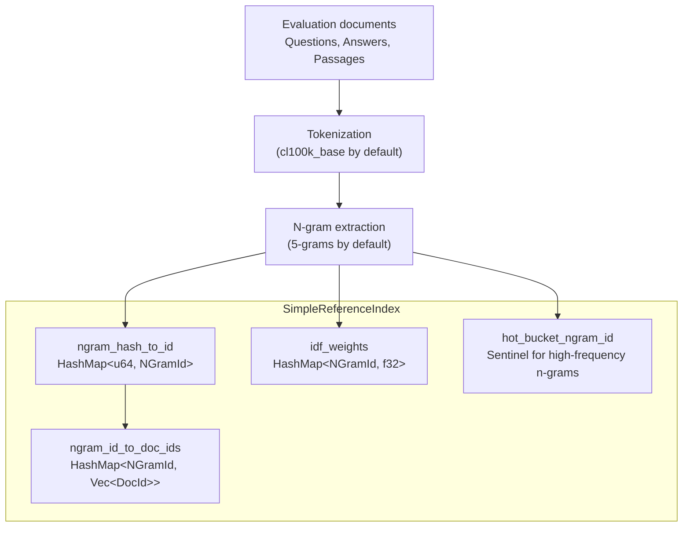
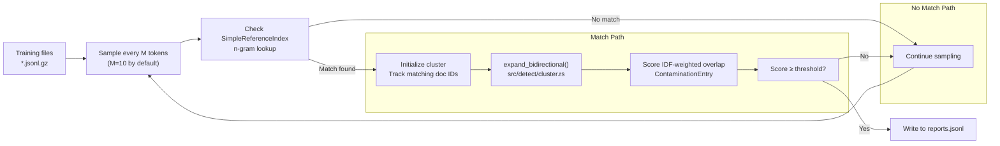
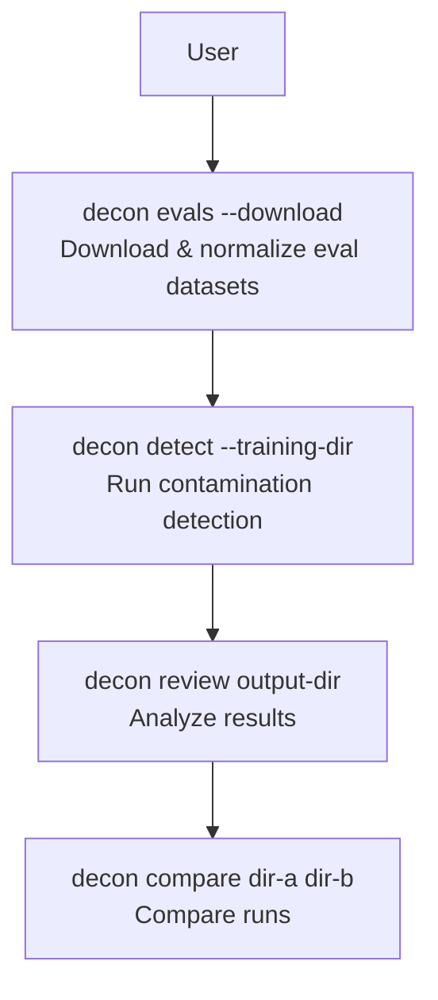
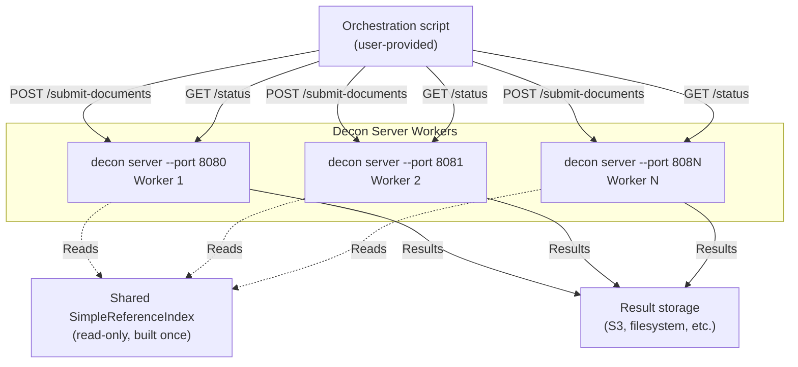
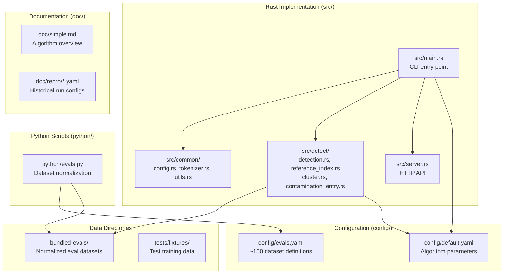

<!-- source: DeepWiki mcp.deepwiki.com · repo allenai/decon · page 1 Overview · fetched 2026-10-26 -->

# Overview

<details>
<summary>Relevant source files</summary>

The following files were used as context for generating this wiki page:

- [README.md](README.md)
- [doc/simple.md](doc/simple.md)

</details>


This document provides a high-level introduction to the **decon** contamination detection system. It covers the system's purpose, architecture, key components, and operational modes. For installation and usage instructions, see [Getting Started](#2). For algorithm details, see [The SIMPLE Algorithm](#4). For configuration options, see [Configuration Guide](#3.3).

## Purpose

**Decon** identifies contamination between training datasets and evaluation datasets. Contamination occurs when evaluation data (test questions, answers, passages) leaks into training data, invalidating benchmark results. Decon uses deterministic, token-based sampling and counting methods to detect such contamination at scale.

The system produces:
- **Contamination reports**: JSONL files identifying which training documents contain which evaluation instances
- **Purified datasets**: Cleaned training data with contaminated documents removed
- **Statistical summaries**: Breakdown of contamination by evaluation suite

Decon is designed for large-scale datasets (billions of tokens) and emphasizes reproducibility through configuration files and deterministic algorithms.

**Sources:** [README.md:1-8](), [README.md:10-23]()

## System Architecture

Decon uses a **two-stage architecture** separating data preparation from detection:



**Sources:** [README.md:1-23](), [doc/simple.md:1-11]()

## Key Components

### CLI Interface

The main entry point is `src/main.rs`, which provides five primary commands:

| Command | Purpose | Key Implementation |
|---------|---------|-------------------|
| `detect` | Run contamination detection | [src/detect/detection.rs:contamination_detect()]() |
| `review` | Analyze detection results | [src/detect/display.rs:print_highlighted_output()]() |
| `evals` | Manage evaluation datasets | [python/evals.py:download_and_normalize()]() |
| `compare` | Compare detection runs | [src/detect/display.rs:compare_reports()]() |
| `server` | Launch HTTP API server | [src/server.rs:run_server()]() |

**Sources:** [README.md:62-82](), [README.md:124-129]()

### Detection Pipeline

The detection pipeline follows this workflow:



**Sources:** [doc/simple.md:7-10](), [README.md:24-57]()

### Reference Index Structure

The `SimpleReferenceIndex` in [src/detect/reference_index.rs]() implements a two-tier lookup structure:



The two-tier design optimizes for the sparsity of initial matches: most n-grams from training data won't match anything, so the first hash lookup quickly filters non-matches before accessing document sets.

**Sources:** [doc/simple.md:12-19]()

## Data Flow

### Evaluation Data Pipeline

Evaluation datasets flow through a normalization pipeline to produce a unified format:

| Source Format | Examples | Normalization | Output Format |
|--------------|----------|---------------|---------------|
| Multiple choice | MMLU (57 domains) | `expand_choices` | Q/A/P JSONL |
| Math reasoning | GSM8K | Field extraction | Q/A/P JSONL |
| Code generation | HumanEval | `concat_messages` | Q/A/P JSONL |
| Extractive QA | SQuAD | Field mapping | Q/A/P JSONL |

All datasets are normalized to include:
- `question`: String
- `answer`: String
- `passage`: Optional string
- `fingerprint`: SHA256 hash for deduplication
- `metadata`: Dataset-specific information

**Sources:** [README.md:88-120]()

### Training Data Processing

Training data is processed in parallel using sampling and cluster expansion:



**Sources:** [doc/simple.md:21-33](), [README.md:10-23]()

## Execution Modes

Decon supports two operational modes:

### Single-Machine CLI Mode

The CLI mode is a sequential workflow for processing datasets on a single machine:



**Sources:** [README.md:59-82]()

### Distributed Server Mode

The server mode enables horizontal scaling for large training datasets:



The server exposes HTTP endpoints implemented in [src/server.rs](). Each worker processes batches independently, with the reference index built once and shared read-only across all workers.

**Sources:** [README.md:122-133]()

## Technology Stack

### Languages and Frameworks

| Component | Language | Key Dependencies |
|-----------|----------|-----------------|
| Detection engine | Rust 1.88+ | `rayon` (parallelism), `tokio` (async), `axum` (HTTP) |
| Data normalization | Python 3 | `datasets` (HuggingFace), `PyYAML` |
| Configuration | YAML | `serde_yaml` parser |

### File Structure



**Sources:** [README.md:1-154]()

## Configuration System

Decon's behavior is controlled entirely through YAML configuration files:

| Configuration File | Purpose | Key Parameters |
|-------------------|---------|----------------|
| `config/default.yaml` | Detection algorithm parameters | `ngram_size`, `sample_every_m_tokens`, `contamination_score_threshold` |
| `config/evals.yaml` | Evaluation dataset definitions | `dataset_name`, `field_extractions`, `split` |
| `doc/repro/*.yaml` | Historical run configurations | Complete parameter sets for reproducing published results |

Parameters in `config/default.yaml` control every aspect of the SIMPLE algorithm, from index construction through scoring thresholds. See [Configuration Guide](#3.3) for detailed parameter documentation.

**Sources:** [README.md:84](), [README.md:102-118]()

## Output Formats

Decon produces structured outputs for both machine and human consumption:

### Contamination Reports

Reports are written as JSONL files in the output directory. Each line represents one contaminated match:

```jsonl
{
  "training_line": 42,
  "eval_key": "mmlu:abstract_algebra:test:0",
  "contamination_score": 0.95,
  "idf_overlap": 0.87,
  "question_cluster": {"start": 100, "end": 150},
  "answer_cluster": {"start": 160, "end": 175}
}
```

### Purified Datasets

When `--purify` flag is used, decon creates cleaned versions of training data with contaminated documents removed, preserving directory structure and compression formats.

### Statistical Summaries

The `decon review --stats` command aggregates reports by evaluation suite, showing counts of contaminated documents per benchmark.

**Sources:** [README.md:135-154](), [README.md:24-57]()

## Key Design Principles

1. **Deterministic**: Same input always produces same output; no randomness in detection
2. **Interpretable**: Every contamination match includes highlighted text snippets showing overlap
3. **Scalable**: Sampling and parallel processing enable billion-token dataset analysis
4. **Configurable**: All algorithm parameters exposed through YAML for reproducibility
5. **Language-separated**: Python handles messy data wrangling; Rust handles performance-critical detection

**Sources:** [README.md:3-8](), [doc/simple.md:1-3]()

---

