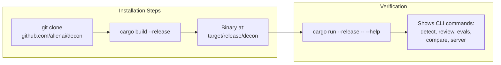
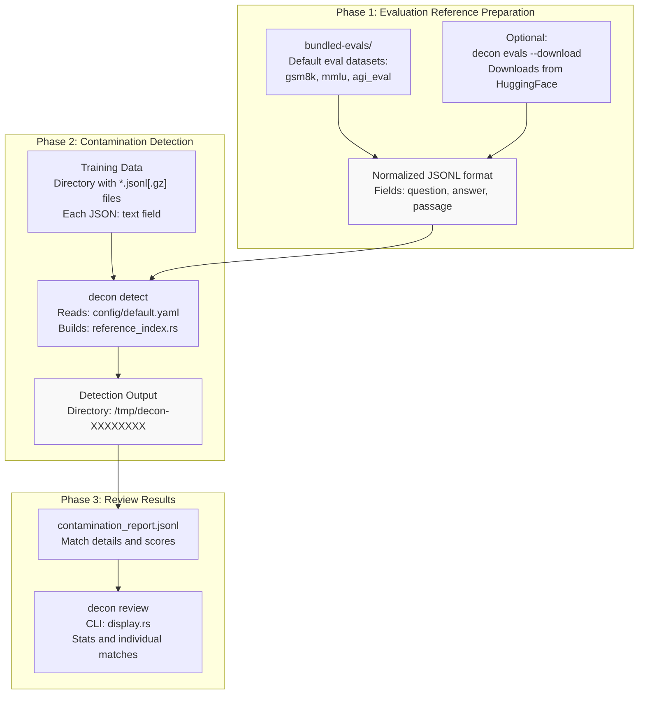
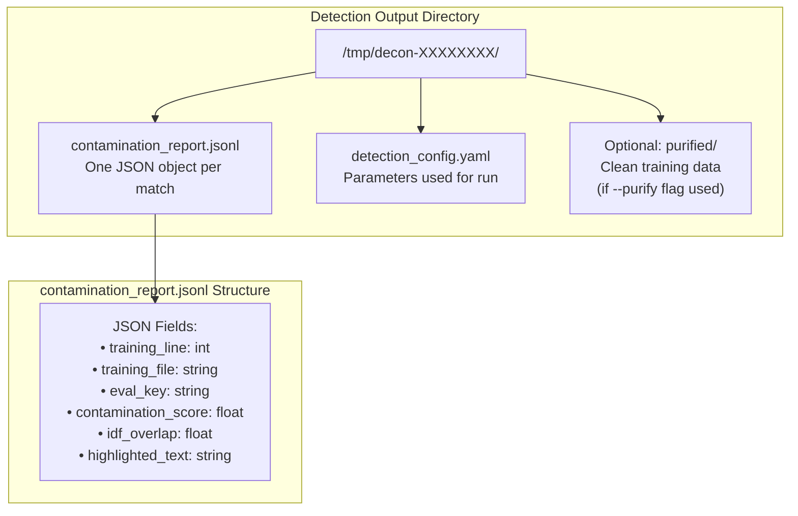
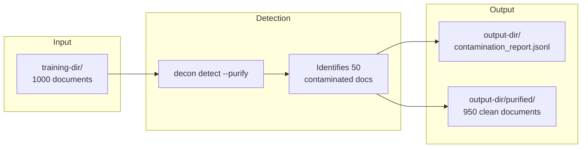
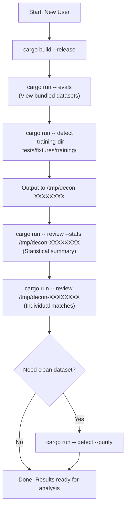

<!-- source: DeepWiki mcp.deepwiki.com · repo allenai/decon · page 2 Getting Started · fetched 2026-10-26 -->

# Getting Started

<details>
<summary>Relevant source files</summary>

The following files were used as context for generating this wiki page:

- [README.md](README.md)
- [config/evals.yaml](config/evals.yaml)

</details>


This page provides installation instructions and a walkthrough for running your first contamination detection. It covers the basic workflow of preparing evaluation data, running detection on training data, and reviewing results.

For a comprehensive guide to all features and configuration options, see [User Guide](#3). For detailed command documentation, see [CLI Commands Reference](#3.1). For understanding the underlying detection algorithm, see [The SIMPLE Algorithm](#4).

---

## Purpose and Scope

This guide walks you through:
- Installing decon and its dependencies
- Understanding the two-phase detection workflow
- Running your first contamination detection
- Interpreting basic results

By the end of this guide, you will have run contamination detection on sample data and understand the core workflow.

---

## Prerequisites

### System Requirements

| Requirement | Version | Purpose |
|------------|---------|---------|
| Rust | 1.88+ | Building and running decon CLI |
| Python | 3.x | Processing evaluation datasets (optional) |
| `datasets` library | Latest | Downloading HuggingFace datasets (optional) |

**Note**: Python and the `datasets` library are only required if you need to download additional evaluation datasets beyond the bundled defaults.

Sources: [README.md:64-66]()

---

## Installation

### Clone and Build

```bash
# Clone the repository
git clone https://github.com/allenai/decon
cd decon

# Build in release mode (optimized for performance)
cargo build --release

# Verify installation
cargo run --release -- --help
```

The release build is important for performance, as decon processes large datasets and uses sampling optimizations that benefit significantly from compiler optimizations.



**Installation Verification**

Sources: [README.md:62-69](), [README.md:113-118]()

---

## Understanding the Decon Workflow

Decon operates in two distinct phases:



**Two-Phase Detection Architecture**

The separation between phases allows you to:
- Build the reference index once and reuse it for multiple training datasets
- Add or remove evaluation datasets without re-processing training data
- Share reference indexes across distributed workers

Sources: [README.md:9-57]()

---

## Your First Detection Run

### Step 1: Check Available Evaluation Datasets

```bash
cargo run --release -- evals
```

This lists all evaluation datasets currently in the reference directory. By default, three eval suites are included:

| Eval Suite | Description | Records |
|-----------|-------------|---------|
| `gsm8k` | Grade school math problems | ~8.5K |
| `mmlu` | Massive Multitask Language Understanding | ~15K |
| `agi_eval` | AGI evaluation benchmarks | ~8K |

The evaluation data is stored in `bundled-evals/` as normalized JSONL files with consistent `question`, `answer`, and optional `passage` fields.

Sources: [README.md:71-73](), [README.md:103-105](), [config/evals.yaml:71-77](), [config/evals.yaml:602-609](), [config/evals.yaml:925-940]()

### Step 2: Run Detection on Sample Data

```bash
cargo run --release -- detect --training-dir tests/fixtures/training/
```

This command:
1. Loads evaluation datasets from `bundled-evals/`
2. Builds n-gram index (implemented in `src/detect/reference_index.rs`)
3. Processes training files in parallel (implemented in `src/detect/detection.rs`)
4. Outputs results to a temporary directory (e.g., `/tmp/decon-295c0cbd`)

**Expected Output:**

```
Training files 4/4 [00:00:02/00:00:00] [████████████████████████████████████]

┌───────────────────────────────────────────┐
│     Contamination Detection Results       │
├───────────────────────────────────────────┤
│ Training lines                        245 │
│ Processing rate                 15 μs/doc │
├───────────────────────────────────────────┤
│ Index building time                 2.45s │
│ Detection time                      0.12s │
│ Total time                          2.57s │
├───────────────────────────────────────────┤
│ Contaminated matches                   12 │
│ Contaminated documents                  8 │
└───────────────────────────────────────────┘

Results written to: /tmp/decon-295c0cbd
```

Sources: [README.md:74-76](), [README.md:26-44]()

### Step 3: Review Results

```bash
# View summary statistics
cargo run --release -- review --stats /tmp/decon-295c0cbd

# Interactive review of individual matches
cargo run --release -- review /tmp/decon-295c0cbd
```

**Statistical Summary Format:**

```
=== TRAINING DOCUMENTS CONTAMINATED BY EVAL SUITE ===
(Each count represents unique training documents that need removal)

  gsm8k                                    5 │████████████████████████           │
  mmlu                                     2 │██████████                         │
  agi_eval                                 1 │█████                              │
```

Sources: [README.md:80-82](), [README.md:45-56]()

---

## Understanding Detection Output

### Output Directory Structure



**Output Directory Contents**

Sources: [README.md:80-82](), [README.md:152-154]()

### Contamination Report Format

Each line in `contamination_report.jsonl` represents one detected match:

```json
{
  "training_line": 1234,
  "training_file": "web_data_00001.jsonl.gz",
  "eval_key": "mmlu/professional_accounting",
  "contamination_score": 0.92,
  "idf_overlap": 0.87,
  "question_match": {
    "start": 45,
    "end": 120,
    "text": "what is the present value of..."
  },
  "answer_match": {
    "start": 125,
    "end": 145,
    "text": "discount rate method"
  }
}
```

**Key Fields:**
- `training_line`: Line number in the training file (0-indexed)
- `eval_key`: Evaluation dataset identifier (format: `dataset/split`)
- `contamination_score`: Overall match score (0.0-1.0), threshold configurable in `config/default.yaml`
- `idf_overlap`: IDF-weighted token overlap score
- Match locations: Character offsets for highlighted text

Sources: [README.md:152-154]()

---

## Data Format Requirements

### Training Data Format

Training data must be JSONL files (optionally gzip compressed) with each line containing a JSON object with a `text` field:

```json
{"text": "This is a training document..."}
{"text": "Another document with content..."}
```

Decon processes all `*.jsonl` and `*.jsonl.gz` files in the specified directory recursively.

**Supported field names** (configurable via `--training-text-field`):
- `text` (default)
- `content`
- Custom field name

Sources: [README.md:90-94]()

### Evaluation Data Format

The bundled evaluation datasets follow a normalized format produced by `python/evals.py`:

```json
{
  "question": "What is the capital of France?",
  "answer": "Paris",
  "passage": "France is a country in Europe...",
  "is_correct": true,
  "fingerprint": "sha256_hash_here",
  "metadata": {"dataset": "trivia_qa", "split": "train"}
}
```

**Required fields:**
- `question`: The evaluation prompt or question text
- `answer`: The expected answer(s)

**Optional fields:**
- `passage`: Supporting context (used if `index_passages: true` in config)
- `is_correct`: For multiple-choice datasets
- `fingerprint`: SHA256 hash for deduplication

Sources: [README.md:96-101]()

---

## Common Options and Flags

### Detection Options

| Option | Description | Default |
|--------|-------------|---------|
| `--training-dir PATH` | Directory containing training data | Required |
| `--evals-dir PATH` | Directory containing evaluation data | `bundled-evals/` |
| `--config PATH` | Configuration file | `config/default.yaml` |
| `--output-dir PATH` | Where to write results | `/tmp/decon-XXXXXXXX` |
| `--purify` | Create cleaned dataset (removes contaminated docs) | False |
| `--training-text-field NAME` | JSON field containing document text | `text` |

### Review Options

| Option | Description |
|--------|-------------|
| `--stats` | Show statistical summary instead of interactive review |
| `--eval NAME` | Filter to specific evaluation dataset |
| `--min-score FLOAT` | Show only matches above threshold |

Sources: [README.md:74-82](), [README.md:139-151]()

---

## Configuration Basics

Decon behavior is controlled by `config/default.yaml`. Key parameters include:

```yaml
# Index construction
ngram_size: 5                    # N-gram size for matching
tokenizer_str: "cl100k"          # Tokenizer to use
index_passages: true             # Index passage fields
index_answers: true              # Index answer fields

# Detection parameters
sample_every_m_tokens: 10        # Sampling rate for efficiency
contamination_score_threshold: 0.8  # Minimum score to report

# Scoring weights
question_weight: 1.0
answer_weight: 0.5
passage_weight: 0.3
```

**Most Important Parameter:**
- `contamination_score_threshold`: Controls sensitivity. Lower values (e.g., 0.6) detect more matches but may include false positives. Higher values (e.g., 0.9) are stricter.

For detailed configuration options, see [Configuration Guide](#3.3).

Sources: [README.md:84]()

---

## Creating a Clean Dataset (Purification)

To create a version of your training data with contaminated documents removed:

```bash
cargo run --release -- detect \
  --training-dir ~/my-training-data \
  --purify \
  --output-dir ~/decon-output
```

This creates a `purified/` subdirectory in the output directory containing cleaned JSONL files with the same structure as the input, minus the contaminated documents.



**Purification Workflow**

The purified dataset maintains:
- Original directory structure
- Original filenames
- Original JSON structure
- Original compression (if input was gzipped)

Sources: [README.md:77-78]()

---

## Next Steps

Now that you've run your first detection, you can:

1. **Download more evaluation datasets**: See [Evaluation Dataset Configuration](#5.1) for adding datasets from HuggingFace
2. **Tune detection parameters**: See [Configuration Guide](#3.3) for adjusting sensitivity and performance
3. **Process large datasets**: See [Server Mode and Distributed Processing](#3.2) for scaling to billions of documents
4. **Understand the algorithm**: See [The SIMPLE Algorithm](#4) for details on how detection works
5. **Compare detection runs**: Use `decon compare` to analyze differences between runs (see [CLI Commands Reference](#3.1))

---

## Downloading Additional Evaluation Datasets

The default bundle includes only three eval suites. To download all ~150 pre-configured datasets:

```bash
# Requires Python 3 with datasets library
pip install datasets

# Download all configured evaluations
cargo run --release -- evals --download --config config/evals.yaml
```

This processes datasets defined in `config/evals.yaml` and normalizes them into the `bundled-evals/` directory. The download may take 10-30 minutes depending on your network connection.

**Commonly added datasets:**
- `humaneval`: Code generation benchmarks
- `hellaswag`: Commonsense reasoning
- `squad`: Reading comprehension
- `drop`: Discrete reasoning
- `mathqa`: Mathematical reasoning

For details on the dataset configuration format and adding custom datasets, see [Evaluation Dataset Configuration](#5.1).

Sources: [README.md:106-118](), [config/evals.yaml:1-69]()

---

## Troubleshooting

### Common Issues

**Issue**: "No evaluation datasets found"
- **Cause**: Empty or missing `bundled-evals/` directory
- **Solution**: The repository includes default evals. If missing, re-clone or run `cargo run --release -- evals --download`

**Issue**: "Failed to parse training file"
- **Cause**: Training JSONL files don't have expected `text` field
- **Solution**: Use `--training-text-field FIELDNAME` to specify the correct field

**Issue**: Detection is slow
- **Cause**: Not using release build
- **Solution**: Always use `cargo run --release` (not `cargo run`)

**Issue**: High memory usage
- **Cause**: Large evaluation reference set with many n-grams
- **Solution**: Reduce `ngram_size` in config or limit evaluation datasets

Sources: [README.md:62-69](), [README.md:90-94]()

---

## Example: Complete First Run

Here's a complete example showing all steps:

```bash
# 1. Build decon
git clone https://github.com/allenai/decon
cd decon
cargo build --release

# 2. Check what evaluations are available
cargo run --release -- evals

# 3. Run detection on test data
cargo run --release -- detect --training-dir tests/fixtures/training/

# 4. Review results (replace with actual output path)
cargo run --release -- review --stats /tmp/decon-a1b2c3d4

# 5. Interactive review of individual matches
cargo run --release -- review /tmp/decon-a1b2c3d4

# 6. Create a cleaned dataset
cargo run --release -- detect \
  --training-dir tests/fixtures/training/ \
  --purify \
  --output-dir ./my-first-run
```



**Complete Getting Started Workflow**

Sources: [README.md:59-82]()

---

