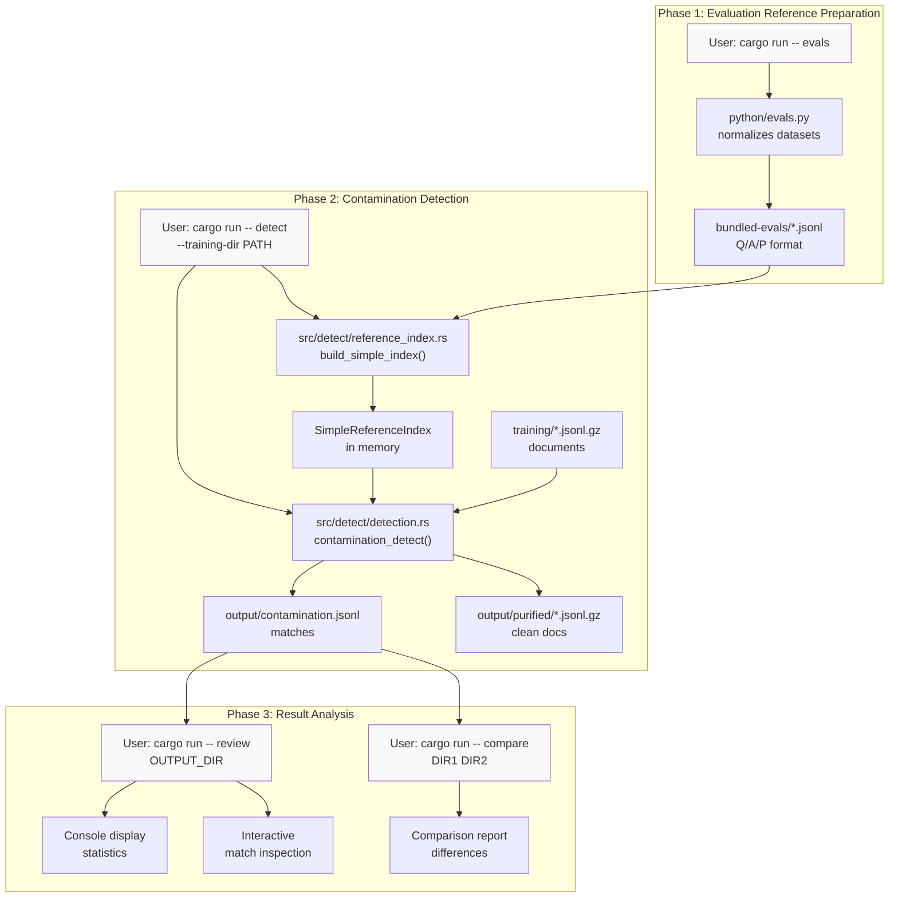
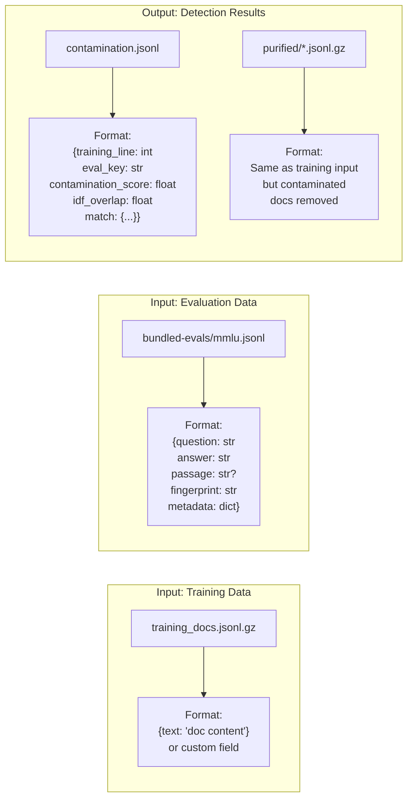
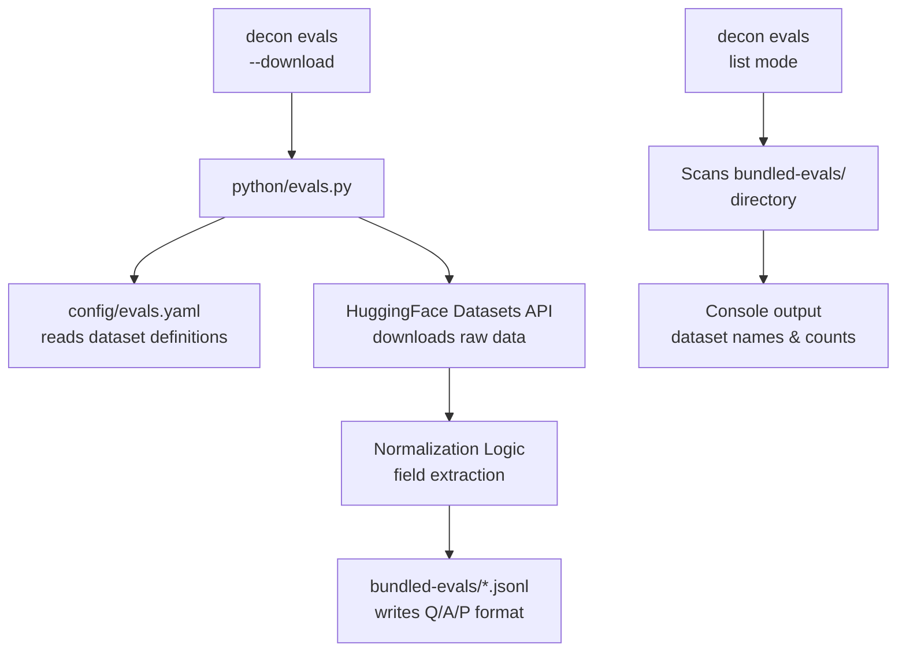
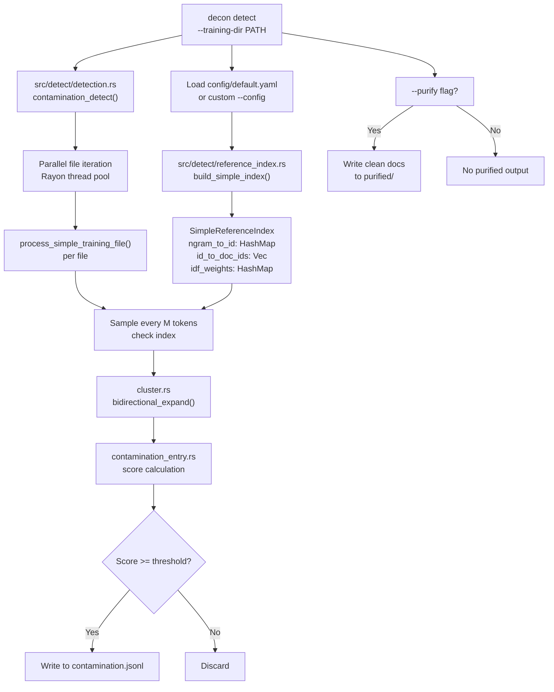
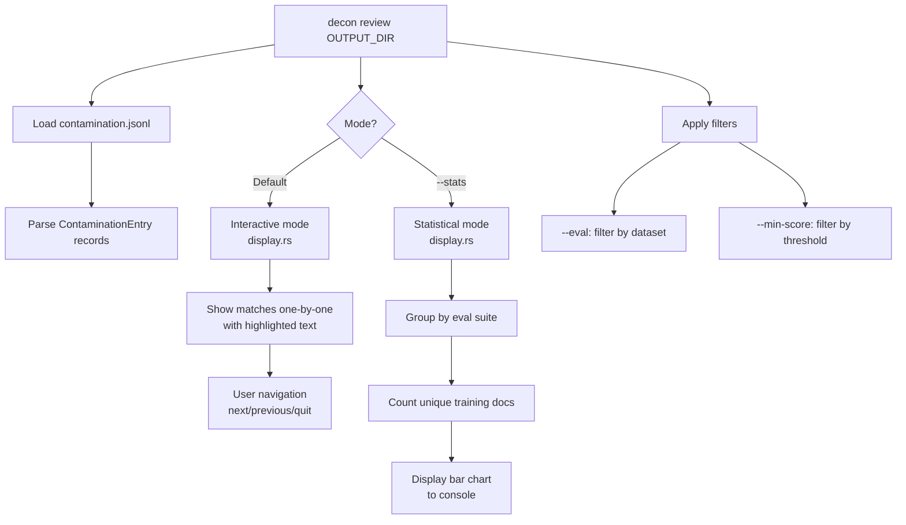

<!-- source: DeepWiki mcp.deepwiki.com · repo allenai/decon · page 3 User Guide · fetched 2026-10-26 -->

# User Guide

<details>
<summary>Relevant source files</summary>

The following files were used as context for generating this wiki page:

- [README.md](README.md)

</details>


This guide provides comprehensive instructions for using decon to detect contamination between training datasets and evaluation benchmarks. It covers the primary workflows, command-line interface usage patterns, input/output file formats, and common usage scenarios.

For detailed command syntax and options, see [CLI Commands Reference](#3.1). For distributed processing setup, see [Server Mode and Distributed Processing](#3.2). For parameter tuning, see [Configuration Guide](#3.3).

## Purpose and Scope

This user guide is organized around practical workflows for contamination detection. It assumes you have decon installed and are ready to run detection on your datasets. For installation instructions, see [Getting Started](#2).

## Core Workflow

Decon operates through a three-phase workflow: preparing evaluation references, detecting contamination, and reviewing results. Each phase corresponds to specific CLI commands that transform data through the system.



**Sources:** [README.md:59-154](), [src/main.rs](), [src/detect/detection.rs](), [src/detect/reference_index.rs]()

## Command Overview

Decon provides five primary commands, each addressing a specific phase of the contamination detection workflow:

| Command | Purpose | Typical Usage |
|---------|---------|---------------|
| `evals` | List, download, or manage evaluation datasets | `cargo run --release -- evals --download` |
| `detect` | Run contamination detection on training data | `cargo run --release -- detect --training-dir ~/data` |
| `review` | Inspect detection results and statistics | `cargo run --release -- review /tmp/decon-output` |
| `compare` | Compare results from different detection runs | `cargo run --release -- compare /tmp/run-a /tmp/run-b` |
| `server` | Launch HTTP server for distributed processing | `cargo run --release -- server --port 8080` |

**Sources:** [README.md:59-154](), [src/main.rs]()

## File Format Requirements

Understanding decon's input and output formats is essential for integrating it into your data pipeline.



**Sources:** [README.md:90-101](), [tests/fixtures/training/contaminated_mixed.jsonl](), [bundled-evals/]()

### Training Data Format

Training data must be provided as a directory containing JSONL files (optionally gzip compressed). Each JSON object must contain a text field with the document content. The field name defaults to `text` but can be customized via the `--training-field` option.

Example training document:
```json
{
  "text": "The plane face of plano convex lens of focal length 20 cm is silvered...",
  "metadata": {"source": "web", "timestamp": "2023-01-15"}
}
```

The system processes common compression formats: `.jsonl`, `.jsonl.gz`, `.jsonl.zst`, `.jsonl.bz2`.

**Sources:** [README.md:90-94](), [tests/fixtures/training/]()

### Evaluation Data Format

Evaluation datasets use a normalized JSONL format with three primary fields: `question`, `answer`, and optionally `passage`. Each record also includes a `fingerprint` (SHA256 hash) and `metadata` dictionary.

Example evaluation record:
```json
{
  "question": "the plane face of plano convex lens of focal length 20 cm is silvered this combination is equivalent to the type of mirror and its focal length is",
  "answer": "concave f 10 cm",
  "passage": null,
  "fingerprint": "a3f2e9b8c1d4...",
  "metadata": {"dataset": "physics_mcq", "category": "optics", "index": 42}
}
```

**Sources:** [README.md:96-101](), [bundled-evals/]()

### Output Format

Detection results are written to a timestamped output directory (e.g., `/tmp/decon-295c0cbd/`) containing:

- `contamination.jsonl` - Detailed match records
- `purified/` - Cleaned training files (if `--purify` enabled)
- `config.yaml` - Detection parameters used for this run

Each line in `contamination.jsonl` represents one contaminated match:
```json
{
  "training_line": 12543,
  "eval_key": "mmlu/physics/optical_instruments/question_17",
  "contamination_score": 0.92,
  "idf_overlap": 0.87,
  "match": {
    "matched_components": ["question"],
    "highlighted_training_text": "...",
    "matched_eval_text": "..."
  }
}
```

**Sources:** [src/detect/contamination_entry.rs](), [src/detect/display.rs]()

## Basic Usage Patterns

### Pattern 1: Quick Detection with Default Evals

The simplest workflow uses the bundled evaluation datasets (gsm8k, mmlu, agi_eval) that come pre-configured with decon.

```bash
# Step 1: List included evaluations
cargo run --release -- evals

# Step 2: Run detection
cargo run --release -- detect --training-dir ~/my-training-data

# Step 3: Review results (use path from previous output)
cargo run --release -- review /tmp/decon-295c0cbd
```

This workflow builds the reference index from bundled evaluations, scans training files, and reports contaminated documents to the console.

**Sources:** [README.md:62-82]()

### Pattern 2: Custom Evaluation Suite

For production decontamination, you typically need to include all evaluation datasets your model will be tested against.

```bash
# Step 1: Download extended evaluation suite
cargo run --release -- evals --download --config config/evals.yaml

# Step 2: Verify evaluations were downloaded
cargo run --release -- evals

# Step 3: Run detection with custom config
cargo run --release -- detect \
  --training-dir ~/training-corpus \
  --config config/my-detection-params.yaml \
  --purify

# Step 4: Generate statistics by eval suite
cargo run --release -- review --stats /tmp/decon-output
```

The `--purify` flag creates cleaned versions of training files in the output directory's `purified/` subdirectory.

**Sources:** [README.md:102-120](), [config/evals.yaml]()

### Pattern 3: Iterative Parameter Tuning

Decon's scoring threshold can be adjusted to control sensitivity. Lower thresholds catch more potential contamination but increase false positives.

```bash
# Run with high precision (default threshold 0.8)
cargo run --release -- detect --training-dir ~/data

# Run with high recall (lower threshold)
cargo run --release -- detect \
  --training-dir ~/data \
  --contamination-score-threshold 0.6

# Compare the two runs
cargo run --release -- compare /tmp/decon-run1 /tmp/decon-run2

# Review specific eval suite at high threshold
cargo run --release -- review /tmp/decon-run1 \
  --eval mmlu --min-score 0.9
```

**Sources:** [README.md:84-85](), [README.md:145-151](), [config/default.yaml]()

### Pattern 4: Filtered Review

When analyzing results, you often want to focus on specific evaluation suites or score ranges:

```bash
# View only MMLU contamination
cargo run --release -- review /tmp/decon-output --eval mmlu

# View high-confidence matches only
cargo run --release -- review /tmp/decon-output --min-score 0.95

# Combine filters
cargo run --release -- review /tmp/decon-output \
  --eval gsm8k --min-score 0.85
```

**Sources:** [README.md:136-151]()

## Command-Specific Details

### evals Command

The `evals` command manages evaluation reference datasets. Without arguments, it lists currently available evaluations in `bundled-evals/`.



Key behaviors:
- Reads dataset definitions from `config/evals.yaml` (or custom config via `--config`)
- Invokes Python script [python/evals.py]() to download and normalize
- Writes normalized JSONL files to `bundled-evals/` directory
- Each dataset becomes a separate JSONL file named by dataset key

**Sources:** [README.md:102-120](), [python/evals.py](), [config/evals.yaml]()

### detect Command

The `detect` command is the core contamination detection engine. It builds an in-memory reference index and scans training files in parallel.



Important options:
- `--training-dir` - Required. Directory containing JSONL training files
- `--training-field` - Field name containing document text (default: `text`)
- `--purify` - Generate cleaned dataset with contaminated documents removed
- `--config` - Path to custom configuration file
- `--contamination-score-threshold` - Override default threshold (0.8)
- `--evals-dir` - Path to evaluation reference directory (default: `bundled-evals/`)

The command creates an output directory (reported to console) containing all results and configuration.

**Sources:** [README.md:74-78](), [src/detect/detection.rs](), [src/detect/reference_index.rs](), [src/detect/cluster.rs]()

### review Command

The `review` command provides interactive and statistical analysis of detection results.



Operating modes:
- **Interactive mode** (default) - Step through individual matches with highlighted text
- **Statistics mode** (`--stats`) - Display aggregate counts by evaluation suite

Filtering options:
- `--eval <name>` - Show only matches for specific evaluation dataset
- `--min-score <float>` - Show only matches above score threshold

**Sources:** [README.md:136-148](), [src/detect/display.rs]()

### compare Command

The `compare` command analyzes differences between two detection runs, useful for understanding the impact of parameter changes.

```bash
cargo run --release -- compare /tmp/decon-run-a /tmp/decon-run-b
```

The command loads `contamination.jsonl` from both directories and reports:
- Documents contaminated in A but not B
- Documents contaminated in B but not A
- Documents contaminated in both runs
- Score distribution differences

**Sources:** [README.md:149-150](), [src/main.rs]()

### server Command

The `server` command launches an HTTP API server for distributed processing workloads. See [Server Mode and Distributed Processing](#3.2) for detailed usage.

```bash
cargo run --release -- server --port 8080
```

**Sources:** [README.md:122-133](), [src/server.rs]()

## Working with Large Datasets

### Memory Considerations

The reference index is held entirely in memory. Memory usage scales with:
- Number of evaluation examples (typically 100K-500K)
- Vocabulary size in evaluations
- N-gram size (default: 5 tokens)

Typical memory footprint: 1-4 GB for comprehensive evaluation suites.

### Processing Performance

Detection speed depends on:
- Training corpus size
- Sampling rate (`sample_every_m_tokens` parameter, default: 10)
- Number of CPU cores (parallel processing via Rayon)
- Disk I/O for reading compressed files

Typical throughput: 20-40 μs per document on modern hardware.

**Sources:** [README.md:29-43](), [config/default.yaml](), [src/detect/detection.rs]()

## Integration Patterns

### Pipeline Integration

Decon can be integrated into data processing pipelines using its deterministic JSONL output format:

```bash
# Upstream: Your data collection
collect_data.sh > training_data.jsonl.gz

# Decontamination step
decon detect --training-dir ./training_data --purify
OUTPUT_DIR=$(decon detect ... | grep "Results:" | awk '{print $2}')

# Downstream: Use cleaned data
cp $OUTPUT_DIR/purified/* ./cleaned_training_data/
train_model.sh --data ./cleaned_training_data/
```

### Programmatic Access

Detection results in `contamination.jsonl` are structured for programmatic analysis:

```python
import json

contaminated_docs = set()
with open('/tmp/decon-output/contamination.jsonl') as f:
    for line in f:
        entry = json.loads(line)
        if entry['contamination_score'] > 0.9:
            contaminated_docs.add(entry['training_line'])

print(f"High-confidence contaminated docs: {len(contaminated_docs)}")
```

**Sources:** [README.md:153-154](), [src/detect/contamination_entry.rs]()

## Troubleshooting Common Issues

### Issue: No Contamination Found

If detection reports zero contaminated documents when you expect contamination:

1. Verify evaluation datasets are properly loaded: `decon evals`
2. Check training data format matches expected structure
3. Lower the contamination threshold: `--contamination-score-threshold 0.5`
4. Verify tokenizer matches training data encoding (default: `cl100k`)

### Issue: Too Many False Positives

If detection reports many low-score matches that appear non-contaminated:

1. Increase threshold: `--contamination-score-threshold 0.9`
2. Review false positives to understand patterns: `decon review --min-score 0.7`
3. Adjust component weights in configuration if specific eval components are problematic

### Issue: Out of Memory

If the process crashes due to memory exhaustion:

1. Reduce evaluation suite size (process in batches)
2. Increase system memory or use distributed mode
3. Consider sampling evaluation datasets for very large suites

**Sources:** [README.md:84-85](), [config/default.yaml]()

## Next Steps

- For detailed command syntax and all available options, see [CLI Commands Reference](#3.1)
- For setting up distributed processing, see [Server Mode and Distributed Processing](#3.2)
- For understanding and tuning configuration parameters, see [Configuration Guide](#3.3)
- For understanding the detection algorithm, see [The SIMPLE Algorithm](#4)

---

