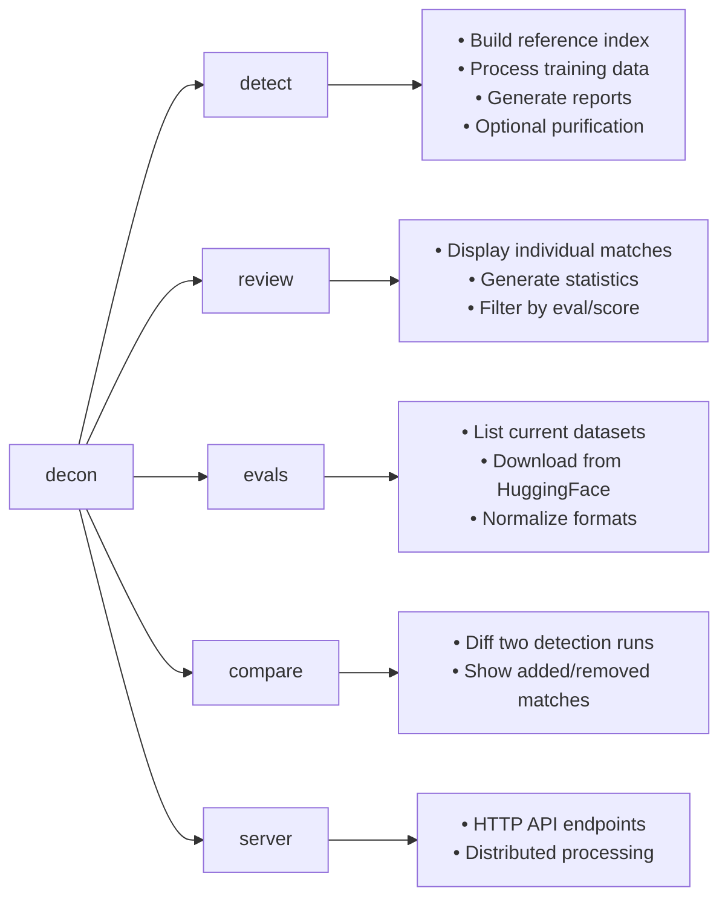
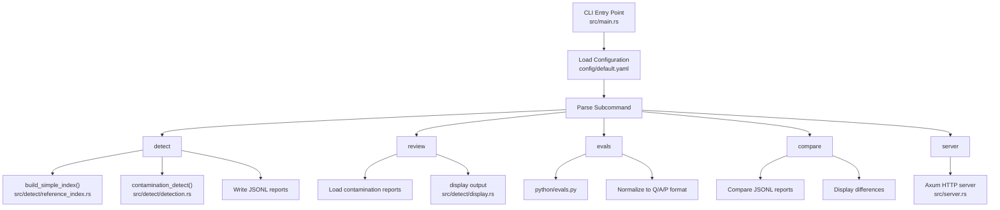
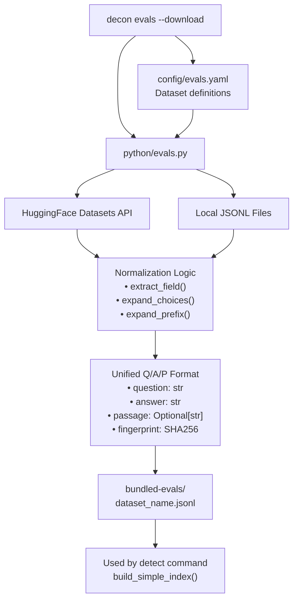
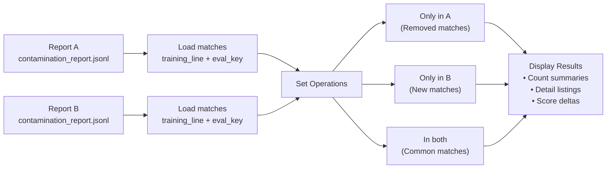
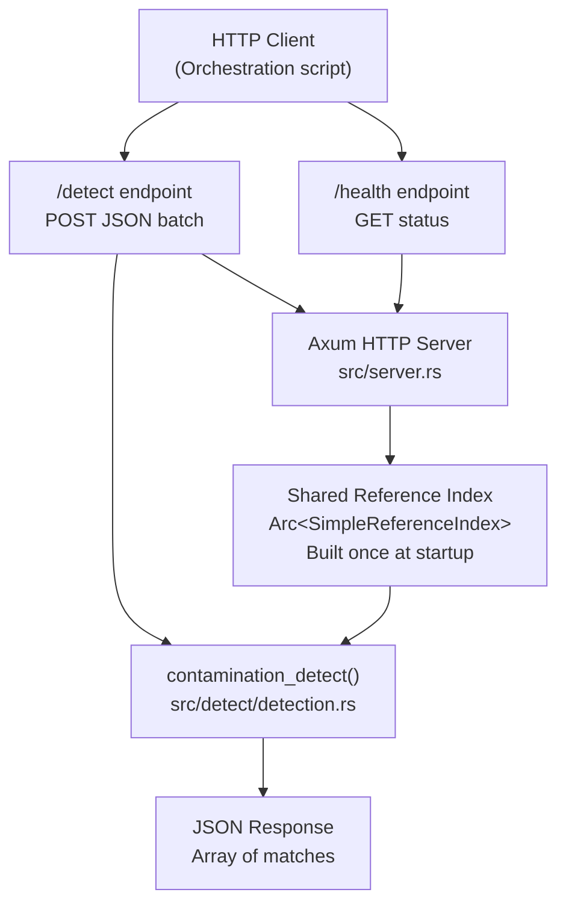

<!-- source: DeepWiki mcp.deepwiki.com · repo allenai/decon · page 3.1 CLI Commands Reference · fetched 2026-10-26 -->

# CLI Commands Reference

<details>
<summary>Relevant source files</summary>

The following files were used as context for generating this wiki page:

- [README.md](README.md)
- [src/detect/display.rs](src/detect/display.rs)

</details>


This page documents all decon command-line interface commands, their arguments, options, and behaviors. For details on server mode deployment patterns, see [Server Mode and Distributed Processing](#3.2). For configuration parameters that control command behavior, see [Configuration Guide](#3.3).

## Command Structure

The decon CLI follows a subcommand pattern where each primary operation is exposed as a distinct command:



**Sources:** [README.md:62-82](), [README.md:123-133](), [README.md:136-151]()

## Command Execution Model

All commands share a common execution pattern implemented in [src/main.rs]():



**Sources:** [README.md:69-82](), [src/detect/display.rs:1-184]()

---

## `decon detect`

The primary command for contamination detection. Builds a reference index from evaluation datasets and scans training data to identify contaminated documents.

### Basic Usage

```bash
# Detect contamination in training data
decon detect --training-dir ~/sample-data --evals-dir ~/references

# With custom configuration
decon detect --training-dir ~/data --config custom-config.yaml

# With purification (creates clean output)
decon detect --training-dir ~/data --purify
```

### Arguments and Options

| Argument | Required | Description |
|----------|----------|-------------|
| `--training-dir <PATH>` | Yes | Directory containing training data JSONL files |
| `--evals-dir <PATH>` | No | Directory containing evaluation reference data (default: `bundled-evals/`) |
| `--config <PATH>` | No | Path to configuration YAML file (default: `config/default.yaml`) |
| `--purify` | No | Generate cleaned dataset with contaminated documents removed |
| `--report-output-dir <PATH>` | No | Output directory for reports (default: `/tmp/decon-<random>`) |

### Behavior

The `detect` command executes the following pipeline:

1. **Index Construction Phase** - Invokes [src/detect/reference_index.rs:build_simple_index()]() to:
   - Load evaluation datasets from `--evals-dir`
   - Tokenize questions, answers, and passages
   - Build n-gram hash tables with IDF weights
   - Apply hot bucket optimization

2. **Detection Phase** - Calls [src/detect/detection.rs:contamination_detect()]() to:
   - Process training files in parallel using Rayon
   - Sample every M tokens (configurable via `sample_every_m_tokens`)
   - Expand clusters bidirectionally when matches found
   - Score contamination using IDF-weighted overlap

3. **Output Generation** - Produces:
   - `contamination_report.jsonl` - Full contamination matches with scores
   - `purified/*.jsonl.gz` - Clean training data (if `--purify` specified)
   - Console statistics via [src/detect/display.rs:display_detection_results()]()

### Output Format

The command displays a formatted summary table:

```
┌───────────────────────────────────────────┐
│     Contamination Detection Results       │
├───────────────────────────────────────────┤
│ Training lines                  5,162,084 │
│ Processing rate                 34 μs/doc │
├───────────────────────────────────────────┤
│ Index building time                38.59s │
│ Detection time                    175.69s │
│ Total time                        214.28s │
├───────────────────────────────────────────┤
│ Contaminated matches                7,699 │
│ Contaminated documents              1,851 │
└───────────────────────────────────────────┘
```

Implemented in [src/detect/display.rs:106-168]()

### Configuration Dependencies

The detect command respects all parameters in `config/default.yaml`:

- **Index parameters:** `ngram_size`, `tokenizer_str`, `index_passages`, `index_answers`
- **Detection parameters:** `sample_every_m_tokens`, `question_max_consecutive_misses`, `passage_max_consecutive_misses`
- **Scoring parameters:** `contamination_score_threshold`, `perfect_match_decay_start`, `perfect_match_decay_end`

See [Configuration Guide](#3.3) for complete parameter reference.

**Sources:** [README.md:26-57](), [README.md:73-78](), [src/detect/display.rs:106-168]()

---

## `decon review`

Interactive review tool for examining contamination detection results. Supports qualitative review of individual matches and statistical analysis.

### Basic Usage

```bash
# Interactive review of all matches
decon review /tmp/decon-295c0cbd

# Display statistics only
decon review --stats /tmp/decon-295c0cbd

# Filter by evaluation suite
decon review /tmp/decon-295c0cbd --eval mmlu

# Filter by minimum score
decon review /tmp/decon-295c0cbd --min-score 0.9

# Combined filters
decon review /tmp/decon-295c0cbd --eval mmlu --min-score 0.9
```

### Arguments and Options

| Argument | Required | Description |
|----------|----------|-------------|
| `<REPORT_DIR>` | Yes | Path to detection output directory containing `contamination_report.jsonl` |
| `--stats` | No | Display statistical summary instead of interactive review |
| `--eval <NAME>` | No | Filter results to specific evaluation suite (e.g., `mmlu`, `gsm8k`) |
| `--min-score <FLOAT>` | No | Only show matches with contamination score ≥ threshold |
| `--max-score <FLOAT>` | No | Only show matches with contamination score ≤ threshold |

### Review Modes

#### Interactive Mode (Default)

Without `--stats`, presents matches one at a time with:
- Training document text with highlighted contaminated regions
- Matching evaluation question/answer/passage
- Contamination score and component breakdown
- Navigation controls to move between matches

#### Statistics Mode

With `--stats`, displays:

```
=== TRAINING DOCUMENTS CONTAMINATED BY EVAL SUITE ===
(Each count represents unique training documents that need removal)

  sciq                                  652 │███████████████████████████████████████│
  mmlu                                  278 │█████████████████████                  │
  mmlu_pro                              211 │████████████████                       │
  ai2_arc_easy                           83 │██████                                 │
  super_gpqa                             65 │████                                   │
```

Bar chart implementation in [src/detect/display.rs:1-184]()

### Report File Format

The review command reads JSONL files with structure:
```json
{
  "training_line": 42,
  "eval_key": "mmlu/high_school_physics/001",
  "contamination_score": 0.94,
  "idf_overlap_question": 0.91,
  "idf_overlap_answer": 0.88,
  "matched_text_snippets": ["...highlighted text..."]
}
```

For complete format specification, see [Data Formats and Structures](#5.3).

**Sources:** [README.md:136-154](), [README.md:45-56](), [src/detect/display.rs:1-184]()

---

## `decon evals`

Management tool for evaluation reference datasets. Lists currently available datasets and downloads/normalizes new ones from HuggingFace.

### Basic Usage

```bash
# List current evaluation datasets
decon evals

# Download all datasets defined in config
decon evals --download --config config/evals.yaml

# Download to custom directory
decon evals --download --output-dir ~/my-evals
```

### Arguments and Options

| Argument | Required | Description |
|----------|----------|-------------|
| `--download` | No | Download and normalize datasets (requires Python environment) |
| `--config <PATH>` | No | Path to evals configuration file (default: `config/evals.yaml`) |
| `--output-dir <PATH>` | No | Target directory for normalized datasets (default: `bundled-evals/`) |
| `--dataset <NAME>` | No | Download only specific dataset(s) instead of all |

### Dataset Processing Pipeline



**Sources:** [README.md:108-120](), [README.md:72-73]()

### List Mode (Default)

Without `--download`, displays:
- Number of evaluation datasets currently available
- Names of each dataset
- Number of examples per dataset
- Total examples across all datasets

### Download Mode

With `--download`:
1. Invokes `python/evals.py` with configuration from `config/evals.yaml`
2. Downloads datasets via HuggingFace `datasets` library
3. Applies field extraction rules (see [Evaluation Dataset Configuration](#5.1))
4. Normalizes to Q/A/P format (see [Dataset Normalization Process](#5.2))
5. Computes SHA256 fingerprints for deduplication
6. Writes JSONL to output directory

### Python Environment Requirements

The download functionality requires:
- Python 3.7+
- `datasets` library (HuggingFace)
- `pyyaml` library

Installation:
```bash
pip install datasets pyyaml
```

### Dataset Configuration

Each dataset in `config/evals.yaml` specifies:
- HuggingFace dataset path or local file
- Split to use (train/validation/test)
- Field extraction methods for question/answer/passage
- Optional filtering criteria

See [Evaluation Dataset Configuration](#5.1) for complete configuration syntax.

**Sources:** [README.md:102-120]()

---

## `decon compare`

Compares contamination detection results from two separate runs, highlighting differences in matched documents and scores.

### Basic Usage

```bash
# Compare two detection runs
decon compare /tmp/results-a /tmp/results-b

# With descriptive labels
decon compare --label-a "baseline" --label-b "experimental" /tmp/results-a /tmp/results-b
```

### Arguments and Options

| Argument | Required | Description |
|----------|----------|-------------|
| `<REPORT_DIR_A>` | Yes | First detection output directory |
| `<REPORT_DIR_B>` | Yes | Second detection output directory |
| `--label-a <NAME>` | No | Label for first run (default: directory name) |
| `--label-b <NAME>` | No | Label for second run (default: directory name) |
| `--show-common` | No | Display matches common to both runs (default: only differences) |

### Comparison Logic

The compare command performs set operations on contamination reports:



**Sources:** [README.md:149-151]()

### Output Format

```
=== COMPARISON SUMMARY ===
Matches only in baseline:             42
Matches only in experimental:         38
Matches in both:                   7,619

=== REMOVED MATCHES (in baseline, not in experimental) ===
Training line 1234 → mmlu/physics/001 (score: 0.85)
Training line 5678 → gsm8k/train/042 (score: 0.92)
...

=== NEW MATCHES (in experimental, not in baseline) ===
Training line 9012 → ai2_arc/easy/103 (score: 0.88)
...
```

### Use Cases

- **Configuration tuning:** Compare results before/after parameter adjustments
- **Threshold analysis:** Evaluate impact of `contamination_score_threshold` changes
- **Eval set updates:** Identify new contamination from added evaluation datasets
- **Reproducibility verification:** Confirm identical results across runs

**Sources:** [README.md:149-151]()

---

## `decon server`

Launches decon as an HTTP API server for distributed contamination detection. Detailed deployment patterns covered in [Server Mode and Distributed Processing](#3.2).

### Basic Usage

```bash
# Launch server on default port
decon server

# Specify port
decon server --port 8080

# With custom configuration
decon server --config production.yaml --port 8080
```

### Arguments and Options

| Argument | Required | Description |
|----------|----------|-------------|
| `--port <NUMBER>` | No | HTTP port (default: 8080) |
| `--config <PATH>` | No | Configuration file (default: `config/default.yaml`) |
| `--evals-dir <PATH>` | No | Evaluation reference directory (default: `bundled-evals/`) |

### Server Architecture



**Sources:** [README.md:123-133]()

### API Endpoints

#### `POST /detect`

Accepts batch of training documents, returns contamination matches.

**Request:**
```json
{
  "documents": [
    {"id": 1, "text": "training document 1..."},
    {"id": 2, "text": "training document 2..."}
  ]
}
```

**Response:**
```json
{
  "matches": [
    {
      "document_id": 1,
      "eval_key": "mmlu/physics/001",
      "contamination_score": 0.94,
      "matched_text": "..."
    }
  ]
}
```

#### `GET /health`

Returns server status and index statistics.

**Response:**
```json
{
  "status": "ready",
  "index_loaded": true,
  "eval_suites": 150,
  "unique_ngrams": 4582910
}
```

### Shared Index Model

The server loads the reference index once at startup and shares it immutably across all request handlers. This enables:
- **Zero-cost sharing:** Arc provides lock-free reads
- **Horizontal scaling:** Multiple server instances with same index
- **Consistent results:** All workers use identical reference data

Implementation uses `Arc<SimpleReferenceIndex>` for thread-safe reference counting.

### Orchestration Pattern

For multi-worker deployments:

1. Start N server instances on different ports
2. Orchestrator retrieves training data batches
3. Load-balance document submissions across servers
4. Poll for completion
5. Aggregate results

Example orchestration script structure in [doc/deployment.md]().

**Sources:** [README.md:123-133]()

---

## Global Options

All commands support common flags:

| Flag | Description |
|------|-------------|
| `--help` / `-h` | Display command-specific help |
| `--version` / `-V` | Show version information |
| `--verbose` / `-v` | Increase logging verbosity |
| `--quiet` / `-q` | Suppress non-error output |

### Help System

```bash
# Top-level help
decon --help

# Command-specific help
decon detect --help
decon review --help
decon evals --help
```

Each subcommand provides detailed help including:
- Argument descriptions
- Option flags
- Default values
- Example usage

**Sources:** [README.md:69]()

---

## Exit Codes

| Code | Meaning |
|------|---------|
| 0 | Success |
| 1 | General error (invalid arguments, file not found, etc.) |
| 2 | Configuration error |
| 3 | Python environment error (for `evals --download`) |

---

## File Path Conventions

The CLI follows these conventions for file paths:

### Input Directories

- `--training-dir`: Directory with `.jsonl` or `.jsonl.gz` files
- `--evals-dir`: Directory with normalized evaluation `.jsonl` files

Both support recursive directory traversal.

### Output Directories

- `--report-output-dir`: Defaults to `/tmp/decon-<random-id>`
- `--output-dir` (for evals): Defaults to `bundled-evals/`

Output structure:
```
/tmp/decon-295c0cbd/
├── contamination_report.jsonl
├── config.yaml (copy of configuration used)
└── purified/ (if --purify specified)
    ├── file1.jsonl.gz
    └── file2.jsonl.gz
```

### Configuration Files

- `config/default.yaml`: Default detection parameters
- `config/evals.yaml`: Evaluation dataset definitions
- `doc/repro/*.yaml`: Historical run configurations

**Sources:** [README.md:91-100](), [README.md:84]()

---

## Command Composition Patterns

### Standard Workflow

```bash
# 1. Prepare evaluation reference
decon evals --download

# 2. Run detection
decon detect --training-dir ~/data --purify
# Output: /tmp/decon-abc123

# 3. Review results
decon review --stats /tmp/decon-abc123
decon review /tmp/decon-abc123 --eval mmlu --min-score 0.9

# 4. Use cleaned data
# purified data in /tmp/decon-abc123/purified/
```

### Configuration Experimentation

```bash
# Baseline run
decon detect --training-dir ~/data --config baseline.yaml
# Output: /tmp/decon-baseline

# Experimental run with different threshold
decon detect --training-dir ~/data --config experimental.yaml
# Output: /tmp/decon-experimental

# Compare
decon compare /tmp/decon-baseline /tmp/decon-experimental
```

### Incremental Evaluation Updates

```bash
# Initial run with base eval set
decon detect --training-dir ~/data --evals-dir ~/evals-v1
# Output: /tmp/decon-v1

# Add new eval datasets
decon evals --download --output-dir ~/evals-v2

# Re-run with expanded eval set
decon detect --training-dir ~/data --evals-dir ~/evals-v2
# Output: /tmp/decon-v2

# Identify new contamination
decon compare /tmp/decon-v1 /tmp/decon-v2
```

**Sources:** [README.md:59-154]()

---

