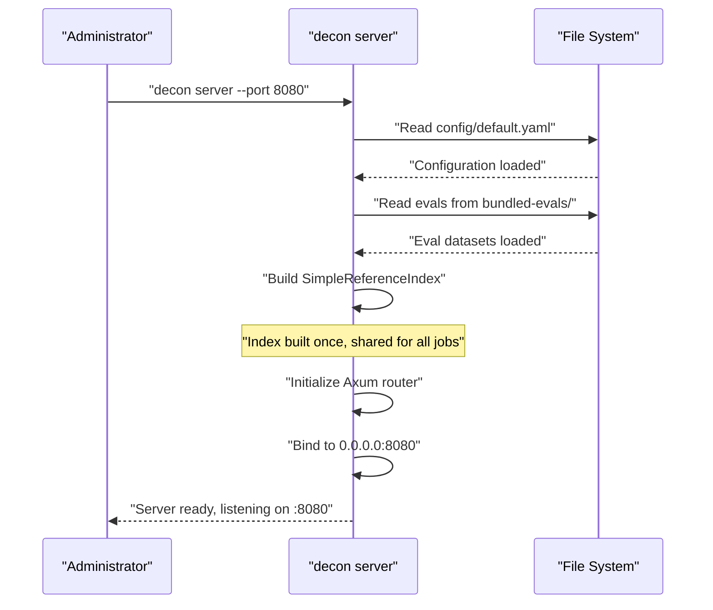
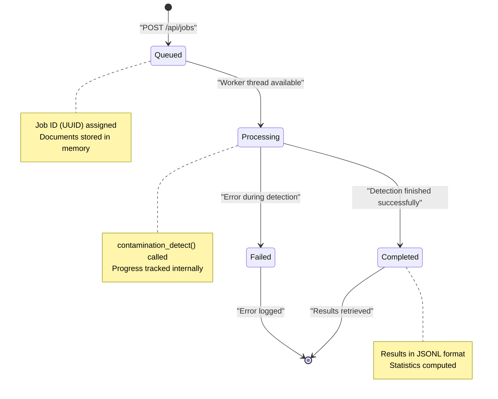
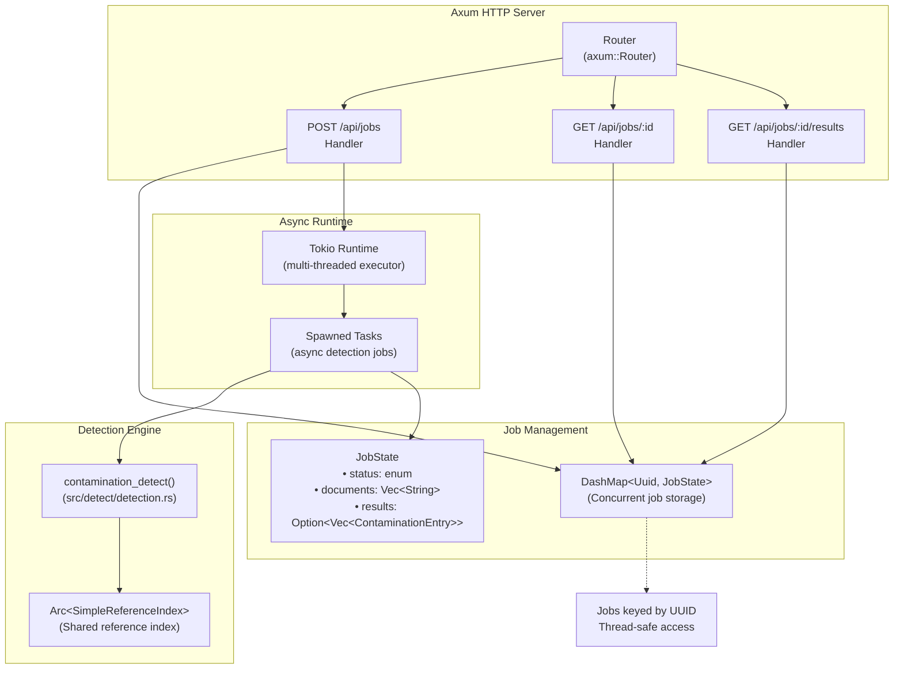
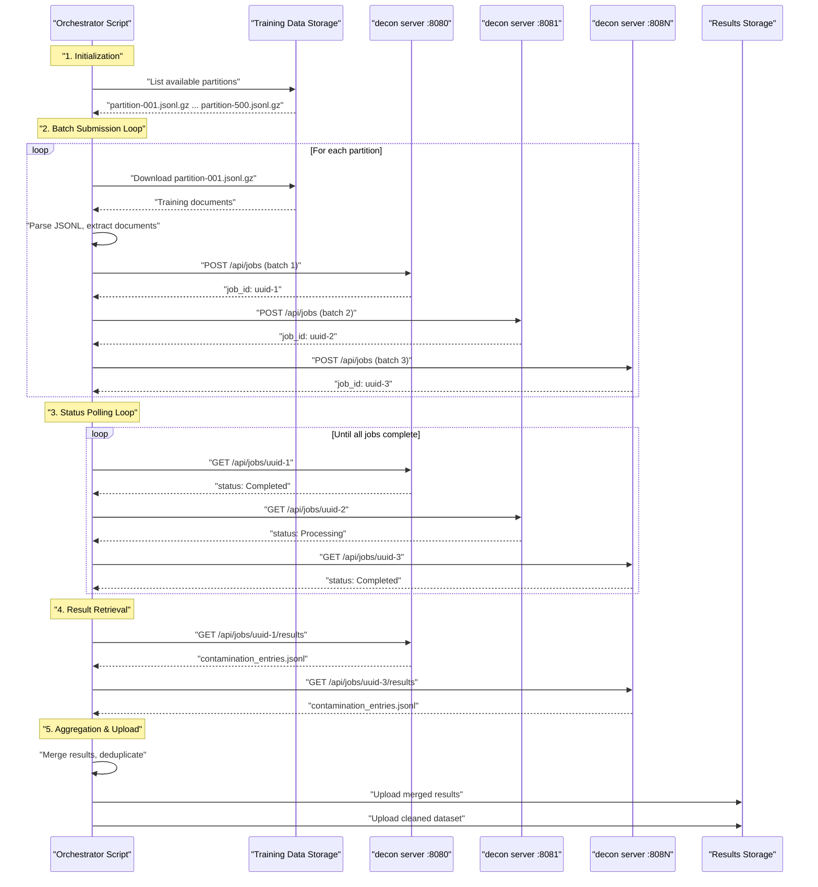
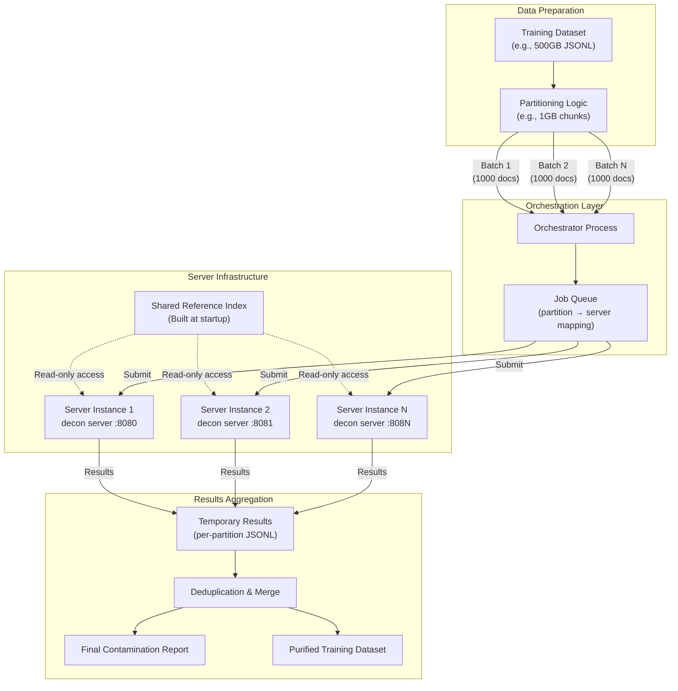

<!-- source: DeepWiki mcp.deepwiki.com · repo allenai/decon · page 3.2 Server Mode and Distributed Processing · fetched 2026-10-26 -->

# Server Mode and Distributed Processing

<details>
<summary>Relevant source files</summary>

The following files were used as context for generating this wiki page:

- [Cargo.toml](Cargo.toml)
- [README.md](README.md)

</details>


## Purpose and Scope

This document describes how to run decon in server mode to enable distributed processing of large training datasets across multiple worker instances. Server mode exposes an HTTP API for submitting detection jobs, checking status, and retrieving results, allowing orchestration scripts to coordinate parallel processing across multiple machines or processes.

For information about the CLI commands for single-machine detection, see [CLI Commands Reference](#3.1). For details on configuring detection parameters, see [Configuration Guide](#3.3).

---

## Server Mode Overview

Server mode transforms decon from a command-line tool into an HTTP service that accepts contamination detection requests via REST API. This enables:

- **Parallel processing** of large training datasets by distributing work across multiple server instances
- **Stateful job management** with unique job IDs for tracking and result retrieval
- **Asynchronous execution** where clients submit work and poll for completion
- **Shared reference index** that is built once and reused across all detection requests

### When to Use Server Mode

| Use Case | Recommended Mode |
|----------|------------------|
| Small datasets (< 10GB) | CLI mode (`decon detect`) |
| Single machine, interactive analysis | CLI mode |
| Large datasets (> 100GB) | Server mode |
| Processing across multiple machines | Server mode |
| Integration with data pipelines | Server mode |
| Batch processing workflows | Server mode |

Sources: [README.md:122-133]()

---

## Starting a Server Instance

### Basic Server Startup

```bash
# Start server on default port 8080
decon server

# Specify custom port
decon server --port 8081

# Use custom configuration
decon server --config /path/to/custom-config.yaml --evals-dir /path/to/evals
```

### Server Initialization Process

When a server starts, it performs the following initialization:

1. **Load configuration** from `config/default.yaml` or specified config file
2. **Build reference index** from evaluation datasets in `--evals-dir` (or default location)
3. **Initialize HTTP server** using Axum web framework
4. **Bind to specified port** and begin accepting requests

The reference index building occurs once at startup and is then shared (read-only) across all incoming detection requests. This is a key performance optimization for distributed processing.



**Server Initialization Sequence**

Sources: [README.md:126-129](), [Cargo.toml:32]()

---

## Server Architecture

### HTTP API Endpoints

The server exposes a REST API for job submission, status checking, and result retrieval. While the exact endpoint structure is defined in [src/server.rs](), the typical API pattern follows:

| Endpoint | Method | Purpose |
|----------|--------|---------|
| `/api/jobs` | POST | Submit new detection job |
| `/api/jobs/{job_id}` | GET | Check job status |
| `/api/jobs/{job_id}/results` | GET | Retrieve contamination results |
| `/health` | GET | Health check endpoint |

### Job Lifecycle Management



**Job State Machine**

### Internal Components



**Server Architecture Components**

The server uses:
- **Axum** for HTTP routing and request handling
- **DashMap** for thread-safe job storage without global locks
- **Arc** for sharing the reference index across async tasks
- **Tokio** for async runtime and task spawning
- **UUID v4** for unique job identifiers

Sources: [Cargo.toml:32-34](), [src/server.rs]()

---

## Orchestration Patterns

Server mode requires external orchestration to coordinate work distribution. The orchestrator is responsible for:

1. **Partitioning** the training dataset into batches
2. **Distributing** batches across available server instances
3. **Polling** for job completion
4. **Aggregating** results from all workers
5. **Handling** failures and retries

### Example Orchestration Workflow



**Distributed Processing Workflow with Orchestration**

### Orchestration Script Responsibilities

An orchestration script typically implements the following logic:

```python
# Pseudocode for orchestration pattern
def orchestrate_detection(training_data_path, server_urls, batch_size):
    # 1. Discover and partition data
    partitions = discover_partitions(training_data_path)
    batches = create_batches(partitions, batch_size)
    
    # 2. Distribute work across servers
    job_tracker = {}  # {job_id: (server_url, batch_info)}
    
    for batch in batches:
        server_url = select_available_server(server_urls)
        documents = load_batch(batch)
        
        response = requests.post(
            f"{server_url}/api/jobs",
            json={"documents": documents}
        )
        job_id = response.json()["job_id"]
        job_tracker[job_id] = (server_url, batch)
    
    # 3. Poll for completion
    while job_tracker:
        for job_id, (server_url, batch) in list(job_tracker.items()):
            status = requests.get(f"{server_url}/api/jobs/{job_id}")
            
            if status.json()["status"] == "Completed":
                # 4. Retrieve results
                results = requests.get(
                    f"{server_url}/api/jobs/{job_id}/results"
                )
                save_results(results.json(), batch)
                del job_tracker[job_id]
            
            elif status.json()["status"] == "Failed":
                # Handle failure (retry or skip)
                handle_failure(job_id, batch)
                del job_tracker[job_id]
        
        time.sleep(poll_interval)
    
    # 5. Aggregate final results
    merge_and_deduplicate_results()
```

Sources: [README.md:131-133]()

---

## Distributed Processing Workflow

### End-to-End Processing Flow



**Distributed Processing Data Flow**

### Key Design Principles

| Principle | Implementation |
|-----------|----------------|
| **Index Sharing** | Reference index built once at server startup, shared read-only via `Arc<SimpleReferenceIndex>` |
| **Embarrassingly Parallel** | Training documents can be processed independently; no inter-worker communication required |
| **Stateless Workers** | Each server instance is stateless except for active job state |
| **Result Aggregation** | Orchestrator merges per-worker results, handles deduplication |
| **Fault Tolerance** | Failed jobs can be retried on different workers; partial results preserved |

### Performance Considerations

When running in distributed mode:

1. **Reference Index Size**: All workers must have sufficient memory to hold the reference index (typically 1-5GB depending on eval dataset size)

2. **Network I/O**: Consider network bandwidth when distributing documents and retrieving results. Batch sizes should balance:
   - Larger batches → fewer network round-trips but longer per-job latency
   - Smaller batches → more network overhead but better load distribution

3. **Worker Count**: Optimal worker count depends on:
   - Available CPU cores (detection is CPU-bound during processing)
   - Memory capacity (each worker holds full reference index)
   - I/O throughput (if training data is on shared storage)

4. **Result Deduplication**: When merging results from multiple workers, ensure document identifiers (line numbers or fingerprints) are globally consistent across partitions

Sources: [README.md:122-133](), High-level Diagram 5

---

## Request and Response Formats

### Job Submission Request

```json
POST /api/jobs
Content-Type: application/json

{
  "documents": [
    "Training document text 1...",
    "Training document text 2...",
    "Training document text N..."
  ],
  "config_overrides": {
    "contamination_score_threshold": 0.85,
    "sample_every_m_tokens": 10
  }
}
```

### Job Submission Response

```json
HTTP/1.1 200 OK
Content-Type: application/json

{
  "job_id": "550e8400-e29b-41d4-a716-446655440000",
  "status": "Queued",
  "submitted_at": "2024-01-15T10:30:00Z"
}
```

### Job Status Response

```json
GET /api/jobs/550e8400-e29b-41d4-a716-446655440000
HTTP/1.1 200 OK
Content-Type: application/json

{
  "job_id": "550e8400-e29b-41d4-a716-446655440000",
  "status": "Processing",
  "progress": {
    "documents_processed": 750,
    "documents_total": 1000
  },
  "started_at": "2024-01-15T10:30:05Z"
}
```

### Results Retrieval Response

```json
GET /api/jobs/550e8400-e29b-41d4-a716-446655440000/results
HTTP/1.1 200 OK
Content-Type: application/json

{
  "job_id": "550e8400-e29b-41d4-a716-446655440000",
  "status": "Completed",
  "completed_at": "2024-01-15T10:32:18Z",
  "statistics": {
    "contaminated_matches": 23,
    "contaminated_documents": 8,
    "processing_rate_us": 35
  },
  "results": [
    {
      "training_line": 42,
      "eval_key": "mmlu/high_school_physics",
      "contamination_score": 0.92,
      "idf_overlap": 0.87,
      "question_highlighted": "What is the <b>speed of light</b> in a vacuum?",
      "passage_highlighted": null
    }
  ]
}
```

The results format matches the `ContaminationEntry` structure from [src/detect/contamination_entry.rs](), ensuring consistency between CLI and server modes.

Sources: [src/server.rs](), [Cargo.toml:33]()

---

## Best Practices

### Deployment Recommendations

1. **Co-locate Index with Workers**: Ensure the evaluation reference dataset (`bundled-evals/`) is available on each worker machine before starting servers

2. **Use Health Checks**: Implement orchestrator logic to verify server readiness via `/health` endpoint before submitting jobs

3. **Batch Size Tuning**: Start with 500-1000 documents per batch and adjust based on:
   - Average document length
   - Network latency
   - Desired parallelism level

4. **Resource Allocation**:
   ```
   Memory per worker: Index size + (batch_size × avg_doc_size × 2)
   CPU per worker: 4-16 cores recommended
   ```

5. **Result Streaming**: For very large datasets, consider streaming results to persistent storage as they complete rather than holding all results in memory

### Error Handling

Implement retry logic for:
- **Network failures**: Connection timeouts or dropped requests
- **Worker failures**: Server crashes or OOM errors
- **Partial failures**: Jobs that fail mid-processing

Example retry strategy:
```python
MAX_RETRIES = 3
RETRY_DELAY = 5  # seconds

def submit_with_retry(server_url, documents):
    for attempt in range(MAX_RETRIES):
        try:
            response = requests.post(
                f"{server_url}/api/jobs",
                json={"documents": documents},
                timeout=30
            )
            return response.json()["job_id"]
        except requests.RequestException as e:
            if attempt == MAX_RETRIES - 1:
                raise
            time.sleep(RETRY_DELAY * (2 ** attempt))
```

### Monitoring

Track these metrics across your worker pool:
- **Job throughput**: Jobs completed per minute
- **Worker utilization**: Active jobs vs. total workers
- **Error rate**: Failed jobs / total jobs
- **Processing rate**: Documents per second per worker
- **Queue depth**: Pending jobs awaiting processing

Sources: [README.md:131-133]()

---

## Comparison with CLI Mode

| Aspect | CLI Mode | Server Mode |
|--------|----------|-------------|
| **Invocation** | `decon detect --training-dir ...` | HTTP POST to `/api/jobs` |
| **Index Building** | Built per invocation | Built once at startup |
| **Parallelism** | Rayon thread pool within single process | Multiple server processes |
| **State Management** | Ephemeral (single run) | Persistent job state with UUIDs |
| **Output** | Files written to disk | JSON responses via HTTP |
| **Progress Visibility** | Progress bar in terminal | Polling via status endpoint |
| **Use Case** | Interactive analysis, small datasets | Batch processing, large datasets |
| **Coordination** | User runs sequential commands | Orchestrator distributes work |

For detailed information on CLI command options, see [CLI Commands Reference](#3.1).

Sources: [README.md:62-82](), [README.md:122-133]()

---

