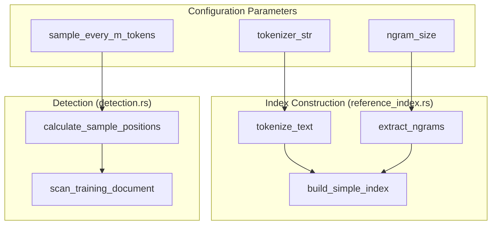
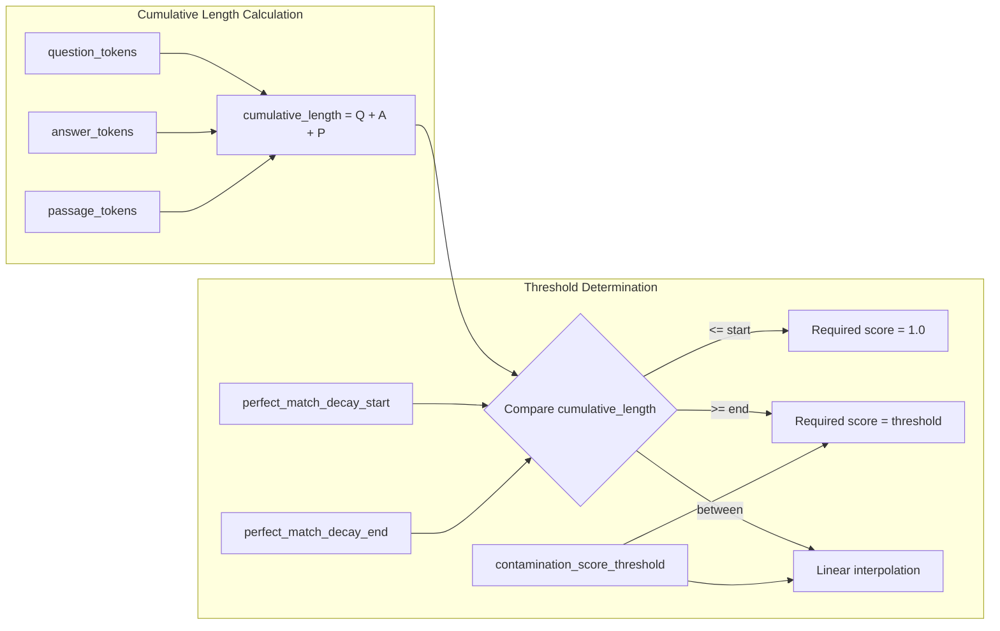
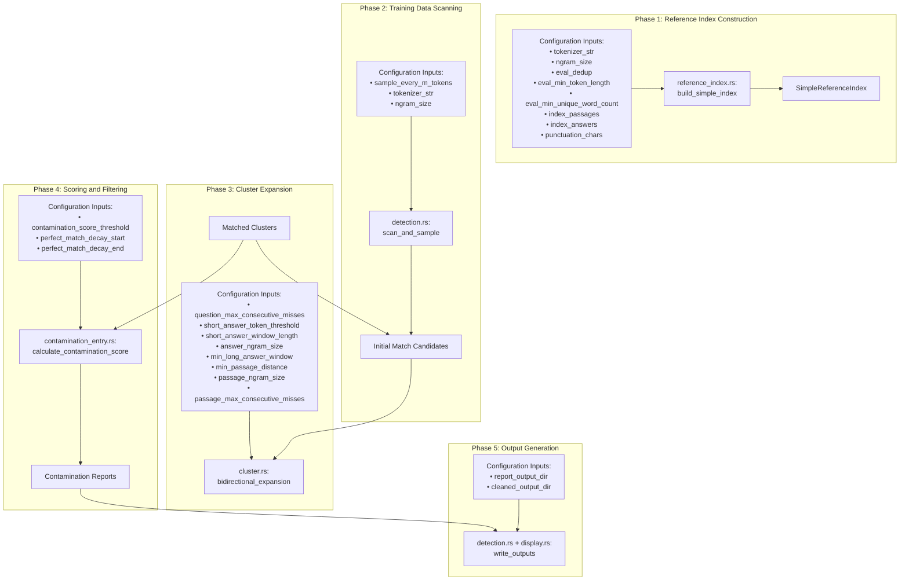
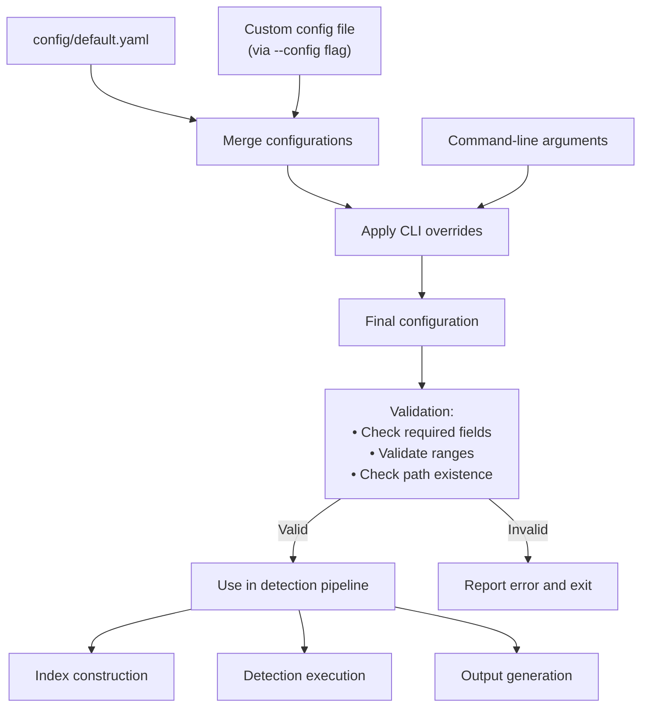

<!-- source: DeepWiki mcp.deepwiki.com · repo allenai/decon · page 3.3 Configuration Guide · fetched 2026-10-26 -->

# Configuration Guide

<details>
<summary>Relevant source files</summary>

The following files were used as context for generating this wiki page:

- [README.md](README.md)
- [doc/repro/olmo-synth.yaml](doc/repro/olmo-synth.yaml)
- [doc/repro/olmo-web.yaml](doc/repro/olmo-web.yaml)

</details>


This page documents all configuration parameters available in decon, their effects on detection behavior, and guidance for tuning them to different use cases. Configuration parameters control every aspect of the detection pipeline, from index construction through scoring and output generation.

For information about running decon commands that use these configurations, see [CLI Commands Reference](#3.1). For details on the algorithm that these parameters control, see [The SIMPLE Algorithm](#4).

**Sources:** [README.md:84](), [doc/repro/olmo-web.yaml:1-50](), [doc/repro/olmo-synth.yaml:1-49]()

## Configuration File Structure

Decon uses YAML configuration files to control all aspects of its behavior. Configuration parameters can be specified in three ways:

1. **Default configuration**: `config/default.yaml` contains sensible defaults for all parameters
2. **Custom configuration files**: Users can create custom YAML files and pass them via `--config` flag
3. **Command-line overrides**: Individual parameters can be overridden via CLI arguments

When multiple configuration sources are provided, they are merged with the following precedence (highest to lowest):
- Command-line arguments
- Custom configuration file (via `--config`)
- Default configuration file

**Sources:** [README.md:84](), [doc/repro/olmo-web.yaml:1-50]()

## Configuration Parameters by Category

### Input/Output Configuration

These parameters specify paths for input data and output locations.

| Parameter | Type | Description | Example |
|-----------|------|-------------|---------|
| `content_key` | String | JSON key containing document text in training files | `"text"` |
| `training_dir` | Path | Directory containing training JSONL files | `"~/sample-data"` |
| `evals_dir` | Path | Directory containing evaluation reference files | `"bundled-evals"` |
| `report_output_dir` | Path | Directory for contamination reports | `"/tmp/decon-output"` |
| `cleaned_output_dir` | Path (optional) | Directory for purified training files | `"/tmp/decon-cleaned"` |

**Notes:**
- `content_key` defaults to `"text"` but can be changed if your training data uses a different field name
- `cleaned_output_dir` is only needed when using the `--purify` option
- All paths support `~` expansion for home directory

**Sources:** [doc/repro/olmo-web.yaml:10-14](), [doc/repro/olmo-synth.yaml:9-13]()

### Tokenization and Indexing Configuration

These parameters control how text is tokenized and how the reference index is constructed.

| Parameter | Type | Default | Description |
|-----------|------|---------|-------------|
| `tokenizer_str` | String | `"cl100k"` | Tokenizer to use for n-gram extraction |
| `ngram_size` | Integer | `5` | Size of n-grams indexed for question matching |
| `sample_every_m_tokens` | Integer | `10` | Sampling interval for training data (tokens) |

**Tokenizer Options:**
- `cl100k`: OpenAI's tiktoken tokenizer (GPT-4 compatible)
- Other tokenizers may be supported depending on implementation

**N-gram Size Considerations:**
- Larger values (e.g., 7-10) increase precision but reduce recall
- Smaller values (e.g., 3-4) increase recall but may increase false positives
- Default of 5 provides good balance for most use cases

**Sampling Strategy:**
- `sample_every_m_tokens=10` means every 10th token position is sampled
- Smaller values increase detection thoroughness but slow processing
- Larger values improve speed but may miss contamination

**Sources:** [doc/repro/olmo-web.yaml:16-19](), [doc/repro/olmo-synth.yaml:16-18]()



**Diagram: Tokenization and Indexing Parameter Flow**

**Sources:** [doc/repro/olmo-web.yaml:16-19](), [doc/repro/olmo-synth.yaml:16-18]()

### Question Matching Configuration

Controls how questions are matched during the cluster expansion phase.

| Parameter | Type | Default | Description |
|-----------|------|---------|-------------|
| `question_max_consecutive_misses` | Integer | `11` | Maximum consecutive token misses before stopping question expansion |

**Behavior:**
- During bidirectional cluster expansion, decon extends matches token-by-token
- When consecutive misses reach this threshold, expansion stops in that direction
- Higher values tolerate more noise but may extend into unrelated text
- Lower values require tighter matches but may truncate valid matches

**Note:** A single mismatched token can "poison" n-gram spans, so this parameter accounts for natural variation in question phrasing.

**Sources:** [doc/repro/olmo-web.yaml:22](), [doc/repro/olmo-synth.yaml:21]()

### Answer Matching Configuration

Controls how answers are located and matched within training documents.

| Parameter | Type | Default | Description |
|-----------|------|---------|-------------|
| `short_answer_token_threshold` | Integer | `1` | Answers with ≤ this many tokens use exact matching |
| `short_answer_window_length` | Integer | `20-50` | Window size after question to search for short answers |
| `answer_ngram_size` | Integer | `2` | N-gram size for long answer IDF overlap |
| `min_long_answer_window` | Integer | `20-50` | Minimum window for long answers (uses max of this or 2× answer length) |

**Short vs. Long Answer Strategy:**
- **Short answers** (≤ `short_answer_token_threshold`): Require exact match within window
- **Long answers** (> `short_answer_token_threshold`): Use IDF-weighted n-gram overlap

**Window Sizing:**
- Smaller windows reduce false positives but may miss valid matches
- Larger windows increase recall but may match spurious text
- Historical OLMo configurations used different values for web (20) vs. synthetic (50) data

**Sources:** [doc/repro/olmo-web.yaml:29-34](), [doc/repro/olmo-synth.yaml:29-34]()

### Passage Matching Configuration

Controls how passages (context documents in QA pairs) are matched.

| Parameter | Type | Default | Description |
|-----------|------|---------|-------------|
| `min_passage_distance` | Integer | `100` | Minimum token distance between question and passage for valid match |
| `passage_ngram_size` | Integer | `4` | N-gram size for passage matching |
| `passage_max_consecutive_misses` | Integer | `2` | Maximum consecutive misses before stopping passage expansion |

**Passage Detection Logic:**
- Passages must appear at least `min_passage_distance` tokens away from the question
- This prevents matching the question itself as a passage
- Lower `passage_max_consecutive_misses` (2 vs. 11 for questions) reflects that passages should be verbatim copies

**Sources:** [doc/repro/olmo-web.yaml:36-39](), [doc/repro/olmo-synth.yaml:36-39]()

### Scoring Configuration

Controls the contamination scoring system and thresholds.

| Parameter | Type | Default | Description |
|-----------|------|---------|-------------|
| `contamination_score_threshold` | Float | `0.78-0.88` | Main threshold for contamination classification |
| `perfect_match_decay_start` | Integer | `5-25` | Require perfect match (score=1.0) for cumulative length ≤ this |
| `perfect_match_decay_end` | Integer | `26-50` | Use `contamination_score_threshold` for cumulative length ≥ this |

**Scoring Behavior:**
- **Cumulative length** = question tokens + answer tokens + passage tokens
- For entries with cumulative length ≤ `perfect_match_decay_start`: Require score = 1.0
- For entries with cumulative length ≥ `perfect_match_decay_end`: Use `contamination_score_threshold`
- Between these values: Linear interpolation

**Threshold Tuning:**
- Higher thresholds (0.88) → Higher precision, lower recall (fewer false positives)
- Lower thresholds (0.78) → Higher recall, lower precision (more aggressive detection)
- Perfect match requirements prevent false positives on very short entries

**Sources:** [doc/repro/olmo-web.yaml:24-27](), [doc/repro/olmo-synth.yaml:24-27]()



**Diagram: Contamination Score Threshold Calculation**

**Sources:** [doc/repro/olmo-web.yaml:24-27](), [doc/repro/olmo-synth.yaml:24-27]()

### Reference Preprocessing Configuration

Controls how evaluation reference data is filtered and preprocessed before indexing.

| Parameter | Type | Default | Description |
|-----------|------|---------|-------------|
| `eval_dedup` | Boolean | `true` | Enable exact deduplication of reference entries |
| `eval_min_token_length` | Integer | `20` | Minimum token count for reference entries (0 = disabled) |
| `eval_min_unique_word_count` | Integer | `4` | Minimum unique word count for reference entries (0 = disabled) |
| `index_passages` | Boolean | `true/false` | Whether to index passage components |
| `index_answers` | Boolean | `true` | Whether to index answer components |

**Preprocessing Effects:**
- **`eval_dedup=true`**: Removes duplicate Q/A/P entries from reference set
- **`eval_min_token_length`**: Filters out very short entries that may cause false positives
- **`eval_min_unique_word_count`**: Filters entries with low lexical diversity (pure whitespace tokens not counted)
- **`index_passages=false`**: Disables passage matching (used in OLMo web configuration)
- **`index_answers=false`**: Disables answer matching (rarely used)

**Use Cases:**
- Disable passage indexing when passages are long contextual documents unlikely to appear in training data
- Enable passage indexing when passages are short, factual snippets that may be copied

**Sources:** [doc/repro/olmo-web.yaml:42-46](), [doc/repro/olmo-synth.yaml:42-46]()

### Text Processing Configuration

Controls character-level text normalization.

| Parameter | Type | Description |
|-----------|------|-------------|
| `punctuation_chars` | String | Characters treated as punctuation and normalized during matching |

**Default Value:**
```
"!'\"#$%&'()*+,-./:;<=>?@[\\]^_`{|}~""''—"
```

**Behavior:**
- Applied to both evaluation data and training data during processing
- Normalizes various Unicode punctuation forms (e.g., smart quotes `""` → `""`)
- Ensures consistent matching regardless of character encoding variations

**Sources:** [doc/repro/olmo-web.yaml:48-49](), [doc/repro/olmo-synth.yaml:48-49]()

## Configuration Parameter Map to Algorithm Phases

The following diagram shows how configuration parameters map to different phases of the SIMPLE algorithm.



**Diagram: Configuration Parameters Mapped to SIMPLE Algorithm Phases**

**Sources:** [doc/repro/olmo-web.yaml:1-50](), [doc/repro/olmo-synth.yaml:1-49]()

## Tuning Guidelines

### Quick Sensitivity Adjustment

For most users, adjusting a single parameter is sufficient:

**`contamination_score_threshold`** (Default: ~0.8-0.9)
- **Increase** (e.g., 0.90-0.95) for higher precision, fewer false positives
- **Decrease** (e.g., 0.70-0.80) for higher recall, more aggressive detection
- Experiment with your specific dataset and eval set to find optimal value

### Performance vs. Thoroughness Trade-offs

| Goal | Parameters to Adjust |
|------|---------------------|
| **Faster processing** | Increase `sample_every_m_tokens` (e.g., 15-20)<br/>Increase `ngram_size` (e.g., 6-7) |
| **More thorough detection** | Decrease `sample_every_m_tokens` (e.g., 5-8)<br/>Decrease `ngram_size` (e.g., 4) |
| **Reduce false positives** | Increase `contamination_score_threshold`<br/>Increase `perfect_match_decay_start`<br/>Increase `eval_min_token_length` |
| **Increase recall** | Decrease `contamination_score_threshold`<br/>Increase `question_max_consecutive_misses`<br/>Decrease `eval_min_token_length` |

### Dataset-Specific Tuning

**Web Data (high noise):**
- Higher `contamination_score_threshold` (0.85-0.90)
- Higher `perfect_match_decay_start` (20-30)
- Consider disabling passage indexing if passages are long
- Example: [doc/repro/olmo-web.yaml]()

**Curated/Synthetic Data (low noise):**
- Lower `contamination_score_threshold` (0.75-0.85)
- Lower `perfect_match_decay_start` (5-15)
- Enable passage indexing
- Example: [doc/repro/olmo-synth.yaml]()

**Sources:** [doc/repro/olmo-web.yaml:1-50](), [doc/repro/olmo-synth.yaml:1-49](), [README.md:84]()

## Historical Configurations

Decon includes reproduction configurations used in published decontamination work. These serve as reference points and starting templates.

### OLMo Web Decontamination

**File:** [doc/repro/olmo-web.yaml]()

**Key Characteristics:**
- High threshold (0.88) for web data with significant noise
- Longer perfect match requirement (25 tokens) to avoid false positives
- Passage indexing disabled (passages unlikely to appear verbatim)
- Shorter answer windows (20 tokens) for tighter matching

**Expected Reproducibility:**
- ~90% overlap with original OLMo web decontamination
- Differences primarily from short knowledge/fact evaluations
- Improved reference set processing may find ~25% additional contamination

### OLMo Synthetic Data Decontamination

**File:** [doc/repro/olmo-synth.yaml]()

**Key Characteristics:**
- Lower threshold (0.78) suitable for cleaner synthetic data
- Shorter perfect match requirement (5 tokens)
- Passage indexing enabled
- Longer answer windows (50 tokens) for more flexible matching

**Expected Reproducibility:**
- ~90% overlap with original OLMo synthetic decontamination
- Differences primarily from consolidated length threshold configuration

**Sources:** [doc/repro/olmo-web.yaml:1-8](), [doc/repro/olmo-synth.yaml:1-7]()

## Configuration Loading Flow



**Diagram: Configuration Loading and Merging Process**

**Sources:** [README.md:84](), [doc/repro/olmo-web.yaml:1-50]()

## Common Configuration Patterns

### Minimal Configuration

For quick testing with defaults:
```yaml
training_dir: ~/my-data
evals_dir: bundled-evals
```

### High-Precision Configuration

For minimizing false positives:
```yaml
contamination_score_threshold: 0.92
perfect_match_decay_start: 30
perfect_match_decay_end: 60
eval_min_token_length: 25
```

### High-Recall Configuration

For maximizing contamination detection:
```yaml
contamination_score_threshold: 0.75
question_max_consecutive_misses: 15
sample_every_m_tokens: 5
eval_min_token_length: 10
```

### Question-Only Detection

For focusing solely on question matching:
```yaml
index_passages: false
index_answers: false
contamination_score_threshold: 0.85
```

**Sources:** [doc/repro/olmo-web.yaml:1-50](), [doc/repro/olmo-synth.yaml:1-49]()

## Configuration Parameter Summary Table

| Category | Parameter | Type | Default Range | Key Effect |
|----------|-----------|------|---------------|------------|
| **I/O** | `content_key` | String | `"text"` | Training data field name |
| **I/O** | `training_dir` | Path | - | Input training data location |
| **I/O** | `evals_dir` | Path | `"bundled-evals"` | Evaluation reference location |
| **I/O** | `report_output_dir` | Path | - | Contamination reports location |
| **I/O** | `cleaned_output_dir` | Path | - | Purified data location |
| **Tokenization** | `tokenizer_str` | String | `"cl100k"` | Tokenization method |
| **Indexing** | `ngram_size` | Integer | `5` | Index granularity |
| **Detection** | `sample_every_m_tokens` | Integer | `10` | Sampling density |
| **Question** | `question_max_consecutive_misses` | Integer | `11` | Question match tolerance |
| **Answer** | `short_answer_token_threshold` | Integer | `1` | Short/long answer boundary |
| **Answer** | `short_answer_window_length` | Integer | `20-50` | Short answer search window |
| **Answer** | `answer_ngram_size` | Integer | `2` | Long answer n-gram size |
| **Answer** | `min_long_answer_window` | Integer | `20-50` | Long answer search window |
| **Passage** | `min_passage_distance` | Integer | `100` | Question-passage separation |
| **Passage** | `passage_ngram_size` | Integer | `4` | Passage n-gram size |
| **Passage** | `passage_max_consecutive_misses` | Integer | `2` | Passage match tolerance |
| **Scoring** | `contamination_score_threshold` | Float | `0.78-0.88` | Main classification threshold |
| **Scoring** | `perfect_match_decay_start` | Integer | `5-25` | Short entry perfect match requirement |
| **Scoring** | `perfect_match_decay_end` | Integer | `26-50` | Long entry threshold transition |
| **Preprocessing** | `eval_dedup` | Boolean | `true` | Reference deduplication |
| **Preprocessing** | `eval_min_token_length` | Integer | `20` | Minimum reference length |
| **Preprocessing** | `eval_min_unique_word_count` | Integer | `4` | Minimum lexical diversity |
| **Preprocessing** | `index_passages` | Boolean | `true/false` | Enable passage matching |
| **Preprocessing** | `index_answers` | Boolean | `true` | Enable answer matching |
| **Text** | `punctuation_chars` | String | Extended set | Character normalization |

**Sources:** [doc/repro/olmo-web.yaml:1-50](), [doc/repro/olmo-synth.yaml:1-49]()

---

