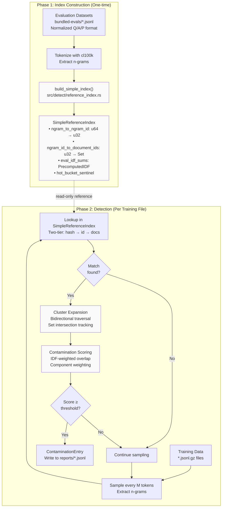
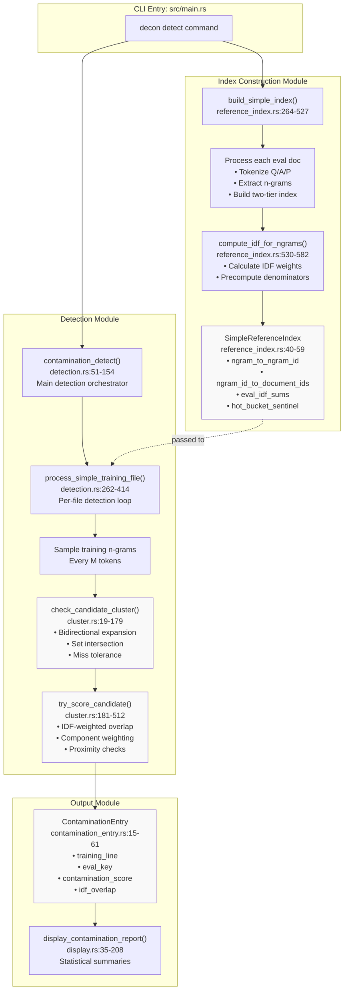

<!-- source: DeepWiki mcp.deepwiki.com · repo allenai/decon · page 4 The SIMPLE Algorithm · fetched 2026-10-26 -->

# The SIMPLE Algorithm

Relevant source files

The following files were used as context for generating this wiki page:

- [doc/simple-details.md](doc/simple-details.md)
- [doc/simple.md](doc/simple.md)

## Purpose and Scope

This page introduces the **SIMPLE** (Sampled Index Match with Progressive Length Extension) algorithm, which is the core contamination detection method used by decon. SIMPLE enables efficient detection of evaluation dataset leakage into training data by using sampled n-gram matching, bidirectional cluster expansion, and IDF-weighted overlap scoring.

This page provides a high-level overview of the algorithm's design, the problem it solves, and its two-phase architecture. For detailed implementation specifics, see:
- [Algorithm Overview](#4.1) - detailed explanation of the two-phase approach
- [Reference Index Construction](#4.2) - how evaluation data becomes searchable indices
- [Detection and Cluster Expansion](#4.3) - cluster discovery and expansion mechanics
- [Contamination Scoring System](#4.4) - IDF weighting, component scoring, and thresholds

For configuration of algorithm parameters, see [Configuration Guide](#3.3). For implementation details, see [Implementation Architecture](#6).

## What is SIMPLE?

**SIMPLE** stands for **S**ampled **I**ndex **M**atch with **P**rogressive **L**ength **E**xtension. It is a specialized algorithm designed to detect when training data contains segments derived from evaluation datasets, distinguishing true contamination from coincidental overlap or shared source material.

The algorithm operates on tokenized text sequences and treats contamination detection as an approximate substring search problem: for each training sequence $t \in T$ and evaluation sequence $e \in E$, determine if $t$ contains a sufficient presence of $e$ to constitute contamination.

Sources: [doc/simple.md:1-10](), [doc/simple-details.md:1-16]()

## The Contamination Detection Problem

Training datasets $T$ and evaluation datasets $E$ both consist of variable-length token sequences. The contamination detection problem can be characterized as:

- **Input**: Large training corpus $T$ where $|T| >> |E|$
- **Goal**: Partition $T \times E$ into contaminated set $C$ and pure set $P$
- **Challenge**: Contamination is sparse ($|C| << |P|$), requiring efficient scanning
- **Complexity**: Must distinguish between:
  - Direct derivation (contamination)
  - Coincidental overlap (common phrases)
  - Shared source material (both derived from same source)

SIMPLE addresses these challenges through three key techniques:

1. **Sampling**: Process training data at intervals, only expanding to exhaustive analysis when matches are found
2. **Set Intersection**: Track multiple candidate evaluation documents simultaneously, eliminating mismatches quickly
3. **IDF Weighting**: Distinguish informative overlap from common phrases using inverse document frequency

Sources: [doc/simple-details.md:7-16]()

## Two-Phase Architecture

SIMPLE operates in two distinct phases that separate index construction from detection:

**Phase 1: Index Construction** occurs once and produces a `SimpleReferenceIndex` structure that maps n-grams to evaluation document IDs with precomputed IDF weights. This index is read-only and can be shared across multiple detection workers.

**Phase 2: Detection** processes training data files in parallel, sampling for initial matches and expanding to exhaustive analysis only when hits are found. Each contaminated match produces a `ContaminationEntry` record.

Sources: [doc/simple.md:5-10](), [doc/simple-details.md:82-148]()

## Key Algorithm Components

### N-gram Matching with Two-Tier Index

SIMPLE uses n-gram shingles (default size: 5 tokens) as the fundamental matching unit. The two-tier index structure optimizes for the fact that most training n-grams will not appear in evaluation data:

| Tier | Type | Purpose |
|------|------|---------|
| Tier 1 | `HashMap<u64, u32>` | Fast membership test: does this n-gram hash exist in eval data? |
| Tier 2 | `HashMap<u32, HashSet<DocId>>` | Document lookup: which eval docs contain this n-gram? |

The two-tier design makes miss detection extremely fast (single hash lookup) while keeping document sets compact for hits.

Sources: [doc/simple-details.md:136-140]()

### Cluster Expansion with Set Intersection

When an initial match is found, SIMPLE expands bidirectionally from the hit position. The algorithm maintains an **active set** of evaluation document IDs that might match the current training segment:

1. **Initial hit**: Active set = all documents containing the matched n-gram
2. **Each step**: Intersect active set with documents containing the current n-gram
3. **Miss tolerance**: Remove documents that accumulate too many consecutive misses
4. **Termination**: Continue until active set is empty or training boundaries reached

This approach efficiently tracks multiple candidate matches simultaneously without string comparison.

Sources: [doc/simple-details.md:92-99](), [doc/simple.md:26-32]()

### Hot N-gram Optimization

Some n-grams are extremely common (e.g., "the", "of", "and" in 5-token windows). These "hot" n-grams produce many initial hits but rarely lead to true contamination. SIMPLE optimizes this by:

- Assigning hot n-grams to a special `hot_bucket_sentinel` ID
- When a hot n-gram is hit, switching to exhaustive token-by-token traversal
- Only initiating full cluster expansion on non-hot hits

This prevents wasted work on false alarms from common phrases.

Sources: [doc/simple-details.md:142-146]()

### IDF-Weighted Overlap Scoring

Contamination scores are based on inverse document frequency (IDF) weighted overlap:

$$O = \frac{\sum_{x \in U_t \cap U_e} \text{idf}(x)}{\sum_{y \in U_e} \text{idf}(y)}$$

where $U_t$ is the set of unique n-grams matched in the training segment and $U_e$ is the set of unique n-grams in the evaluation document. This gives more weight to distinctive n-grams and less to common phrases.

Sources: [doc/simple-details.md:101-109]()

## Evaluation Component Structure

SIMPLE normalizes all evaluation instances into three components: **Question (Q)**, **Answer (A)**, and **Passage (P)**. Different evaluation datasets have different compositions:

| Composition | Components Present | Example Dataset | Weight Distribution |
|-------------|-------------------|-----------------|---------------------|
| Q | Question only | Some multiple-choice tests | 100% question |
| QA | Question + Answer | Math reasoning, factoid QA | 75% question, 25% answer |
| QP | Question + Passage | Some reading comprehension | 85% question, 15% passage |
| QAP | All three | Extractive QA with context | 70% question, 20% answer, 10% passage |

The **question** component serves as the primary contamination signal and is used for initial cluster discovery. The **answer** provides supporting evidence, particularly for low-information questions. The **passage** (often derived from source material) is the weakest contamination indicator but provides additional confirmation.

Component weights are adaptive based on confidence factors derived from length, allowing the algorithm to handle cases where a short question is paired with a long answer or passage.

Sources: [doc/simple-details.md:63-80](), [doc/simple-details.md:149-188]()

## Algorithm Flow in Code

The following diagram maps the algorithm phases to their implementation in the codebase:

The implementation flow:

1. **CLI invocation** ([src/main.rs]()) triggers detection
2. **Index construction** ([src/detect/reference_index.rs:264-527]()) builds `SimpleReferenceIndex`
3. **Detection orchestration** ([src/detect/detection.rs:51-154]()) coordinates parallel file processing
4. **Per-file processing** ([src/detect/detection.rs:262-414]()) samples training data and initiates expansion
5. **Cluster expansion** ([src/detect/cluster.rs:19-179]()) performs bidirectional traversal with set intersection
6. **Contamination scoring** ([src/detect/cluster.rs:181-512]()) computes IDF-weighted scores
7. **Output generation** ([src/detect/contamination_entry.rs:15-61]()) produces structured contamination records

Sources: [src/detect/reference_index.rs](), [src/detect/detection.rs](), [src/detect/cluster.rs](), [src/detect/contamination_entry.rs]()

## Length-Based Adaptations

SIMPLE adapts its behavior based on text length to minimize false positives:

**Length Decay for Short Texts**: Shorter texts get their overlap scores penalized before threshold comparison. Texts below `perfect_match_decay_start` (default: 20 tokens) require near-perfect matches. Scores interpolate linearly to normal threshold at `perfect_match_decay_end` (default: 50 tokens).

**Confidence-Adjusted Weights**: Component weights adjust based on the unique n-gram count in each component. Short questions (< 20 unique n-grams) have reduced confidence, redistributing weight to answers or passages.

These adaptations ensure that common short phrases don't trigger false contamination flags while still detecting true leakage.

Sources: [doc/simple-details.md:110-118](), [doc/simple-details.md:170-187]()

## Algorithm Parameters

The SIMPLE algorithm is highly configurable via `config/default.yaml`. Key parameters include:

| Parameter | Default | Phase | Purpose |
|-----------|---------|-------|---------|
| `ngram_size` | 5 | Index | N-gram shingle size |
| `sample_every_m_tokens` | 10 | Detection | Sampling interval for training data |
| `question_max_consecutive_misses` | 11 | Detection | Miss tolerance for question cluster expansion |
| `passage_max_consecutive_misses` | 2 | Detection | Miss tolerance for passage matching |
| `contamination_score_threshold` | 0.8 | Scoring | Minimum score to call contamination |
| `perfect_match_decay_start` | 20 | Scoring | Short text penalty start threshold |
| `perfect_match_decay_end` | 50 | Scoring | Short text penalty end threshold |
| `min_passage_distance` | 100 | Scoring | Maximum tokens between question and passage |

For detailed parameter descriptions and tuning guidance, see [Configuration Guide](#3.3).

Sources: [doc/simple-details.md]()

## Design Rationale

SIMPLE's design prioritizes:

- **Efficiency**: Sampling reduces computational cost; exhaustive analysis only when needed
- **Precision**: IDF weighting distinguishes informative matches from common phrases
- **Recall**: Bidirectional expansion with miss tolerance handles edits, insertions, deletions
- **Scalability**: Read-only index enables parallel processing across multiple workers
- **Transparency**: Structured scoring with interpretable components and thresholds

The algorithm avoids direct string comparison, relying instead on n-gram shingle overlap probabilities. While degenerate cases are theoretically possible, they have not been observed in practice due to the low probability of substantial n-gram overlap by chance.

Sources: [doc/simple-details.md:128-134](), [doc/simple.md:1-58]()

---

