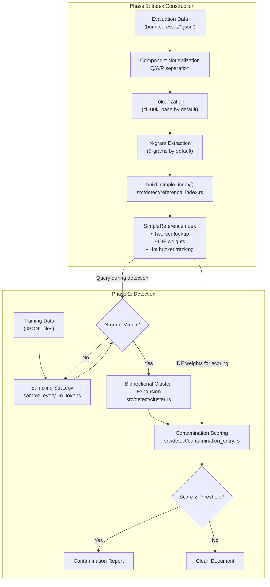
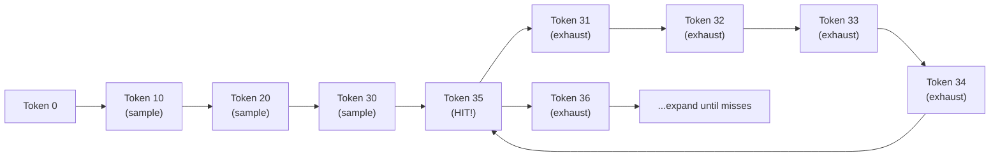
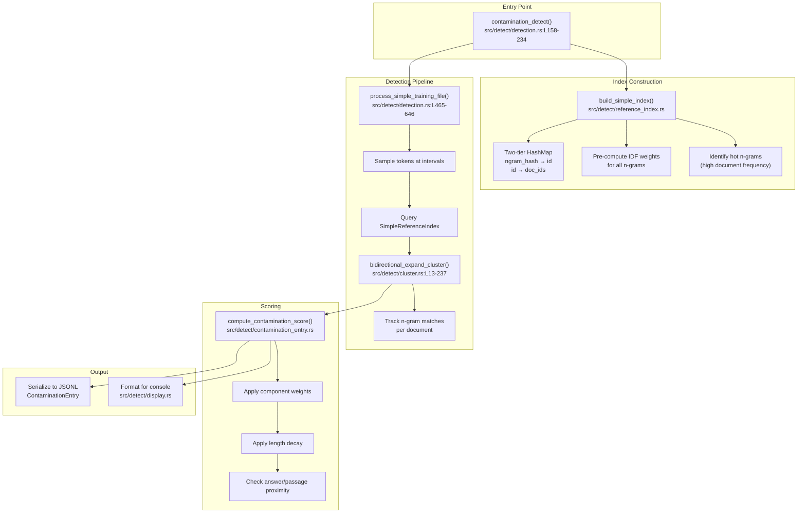

<!-- source: DeepWiki mcp.deepwiki.com · repo allenai/decon · page 4.1 Algorithm Overview · fetched 2026-10-26 -->

# Algorithm Overview

<details>
<summary>Relevant source files</summary>

The following files were used as context for generating this wiki page:

- [doc/simple-details.md](doc/simple-details.md)
- [doc/simple.md](doc/simple.md)
- [doc/worked-example.png](doc/worked-example.png)

</details>


This page provides a high-level explanation of the **SIMPLE algorithm** (Sampled Index Match with Progressive Length Extension), which is the core contamination detection method used by decon. This overview introduces the two-phase architecture and key algorithmic concepts. For detailed technical information about each phase, see [Reference Index Construction](#4.2), [Detection and Cluster Expansion](#4.3), and [Contamination Scoring System](#4.4).

## What is SIMPLE?

SIMPLE detects contamination between training datasets and evaluation datasets by treating the problem as an approximate substring search. Given a large set of training documents **T** and a smaller set of evaluation documents **E**, the algorithm identifies which training documents contain substantial overlap with evaluation data, indicating potential data leakage.

The algorithm name describes its core strategy:
- **Sampled** - Training data is sampled at intervals for efficiency
- **Index Match** - Initial matches found using pre-built n-gram indices
- **Progressive Length Extension** - Matches expand bidirectionally to find contamination clusters

Sources: [doc/simple.md:1-11](), [doc/simple-details.md:1-16]()

## Two-Phase Architecture

SIMPLE operates in two distinct phases that separate preprocessing from detection:



**Phase 1** runs once to prepare evaluation data for efficient searching. **Phase 2** processes training data files in parallel, using the reference index to detect contamination.

Sources: [doc/simple.md:5-10](), [doc/simple-details.md:81-98]()

## Phase 1: Reference Index Construction

The first phase transforms evaluation datasets into an efficient searchable structure. Each evaluation instance is normalized into **question (Q)**, **answer (A)**, and **passage (P)** components. These components are tokenized and converted into n-grams, which are then indexed with pre-computed IDF (inverse document frequency) weights.

### Key Index Structures

| Structure | Purpose | Implementation |
|-----------|---------|----------------|
| Two-tier lookup | Maps n-gram hash → sequential ID → document IDs | Optimized for sparse matches |
| Component indices | Separate indices for Q, A, P | Enables component-specific scoring |
| IDF weights | Pre-computed frequency weights | Cached for efficient scoring |
| Hot bucket tracking | Identifies very common n-grams | Prevents false positive clusters |

The index is implemented in `SimpleReferenceIndex` and built by the `build_simple_index()` function.

For detailed information about index construction, see [Reference Index Construction](#4.2).

Sources: [doc/simple.md:12-20](), [doc/simple-details.md:136-148]()

## Phase 2: Detection with Cluster Expansion

The detection phase processes training documents to find contamination clusters - regions that substantially overlap with evaluation data.

### Detection Workflow

```mermaid
graph LR
    Start["Training Document Start"] --> SampleLoop["Sample every M tokens"]
    SampleLoop --> Extract["Extract n-gram"]
    Extract --> Lookup["Lookup in reference_index"]
    Lookup --> Hit{Match found?}
    Hit -->|No| SampleLoop
    Hit -->|Yes| InitCluster["Initialize active set<br/>with matching doc IDs"]
    InitCluster --> Expand["bidirectional_expand_cluster()<br/>src/detect/cluster.rs"]
    Expand --> BuildLeft["Expand left from hit<br/>Track misses per doc"]
    BuildLeft --> BuildRight["Expand right from hit<br/>Track misses per doc"]
    BuildRight --> Accumulate["Accumulate n-gram matches<br/>per eval document"]
    Accumulate --> ScoreAll["Score each eval doc<br/>compute_contamination_score()"]
    ScoreAll --> MaxScore["Select maximum score"]
    MaxScore --> Compare{Score ≥ Threshold?}
    Compare -->|Yes| Report["Report Contamination"]
    Compare -->|No| Next["Continue sampling"]
    Next --> SampleLoop
    Report --> SampleLoop
```



### Cluster Expansion Algorithm

When an initial n-gram match is found:

1. **Initialize active set** - All evaluation documents containing the matched n-gram become candidates
2. **Bidirectional traversal** - Expand both left and right from the hit position
3. **Set intersection** - At each position, compute intersection of current n-gram's document set with active set
4. **Miss tolerance** - Documents that miss `question_max_consecutive_misses` consecutive positions are removed
5. **Accumulation** - Track unique n-gram matches per document throughout expansion

This approach efficiently handles insertions, deletions, and edits while avoiding exhaustive string comparison.

For detailed information about the detection process, see [Detection and Cluster Expansion](#4.3).

Sources: [doc/simple.md:21-33](), [doc/simple-details.md:88-100]()

## Contamination Scoring System

Once a cluster is identified, the algorithm computes a contamination score based on IDF-weighted overlap between training and evaluation components.

### Scoring Formula

The base score uses IDF-weighted overlap for each component:

```
O = Σ(idf(x) for x in matched_ngrams) / Σ(idf(y) for y in all_eval_ngrams)
```

### Component Composition

Evaluation instances have different compositions, which affects scoring weights:

| Composition | Components Present | Default Weights |
|-------------|-------------------|-----------------|
| Q | Question only | 100% question |
| QA | Question + Answer | 75% question, 25% answer |
| QP | Question + Passage | 85% question, 15% passage |
| QAP | All three | 70% question, 20% answer, 10% passage |

These weights are **confidence-adjusted** based on component length - shorter questions redistribute weight to answers or passages.

### Additional Scoring Factors

- **Length decay** - Short matches (< `perfect_match_decay_start` tokens) require near-perfect overlap
- **Answer proximity** - Answers must appear within configurable distance of question cluster
- **Passage proximity** - Passages checked within `min_passage_distance` tokens

For detailed information about scoring, see [Contamination Scoring System](#4.4).

Sources: [doc/simple.md:34-58](), [doc/simple-details.md:101-218]()

## Key Design Principles

The SIMPLE algorithm embodies several design principles that make it effective for large-scale contamination detection:

### 1. Sampling Over Exhaustive Search

By default, training data is sampled every `sample_every_m_tokens` (default: 10) positions. This provides **10x speedup** while maintaining high recall, since contaminated regions typically have multiple matching n-grams.



Once a match is found, the algorithm switches to **exhaustive mode** for cluster expansion.

### 2. Set-Based Matching vs String Comparison

Rather than comparing strings directly, SIMPLE uses **set intersection** of document IDs at each position. This avoids expensive string operations and naturally handles multiple simultaneous candidate matches.

### 3. Non-Comparative Scoring

IDF weights are pre-computed during index construction. Detection only needs to **sum IDF values** for matched n-grams - no runtime computation of document frequencies or string similarity metrics.

### 4. Component-Aware Architecture

By separately indexing and scoring questions, answers, and passages, the algorithm can:
- Weight components appropriately for different evaluation types
- Check proximity constraints (answer near question, passage within range)
- Handle diverse evaluation formats with a unified approach

Sources: [doc/simple-details.md:128-135](), [doc/simple.md:21-24]()

## Algorithm Parameters and Configuration

The SIMPLE algorithm is highly configurable through parameters in `config/default.yaml`. Key parameters control each phase:

### Index Construction Parameters

| Parameter | Default | Purpose |
|-----------|---------|---------|
| `ngram_size` | 5 | Size of n-grams for matching |
| `tokenizer_str` | `"cl100k"` | Tokenizer to use (typically cl100k_base) |
| `index_passages` | `true` | Whether to index passage components |
| `index_answers` | `true` | Whether to index answer components |

### Detection Parameters

| Parameter | Default | Purpose |
|-----------|---------|---------|
| `sample_every_m_tokens` | 10 | Sampling interval for training data |
| `question_max_consecutive_misses` | 11 | Misses before removing doc from active set |
| `passage_max_consecutive_misses` | 2 | Miss tolerance for passage matching |

### Scoring Parameters

| Parameter | Default | Purpose |
|-----------|---------|---------|
| `contamination_score_threshold` | 0.8 | Minimum score to call contamination |
| `perfect_match_decay_start` | 20 | Token length where decay begins |
| `perfect_match_decay_end` | 50 | Token length where decay completes |
| `min_passage_distance` | 100 | Maximum tokens between question and passage |

For comprehensive parameter documentation, see [Configuration Guide](#3.3).

Sources: [doc/simple-details.md:118-119](), [doc/simple-details.md:156-162]()

## Implementation Architecture

The SIMPLE algorithm is implemented across several Rust modules that correspond to the algorithmic phases:



### Core Data Structures

- **`SimpleReferenceIndex`** - In-memory n-gram index with IDF weights ([src/detect/reference_index.rs]())
- **`ContaminationEntry`** - Result structure with scores and metadata ([src/detect/contamination_entry.rs]())
- **`ClusterExpansionState`** - Tracks active document set during expansion ([src/detect/cluster.rs]())

For detailed implementation information, see [Detection Pipeline Implementation](#6.1) and [Parallel Processing Architecture](#6.2).

Sources: [src/detect/detection.rs](), [src/detect/cluster.rs](), [src/detect/contamination_entry.rs](), [src/detect/reference_index.rs]()

## Summary

The SIMPLE algorithm provides an efficient, scalable solution for contamination detection through:

1. **Two-phase design** - Pre-computed indices separate from detection
2. **Sampling with expansion** - Fast initial screening with exhaustive local search
3. **Set-based matching** - Efficient simultaneous candidate tracking
4. **IDF-weighted scoring** - Emphasis on rare, informative n-grams
5. **Component-aware architecture** - Flexible handling of diverse evaluation formats

This design enables processing billions of tokens of training data against hundreds of evaluation datasets in a tractable timeframe, with configurable trade-offs between precision and recall.

Sources: [doc/simple.md:1-58](), [doc/simple-details.md:1-220]()

---

