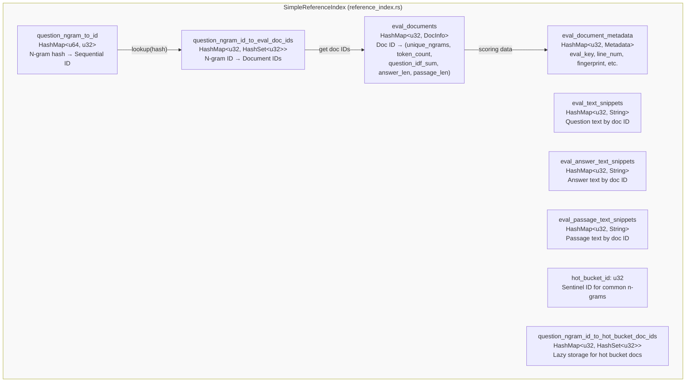
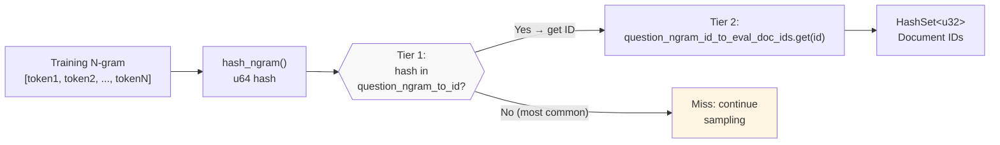
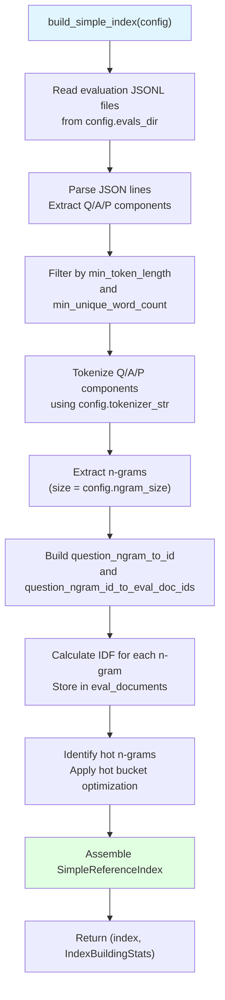
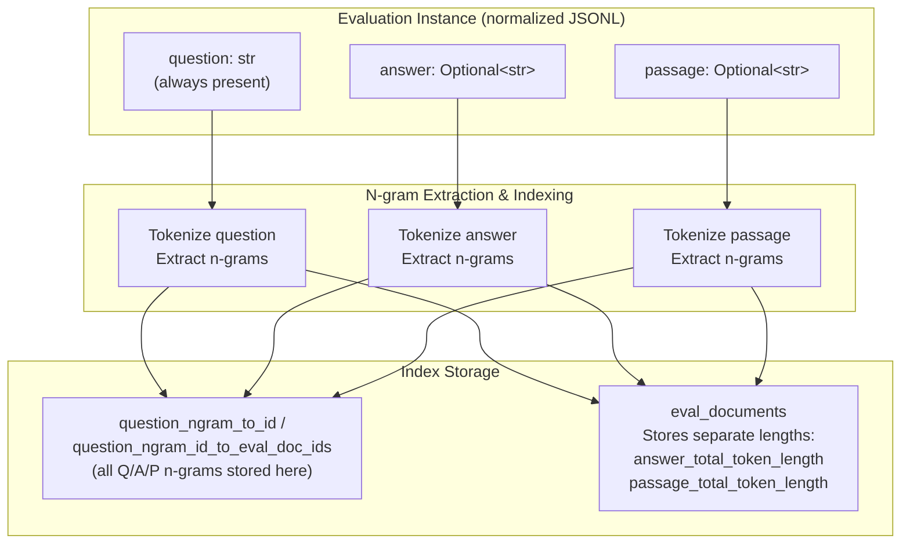
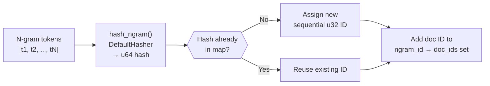
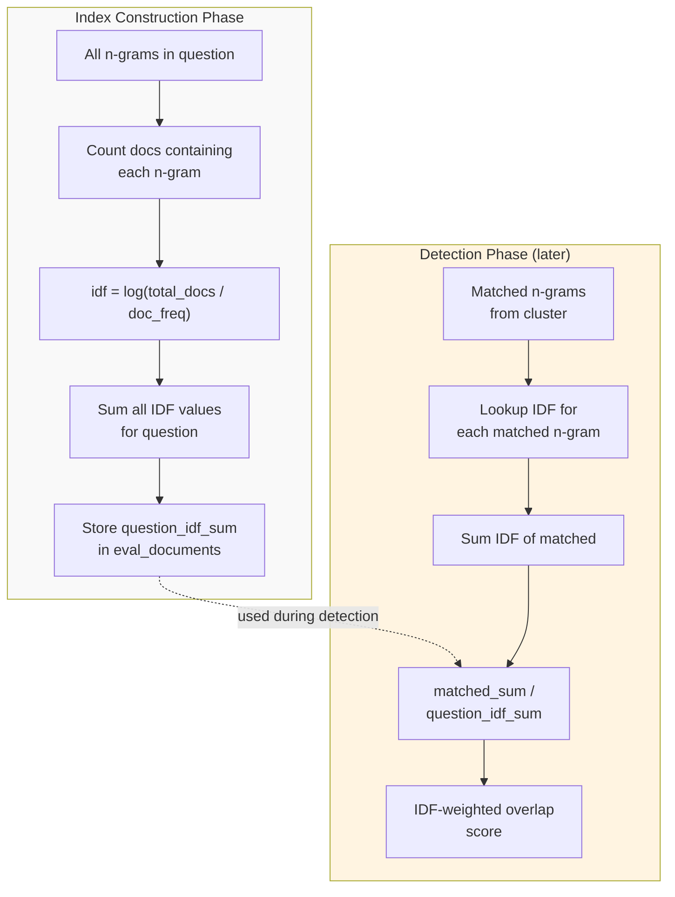
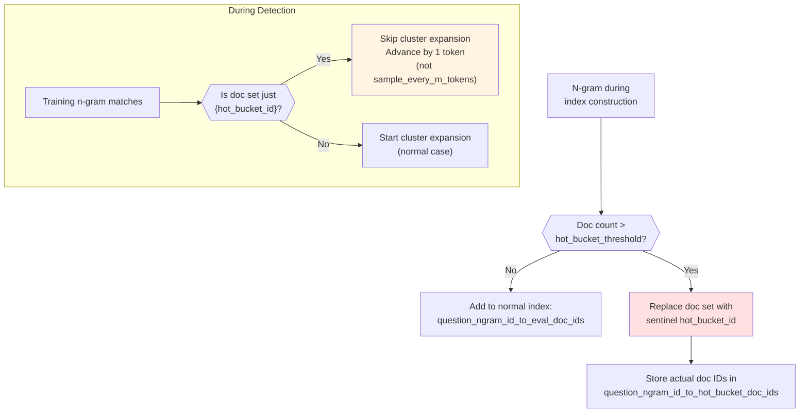
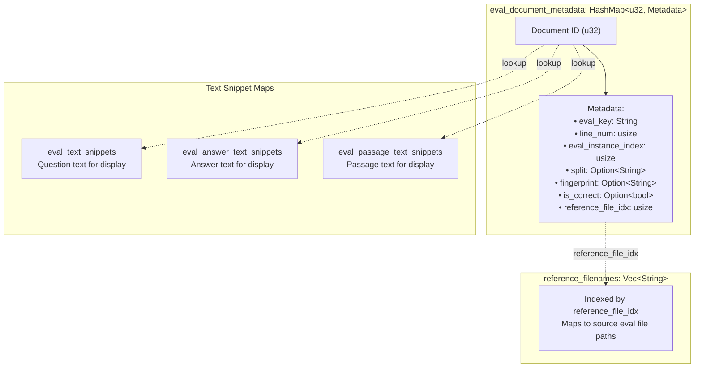

<!-- source: DeepWiki mcp.deepwiki.com · repo allenai/decon · page 4.2 Reference Index Construction · fetched 2026-10-26 -->

# Reference Index Construction

<details>
<summary>Relevant source files</summary>

The following files were used as context for generating this wiki page:

- [doc/simple-details.md](doc/simple-details.md)
- [doc/simple.md](doc/simple.md)
- [src/detect/detection.rs](src/detect/detection.rs)

</details>


## Purpose and Scope

This page details how decon builds the reference index from evaluation datasets. The index is a searchable data structure that enables efficient contamination detection by mapping n-grams to evaluation documents with pre-computed IDF weights. This page covers the index data structures, construction process, and optimization techniques.

For information about how the index is used during detection, see [Detection and Cluster Expansion](#4.3). For details on the overall SIMPLE algorithm, see [Algorithm Overview](#4.1).

## Index Data Structures

### SimpleReferenceIndex Structure

The `SimpleReferenceIndex` is the central data structure built during Phase 1 of the SIMPLE algorithm. It consolidates all searchable n-gram mappings, IDF weights, document metadata, and text snippets needed for contamination detection.



**Sources:** [src/detect/reference_index.rs](), [src/detect/detection.rs:21-24]()

### Two-Tier Lookup System

The index uses a two-tier lookup to optimize the common case where training n-grams are not present in the evaluation data:

**Tier 1: Hash to ID Mapping**
- **Type:** `QuestionNgramToIdMap` = `HashMap<u64, u32>`
- **Purpose:** Maps 64-bit n-gram hashes to 32-bit sequential IDs
- **Optimization:** Enables fast membership testing with minimal memory overhead

**Tier 2: ID to Document Set Mapping**
- **Type:** `QuestionNgramIdToEvalDocIdsMap` = `HashMap<u32, HashSet<u32>>`
- **Purpose:** Maps n-gram IDs to sets of document IDs containing that n-gram
- **Rationale:** Most training n-grams are misses; avoiding large document set lookups for misses improves performance



**Sources:** [src/detect/reference_index.rs](), [doc/simple-details.md:137-141]()

## Index Construction Process

### Build Pipeline Overview

The `build_simple_index()` function orchestrates the complete index construction process:



**Sources:** [src/detect/reference_index.rs](), [src/detect/detection.rs:73-77]()

### Component Separation (Q/A/P)

Evaluation instances are normalized into Question, Answer, and Passage components. Each component is indexed separately to enable targeted scoring:

| Component | Index Structure | Purpose |
|-----------|----------------|---------|
| **Question (Q)** | `question_ngram_to_id` + `question_ngram_id_to_eval_doc_ids` | Primary contamination detection; cluster discovery |
| **Answer (A)** | Indexed with same maps; tracked separately in scoring | Supporting evidence; proximity checks |
| **Passage (P)** | Indexed with same maps; tracked separately in scoring | Contextual evidence; retrieval task support |



**Configuration:**
- `config.index_questions`: Whether to index question component (default: true)
- `config.index_answers`: Whether to index answer component (default: true) 
- `config.index_passages`: Whether to index passage component (default: true)

**Sources:** [doc/simple-details.md:63-80](), [src/detect/reference_index.rs]()

### N-gram Hashing and Sequential ID Assignment

N-grams are hashed to 64-bit values and assigned sequential 32-bit IDs during index construction:



The `hash_ngram()` function uses Rust's `DefaultHasher` to generate a stable 64-bit hash from the token sequence. This hash is used as a key in `question_ngram_to_id`.

**Sources:** [src/detect/reference_index.rs](), [src/detect/detection.rs:791]()

### IDF Calculation and Pre-computation

Inverse Document Frequency (IDF) is calculated during index construction and stored in `eval_documents`:

**IDF Formula:**
```
idf(ngram) = log(total_docs / document_frequency(ngram))
```

**Pre-computed Values Stored:**
- `question_idf_sum`: Sum of IDF values for all unique n-grams in the question component
- Document frequency tracked via set size in `question_ngram_id_to_eval_doc_ids`

This pre-computation avoids recalculating IDF during detection, as the denominator in the overlap ratio is constant for each evaluation document.



**Sources:** [doc/simple-details.md:101-110](), [src/detect/detection.rs:462-467]()

## Hot Bucket Optimization

Hot n-grams are extremely common sequences that appear in many evaluation documents. Starting cluster expansion from hot n-grams has low contamination probability and degrades performance.

### Hot Bucket Mechanism



**Configuration:**
- `config.hot_bucket_threshold`: Number of documents above which an n-gram is considered "hot"
- Default behavior: Skip cluster expansion on hot bucket hits, advance by single token

**Rationale:** Hot n-grams like ["the", "of", "and"] in word tokenization or common BPE sequences appear in many documents. Their presence in training data is weak evidence of contamination. By skipping cluster expansion on hot hits, detection focuses on more informative n-grams while still scanning through regions with hot n-grams at single-token granularity.

**Sources:** [doc/simple-details.md:142-147](), [src/detect/detection.rs:738-745]()

### Hot Bucket Statistics

The index tracks statistics about hot bucket optimization if `config.verbose` is enabled:

| Statistic | Description |
|-----------|-------------|
| Total hot n-grams | Count of n-grams exceeding threshold |
| Total documents in hot buckets | Sum of document set sizes for hot n-grams |
| Average documents per hot n-gram | Mean document set size |
| Memory saved | Estimated memory not allocated for hot bucket doc sets |

These statistics are displayed after index construction via `hot_bucket_stats.display()`.

**Sources:** [src/detect/detection.rs:83-86]()

## Index Building Statistics

The `build_simple_index()` function returns `IndexBuildingStats` alongside the index:

```rust
struct IndexBuildingStats {
    files_processed: usize,
    total_lines_examined: usize,
    lines_indexed: usize,
    total_eval_instances: usize,
    // ... additional fields
}
```

These statistics are displayed to the user via `display_index_building_results()`:

| Metric | Meaning |
|--------|---------|
| `files_processed` | Number of evaluation JSONL files read |
| `total_lines_examined` | Total JSON lines parsed |
| `lines_indexed` | Lines meeting minimum length/quality criteria |
| `total_eval_instances` | Unique evaluation instances added to index |

**Error Condition:** If `lines_indexed == 0`, the system raises an error with diagnostic information about why no data was indexed (e.g., all entries filtered out by `eval_min_token_length` or `eval_min_unique_word_count`).

**Sources:** [src/detect/detection.rs:77-81](), [src/detect/detection.rs:115-132]()

## Performance Characteristics

### Memory Footprint

The reference index is memory-resident for fast lookup:

| Structure | Size Driver | Typical Scale |
|-----------|-------------|---------------|
| `question_ngram_to_id` | Unique n-grams across all eval data | O(100K - 1M entries) |
| `question_ngram_id_to_eval_doc_ids` | Same as above; sets scale with n-gram frequency | O(100K - 1M entries) |
| `eval_documents` | Number of evaluation instances | O(10K - 100K docs) |
| Text snippets maps | Number of eval instances × snippet length | O(10-100 MB) |

For ~150 evaluation datasets with ~100K total instances, the index typically consumes 1-5 GB of RAM.

### Construction Time

Index construction is a one-time cost at the start of each contamination detection run:

- **Typical Time:** 10-60 seconds for ~150 evaluation datasets
- **Parallel Processing:** Evaluation files can be read in parallel (implementation-dependent)
- **Bottleneck:** Tokenization and n-gram extraction

The construction time is reported separately from detection time in the final output.

**Sources:** [src/detect/detection.rs:73-77](), [src/detect/detection.rs:95-103]()

## Document Metadata Storage

The index stores metadata for each evaluation document to enable detailed reporting:



This metadata is loaded lazily during contamination reporting via `finalize_contaminated_entry()` to minimize allocations in the hot path where most candidates are not contaminated.

**Sources:** [src/detect/detection.rs:589-599](), [src/detect/detection.rs:661-673]()

---

