<!-- source: DeepWiki mcp.deepwiki.com · repo allenai/decon · page 4.3 Detection and Cluster Expansion · fetched 2026-10-26 -->

# Detection and Cluster Expansion

Relevant source files

The following files were used as context for generating this wiki page:

- [doc/simple-details.md](doc/simple-details.md)
- [doc/simple.md](doc/simple.md)
- [src/detect/detection.rs](src/detect/detection.rs)

## Purpose and Scope

This page describes the detection phase of the SIMPLE algorithm, focusing on how training data is sampled for potential contamination and how initial n-gram matches are expanded into contamination clusters through bidirectional traversal. 

For information about how the reference index is constructed prior to detection, see [Reference Index Construction](#4.2). For information about how clusters are scored to determine actual contamination, see [Contamination Scoring System](#4.4).

## Detection Pipeline Overview

The detection phase processes training data files in parallel to identify regions that match evaluation data. The pipeline operates at the document level, where each line in a training JSONL file is treated as a separate document.

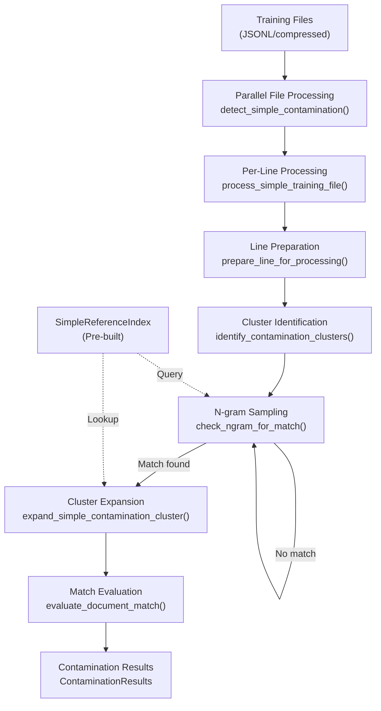

**Sources:** [src/detect/detection.rs:242-317](), [src/detect/detection.rs:319-415]()

The detection process follows these stages:

| Stage | Function | Purpose |
|-------|----------|---------|
| File Discovery | `detect_simple_contamination` | Expands training directory, creates parallel processing pool |
| Document Processing | `process_simple_training_file` | Reads compressed files, iterates over JSONL lines |
| Text Preparation | `prepare_line_for_processing` | Parses JSON, extracts text, cleans punctuation, tokenizes |
| Cluster Identification | `identify_contamination_clusters` | Samples n-grams and expands matches into clusters |
| Match Evaluation | `evaluate_document_match` | Scores clusters to determine contamination |

## Training Data Preparation

Before contamination detection can begin, each training document line undergoes preparation to normalize the text and tokenize it for n-gram analysis.

### Text Extraction and Cleaning

The `prepare_line_for_processing` function handles the conversion from raw JSONL to tokenized sequences:

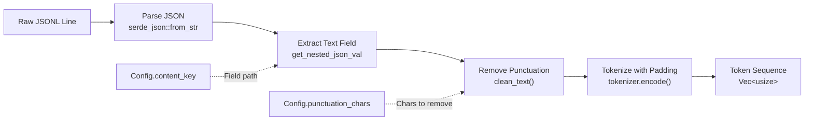

**Sources:** [src/detect/detection.rs:418-447]()

Key implementation details:

- **JSON field extraction**: Uses `config.content_key` to navigate nested JSON structures (e.g., `"text"` or `"content.body"`)
- **Text cleaning**: Strips configured punctuation characters to normalize text before tokenization
- **BPE padding**: For BPE tokenizers, text is padded with a leading space (`" {text}"`) to ensure tokens match correctly regardless of their position in the document
- **Error recovery**: Tokenization failures are caught with `catch_unwind` to prevent single problematic documents from crashing the entire detection run
- **Minimum token threshold**: Documents with fewer than `ngram_size * 2` tokens are skipped as they cannot produce meaningful n-gram matches

## N-gram Sampling Strategy

The core efficiency optimization in SIMPLE is selective sampling of training document n-grams rather than checking every possible position.

### Configurable Sampling Rate

The `sample_every_m_tokens` configuration parameter controls the sampling interval:

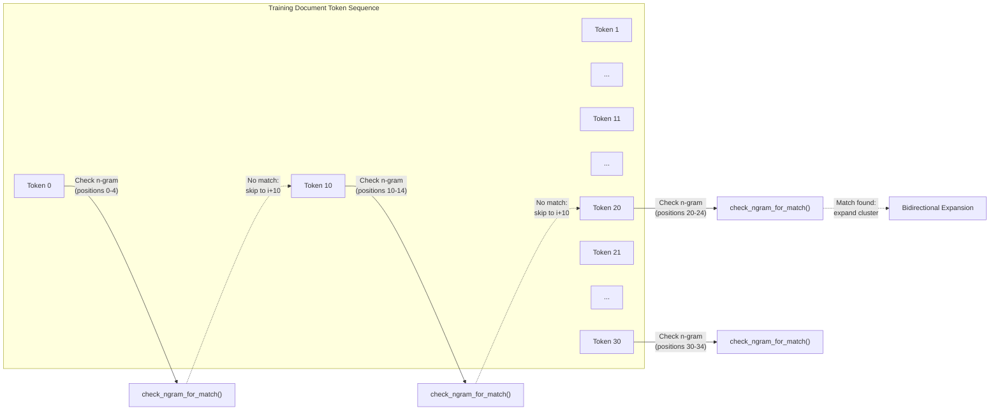

**Sources:** [src/detect/detection.rs:717-777](), [src/detect/detection.rs:725-734]()

The sampling strategy implements several key behaviors:

- **Default sampling interval**: By default, `sample_every_m_tokens = 10`, meaning only 1 in 10 possible n-gram positions are checked
- **Match behavior**: Upon finding a match, sampling stops and exhaustive cluster expansion begins
- **Post-expansion behavior**: After expanding a cluster to boundaries `[start, end]`, sampling resumes at `end + 1`
- **Efficiency trade-off**: This creates a known blind spot where contamination fully contained within a previously expanded cluster may be missed (see [Cluster Expansion Limitations](#cluster-expansion-limitations))

### N-gram Match Detection

The `check_ngram_for_match` function performs the actual index lookup:

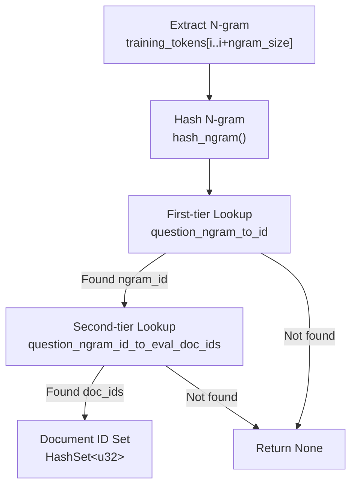

**Sources:** [src/detect/detection.rs:780-800]()

The two-tier index lookup is optimized for the common case where most n-grams are not present in the evaluation data:

1. **First tier** (`QuestionNgramToIdMap`): Maps `u64` n-gram hash to `u32` sequential ID
2. **Second tier** (`QuestionNgramIdToEvalDocIdsMap`): Maps `u32` ID to `HashSet<u32>` of document IDs

This structure provides faster membership testing than a single-tier hash map from n-gram hash to document sets.

## Hot Bucket Optimization

Very common n-grams (e.g., "the", "and", "of") appear in numerous evaluation documents. Starting cluster expansion on these n-grams is inefficient because they rarely lead to actual contamination.

### Hot Bucket Detection and Handling

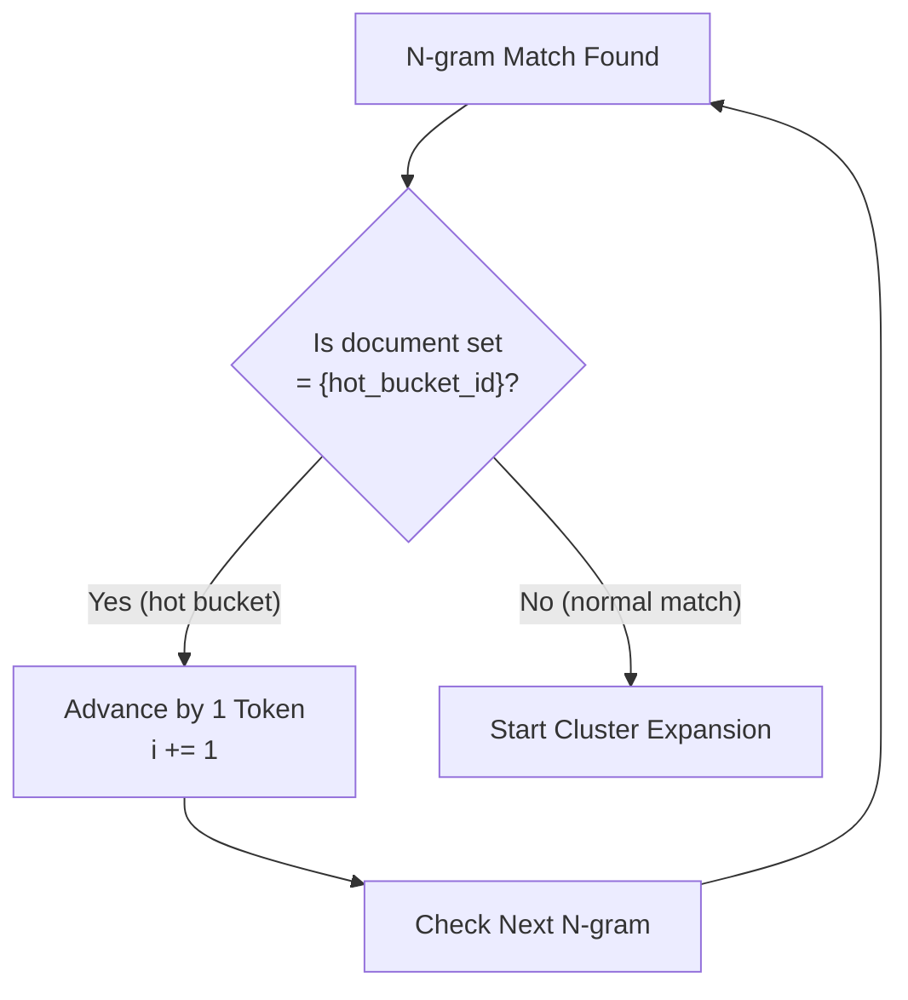

**Sources:** [src/detect/detection.rs:738-746]()

Hot bucket behavior:

- **Sentinel ID**: During index construction, n-grams appearing in more than `hot_bucket_threshold` documents (default: 1000) are assigned a special sentinel document ID
- **Detection-time handling**: When a match returns only `{hot_bucket_id}`, the algorithm advances by 1 token instead of starting expansion or sampling forward
- **Efficiency gain**: This prevents wasting time expanding clusters around extremely common n-grams while still allowing them to contribute to actual contamination clusters when combined with more specific n-grams

For more information on hot bucket index construction, see [Reference Index Construction](#4.2).

## Bidirectional Cluster Expansion

When a non-hot n-gram match is found, the algorithm switches from sampling to exhaustive expansion to identify the full extent of the match.

### Expansion Context and Initialization

The expansion process requires several pieces of context:

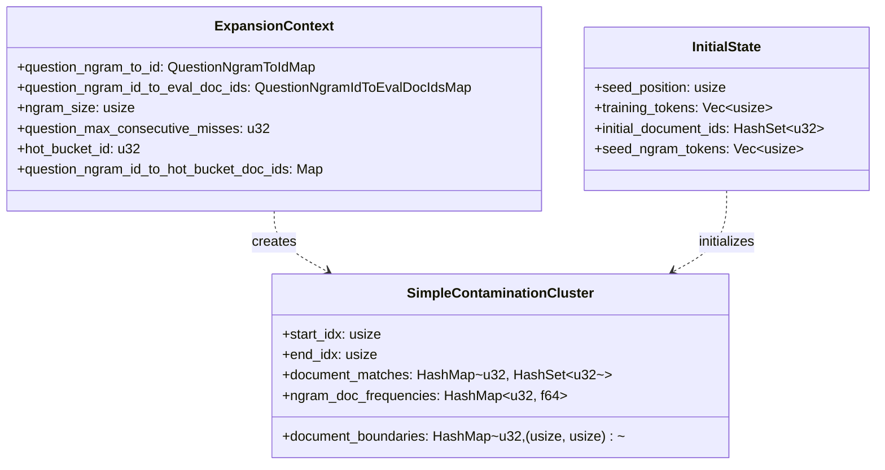

**Sources:** [src/detect/detection.rs:750-758]()

The `ExpansionContext` structure ([src/detect/cluster.rs](), referenced but not shown in files) bundles all the reference index data needed during expansion:

- **Index maps**: References to the two-tier n-gram index
- **Configuration parameters**: N-gram size and miss tolerance thresholds
- **Hot bucket data**: Sentinel ID and document sets for hot buckets

### Set Intersection-Based Tracking

The key innovation in cluster expansion is using set intersections to efficiently track which evaluation documents continue to match as the algorithm traverses the training sequence.

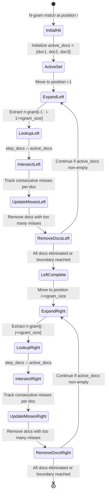

**Sources:** [doc/simple-details.md:91-100]()

The expansion algorithm maintains:

1. **Active set**: Current set of evaluation documents that have matched n-grams in the traversal
2. **Step set**: Set of documents matching the n-gram at the current position
3. **Intersection**: Only documents in both `active_set ∩ step_set` continue tracking
4. **Miss counters**: Per-document counters tracking consecutive positions without matches
5. **Ngram accumulation**: Unique matched n-gram IDs accumulated per document

### Consecutive Miss Tolerance

The algorithm tolerates gaps in matches to account for insertions, deletions, and minor edits in contaminated text:

| Parameter | Configuration | Default | Purpose |
|-----------|---------------|---------|---------|
| Question miss tolerance | `question_max_consecutive_misses` | 11 | Maximum consecutive positions without n-gram matches before removing a document from tracking |
| Passage miss tolerance | `passage_max_consecutive_misses` | 2 | Lower tolerance for passages since they're less critical |

**Sources:** [doc/simple-details.md:96-98]()

When a document accumulates more than the configured threshold of consecutive misses, it is removed from the active set. This allows the expansion to handle:

- **Insertions**: Extra words added to contaminated text
- **Deletions**: Words removed from eval text
- **Substitutions**: Minor edits that break n-gram matches
- **Paraphrasing**: Light rewording while maintaining overall structure

### Cluster Boundary Determination

The expansion process tracks boundaries independently for each matching document:

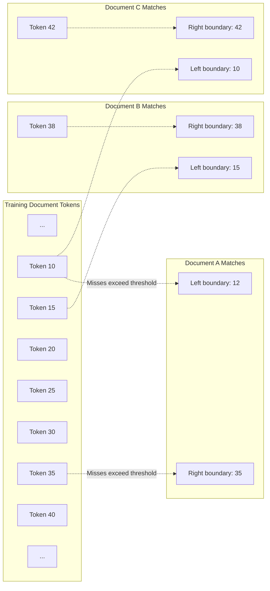

**Sources:** [src/detect/detection.rs:477-483]()

The `document_boundaries` map in `SimpleContaminationCluster` records the `(start_idx, end_idx)` for each document, representing:

- **Start index**: Leftmost training token position where the document had a match (before consecutive misses exceeded threshold)
- **End index**: Rightmost training token position where the document had a match (before consecutive misses exceeded threshold)

These boundaries are crucial for subsequent scoring, as they define the token range to analyze for answer and passage proximity.

## Cluster Data Structure

The result of expansion is a `SimpleContaminationCluster` containing all information needed for contamination scoring:

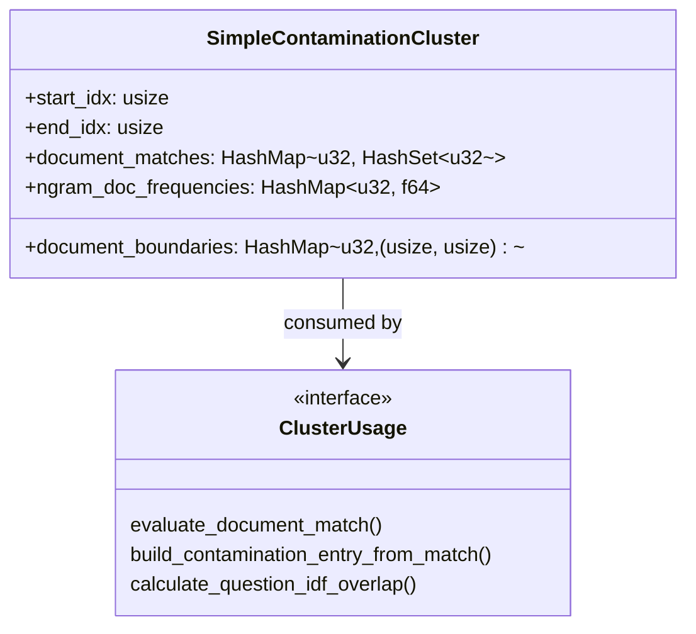

**Sources:** [src/detect/detection.rs:354-375]()

The cluster structure contains:

| Field | Type | Purpose |
|-------|------|---------|
| `start_idx` | `usize` | Earliest token position with any document match |
| `end_idx` | `usize` | Latest token position with any document match |
| `document_matches` | `HashMap<u32, HashSet<u32>>` | Maps each matching document ID to set of matched n-gram IDs |
| `document_boundaries` | `HashMap<u32, (usize, usize)>` | Maps each document ID to its specific match boundaries |
| `ngram_doc_frequencies` | `HashMap<u32, f64>` | Pre-computed IDF values for matched n-grams |

### From Clusters to Contamination Entries

Each cluster potentially contains multiple contamination matches (one per document in `document_matches`):

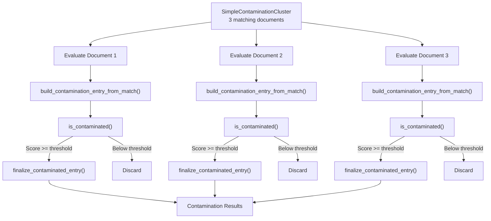

**Sources:** [src/detect/detection.rs:354-411]()

The conversion process:

1. **Per-document iteration**: Each document in `cluster.document_matches` is evaluated separately
2. **Entry construction**: `build_contamination_entry_from_match` creates a preliminary `SimpleContaminationEntry` with basic metrics
3. **Contamination check**: `is_contaminated` performs complete scoring including answer/passage analysis
4. **Finalization**: Only entries that exceed the contamination threshold are finalized with full metadata and text snippets
5. **Deduplication**: The `processed_contaminations` set prevents duplicate entries for the same (eval_key, instance_index, position) tuple

## Cluster Expansion Limitations

The current implementation has a documented efficiency trade-off that can lead to missed contamination in edge cases:

### Edge Case: Nested Contamination

```mermaid
gantt
    title Token Position Timeline (Hypothetical)
    dateFormat X
    axisFormat %s
    
    section Cluster A
    Doc A matches     :10, 40
    Doc B matches     :10, 35
    Doc C matches     :15, 40
    
    section Missed
    Doc D (missed!)   :20, 30
    
    section Next Cluster
    Doc E matches     :41, 60
```

**Sources:** [src/detect/detection.rs:684-716]()

The algorithm can miss contamination when:

1. Initial sampling at position 10 matches documents A, B, C
2. Cluster expansion tracks only A, B, C
3. Expansion ends at position 40 (rightmost boundary)
4. Document D, which would match n-grams at positions 20-30, is never checked because:
   - It didn't match the seed n-gram at position 10
   - Sampling resumes at position 41, skipping the interior
5. Document D is missed unless it extends past position 40

### Mitigation Factors

This edge case is rare in practice due to:

- **Bidirectional expansion**: Expansion moves both left and right, so contamination extending past cluster boundaries is caught by subsequent seeds
- **Large evaluation documents**: Most contaminated content is long enough to match initial seed n-grams
- **Exhaustive mode**: Setting `sample_every_m_tokens = 1` makes detection exhaustive, eliminating this blind spot (at significant performance cost)

For complete decontamination requirements, the code comments suggest modifying the algorithm to set sampling position based on the rightmost boundary of *scored contamination* rather than cluster boundaries.

## Implementation Entry Points

Key functions for understanding the detection and expansion implementation:

| Function | File | Lines | Purpose |
|----------|------|-------|---------|
| `contamination_detect` | detection.rs | 69-112 | Main entry point, orchestrates index building and detection |
| `detect_simple_contamination` | detection.rs | 242-317 | Parallel processing of training files |
| `process_simple_training_file` | detection.rs | 319-415 | Per-file processing loop |
| `identify_contamination_clusters` | detection.rs | 717-777 | Sampling and cluster identification |
| `check_ngram_for_match` | detection.rs | 780-800 | N-gram index lookup |
| `expand_simple_contamination_cluster` | cluster.rs | (not shown) | Bidirectional expansion implementation |

**Sources:** [src/detect/detection.rs:1-1039]()

The detection phase outputs a `ContaminationResults` structure (type alias for `DashMap<String, Vec<SimpleContaminationEntry>>`) that maps training file names to lists of contamination entries. These results are then passed to the reporting and display systems for output generation.

For details on how contamination entries are scored and evaluated, see [Contamination Scoring System](#4.4).

---

