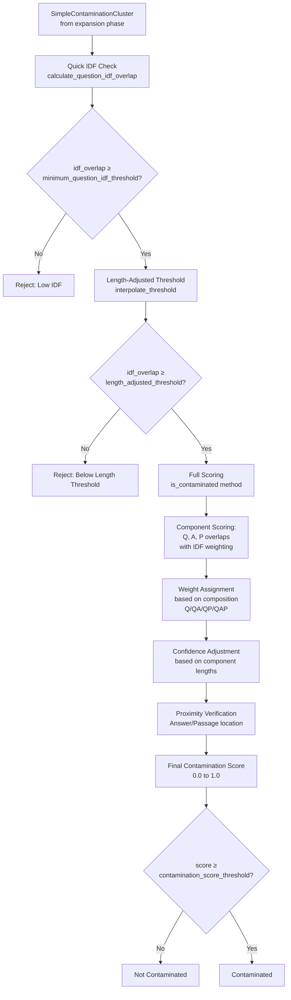
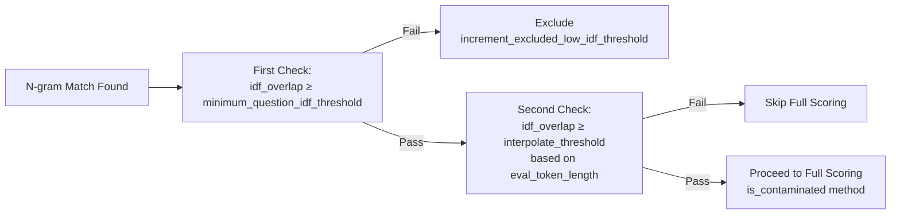
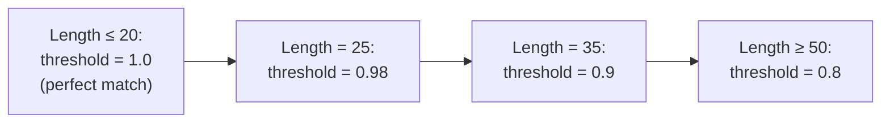
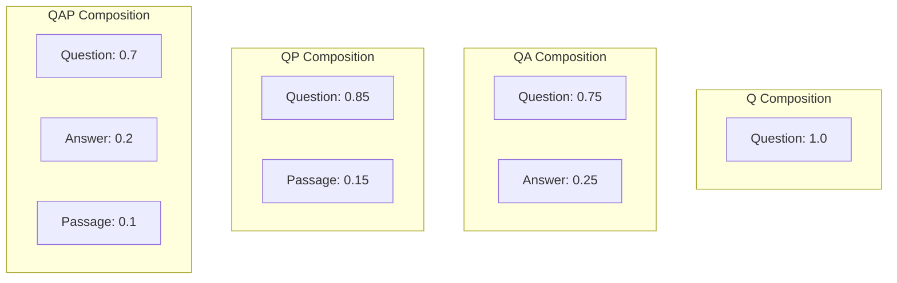
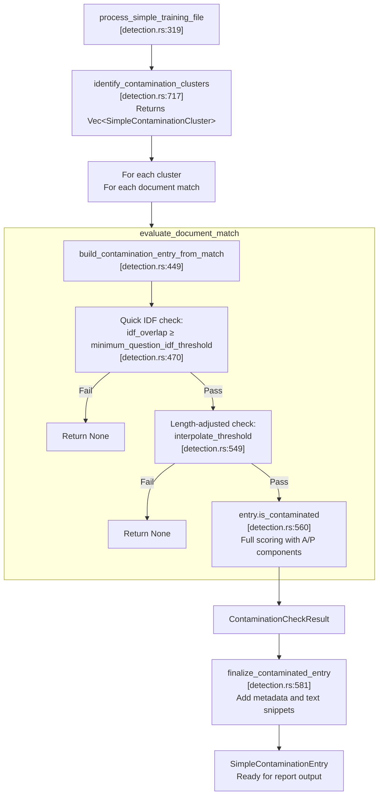

<!-- source: DeepWiki mcp.deepwiki.com · repo allenai/decon · page 4.4 Contamination Scoring System · fetched 2026-10-26 -->

# Contamination Scoring System

<details>
<summary>Relevant source files</summary>

The following files were used as context for generating this wiki page:

- [doc/simple-details.md](doc/simple-details.md)
- [src/detect/detection.rs](src/detect/detection.rs)

</details>


## Purpose and Scope

This page documents the scoring system that determines whether a detected cluster of n-gram matches represents true contamination between training data and evaluation datasets. After the detection phase identifies candidate matches through cluster expansion (see [Detection and Cluster Expansion](#4.3)), the scoring system applies multi-component analysis, length-based thresholds, and proximity checks to distinguish real contamination from coincidental overlap or common source material.

For information about how the reference index is built with IDF weights, see [Reference Index Construction](#4.2). For the overall algorithm design, see [Algorithm Overview](#4.1).

## Scoring Architecture Overview

The scoring system evaluates contamination through a multi-stage pipeline:



**Sources:** [src/detect/detection.rs:449-575](), [doc/simple-details.md:101-218]()

## IDF-Weighted Overlap: The Core Metric

### Concept

IDF (Inverse Document Frequency) weighting assigns higher importance to rare n-grams and lower importance to common ones. An n-gram that appears in many evaluation documents is less diagnostic of contamination than one that appears in only a few.

The fundamental overlap metric is:

```
O = Σ(idf(x) for x in matched_ngrams) / Σ(idf(y) for y in all_eval_ngrams)
```

Where:
- **Numerator**: Sum of IDF weights for n-grams that matched between training and eval
- **Denominator**: Sum of IDF weights for all n-grams in the eval document

### Implementation

The question IDF overlap is computed in two phases:

**Phase 1 - During Index Construction:**
```
question_idf_sum = Σ(idf(ngram) for ngram in question_ngrams)
```
This sum is pre-computed and stored in `SimpleReferenceIndex.eval_documents` for each eval document.

**Phase 2 - During Detection:**
```
matched_idf_sum = Σ(idf(ngram_id) for ngram_id in matched_ngram_ids)
idf_overlap = matched_idf_sum / question_idf_sum
```

The `calculate_question_idf_overlap` function performs this calculation, looking up IDF values from the cluster's `ngram_doc_frequencies` map and the index's `total_docs` count.

**Sources:** [src/detect/detection.rs:462-467](), [doc/simple-details.md:101-109]()

### Early Filtering with IDF Thresholds

Two early checks prevent expensive scoring of unlikely contamination:



| Check Point | Location | Default Threshold | Purpose |
|-------------|----------|-------------------|---------|
| First Check | [detection.rs:470-475]() | `minimum_question_idf_threshold` (configurable) | Fast rejection of very weak matches |
| Second Check | [detection.rs:549-557]() | Length-adjusted threshold (computed) | Reject before expensive full scoring |

**Sources:** [src/detect/detection.rs:470-475](), [src/detect/detection.rs:549-557]()

## Length-Adjusted Thresholds

### Motivation

Short texts with minimal information content should require near-perfect matches to be called contamination. Longer texts with more distinctive content can tolerate minor edits or gaps.

### Interpolation Formula

The `interpolate_threshold` function implements a decay curve:

```
threshold = 1.0  (if length <= perfect_match_decay_start)
threshold = 1.0 - 0.2 × (length - decay_start) / (decay_end - decay_start)  (if decay_start < length < decay_end)
threshold = 0.8  (if length >= perfect_match_decay_end)
```

### Configuration Parameters

| Parameter | Default Value | Description |
|-----------|---------------|-------------|
| `perfect_match_decay_start` | 20 tokens | Length below which perfect match required |
| `perfect_match_decay_end` | 50 tokens | Length at which threshold reaches minimum |
| `minimum_question_idf_threshold` | 0.8 (implied) | Floor for question overlap |

**Visualization:**



**Sources:** [doc/simple-details.md:110-118](), [src/detect/detection.rs:549-557]()

## Component-Based Scoring

### Eval Composition Types

Evaluation instances are normalized into three components (see [Dataset Normalization Process](#5.2)):

| Component | Symbol | Description | Always Present? |
|-----------|--------|-------------|-----------------|
| Question | Q | The task description or query | Yes |
| Answer | A | The expected response | Sometimes |
| Passage | P | Reference context/source material | Sometimes |

This yields four composition types:

| Composition | Components | Example Eval Type |
|-------------|-----------|-------------------|
| **Q** | Question only | Multiple-choice with held-out answers |
| **QA** | Question + Answer | Math problems, knowledge QA |
| **QP** | Question + Passage | Reading comprehension (answer held out) |
| **QAP** | Question + Answer + Passage | Full extractive QA, cloze tasks |

**Sources:** [doc/simple-details.md:63-80]()

### Default Component Weights

Each composition has default weights that reflect component importance:



**Rationale:**
- **Question** carries most weight because it describes the unique task
- **Answer** provides supporting evidence, especially for low-info questions
- **Passage** is weakest signal (often from common source material)

**Sources:** [doc/simple-details.md:149-157]()

### Confidence-Based Weight Adjustment

When components have low information content (few unique n-grams), their weights are reduced and redistributed to higher-confidence components.

**Question Confidence Factor:**
```
C_q = 0.5 + 0.5 × (N_q / 20)  (if N_q < 20 unique n-grams)
C_q = 1.0                      (if N_q ≥ 20 unique n-grams)
```

**Weight Adjustment:**
```
W_adjusted = W_default × C + W_redistributed
```

Where `W_redistributed` comes from low-confidence components. This ensures that a short, uninformative question doesn't dominate scoring when paired with a long, distinctive answer.

**Sources:** [doc/simple-details.md:170-188]()

## Full Contamination Score Calculation

### Score Computation by Composition

The `is_contaminated` method in `SimpleContaminationEntry` computes the final score based on composition:

**Q (Question Only):**
```
S_base = O_q
```

**QA (Question + Answer):**
```
S_base = O_q × W_q,adjusted + O_a × W_a,adjusted
```

**QP (Question + Passage):**
```
S_base = O_q × W_q,adjusted + O_p × W_p,adjusted
```

**QAP (Question + Answer + Passage):**
```
S_base = O_q × W_q,adjusted + O_a × W_a,adjusted + O_p × W_p,adjusted
```

Where:
- `O_q` = question IDF overlap (already computed)
- `O_a` = answer IDF overlap (computed if answer exists and found)
- `O_p` = passage IDF overlap (computed if passage exists and found)

**Sources:** [doc/simple-details.md:193-211]()

### Length Penalty

After computing `S_base`, a length penalty is applied based on the total token length (`L_total = eval_token_length + answer_token_length + passage_token_length`):

```
S_final = S_base × scale_factor(L_total)
```

The `scale_factor` function:
- Returns 1.0 for perfect scores (no penalty on perfect matches)
- Applies stronger penalties for shorter total lengths
- Reduces the effective score, making the threshold harder to reach

This ensures that brief text snippets require stronger evidence than lengthy distinctive texts.

**Sources:** [doc/simple-details.md:158-168]()

### Threshold Comparison

The final score is compared against `contamination_score_threshold` (default 0.8):

```rust
is_contaminated = (S_final >= contamination_score_threshold)
```

**Sources:** [src/detect/detection.rs:560-574]()

## Proximity Verification

### Answer Proximity

For QA and QAP compositions, the answer must appear near the question cluster. The system uses two strategies based on answer length:

**Short Answers** (few tokens):
- Exact token matching within the training sequence
- Answer must appear close to the question cluster

**Long Answers** (many tokens):
- N-gram overlap with IDF weighting
- Allows for minor edits or gaps
- Uses same IDF formula as question scoring

Configuration parameter `min_passage_distance` controls maximum distance.

**Sources:** [doc/simple-details.md:213-215]()

### Passage Proximity

For QP and QAP compositions, the passage must be found within configurable distance from the question:

| Parameter | Default | Purpose |
|-----------|---------|---------|
| `min_passage_distance` | 100 tokens | Maximum gap between question and passage |
| `passage_max_consecutive_misses` | 2 | Tolerance for edits within passage |

The passage is searched using the same bidirectional expansion logic as question detection, but with higher miss tolerance since passages are often lightly edited source material.

**Sources:** [doc/simple-details.md:216-218]()

## Scoring Pipeline Code Flow

### Entry Point and Data Flow



**Sources:** [src/detect/detection.rs:319-415](), [src/detect/detection.rs:449-575](), [src/detect/detection.rs:581-676]()

### Key Data Structures

**`SimpleContaminationEntry`** (defined in `contamination_entry.rs`):
- Stores all scoring results and metadata
- `contamination_score`: Final score (0.0-1.0)
- `idf_overlap`: Question IDF overlap
- `answer_idf_overlap`: Answer IDF overlap (optional)
- `passage_idf_overlap`: Passage IDF overlap (optional)
- Component boundaries, token lengths, text snippets

**`ContaminationCheckResult`** (returned by `is_contaminated`):
- `is_contaminated`: Boolean decision
- `contamination_score`: Final computed score
- `answer_boundaries`: Token positions of matched answers
- `passage_boundaries`: Token positions of matched passage
- Component overlap ratios and IDF values

**`ContaminationContext`** (groups parameters for scoring):
```rust
pub(crate) struct ContaminationContext<'a> {
    pub training_tokens: &'a [usize],
    pub config: &'a Config,
    pub index: &'a SimpleReferenceIndex,
    pub stats: Option<&'a StatsContainer>,
}
```

**Sources:** [src/detect/detection.rs:52-58]()

### Configuration Parameters Reference

All scoring parameters are configurable via `config/default.yaml`:

| Parameter | Type | Default | Purpose |
|-----------|------|---------|---------|
| `contamination_score_threshold` | float | 0.8 | Minimum final score for contamination |
| `minimum_question_idf_threshold` | float | varies | Early filter threshold |
| `perfect_match_decay_start` | int | 20 | Length where threshold starts dropping |
| `perfect_match_decay_end` | int | 50 | Length where threshold reaches minimum |
| `min_passage_distance` | int | 100 | Max tokens between question and passage |
| `passage_max_consecutive_misses` | int | 2 | Tolerance for passage gaps |
| `ngram_size` | int | 5 | N-gram size for matching |

**Sources:** [doc/simple-details.md:118-119](), [src/detect/detection.rs:549-554]()

## Statistical Tracking

When `--verbose` mode is enabled, the scoring system tracks statistics via `StatsContainer`:

**Tracked Metrics:**
- `increment_excluded_low_idf_threshold()`: Count of entries rejected at first IDF check
- Various timing metrics for scoring phases
- Component-specific overlap distributions

These statistics help tune threshold parameters and understand scoring behavior across large training corpora.

**Sources:** [src/detect/detection.rs:472-473]()

---

