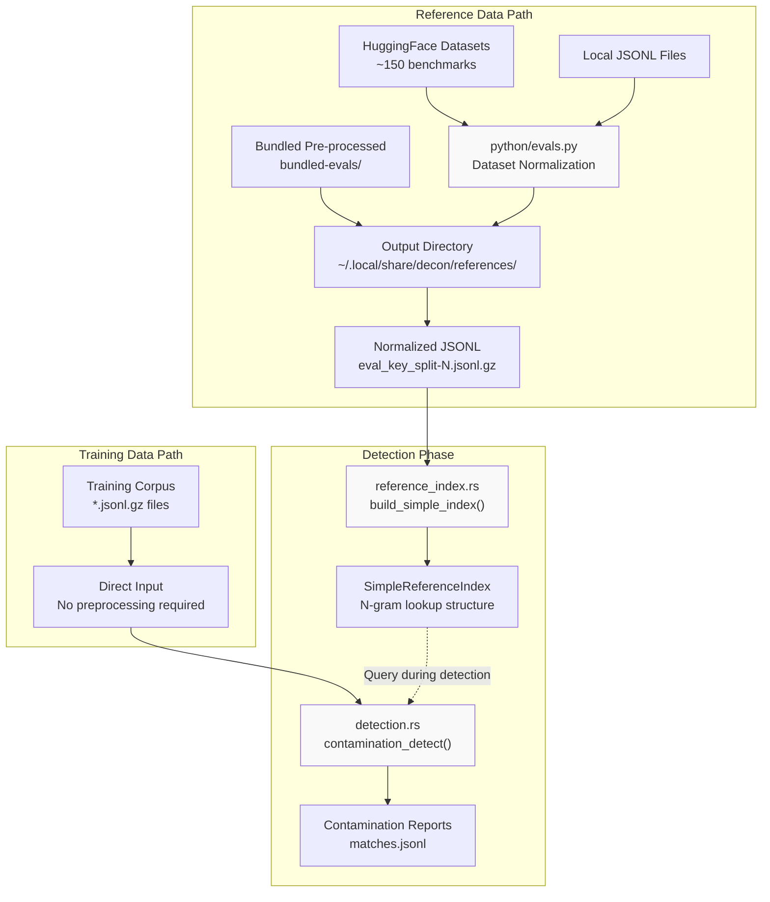
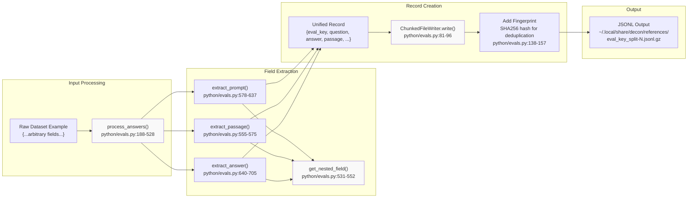
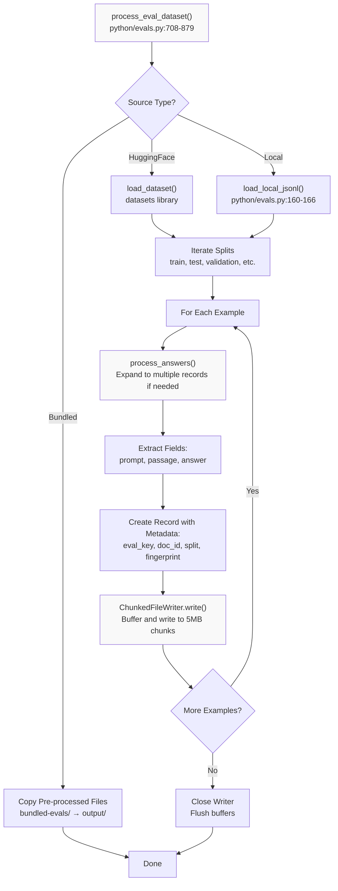
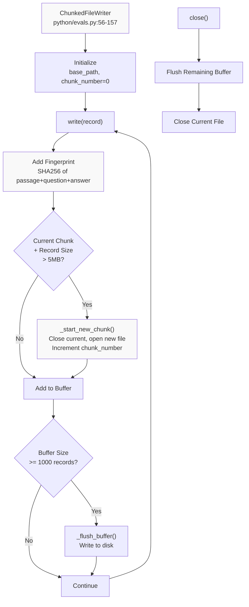
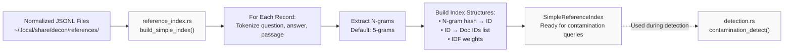

<!-- source: DeepWiki mcp.deepwiki.com · repo allenai/decon · page 5 Data Pipeline · fetched 2026-10-26 -->

# Data Pipeline

<details>
<summary>Relevant source files</summary>

The following files were used as context for generating this wiki page:

- [config/evals.yaml](config/evals.yaml)
- [python/evals.py](python/evals.py)

</details>


## Purpose and Scope

This page describes how data flows through the decon system, covering both evaluation/reference datasets and training data. It explains the overall pipeline architecture, data sources, and transformations that occur before contamination detection begins.

For detailed information about specific configuration syntax, see [Evaluation Dataset Configuration](#5.1). For implementation details of the normalization process, see [Dataset Normalization Process](#5.2). For complete specifications of data formats, see [Data Formats and Structures](#5.3).

## Overview

The decon system processes two distinct types of data:

1. **Reference/Evaluation Data**: Benchmark datasets (MMLU, GSM8K, HumanEval, etc.) that are normalized into a unified format and indexed for contamination detection
2. **Training Data**: Large-scale datasets being checked for contamination, processed in parallel during detection

These data streams are independent until the detection phase, where the reference index is queried against training data to identify contamination.



**Sources**: High-level system architecture diagrams, [python/evals.py:1-994](), [config/evals.yaml:1-2176]()

## Evaluation Data Pipeline

The evaluation data pipeline transforms diverse benchmark datasets into a standardized format suitable for indexing and contamination detection.

### Data Sources

Evaluation datasets are sourced from three types of locations:

| Source Type | Configuration | Example | Processing |
|------------|---------------|---------|------------|
| HuggingFace | `hf_path` + optional `hf_config` | `allenai/ai2_arc` with config `ARC-Challenge` | Downloaded via HuggingFace `datasets` library |
| Local Files | `local_path` | `path/to/dataset.jsonl` | Loaded directly from filesystem |
| Bundled Pre-processed | `local_path` with `bundled_evals/` prefix | `bundled_evals/agi_eval_` | Copied directly to output directory |

**Sources**: [config/evals.yaml:7-9](), [python/evals.py:711-782]()

### Normalization Architecture



**Sources**: [python/evals.py:188-528](), [python/evals.py:531-705](), [python/evals.py:56-157]()

### Processing Flow

The main processing function `process_eval_dataset()` orchestrates the normalization:



**Sources**: [python/evals.py:708-879]()

### Answer Expansion

A key feature of the normalization process is **answer expansion**, where a single dataset example may generate multiple output records. This is implemented in `process_answers()` which handles several expansion patterns:

| Expansion Method | Configuration Key | Purpose | Example |
|-----------------|-------------------|---------|---------|
| Multiple Choice | `expand_choices` | Create one record per answer choice | MMLU: 4 records per question (A/B/C/D) |
| Prefix Pattern | `expand_prefix` | Expand fields matching prefix | PIQA: `sol1`, `sol2` → 2 records |
| Parallel Arrays | `array` in prompts/answers | One record per array element | CoQA: multiple Q&A pairs per passage |
| Indexed Access | `indexed` | Select answer using key field | Direct single answer extraction |

**Sources**: [python/evals.py:188-528](), [config/evals.yaml:20-68]()

## Training Data Pipeline

Training data flows through a simpler pipeline as it requires no preprocessing:

```mermaid
graph LR
    A["Training Corpus<br/>Large JSONL files<br/>*.jsonl.gz"] --> B["detection.rs<br/>process_simple_training_file()"]
    
    B --> C["Read Line-by-Line<br/>Each line = document"]
    
    C --> D["Extract 'text' Field<br/>or use entire line"]
    
    D --> E["Tokenize<br/>Using configured tokenizer"]
    
    E --> F["Sample Every M Tokens<br/>Extract N-grams"]
    
    F --> G["Query Reference Index<br/>Check for matches"]
    
    G --> H{"Match Found?"}
    H -->|"Yes"| I["Cluster Expansion<br/>Exhaustive analysis"]
    H -->|"No"| F
    
    I --> J["Contamination Report"]
    
    style B fill:#f9f9f9
    style G fill:#f9f9f9
    style I fill:#f9f9f9
```



Training data files must be in JSONL format (optionally gzipped) with one document per line. Each line should either:
- Be a JSON object with a `"text"` field containing the document content
- Be a plain string (treated as the document text)

**Sources**: Algorithm design from high-level diagrams, implementation in Rust `src/detect/detection.rs`

## Data Format Transformations

### Input Format Diversity

Evaluation datasets arrive in highly diverse formats. Here are examples of how different dataset structures are normalized:

**Multiple Choice (MMLU)**:
```json
// Input from HuggingFace
{
  "question": "What is the capital of France?",
  "choices": ["London", "Paris", "Berlin", "Madrid"],
  "answer": 1,
  "subject": "geography"
}

// Output: 4 records (one per choice)
{"eval_key": "mmlu", "question": "What is the capital of France?", 
 "answer": "London", "is_correct": false, "fingerprint": "a1b2c3..."}
{"eval_key": "mmlu", "question": "What is the capital of France?", 
 "answer": "Paris", "is_correct": true, "fingerprint": "d4e5f6..."}
// ... 2 more records
```

**Parallel Arrays (CoQA)**:
```json
// Input
{
  "story": "The cat sat on the mat...",
  "questions": {"input_text": ["Where was the cat?", "What did it sit on?"]},
  "answers": {"input_text": ["on the mat", "the mat"]}
}

// Output: 2 records (one per Q&A pair)
{"eval_key": "coqa", "passage": "The cat sat on the mat...",
 "question": "Where was the cat?", "answer": "on the mat", "sub_index": 0}
{"eval_key": "coqa", "passage": "The cat sat on the mat...",
 "question": "What did it sit on?", "answer": "the mat", "sub_index": 1}
```

**Sources**: [config/evals.yaml:926-940](), [config/evals.yaml:508-517]()

### Output Format Standardization

All evaluation datasets are normalized to a consistent JSONL format with these fields:

| Field | Type | Required | Description |
|-------|------|----------|-------------|
| `eval_key` | string | Yes | Dataset identifier (e.g., "mmlu", "gsm8k") |
| `eval_instance_index` | integer | Yes | Index within the source split |
| `split` | string | Yes | Dataset split ("train", "test", "validation") |
| `question` | string | Yes | The prompt/question text |
| `doc_id` | integer | Yes | Global unique document ID |
| `config` | string | No | HuggingFace config name if applicable |
| `fingerprint` | string | Yes | SHA256 hash (first 16 chars) for deduplication |
| `passage` | string | No | Supporting context or reference text |
| `answer` | string | No | Expected response (omitted for some test splits) |
| `sub_index` | integer | No | Index when multiple records from one example |
| `is_correct` | boolean | No | For multiple choice: marks correct option |

**Sources**: [python/evals.py:3-39](), [python/evals.py:836-865]()

### Chunked Output

The `ChunkedFileWriter` class automatically splits large datasets into 5MB chunks to avoid creating very large files:



Output files follow the naming pattern: `{eval_key}_{split}-{chunk_number}.jsonl` (optionally gzipped).

Example: `mmlu_test-1.jsonl.gz`, `mmlu_test-2.jsonl.gz`, ...

**Sources**: [python/evals.py:56-157]()

## Configuration-Driven Processing

The entire normalization pipeline is driven by `config/evals.yaml`, which defines ~150 evaluation datasets. Each dataset configuration specifies:

- **Data source**: `hf_path` (HuggingFace) or `local_path` (local file)
- **Splits to process**: List of split names
- **Field extraction rules**: How to find prompts, passages, and answers in the source format
- **Special processing**: Expansion methods, transformations, filtering

The configuration supports a rich extraction DSL with operations like:
- `expand_choices`: Create multiple records from multiple-choice options
- `expand_prefix`: Match fields by prefix pattern (e.g., `answer1`, `answer2`)
- `indexed`: Access array elements using a key field
- `concat_messages`: Concatenate conversation history
- `array`: Process parallel arrays of prompts and answers

This design allows adding new datasets without modifying code—only configuration changes are needed.

**Sources**: [config/evals.yaml:1-68](), [python/evals.py:188-528]()

## Relationship to Detection Phase

The normalized evaluation data serves as input to the reference index construction phase:



The three text components (question, answer, passage) are indexed separately, allowing component-specific matching and scoring during detection. See [Reference Index Construction](#4.2) for implementation details and [Detection and Cluster Expansion](#4.3) for how the index is queried.

**Sources**: High-level system architecture diagrams, Rust implementation in `src/detect/reference_index.rs` and `src/detect/detection.rs`

---

