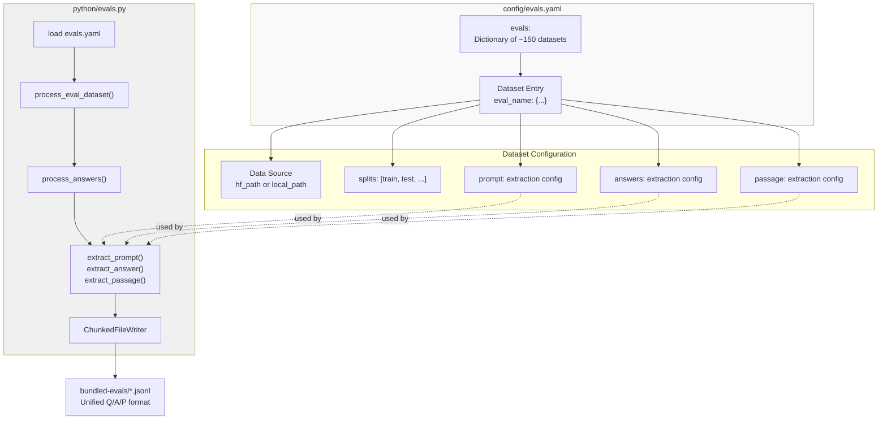
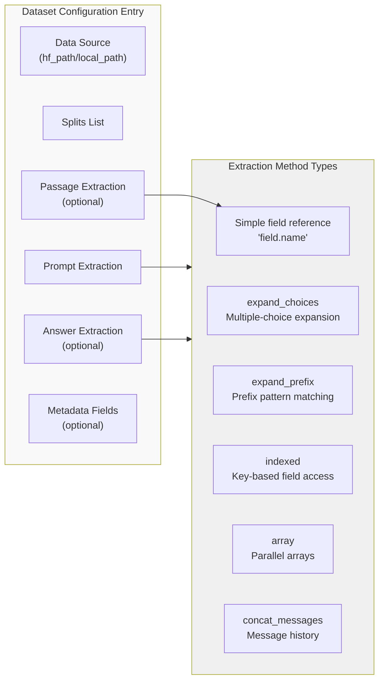
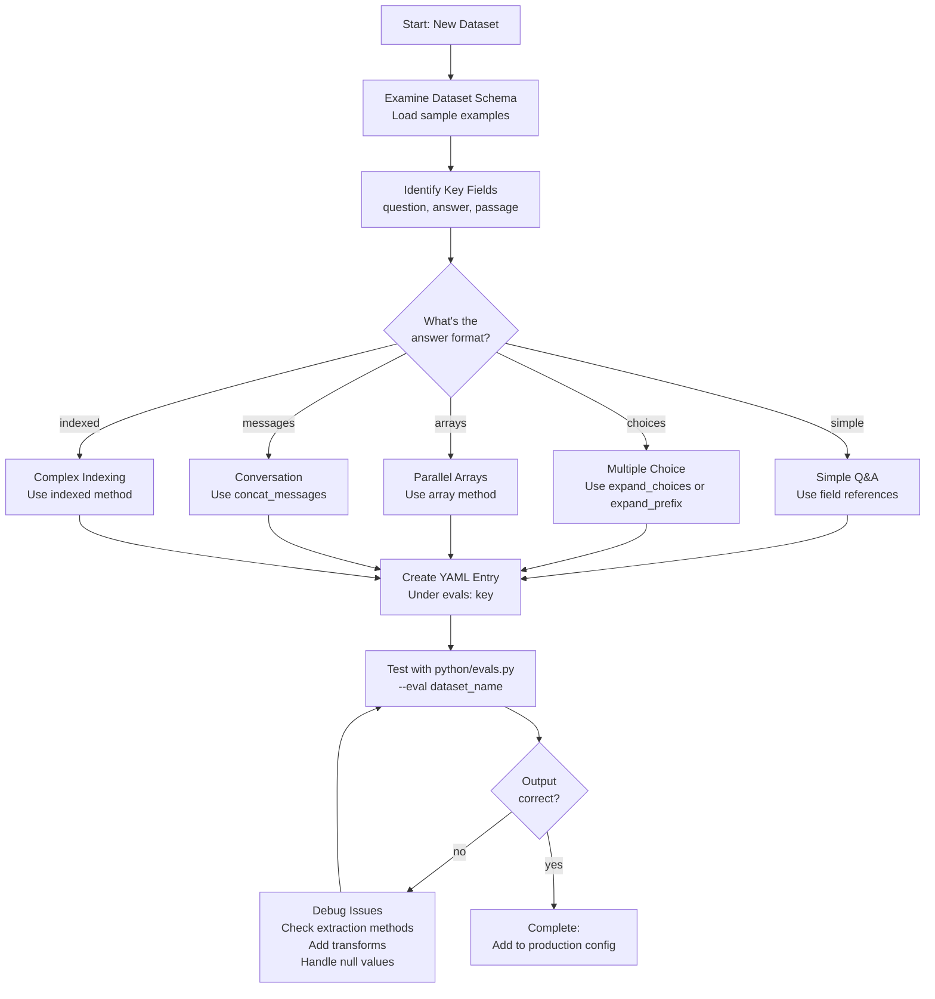
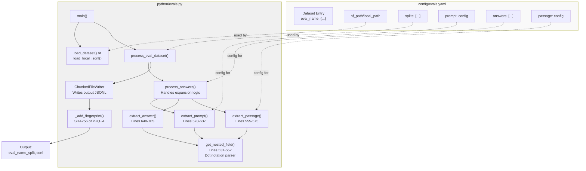

<!-- source: DeepWiki mcp.deepwiki.com · repo allenai/decon · page 5.1 Evaluation Dataset Configuration · fetched 2026-10-26 -->

# Evaluation Dataset Configuration

<details>
<summary>Relevant source files</summary>

The following files were used as context for generating this wiki page:

- [config/evals.yaml](config/evals.yaml)
- [python/evals.py](python/evals.py)

</details>


## Purpose and Scope

This page documents the `config/evals.yaml` configuration file, which defines how the decon system extracts questions, answers, and passages from approximately 150 diverse evaluation datasets. The configuration file provides a declarative DSL (Domain-Specific Language) for field extraction that allows the system to normalize datasets with vastly different structures into a unified format.

For information about how the Python normalization script processes these configurations, see [Dataset Normalization Process](#5.2). For documentation of the output formats, see [Data Formats and Structures](#5.3).

**Sources:** [config/evals.yaml:1-70]()

## Overview

The `config/evals.yaml` file serves as the central registry of all evaluation datasets used for contamination detection. Each dataset entry specifies:

- Where to load the dataset from (HuggingFace Hub or local files)
- Which splits to process (train, test, validation, etc.)
- How to extract the question/prompt, answer, and optional passage fields
- Dataset-specific metadata to preserve

The extraction DSL is designed to handle the diverse formats found in evaluation benchmarks: multiple-choice questions with varied answer formats, parallel Q&A arrays, conversational message histories, nested field structures, and datasets requiring field transformations.



**Sources:** [config/evals.yaml:1-70](), [python/evals.py:708-880]()

## Configuration File Structure

The `config/evals.yaml` file has a single top-level key `evals` containing a dictionary where keys are dataset identifiers (e.g., `gsm8k`, `mmlu`, `humaneval_plus`) and values are dataset configuration objects.

### Dataset Entry Anatomy

Each dataset configuration has the following structure:

| Field | Required | Type | Description |
|-------|----------|------|-------------|
| `hf_path` or `local_path` | Yes (one) | String | Source of the dataset |
| `splits` | Yes | List[String] | Dataset splits to process |
| `prompt` | Yes | String or Dict | Field(s) containing question/instruction |
| `answers` | No | String, Dict, or List | Field(s) containing answer(s) |
| `passage` | No | String or Dict | Field containing supporting context |
| `hf_config` | No | String | HuggingFace dataset configuration name |
| `no_answer_splits` | No | List[String] | Splits without answers (e.g., test sets) |
| `extra_fields` | No | List[String] | Additional fields to preserve |
| `dataset_name_field` | No | String | Field to use as dataset name for multi-domain datasets |



**Sources:** [config/evals.yaml:1-70](), [python/evals.py:708-880]()

## Field Extraction Methods

The configuration DSL supports six extraction methods to handle diverse dataset structures. The `python/evals.py` script implements these methods in the `process_answers()`, `extract_prompt()`, `extract_answer()`, and `extract_passage()` functions.

### Simple Field Reference

The simplest extraction method uses dot notation to access fields, including nested fields and array indices.

**Syntax:**
```yaml
prompt: field_name
# or nested access
prompt: field.subfield.0
# or multiple levels
answers:
  - answer.text.0
  - answer.spans.0
```

**Examples from Configuration:**
```yaml
gsm8k:
  prompt: question
  answers:
    - answer

squad:
  prompt: question
  passage: context
  answers:
    - answers.text.0
```

**Code Implementation:** [python/evals.py:531-553]() implements nested field access via the `get_nested_field()` function, which splits the path on dots and traverses the object structure.

**Sources:** [config/evals.yaml:601-609](), [config/evals.yaml:1985-1993](), [python/evals.py:531-553]()

### expand_choices: Multiple-Choice Question Expansion

This method creates one output record per answer choice, marking the correct answer with an `is_correct` flag. Used for datasets like MMLU, ARC, and CommonsenseQA.

**Syntax:**
```yaml
answers:
  - expand_choices:
      field: choices           # Field containing choice array/dict
      correct_index: answerKey # Field with correct answer index/letter
```

**Example Configuration:**
```yaml
ai2_arc_challenge:
  hf_path: allenai/ai2_arc
  hf_config: ARC-Challenge
  prompt: question
  answers:
    - expand_choices:
        field: choices.text
        correct_index: answerKey
```

**Processing Logic:** [python/evals.py:305-344]() handles two choice formats:
1. Dict format with `text` and `label` keys
2. Simple list format

The correct index can be a letter (A, B, C, D) or numeric index. The processor converts letters to indices (A=0, B=1, etc.) for comparison.

**Output Structure:**
Each choice generates a separate record with:
- `question`: Original question
- `answer`: Choice text
- `is_correct`: Boolean indicating correct answer

**Sources:** [config/evals.yaml:78-101](), [python/evals.py:305-344]()

### expand_prefix: Prefix Pattern Matching

This method finds all fields matching a prefix pattern (e.g., `answerA`, `answerB`, `answerC`) and creates one record per matching field. Used for datasets where multiple-choice options are stored as separate fields.

**Syntax:**
```yaml
answers:
  - expand_prefix:
      prefix: answer              # Prefix to match
      suffix_match_field: label   # Field containing correct suffix
      label_transform: <optional> # Transformation to apply
```

**Label Transforms:**
- `numbers_to_letters`: Convert 1→A, 2→B, 3→C, 4→D
- `add_one`: Convert 0→1, 1→2 (0-based to 1-based)
- `index_to_letter`: Convert 0→a, 1→b, 2→c, 3→d
- `binary_to_bool`: Convert 0→false, 1→true

**Example Configuration:**
```yaml
piqa:
  prompt: goal
  answers:
    - expand_prefix:
        prefix: sol
        suffix_match_field: label
        label_transform: add_one

medmcqa:
  prompt: question
  answers:
    - expand_prefix:
        prefix: op
        suffix_match_field: cop
        label_transform: index_to_letter
```

**Code Implementation:** [python/evals.py:413-478]() iterates through example fields, identifies those starting with the prefix, extracts suffixes, applies transformations, and marks the correct answer.

**Sources:** [config/evals.yaml:1871-1883](), [config/evals.yaml:902-915](), [python/evals.py:413-478]()

### indexed: Key-Based Field Access

This method uses a value from one field to index into another field. Supports both prefix-based indexing (e.g., `answerA`, `answerB`) and array indexing.

**Syntax:**
```yaml
# Prefix-based indexing
answers:
  - indexed:
      prefix: sol              # Prefix for field names
      key_field: label         # Field containing the key
      label_transform: <optional>

# Array-based indexing
answers:
  - indexed:
      field: options           # Array field
      key_field: answer_idx    # Field with array index
```

**Example Configuration:**
```yaml
# Prefix-based (field name = prefix + key)
dataset_a:
  answers:
    - indexed:
        prefix: answer
        key_field: correct_index
        label_transform: numbers_to_letters

# Array-based
dataset_b:
  answers:
    - indexed:
        field: choices
        key_field: answer_key
```

**Code Implementation:** [python/evals.py:345-411]() handles both variants:
- For prefix-based: constructs field name as `prefix + transformed_key` and retrieves that field
- For array-based: uses key to index into array, supporting both letter indices (A=0) and numeric indices

**Sources:** [config/evals.yaml:49-59](), [python/evals.py:345-411]()

### array: Parallel Arrays

This method processes datasets where questions and answers are stored as parallel arrays. Creates one record per array element with matching indices.

**Syntax:**
```yaml
prompts:
  array: questions.text
answers:
  - array: answers.text
```

**Example Configuration:**
```yaml
coqa:
  hf_path: EleutherAI/coqa
  passage: story
  prompts:
    array: questions.input_text
  answers:
    - array: answers.input_text
```

**Processing Logic:** [python/evals.py:204-235]() detects the `array` key in prompts configuration, extracts both arrays, and zips them together. Each output record gets a `sub_index` field indicating its position in the array.

**Output Structure:**
```json
{"question": "Q1", "answer": "A1", "sub_index": 0, ...}
{"question": "Q2", "answer": "A2", "sub_index": 1, ...}
{"question": "Q3", "answer": "A3", "sub_index": 2, ...}
```

**Sources:** [config/evals.yaml:508-517](), [python/evals.py:204-235]()

### concat_messages: Message History Concatenation

This method concatenates messages from conversational datasets, useful for multi-turn dialogue evaluation datasets.

**Syntax:**
```yaml
prompt:
  concat_messages:
    field: messages           # Field containing message array
    content_field: content    # Field within each message containing text
  append_field: instruction   # Optional additional field to append
```

**Example Configuration:**
```yaml
alpaca-multiturn_self_compare_assistant_dependent:
  prompt:
    concat_messages:
      field: messages
      content_field: content
    append_field: instruction
  answers:
    - output
```

**Code Implementation:** [python/evals.py:604-631]() iterates through the message array, extracts content from each message, joins with spaces, and optionally appends an additional field.

**Sources:** [config/evals.yaml:189-200](), [python/evals.py:604-631]()

## Multiple Answer Configuration

Datasets can specify multiple answer extraction methods as a fallback chain. The processor tries each method in order until it finds a non-null answer.

**Syntax:**
```yaml
answers:
  - answer.spans.0    # Try first
  - answer.number     # If first is null, try second
  - answer.date       # If second is null, try third
```

**Example Configuration:**
```yaml
drop:
  prompt: question
  passage: passage
  answers:
    - answer.spans.0
    - answer.number
    - answer.date
```

This is particularly useful for datasets with multiple answer types, like DROP which can have span extractions, numeric answers, or date answers.

**Code Implementation:** [python/evals.py:238-528]() iterates through the answer list until finding a meaningful value via `is_meaningful_answer()`.

**Sources:** [config/evals.yaml:541-551](), [python/evals.py:238-528]()

## Label Transformations

Label transformations convert answer indices or keys between different formats. Supported transformations:

| Transform | Input → Output | Use Case |
|-----------|----------------|----------|
| `numbers_to_letters` | 1→A, 2→B, 3→C, 4→D | Convert numeric to letter indices |
| `add_one` | 0→1, 1→2, 2→3 | Convert 0-based to 1-based indexing |
| `index_to_letter` | 0→a, 1→b, 2→c, 3→d | Convert numeric to lowercase letter |
| `binary_to_bool` | 0→false, 1→true | Convert binary to boolean string |

**Code Implementation:** Transformations are applied in multiple places:
- `expand_prefix`: [python/evals.py:434-465]()
- `indexed`: [python/evals.py:357-370]()

**Sources:** [config/evals.yaml:43-48](), [python/evals.py:434-465](), [python/evals.py:357-370]()

## Special Fields and Options

### no_answer_splits

Some dataset splits (typically test sets) don't provide answers. Specify these to prevent error messages:

```yaml
hellaswag:
  splits:
    - train
    - test
    - validation
  no_answer_splits:
    - test
```

**Code Implementation:** [python/evals.py:826-830]() checks this list and sets answer to None for specified splits.

**Sources:** [config/evals.yaml:659-672](), [python/evals.py:826-830]()

### extra_fields

Preserve additional metadata fields in the output:

```yaml
mmlu:
  prompt: question
  extra_fields:
    - subject
  dataset_name_field: subject
```

The `dataset_name_field` option uses a field value as a sub-dataset identifier, useful for multi-domain benchmarks like MMLU with 57 subjects.

**Sources:** [config/evals.yaml:925-939]()

### local_path with Bundled Files

Pre-processed datasets can be copied directly from `bundled-evals/`:

```yaml
agi_eval:
  local_path: bundled_evals/agi_eval_
  splits:
    - train
```

Files matching the prefix pattern are copied to the output directory without processing. This is used for datasets requiring complex pre-processing.

**Code Implementation:** [python/evals.py:711-759]() detects the bundled prefix pattern, finds matching files, and copies them.

**Sources:** [config/evals.yaml:71-77](), [python/evals.py:711-759]()

## Adding a New Dataset

Follow these steps to add a new evaluation dataset:

### 1. Identify Dataset Structure

Examine the dataset schema on HuggingFace or in your local files:
```python
from datasets import load_dataset
ds = load_dataset("organization/dataset-name", "config-name")
print(ds['train'][0])  # Examine first example
```

### 2. Create Configuration Entry

Add an entry to `config/evals.yaml` under the `evals` key:

```yaml
evals:
  my_dataset:
    hf_path: organization/dataset-name
    hf_config: config-name  # if applicable
    splits:
      - train
      - test
    prompt: question_field
    answers:
      - answer_field
```

### 3. Choose Extraction Method

Based on the dataset structure, select the appropriate extraction method:

- **Simple Q&A**: Use string field references
- **Multiple choice**: Use `expand_choices` or `expand_prefix`
- **Conversational**: Use `concat_messages`
- **Parallel arrays**: Use `array` method
- **Complex indexing**: Use `indexed` method

### 4. Test Processing

Run the processor on your dataset:

```bash
python python/evals.py --eval my_dataset --output-dir ./test_output
```

Examine the output JSONL files to verify correct extraction.

### 5. Handle Edge Cases

Common issues:
- **Empty answers**: Check if splits need `no_answer_splits`
- **Null fields**: Use multiple answer fallbacks
- **Index mismatches**: Apply appropriate `label_transform`
- **Nested structures**: Use dot notation for deep access



**Sources:** [python/evals.py:882-994]()

## Configuration-to-Code Mapping

The following diagram shows how configuration elements map to processing functions in `python/evals.py`:



**Sources:** [config/evals.yaml:1-2176](), [python/evals.py:1-995]()

## Real-World Examples

### Example 1: Simple Question-Answer Dataset

**GSM8K Math Problems:**
```yaml
gsm8k:
  hf_path: openai/gsm8k
  hf_config: main
  splits:
    - train
    - test
  prompt: question
  answers:
    - answer
```

Dataset structure:
```json
{
  "question": "Janet's ducks lay 16 eggs per day...",
  "answer": "She sells 16 - 4 - 2 = <<16-4-2=10>>10..."
}
```

**Sources:** [config/evals.yaml:601-609]()

### Example 2: Multiple-Choice with Letter Indices

**AI2 ARC Challenge:**
```yaml
ai2_arc_challenge:
  hf_path: allenai/ai2_arc
  hf_config: ARC-Challenge
  splits:
    - train
    - test
    - validation
  prompt: question
  answers:
    - expand_choices:
        field: choices.text
        correct_index: answerKey
```

Dataset structure:
```json
{
  "question": "Which property of a mineral can be...",
  "choices": {
    "text": ["color", "hardness", "luster", "weight"],
    "label": ["A", "B", "C", "D"]
  },
  "answerKey": "B"
}
```

Output (4 records created):
```json
{"question": "Which property...", "answer": "color", "is_correct": false}
{"question": "Which property...", "answer": "hardness", "is_correct": true}
{"question": "Which property...", "answer": "luster", "is_correct": false}
{"question": "Which property...", "answer": "weight", "is_correct": false}
```

**Sources:** [config/evals.yaml:78-101]()

### Example 3: Prefix-Based Multiple Choice

**Physical IQA (PIQA):**
```yaml
piqa:
  hf_path: piqa
  splits:
    - train
    - test
    - validation
  prompt: goal
  answers:
    - expand_prefix:
        prefix: sol
        suffix_match_field: label
        label_transform: add_one
```

Dataset structure:
```json
{
  "goal": "To remove stubborn stains from a coffee cup",
  "sol1": "Use baking soda and vinegar",
  "sol2": "Use only water",
  "label": 0
}
```

The `add_one` transform converts label 0 → "1", so it matches "sol1".

**Sources:** [config/evals.yaml:1871-1883]()

### Example 4: Parallel Arrays

**CoQA Conversational QA:**
```yaml
coqa:
  hf_path: EleutherAI/coqa
  splits:
    - train
    - validation
  passage: story
  prompts:
    array: questions.input_text
  answers:
    - array: answers.input_text
```

Dataset structure:
```json
{
  "story": "A long passage about...",
  "questions": {
    "input_text": ["Q1", "Q2", "Q3"]
  },
  "answers": {
    "input_text": ["A1", "A2", "A3"]
  }
}
```

Output (3 records from 1 example):
```json
{"passage": "A long passage...", "question": "Q1", "answer": "A1", "sub_index": 0}
{"passage": "A long passage...", "question": "Q2", "answer": "A2", "sub_index": 1}
{"passage": "A long passage...", "question": "Q3", "answer": "A3", "sub_index": 2}
```

**Sources:** [config/evals.yaml:508-517]()

### Example 5: Message Concatenation

**Alpaca Multi-turn:**
```yaml
alpaca-multiturn_self_compare_assistant_dependent:
  hf_path: VGraf/TurnWise
  hf_config: self_compare_assistant_dependent
  splits:
    - eval
  prompt:
    concat_messages:
      field: messages
      content_field: content
    append_field: instruction
  answers:
    - output
```

Dataset structure:
```json
{
  "messages": [
    {"content": "User message 1"},
    {"content": "Assistant response 1"},
    {"content": "User message 2"}
  ],
  "instruction": "Now compare...",
  "output": "Expected answer"
}
```

Output question: "User message 1 Assistant response 1 User message 2 Now compare..."

**Sources:** [config/evals.yaml:189-200]()

### Example 6: Multi-Domain Dataset with Subject Field

**MMLU (57 subjects):**
```yaml
mmlu:
  hf_path: cais/mmlu
  hf_config: all
  splits:
    - test
    - validation
    - dev
  prompt: question
  extra_fields:
    - subject
  dataset_name_field: subject
  answers:
    - expand_choices:
        field: choices
        correct_index: answer
```

The `dataset_name_field: subject` causes the system to treat each subject (e.g., "anatomy", "astronomy") as a separate sub-dataset for tracking purposes.

**Sources:** [config/evals.yaml:925-939]()

---

