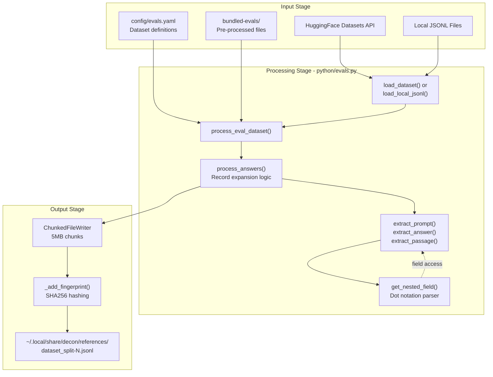
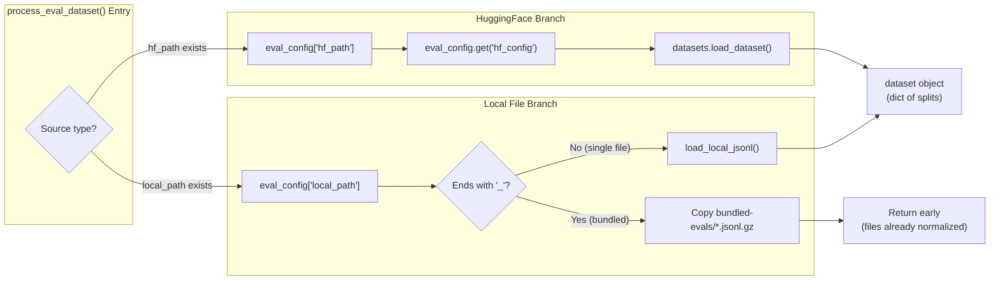
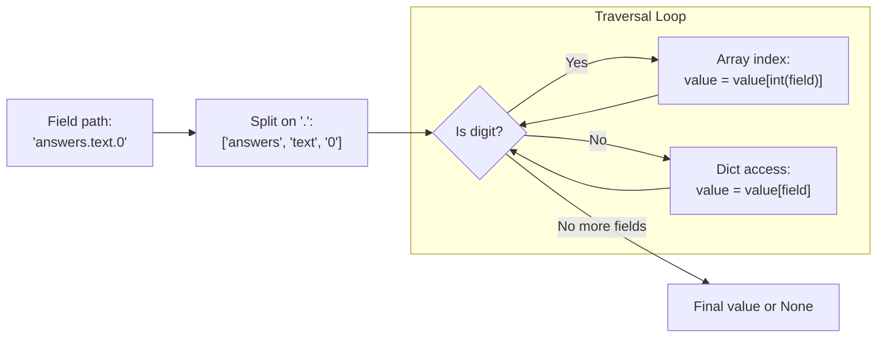
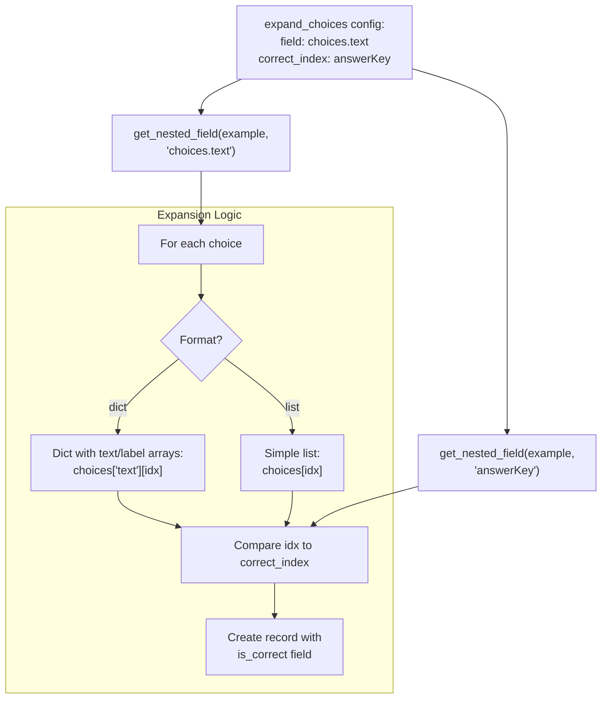
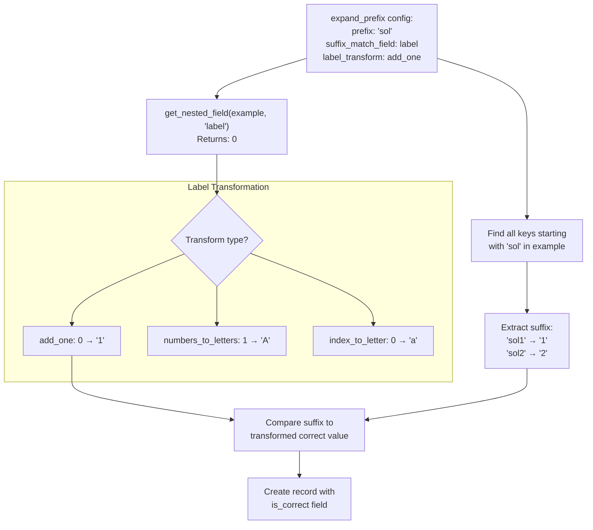
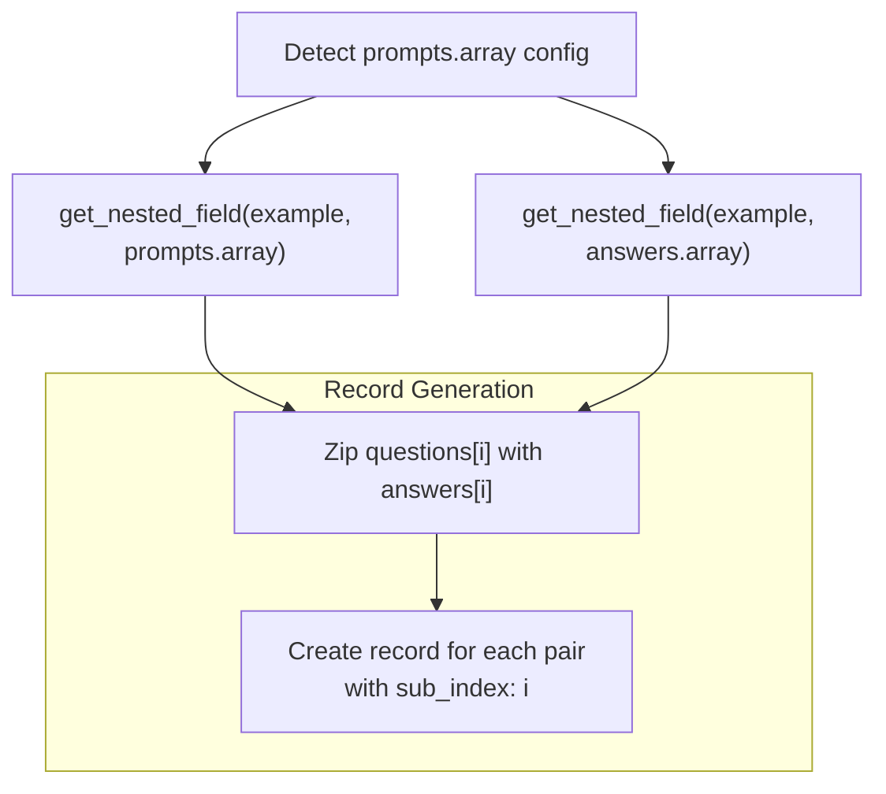
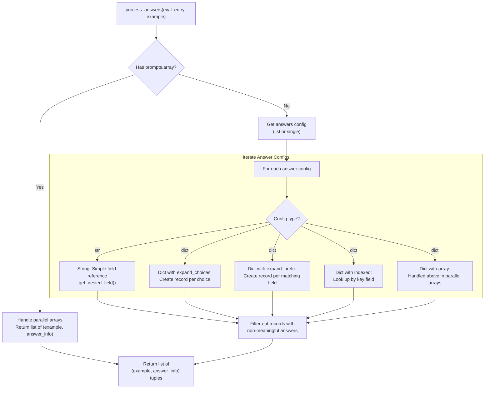
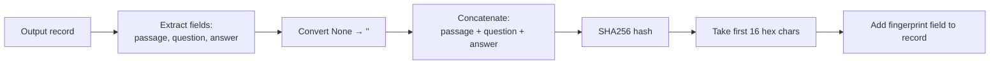
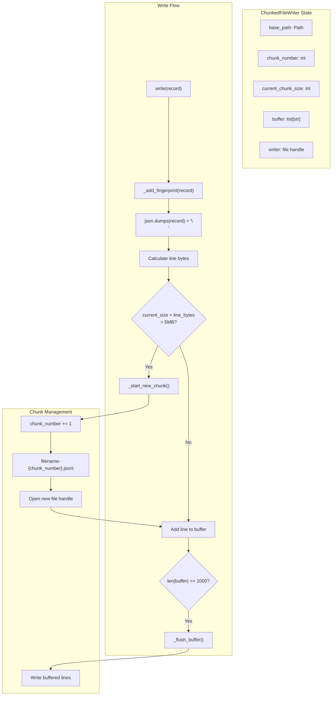
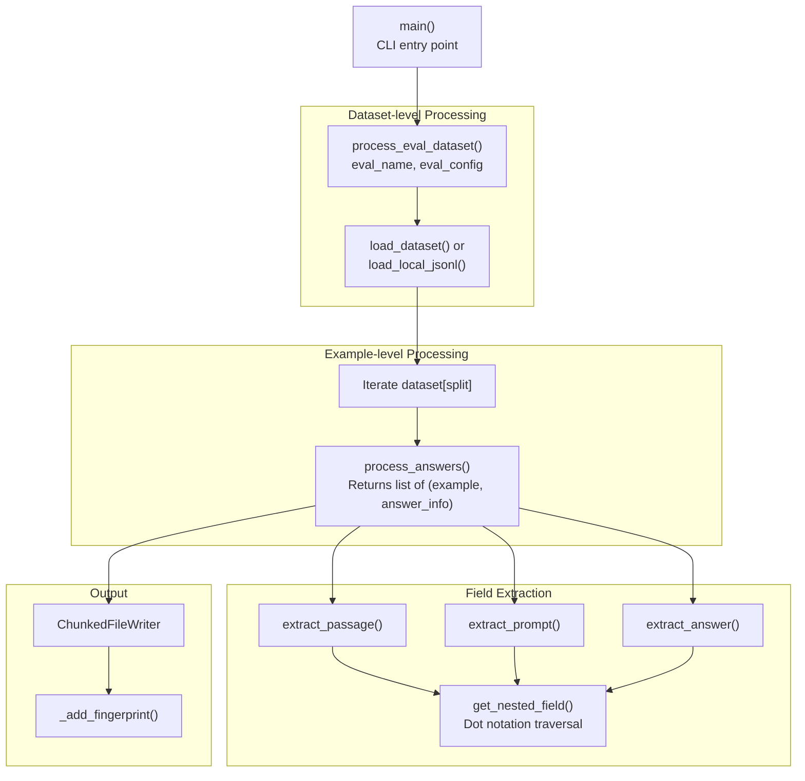

<!-- source: DeepWiki mcp.deepwiki.com · repo allenai/decon · page 5.2 Dataset Normalization Process · fetched 2026-10-26 -->

# Dataset Normalization Process

<details>
<summary>Relevant source files</summary>

The following files were used as context for generating this wiki page:

- [config/evals.yaml](config/evals.yaml)
- [python/evals.py](python/evals.py)

</details>


**Purpose**: This page documents how [python/evals.py]() transforms diverse evaluation dataset formats from HuggingFace and local sources into a unified Question/Answer/Passage (Q/A/P) format for contamination detection. This normalization process is the first phase of the data pipeline, converting approximately 150 heterogeneous benchmarks into standardized JSONL records.

**Scope**: This page covers the Python normalization script implementation. For configuration of evaluation datasets, see [Evaluation Dataset Configuration](#5.1). For documentation of the final data format structures, see [Data Formats and Structures](#5.3).

---

## Normalization Pipeline Overview

The normalization process follows a three-stage pipeline: dataset loading, field extraction and record expansion, and serialization with fingerprinting.

### End-to-End Processing Flow



**Sources**: [python/evals.py:708-880](), [python/evals.py:56-158]()

---

## Dataset Loading Strategy

The normalization script supports three dataset sources, each with distinct loading mechanisms.

### Dataset Source Types

| Source Type | Configuration Field | Loader Function | Description |
|-------------|---------------------|-----------------|-------------|
| HuggingFace Hub | `hf_path` | `load_dataset()` | Remote datasets via HuggingFace API |
| Local Files | `local_path` (file) | `load_local_jsonl()` | Single JSONL files on disk |
| Bundled Pre-processed | `local_path` (prefix) | `shutil.copy2()` | Pre-normalized files copied directly |

### Loading Implementation Map



**Sources**: [python/evals.py:708-799](), [python/evals.py:160-166]()

### Bundled Evaluation Handling

For pre-processed datasets like `agi_eval`, the script detects the `bundled_evals/agi_eval_` prefix pattern and copies files directly from [bundled-evals/]() to the output directory without re-processing. This optimization avoids redundant normalization for complex multi-domain datasets.

**Sources**: [python/evals.py:711-759](), [config/evals.yaml:71-77]()

---

## Field Extraction Methods

The normalization script supports six extraction methods, each designed to handle different dataset schema patterns.

### Extraction Method Taxonomy

| Method | Configuration Syntax | Use Case | Example |
|--------|---------------------|----------|---------|
| **Simple Field** | `"field_name"` or `"nested.field.0"` | Direct field access | `prompt: question` |
| **expand_choices** | `expand_choices: {field, correct_index}` | Multiple-choice expansion | MMLU, ARC |
| **expand_prefix** | `expand_prefix: {prefix, suffix_match_field}` | Prefix pattern matching | PIQA (sol1, sol2) |
| **indexed** | `indexed: {field/prefix, key_field}` | Index-based lookup | MedMCQA (opa, opb, opc) |
| **array** | `array: "field.array"` | Parallel array processing | CoQA (multiple Q&A pairs) |
| **concat_messages** | `concat_messages: {field, content_field}` | Conversation history | TurnWise (message chains) |

### Simple Field Extraction (Nested Access)

The `get_nested_field()` function implements dot-notation traversal for accessing nested structures and array indices.



**Sources**: [python/evals.py:531-552]()

**Example**: For SQuAD's `answers.text.0` field path:
1. Access `example['answers']` → `{'text': ['answer1', 'answer2'], 'start': [...]}`
2. Access `['text']` → `['answer1', 'answer2']`
3. Access `[0]` → `'answer1'`

### expand_choices Implementation

This method creates one record per answer choice, marking the correct option with `is_correct` field.



**Sources**: [python/evals.py:305-343]()

**Example**: ARC-Challenge record expansion:
```
Input example:
  question: "What is photosynthesis?"
  choices: {text: ["A process", "A reaction", "Energy transfer"], label: ["A", "B", "C"]}
  answerKey: "A"

Output records:
  1. {question: "What is photosynthesis?", answer: "A process", is_correct: true}
  2. {question: "What is photosynthesis?", answer: "A reaction", is_correct: false}
  3. {question: "What is photosynthesis?", answer: "Energy transfer", is_correct: false}
```

### expand_prefix Implementation

This method finds all fields matching a prefix pattern (e.g., `sol1`, `sol2`) and creates records for each.



**Sources**: [python/evals.py:413-478](), [config/evals.yaml:36-48]()

### indexed Method Implementation

The `indexed` method uses a key field to select the correct answer from a set of options.

**Sources**: [python/evals.py:345-411]()

**Example**: MedMCQA configuration:
```yaml
answers:
  - expand_prefix:
      prefix: op          # Fields: opa, opb, opc, opd
      suffix_match_field: cop  # cop field contains: 0, 1, 2, or 3
      label_transform: index_to_letter  # 0→'a', 1→'b', 2→'c', 3→'d'
```

### Array Processing (Parallel Arrays)

For datasets with parallel arrays of questions and answers, the script creates multiple records from a single example.



**Sources**: [python/evals.py:203-235]()

**Example**: CoQA processing:
```yaml
passage: story
prompts:
  array: questions.input_text  # ["Q1", "Q2", "Q3"]
answers:
  - array: answers.input_text  # ["A1", "A2", "A3"]

Output:
  - {passage: "story text", question: "Q1", answer: "A1", sub_index: 0}
  - {passage: "story text", question: "Q2", answer: "A2", sub_index: 1}
  - {passage: "story text", question: "Q3", answer: "A3", sub_index: 2}
```

### concat_messages Method

For conversational datasets, this method concatenates multiple message turns into a single prompt.

**Sources**: [python/evals.py:604-631]()

**Example**: TurnWise configuration:
```yaml
prompt:
  concat_messages:
    field: messages
    content_field: content
  append_field: instruction

Processing:
  messages: [{content: "Hello"}, {content: "How are you?"}]
  instruction: "Respond politely"
  → "Hello How are you? Respond politely"
```

---

## Record Expansion and Answer Processing

The `process_answers()` function is the central dispatcher that determines how to expand a single dataset example into one or more output records.

### Answer Processing Flow



**Sources**: [python/evals.py:188-528]()

### Answer Info Structure

Each `(example, answer_info)` tuple returned by `process_answers()` contains metadata for record customization:

| Field | Type | Purpose | Example |
|-------|------|---------|---------|
| `override_prompt` | str | Replaces default prompt | From parallel arrays |
| `override_answer` | str | Replaces default answer | Selected choice or field |
| `sub_index` | int | Index within expanded array | 0, 1, 2 for CoQA turns |
| `choice_index` | int | Choice number in multiple choice | 0-3 for MMLU options |
| `is_correct` | bool/None | Marks correct answer in MC | True for correct choice |
| `answer_config` | dict/str | Original config used | For fallback logic |

**Sources**: [python/evals.py:228-232](), [python/evals.py:318-324]()

---

## Fingerprinting and Deduplication

Every output record receives a SHA256-based fingerprint for deduplication across dataset splits.

### Fingerprint Generation Algorithm



**Sources**: [python/evals.py:138-157]()

**Implementation**:
```python
# From _add_fingerprint() method
passage = record.get('passage', '')
prompt = record.get('prompt') or record.get('question', '')
answer = record.get('answer', '')

# Handle None values
if passage is None: passage = ''
if prompt is None: prompt = ''
if answer is None: answer = ''

content = f"{passage}{prompt}{answer}"
hash_obj = hashlib.sha256(content.encode('utf-8'))
fingerprint = hash_obj.hexdigest()[:16]  # First 16 chars
```

The fingerprint enables the Rust detection engine to identify and skip duplicate questions that may appear in multiple splits or datasets.

**Sources**: [python/evals.py:138-157]()

---

## Output Format and Chunking

The `ChunkedFileWriter` class manages output serialization with automatic file splitting at 5MB boundaries.

### Chunked Output Architecture



**Sources**: [python/evals.py:56-136]()

### Chunking Parameters

| Parameter | Value | Purpose |
|-----------|-------|---------|
| `CHUNK_SIZE_BYTES` | 5 MB | Maximum size per chunk file |
| Buffer flush threshold | 1000 records | Prevents excessive memory usage |
| Chunk naming pattern | `{base}-{N}.jsonl` | e.g., `gsm8k_train-1.jsonl`, `gsm8k_train-2.jsonl` |

**Sources**: [python/evals.py:59]()

---

## Output Record Structure

Each normalized record follows a standardized schema regardless of source dataset.

### Standard Fields (Always Present)

| Field | Type | Description | Example |
|-------|------|-------------|---------|
| `eval_key` | str | Dataset identifier | `"gsm8k"`, `"mmlu"` |
| `eval_instance_index` | int | Index within split | `42` |
| `split` | str | Dataset split | `"train"`, `"test"`, `"validation"` |
| `question` | str | Prompt/question text | `"What is 2+2?"` |
| `doc_id` | int | Global unique ID | Sequential counter |
| `config` | str/null | HuggingFace config | `"abstract_algebra"` for MMLU |
| `fingerprint` | str | SHA256 hash (16 chars) | `"a3f2c1e9d8b7f0e1"` |

### Optional Fields (Conditionally Present)

| Field | Type | Condition | Purpose |
|-------|------|-----------|---------|
| `passage` | str | If dataset has context | Supporting text for question |
| `answer` | str | If not in `no_answer_splits` | Expected response |
| `sub_index` | int | Parallel array expansion | Index within array |
| `is_correct` | bool | Multiple-choice expansion | Marks correct choice |

**Sources**: [python/evals.py:1-39](), [python/evals.py:836-865]()

### Example Record

```json
{
  "eval_key": "mmlu",
  "eval_instance_index": 0,
  "split": "test",
  "question": "Which of the following is a prime number?",
  "answer": "7",
  "config": "abstract_algebra",
  "doc_id": 12345,
  "sub_index": null,
  "is_correct": true,
  "fingerprint": "8f3a2d1c9e4b7a6f"
}
```

---

## Main Processing Functions

### Function Call Hierarchy



**Sources**: [python/evals.py:882-994](), [python/evals.py:708-880]()

### Key Function Responsibilities

| Function | Location | Responsibility | Return Value |
|----------|----------|----------------|--------------|
| `main()` | [python/evals.py:882-994]() | CLI parsing, config loading, orchestration | None |
| `process_eval_dataset()` | [python/evals.py:708-880]() | Per-dataset processing loop | bool (success) |
| `process_answers()` | [python/evals.py:188-528]() | Record expansion logic | list[(example, dict)] |
| `extract_prompt()` | [python/evals.py:578-637]() | Question/prompt extraction | str or None |
| `extract_answer()` | [python/evals.py:640-705]() | Answer extraction | str or None |
| `extract_passage()` | [python/evals.py:555-575]() | Passage/context extraction | str or None |
| `get_nested_field()` | [python/evals.py:531-552]() | Nested field access | Any or None |
| `is_meaningful_answer()` | [python/evals.py:169-185]() | Answer validation | bool |

---

## Special Cases and Edge Handling

### Empty Answer Filtering

The script filters out records with non-meaningful answers using `is_meaningful_answer()`:

**Sources**: [python/evals.py:169-185]()

**Rules**:
- `None` values → filtered out
- Empty strings (`""` or whitespace-only) → filtered out
- Empty dicts with no non-empty values → filtered out
- All other values → kept

### Date Object Handling (DROP Dataset)

For DROP dataset's date objects, the script extracts meaningful date components:

**Sources**: [python/evals.py:254-271]()

**Example**:
```python
# Input: answer.date = {month: "January", day: "15", year: "2020"}
# Output: answer = "January 15 2020"

# Input: answer.date = {month: "", day: "", year: ""}
# Output: record filtered (no meaningful answer)
```

### No-Answer Splits

Some dataset splits (typically test splits) don't have answers. The script handles this via `no_answer_splits` configuration:

**Sources**: [python/evals.py:826-830](), [config/evals.yaml:487-488]()

**Example**:
```yaml
codeforces:
  splits:
    - test
  no_answer_splits:
    - test  # Test split has no answers
  prompt: description
```

---

## CLI Usage

The script supports two primary modes via CLI arguments:

### Command-Line Interface

| Argument | Type | Purpose | Example |
|----------|------|---------|---------|
| `--download` | flag | Process all datasets | `python/evals.py --download` |
| `--eval` | str | Process single dataset | `--eval gsm8k` |
| `--output-dir` | str | Output directory | `--output-dir ./my-evals` |
| `--config` | str | Config file path | `--config my-config.yaml` |

**Sources**: [python/evals.py:882-991]()

### Default Paths

| Path Type | Default Value |
|-----------|---------------|
| Config file | `config/evals.yaml` |
| Output directory | `~/.local/share/decon/references/` |

**Sources**: [python/evals.py:924](), [python/evals.py:943]()

---

## Performance Characteristics

### Processing Statistics

| Metric | Typical Value | Notes |
|--------|---------------|-------|
| Datasets processed | ~150 | When using `--download` |
| Records per dataset | 100 - 100,000+ | Varies widely by dataset |
| Chunk size | 5 MB | Prevents memory issues |
| Buffer size | 1000 records | Flushes to disk periodically |

**Sources**: [python/evals.py:59](), [python/evals.py:95]()

### Memory Management

The `ChunkedFileWriter` implements two memory-safety mechanisms:

1. **Chunk splitting**: New file created when current chunk exceeds 5MB
2. **Buffer flushing**: Buffer written to disk every 1000 records

This ensures the script can process arbitrarily large datasets without excessive memory consumption.

**Sources**: [python/evals.py:82-96]()

---

**Sources**: [python/evals.py:1-994](), [config/evals.yaml:1-2176]()

---

