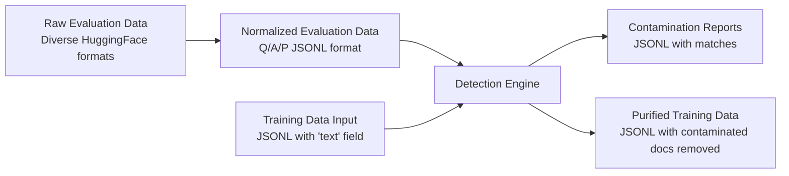
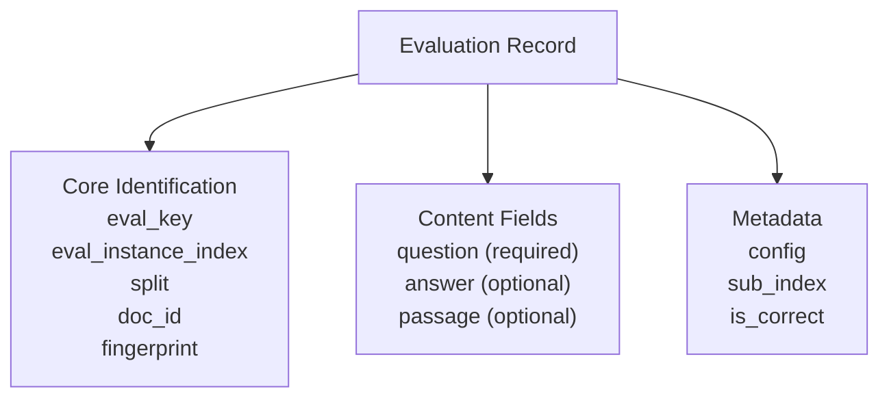
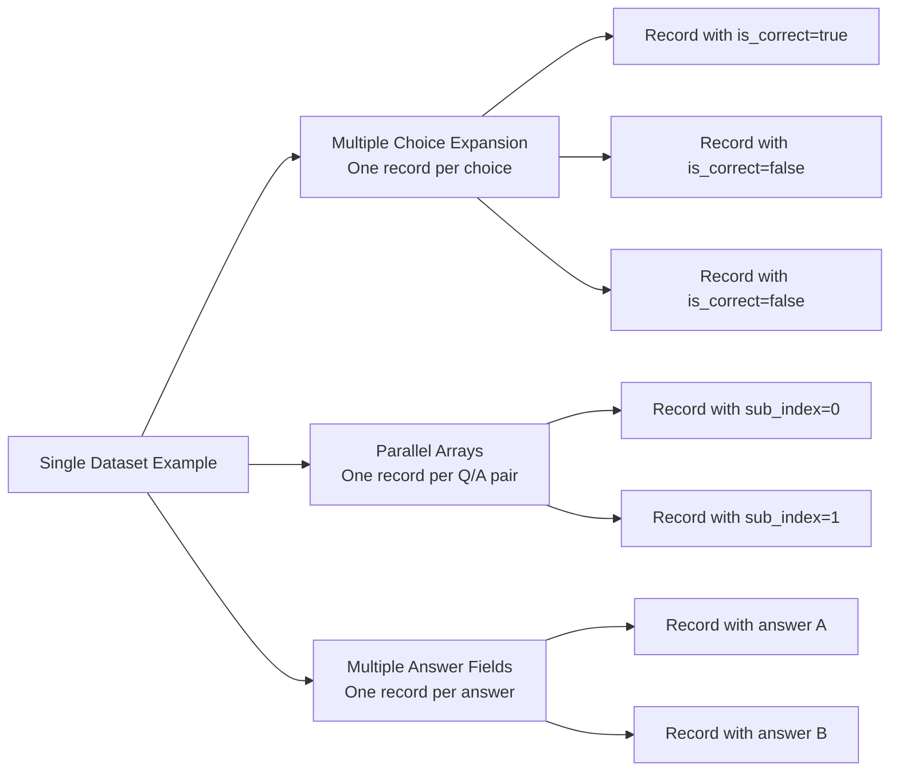
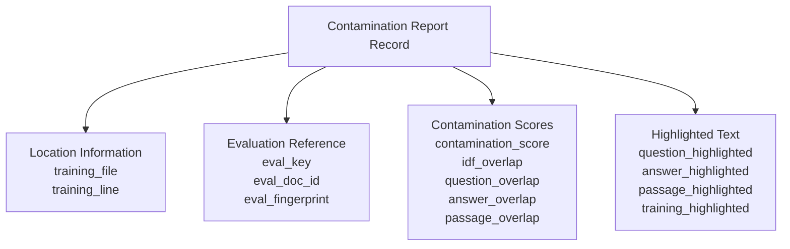
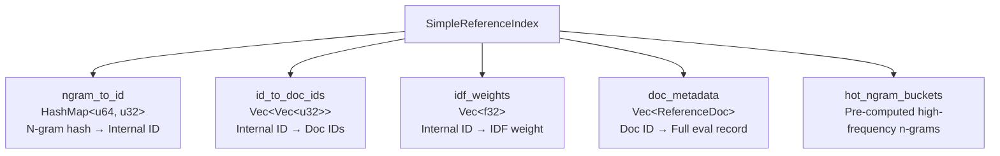

<!-- source: DeepWiki mcp.deepwiki.com · repo allenai/decon · page 5.3 Data Formats and Structures · fetched 2026-10-26 -->

# Data Formats and Structures

<details>
<summary>Relevant source files</summary>

The following files were used as context for generating this wiki page:

- [README.md](README.md)
- [python/evals.py](python/evals.py)
- [tests/fixtures/training/demo.jsonl](tests/fixtures/training/demo.jsonl)

</details>


## Purpose and Scope

This page documents the JSONL file formats and data structures used throughout the decon system for training data input, evaluation reference data, contamination reports, and internal processing structures. Understanding these formats is essential for preparing data for decon, interpreting its outputs, and integrating with external systems.

For guidance on configuring evaluation dataset extraction rules, see [Evaluation Dataset Configuration](#5.1). For information about how diverse datasets are normalized into the unified format, see [Dataset Normalization Process](#5.2).

## Overview of Data Flow

Before diving into specific formats, it's helpful to understand how data flows through the system and which formats are used at each stage:



Sources: [README.md:1-154](), [python/evals.py:1-40]()

## Training Data Format

Training data must be provided as JSONL (JSON Lines) files where each line contains a single JSON object representing a document. The files may be gzipped (`.jsonl.gz`) or uncompressed (`.jsonl`).

### Required Fields

| Field | Type | Description |
|-------|------|-------------|
| `text` | string | The full text content of the training document |

### Example Training Records

```json
{"text": "Welcome to RISC questions blog. A certain pipelined RISC machine has 8 general-purpose registers R0, R1, . . . , R7 and supports the following operations..."}
{"text": "Kenneth has created a care package to send to his brother, who was away at boarding school..."}
```

### File Organization

Training data should be organized in a directory structure. Decon will recursively process all `.jsonl` and `.jsonl.gz` files within the specified training directory.

```
training-data/
├── partition-001.jsonl.gz
├── partition-002.jsonl.gz
├── partition-003.jsonl.gz
└── ...
```

### Implementation Note

The training data reader expects each JSON object to have a field containing the document text. The default field name is `"text"`, but this can be configured via the `training_text_field` parameter in the configuration.

Sources: [README.md:90-94](), [tests/fixtures/training/demo.jsonl:1-3]()

## Evaluation Data Format (Normalized)

Evaluation datasets are normalized into a unified JSONL format with consistent field names regardless of their original structure. This normalization is performed by [python/evals.py]() and produces the reference data used for contamination detection.

### Standard Fields (Always Present)

| Field | Type | Description |
|-------|------|-------------|
| `eval_key` | string | Dataset identifier (e.g., `"gsm8k"`, `"mmlu"`, `"humaneval"`) |
| `eval_instance_index` | integer | Index of the example within its dataset split |
| `split` | string | Dataset split name (`"train"`, `"test"`, `"validation"`, etc.) |
| `question` | string | The prompt or question text extracted from the dataset |
| `doc_id` | integer | Unique document ID (incremental across all processed datasets) |
| `config` | string \| null | HuggingFace config name if applicable |
| `fingerprint` | string | SHA256 hash (first 16 characters) of `passage+question+answer` for deduplication |

### Optional Fields

| Field | Type | Description |
|-------|------|-------------|
| `passage` | string | Supporting context or reference text for the question |
| `answer` | string | Expected answer or response |
| `sub_index` | integer | When a single dataset example expands to multiple records (e.g., parallel arrays) |
| `is_correct` | boolean | For multiple-choice questions, indicates if this is the correct option |

### Evaluation Record Structure



Sources: [python/evals.py:10-39]()

### Example Evaluation Records

#### Simple Question-Answer Record
```json
{
  "eval_key": "gsm8k",
  "eval_instance_index": 42,
  "split": "train",
  "question": "Kenneth has created a care package... What was the final weight of the box of goodies, in pounds?",
  "answer": "16",
  "doc_id": 1523,
  "config": null,
  "fingerprint": "a3f7e9c2b1d4f8a6"
}
```

#### Multiple-Choice Record (Expanded)
```json
{
  "eval_key": "mmlu",
  "eval_instance_index": 89,
  "split": "test",
  "question": "The plane face of plano convex lens of focal length 20 cm is silvered this combination is equivalent to the type of mirror and its focal length is",
  "answer": "concave f 20 cm",
  "doc_id": 2047,
  "config": "college_physics",
  "is_correct": false,
  "fingerprint": "d8e4f2a9c7b3e6f1"
}
```

#### Record with Passage Context
```json
{
  "eval_key": "squad",
  "eval_instance_index": 156,
  "split": "validation",
  "passage": "The Amazon rainforest, also known in English as Amazonia or the Amazon Jungle, is a moist broadleaf forest...",
  "question": "What percentage of Earth's oxygen is produced by the Amazon rainforest?",
  "answer": "20%",
  "doc_id": 3891,
  "config": null,
  "fingerprint": "b2c9e8f4d1a7e3f6"
}
```

### Special Processing Cases

The normalization process handles several special cases that result in multiple output records from a single source example:



Sources: [python/evals.py:188-528]()

### Fingerprinting for Deduplication

Each record includes a `fingerprint` field computed as the first 16 characters of the SHA256 hash of the concatenation of `passage`, `question`, and `answer` fields. This enables efficient deduplication of identical evaluation instances that may appear across different datasets or splits.

```
fingerprint = SHA256(passage + question + answer)[:16]
```

The fingerprint calculation is implemented in [python/evals.py:138-157]().

Sources: [python/evals.py:138-157]()

### File Organization

Normalized evaluation files are organized by dataset and split, with automatic chunking into 5MB files for large datasets:

```
references/
├── gsm8k_train-1.jsonl.gz
├── mmlu_test-1.jsonl.gz
├── mmlu_test-2.jsonl.gz
├── humaneval_test-1.jsonl.gz
└── ...
```

The chunking logic is handled by the `ChunkedFileWriter` class in [python/evals.py:56-157]().

Sources: [python/evals.py:56-133](), [README.md:98-100]()

## Contamination Report Format

When decon detects contamination, it outputs detailed reports in JSONL format. Each line represents a single contamination match between a training document and an evaluation instance.

### Report Record Fields

| Field | Type | Description |
|-------|------|-------------|
| `training_file` | string | Path to the training file containing the contaminated document |
| `training_line` | integer | Line number in the training file (0-indexed) |
| `eval_key` | string | Evaluation dataset identifier |
| `eval_doc_id` | integer | Document ID of the matched evaluation instance |
| `eval_fingerprint` | string | Fingerprint of the evaluation instance |
| `contamination_score` | float | Overall contamination score (0.0 to 1.0+) |
| `idf_overlap` | float | IDF-weighted overlap score |
| `question_overlap` | float | Question component overlap score |
| `answer_overlap` | float | Answer component overlap score |
| `passage_overlap` | float | Passage component overlap score |
| `question_highlighted` | string | Question text with highlighted matching tokens |
| `answer_highlighted` | string | Answer text with highlighted matching tokens |
| `passage_highlighted` | string | Passage text with highlighted matching tokens |
| `training_highlighted` | string | Training document excerpt with highlighted matching tokens |

### Report Structure Diagram



Sources: [README.md:10-23]()

### Example Contamination Report Record

```json
{
  "training_file": "sample-data/partition-042.jsonl.gz",
  "training_line": 1847,
  "eval_key": "mmlu",
  "eval_doc_id": 2047,
  "eval_fingerprint": "d8e4f2a9c7b3e6f1",
  "contamination_score": 0.95,
  "idf_overlap": 0.89,
  "question_overlap": 0.98,
  "answer_overlap": 0.87,
  "passage_overlap": 0.0,
  "question_highlighted": "the plane face of **plano convex lens** of **focal length 20 cm** is silvered this combination is equivalent to the type of **mirror** and its **focal length** is",
  "answer_highlighted": "**concave** f 20 cm",
  "passage_highlighted": null,
  "training_highlighted": "... for θ 30 c i θ i0 4 for θ 90 d i θ is constant for all values of θ **the plane face of plano convex lens of focal length 20 cm is silvered this combination is equivalent to the type of mirror and its focal length is** a convex f 20 c m b **concave f** 20 cm in a displacement method using convex lens ..."
}
```

### Report File Organization

Detection runs produce a timestamped output directory containing multiple report files:

```
/tmp/decon-295c0cbd/
├── contamination_report.jsonl
├── summary.json
├── metadata.json
└── purified/
    └── (cleaned training files if --purify flag used)
```

The report directory path is printed by the `detect` command upon completion.

Sources: [README.md:24-57](), [README.md:136-151]()

## Internal Data Structures

While the primary focus of this page is on external data formats, understanding key internal structures helps clarify how data flows through the system.

### SimpleReferenceIndex Structure

The reference index is the core in-memory data structure built from normalized evaluation data. Its structure is designed for efficient n-gram lookup:



This two-tier lookup structure (hash → internal ID → doc IDs) enables efficient memory usage while maintaining fast query performance. See [Reference Index Construction](#4.2) for algorithmic details.

Sources: References to implementation in `src/detect/reference_index.rs`

### ReferenceDoc Structure

Each evaluation instance is stored as a `ReferenceDoc` containing:
- `doc_id`: Unique document identifier
- `eval_key`: Dataset name
- `fingerprint`: Deduplication hash
- `question_tokens`: Tokenized question
- `answer_tokens`: Tokenized answer
- `passage_tokens`: Tokenized passage (if present)
- Additional metadata from the source record

### ContaminationEntry Structure

Detection results are internally represented as `ContaminationEntry` objects before being serialized to JSONL reports. Key fields include:
- Location information (training file path, line number)
- Evaluation reference (eval_key, doc_id, fingerprint)
- Component scores (question, answer, passage overlap)
- Aggregate contamination score
- Highlighted text snippets for display

The scoring logic is detailed in [Contamination Scoring System](#4.4).

## Format Validation and Best Practices

### Training Data Validation

When preparing training data:
- Ensure each line is valid JSON
- The `text` field should contain meaningful content (non-empty strings)
- Large documents are acceptable; decon uses sampling for efficiency
- Files can be gzipped for storage efficiency

### Evaluation Data Validation

The normalization process includes several validation steps:
- Empty or meaningless answers are filtered out ([python/evals.py:169-185]())
- Records without questions are skipped ([python/evals.py:833-834]())
- Fingerprints enable detection of duplicate instances

### Report Interpretation

When analyzing contamination reports:
- `contamination_score` is the primary metric; default threshold is 0.8
- Component scores (question/answer/passage) show which parts matched
- `idf_overlap` indicates the quality of matches (rare tokens score higher)
- Highlighted text shows exact matching regions

## Command-Line Usage Examples

### Detecting Contamination

```bash
# Basic detection run
decon detect --training-dir ~/training-data --evals-dir ~/references

# With custom threshold
decon detect --training-dir ~/training-data --contamination-score-threshold 0.9

# Generate cleaned dataset
decon detect --training-dir ~/training-data --purify
```

### Reviewing Reports

```bash
# View contamination statistics
decon review --stats /tmp/decon-295c0cbd

# Filter by evaluation dataset
decon review /tmp/decon-295c0cbd --eval mmlu --min-score 0.9

# Qualitative review of individual matches
decon review /tmp/decon-295c0cbd
```

Sources: [README.md:59-154]()

## Summary

The decon system uses three primary JSONL formats:

1. **Training Data**: Simple format with `text` field containing documents
2. **Evaluation Data**: Normalized Q/A/P format with consistent fields and fingerprinting
3. **Contamination Reports**: Detailed match information with scores and highlighted text

All formats use line-delimited JSON for efficient streaming processing and are designed for both programmatic access and human inspection. The normalization layer ([Dataset Normalization Process](#5.2)) handles the complexity of converting diverse evaluation datasets into the unified format, while the detection engine operates efficiently on these standardized structures.

Sources: [README.md:1-154](), [python/evals.py:1-995](), [tests/fixtures/training/demo.jsonl:1-3]()

---

